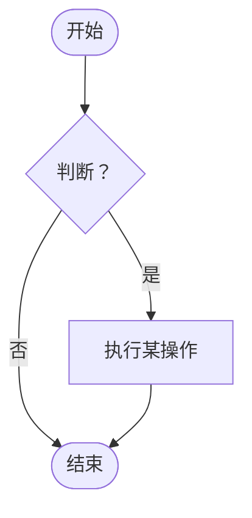

# 如何撰写 DRD — 指南

本指南说明什么是设计需求文档（DRD）、如何使用模板，以及每个章节应写什么。

**配合以下文件使用：**
- [DRD_Template_zh.md](DRD_Template_zh.md)：可复制并填写的空白模板
- [DRD_Sample_In-App_Feedback_zh.md](DRD_Sample_In-App_Feedback_zh.md)：一份完整示例，让你看到"好的 DRD"是什么样子。示例是虚构的，与 PRD 示例相匹配，因此其中的平台和规则仅作说明，不是默认选项。
- [PRD_Guide_zh.md](../PRD/PRD_Guide_zh.md)：PRD 指南。DRD 从 PRD 结束的地方开始。

---

## 第一部分：DRD 基础

### 什么是 DRD？

DRD 把产品需求转化为**具体的界面和行为**。它是关于每个页面结构如何、每个元素做什么、各种状态下会发生什么的共同约定。研发据此开发，测试据此验证，产品负责人据此检查设计是否满足需求。

通常由交互设计师或 UX 设计师撰写。在小团队中，产品经理可能会撰写其中一部分。

### 为什么要写？

| 对象 | 好处 |
|-----|---------|
| 你自己 | 迫使你把每种状态都想清楚；留下可用于项目复盘的记录 |
| 项目 | 降低沟通成本和风险；解决遗忘决策、理解偏差和"这是谁改的？"的问题 |
| 团队 | 文档可以共享和学习；统一的格式让每个角色都能快速找到所需内容 |

### PRD 与 DRD

| | PRD | DRD |
|---|-----|-----|
| 回答的问题 | *做什么*、为谁做、*为什么*，如何衡量成功？ | 结构上*长什么样*、界面上*怎么表现*？ |
| 主要作者 | 产品经理 | 交互 / UX 设计师 |
| 主要内容 | 问题、目标、用户故事、规则、指标 | 结构、流程、线框图、元素状态、全局规则 |
| 主要读者 | 所有人 | 研发、测试、视觉设计师 |

不要重复 PRD。链接过去，再补充设计细节。

### DRD 不是什么

| DRD 不是…… | 原因 |
|-----------------|------------|
| 商业方案 | "为什么做这个功能"属于 PRD。简短的背景就够了。 |
| 视觉规范 | 颜色、间距、字号属于视觉设计或设计系统。线框图保持灰度。 |
| 技术设计 | 代码如何组织属于研发。DRD 说明用户看到什么、系统必须为他们做什么。 |
| 交付后就完成 | 设计变化时要更新它，并记录变更。 |

### 谁会读它，关注什么

| 读者 | 关注点 |
|--------|-------------|
| 产品经理 | 第 2 和第 5 章：设计是否覆盖了需求？ |
| 研发 | 第 3、6、7、8 章：数据、共享组件、约束、行为 |
| 测试 | 第 8 章：元素规则、状态、待测的边界情况 |
| 视觉设计师 | 第 6 和第 8 章：结构、组件、需要上视觉的状态 |
| 客服 / 运营 | 第 8 章的文案和状态：用户会看到什么 |

### 写作原则

1. **一个页面，一个任务。**每个页面让用户完成一件事，有清晰的起点和终点。
2. **展示每种状态。**空、加载、错误、离线和无权限情形都设计到位，界面才算完成。
3. **使用真实数据。**真实的名称、长标题、大数字和缺失值，能暴露"Lorem ipsum"掩盖的布局问题。
4. **保持灰度。**黑、白、灰让注意力集中在结构和行为上。
5. **定义一次，处处引用。**共享规则放在第 6 章，不要在每个页面里重复。
6. **不留歧义。**文案逐字写出；限制写成数字。不要悄悄改动：设计变化时，通知受影响的人并记录。
7. **可检验。**如果测试读完后不知道用户做 X 时应该发生什么，这条说明就没写完。

---

## 第二部分：撰写流程

不要从上到下依次填写模板。更好的顺序：

| 步骤 | 做什么 | 对应章节 |
|------|---------|----------|
| 1. 阅读 PRD | 理解问题、用户、范围和优先级。向产品经理列出待确认问题。 | 2 |
| 2. 收集输入 | 查看调研、画像、竞品、现有设计和组件 | 2.4、6 |
| 3. 梳理结构 | 画出模块和页面；列出每个页面的动态数据 | 3 |
| 4. 画流程 | 先画业务流程，再为复杂功能画功能流程；包含失败路径 | 4 |
| 5. 列清工作 | 每个需求一行：平台、页面、PRD 链接、影响 | 5 |
| 6. 尽早对齐约束 | 与研发讨论性能、网络、安全、兼容性 | 7 |
| 7. 定义共享部分 | 可复用页面、组件、格式、限制 | 6 |
| 8. 逐页画线框图 | 草图、写元素规则和状态、与用户测试 | 8 |
| 9. 补充埋点 | 定义为 PRD 指标提供数据的事件 | 9 |
| 10. 评审并定稿 | 过检查清单、解决待决问题、更新变更记录 | 1、10 |

### 选择文档规模

| 场景 | 包含 | 省略 |
|-----------|---------|------|
| **完整版**：新产品领域或多平台工作 | 全部 | 无 |
| **标准版**：典型功能（默认） | 第 1–8 章 | 支撑调研、不需要时的埋点、在有内容被弃用之前的归档 |
| **快速版**：基于现有模式的小改动 | 1、2.1–2.2、5、8（仅变更的页面） | 3、4.2、6、7、9、11，除非改动涉及它们 |

---

## 第三部分：逐章指南

每个章节包括：**作用**、**写什么**、**技巧**和**常见错误**。

---

### 文档头部

**作用：**让读者一眼看出这是哪个版本、谁负责，以及 PRD 和设计文件在哪里。

**写什么：**产品和团队、版本、作者、状态（草稿 / 评审中 / 已批准）、最后更新日期、关联 PRD 的链接（含版本）、设计文件链接、相关方。

**常见错误：**没有记录 DRD 基于哪个 PRD 版本，导致没人知道需求是否变过。

---

### 1. 变更记录

**作用：**让每一次变更都能追溯到具体的人和日期。

**写什么：**版本、日期、负责人和变更内容。每次修订都要更新，无论多小。

**技巧：**要具体（"为表单增加离线状态"），不要含糊（"更新线框图"）。

---

### 2. 需求分析

**作用：**帮助每位读者在几分钟内理解设计任务。

**写什么：**
- **背景**（2.1）：为什么需要这项设计工作。简短，并链接到 PRD。
- **设计范围**（2.2）：做什么、不做什么，以及哪些平台。
- **设计目标**（2.3）：设计必须达成什么，以及如何判断。
- **支撑调研**（2.4，可选）：用户研究、画像、竞品分析、体验地图。

**技巧：**
- 设计目标关乎体验（"学员能在 30 秒内完成提交"），而不是业务。业务目标写在 PRD 里。
- 调研链接在你需要为某个选择辩护时很有说服力。

**常见错误：**照抄 PRD 的背景和目标；目标没有判断方式。

---

### 3. 产品结构与信息结构

**作用：**在开始排版前，展示产品的整体形状以及每个页面需要什么数据。

#### 3.1 产品结构

**写什么：**模块及其下页面的树。只写页面名称，不写内容。

**技巧：**把它当作第 8 章的目录。在线框图里使用同样的名称。

#### 3.2 信息结构

**写什么：**对每个页面，列出**动态**数据元素：名称、类型、来源和备注（格式、限制、为空时显示什么）。

**技巧：**
- 凡是固定的都不要列：静态标签、图标和标题。
- 研发用这份清单核对接口是否返回了设计所需的数据。请尽早分享。

**常见错误：**列出页面上所有标签；忘记可选数据的空值。

---

### 4. 流程

**作用：**展示在单张线框图上难以看清的逻辑。

#### 4.1 业务流程

**写什么：**一张 Mermaid 流程图，展示从开始到结束的整体流程，包含判断、错误和退出。

#### 4.2 功能流程

**写什么：**为每个复杂功能（上传文件、支付、登录）画一张，展示设计逻辑和每个分支。

**技巧：**
- 流程超过约 15 个节点时，拆分。
- 务必画出失败路径：校验失败、无网络、无权限。
- 业务流程展示用户和系统做什么；功能流程展示某个功能如何在不同结果之间做判断。

**常见错误：**只有主流程；流程与线框图互相矛盾。

---

### 5. 需求列表

**作用：**一处看清本次发布包含什么，以及会影响什么。

**写什么：**每一项：编号、描述、平台、页面、PRD 引用、优先级和可能的影响（对其他页面、数据或流程）。

**技巧：**
- 使用 PRD 的优先级（P0/P1/P2），让两份文档保持一致。
- "可能的影响"一列是隐藏工作的暴露之处：共享组件、新路由、其他团队的数据。
- 每个 DR 行都应对应一个 PRD 用户故事或功能。如果对应不上，问问为什么它在这里。

**常见错误：**行内容逐字复述 PRD；影响一栏没填。

---

### 6. 全局设计规范

**作用：**存放跨页面共享的规则，避免重复（也避免出现不一致）。

**写什么：**
- **可复用页面**（6.1）：分享页、空状态、错误页、搜索、登录提示。
- **通用组件**（6.2）：按钮、输入框、导航、对话框、轻提示、加载、空状态、网络异常——及其变体、状态和使用规则。
- **单位与格式**（6.3）：日期、时间、货币、距离、文件大小。
- **字符与输入限制**（6.4）：最小、最大、允许的字符，以及达到限制时的行为。

**技巧：**
- 线框图应写"使用标准空状态（6.1）"，而不是重新画一遍。
- 把对话框和轻提示的文案写成规则（"轻提示持续 3 秒，不带操作"）。
- 如果团队有设计系统，链接过去，只列出例外。

**常见错误：**同一个组件在两个页面的定义不同；限制写成"合理长度"。

---

### 7. 非功能需求

**作用：**在线框图定稿之前，敲定那些既影响设计又影响研发的事项。

**写什么：**对每个领域，写要求，并在适用时写明未满足时用户看到什么。

| 领域 | 涵盖内容 |
|------|-------|
| **安全** | 谁能看到和做什么；敏感数据处理；校验（服务端必须，客户端用于体验）；防滥用 |
| **性能** | 响应时间目标；如相关，并发和吞吐量；超时时用户看到什么 |
| **用户体验约定** | 加载方式；对话框和轻提示规则；复用；网络故障、切换和中断 |
| **其他** | 兼容性；无障碍；升级；国际化；埋点方式 |

**技巧：**
- 尽早与研发讨论。后期一句"我们做不到 2 秒"就会推翻设计。
- 每个性能目标，都要写明达不到时用户看到什么（骨架屏、超时提示、重试）。
- 后端校验永远必需；前端校验是为了让用户立刻看到问题。说明哪些字段需要前端校验。

**常见错误：**"应该很快"却没有数字；网络故障没有定义；到测试阶段才想起无障碍。

---

### 8. 页面交互说明

**作用：**DRD 的核心。每个界面、每个元素、每种状态，让任何人都不必猜。

#### 8.1 文档结构

**写什么：**页面的组织方式与产品结构一致：**平台 → 功能 → 页面 → 子页面 → 分支**。页面和画板命名保持一致（例如 `页面_界面_状态`）。

#### 8.2 每个页面包含什么

| 元素 | 用途 |
|---------|---------|
| 页面标题 | 页面是什么（与导航栏标题一致） |
| 界面标题 | 每个界面 / 状态的唯一名称，便于说明中引用（"回到界面 B"） |
| 界面内容 | 灰度线框图，带真实数据（移动端建议 375 × 812 px） |
| 设计说明 | 该界面特有的逻辑、元素状态、小流程 |
| 流程线 | 表示界面如何连接的箭头 |
| 链接 | 指向相关页面、分支和第 6 章的全局规则 |

#### 8.3 页面规格

**每个页面包含：**
- 关联需求（DR-xxx）
- 用户在该页面完成的任务，一句话
- 入口和出口（包括返回行为）
- 线框图（名称或链接）
- 一张**元素表**：每个元素、它的描述、状态和规则
- 一张**页面状态表**：加载、空、错误、无权限、离线
- **交互说明**：手势、转场、反馈、边界情况、埋点

**技巧：**
- 在线框图上给元素编号，并在表格中使用同样的编号。
- 对每个元素，问：点击会发生什么？何时禁用？文字很长怎么办？值缺失怎么办？
- 提示文案要逐字按最终呈现写。
- 想想：快速连点、提交过程中返回、网络中断、屏幕旋转、键盘遮挡输入框、超小屏幕、字号放大到 200%。
- 说明行为和结果，而不是动画曲线（属于动效规范）或颜色（属于视觉规范）。

**交互说明中不应包含：**

| 不要写 | 应放在哪里 |
|-------------|---------------------|
| 商业理由（"为什么要这个"） | PRD 和第 2 章 |
| 视觉规范（颜色、间距、字体） | 视觉设计 / 设计系统 |
| 代码逻辑 | 研发 |

**评审前自查：**

- [ ] 每个可点击元素都有明确的结果
- [ ] 每个会变化的元素都展示了全部状态
- [ ] 已覆盖空、加载、错误、离线和无权限情形
- [ ] 限制和校验提示已写明
- [ ] 入口、出口和返回行为清晰
- [ ] 测试仅凭该页面就能回答"我做 X，应该看到什么？"

**常见错误：**只展示主流程界面；写"显示错误"却没有文案；说明在描述图片（"右边有一个按钮"），而不是行为。

---

### 9. 埋点需求（可选）

**作用：**确保产品能够衡量 PRD 中的指标。

**写什么：**事件名称、页面、触发时机、属性，以及它支撑哪个指标。

**技巧：**
- 从 PRD 的指标倒推：要算出它们需要哪些事件？
- 既包含成功事件（如提交），也包含分母事件（如打开表单）。
- 与数据团队商定命名（`对象_动作`）。

**常见错误：**什么都埋；漏掉提供分母的事件。

---

### 10. 待决问题

**作用：**让未解决的问题保持可见，避免它们变成默认假设。

**写什么：**问题、负责人、截止日期，以及已知时的答案。批准前复查。

---

### 11. 归档（废纸篓）

**作用：**存放已弃用的设计，让主文档保持整洁，也便于解释或找回被放弃的方案。

**写什么：**项目、弃用日期、原因和链接。

**技巧：**原因才是有价值的部分。它能防止同一个想法两个月后又冒出来，同时记录你学到了什么（例如来自可用性测试）。

---

## 第四部分：使用 Mermaid 图表

模板中的流程图使用 Mermaid，可在 GitHub、Notion、Obsidian、VS Code（需预览插件）和 [Mermaid Live Editor](https://mermaid.live) 中渲染。

| 形状 | 语法 | 用途 |
|-------|--------|---------|
| 圆角两端 | `A([文字])` | 开始 / 结束 |
| 矩形 | `B[文字]` | 步骤或界面 |
| 菱形 | `C{文字}` | 判断 |
| 带标签的箭头 | `A -->|标签| B` | 分支条件 |

产品结构树可以使用自上而下的 `flowchart TD`，用模块和页面作为节点。对于复杂图表，也可以在设计工具里绘制，然后链接画板。

---

## 第五部分：质量检查清单

提交评审前，请确认：

**基础**
- [ ] DRD 写明了所基于的 PRD 版本
- [ ] 每个需求（DR-xxx）都链接到一个 PRD 条目
- [ ] 范围和平台清晰

**结构与流程**
- [ ] 产品结构与第 8 章的页面列表一致
- [ ] 列出了每个页面的动态数据，可选字段有空值
- [ ] 流程包含错误、离线和权限路径

**共享规则**
- [ ] 组件、格式和限制在第 6 章中只定义一次
- [ ] 消息文案（对话框、轻提示、错误）逐字写出
- [ ] 非功能需求已与研发对齐

**页面**
- [ ] 每个页面说明任务、入口、出口和返回行为
- [ ] 每个元素列出状态和规则
- [ ] 展示了加载、空、错误、离线和无权限状态
- [ ] 线框图使用真实数据并保持灰度
- [ ] 考虑了无障碍（标签、焦点、对比度、字号）

**完整性**
- [ ] 埋点事件覆盖每个 PRD 指标（分子和分母）
- [ ] 待决问题有负责人和日期
- [ ] 被弃用的设计已连同原因归档
- [ ] 没有遗留 `[方括号]` 或引导性文字
- [ ] 版本、状态和变更记录已更新

---

## 第六部分：常见错误一览

| 错误 | 解决办法 |
|---------|-----|
| 重复 PRD | 链接过去；只补充设计细节 |
| 只有主流程 | 补充空、加载、错误、离线和权限状态 |
| "显示错误" | 写出确切的文案和出现位置 |
| 同一个组件在两个页面描述不同 | 在第 6 章定义一次并引用 |
| DRD 中放了带颜色的精致效果图 | 线框图保持灰度；样式属于视觉设计 |
| 线框图用完美数据 | 使用真实、凌乱的数据：长名称、大数字、缺失值 |
| 太晚才与研发讨论约束 | 在最终线框图之前对齐第 7 章 |
| 说明在描述图片 | 描述行为、规则和结果 |
| 悄悄改动 | 通知受影响的人并记录变更 |
| 删除旧设计 | 连同弃用原因一起归档 |
| 任由 DRD 过时 | 随设计更新，并保持变更记录最新 |

---

## 第七部分：让 DRD 持续有用

检验 DRD 的标准是：它是否让工作更快、减少来回沟通。条理清晰、组织良好的说明，比精美的界面更重要；一个选择背后的思考，比界面本身更重要。

- **规范化。**跨项目使用相同的文件夹命名、页面布局和说明风格。简短、结构化的说明胜过冗长的段落。
- **建立组件库。**保留一小套定义清晰的交互组件，随产品成长而更新。少而精胜过多而杂。
- **形成闭环。**每个任务在页面上都应有清晰的开始和结束，没有死胡同。
- **谨慎变更。**交接后如果设计必须改动，更新文档，并在当天通知受影响的人。
