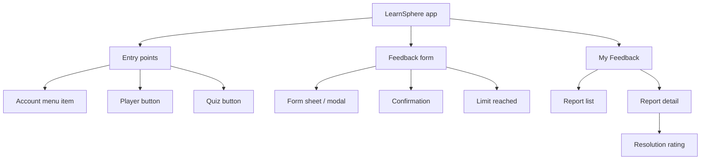
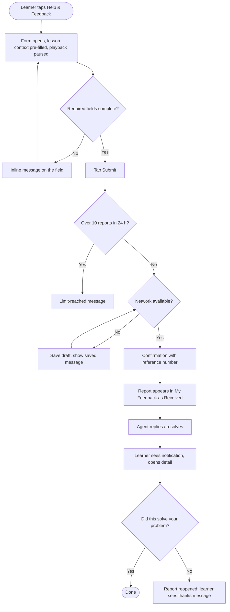
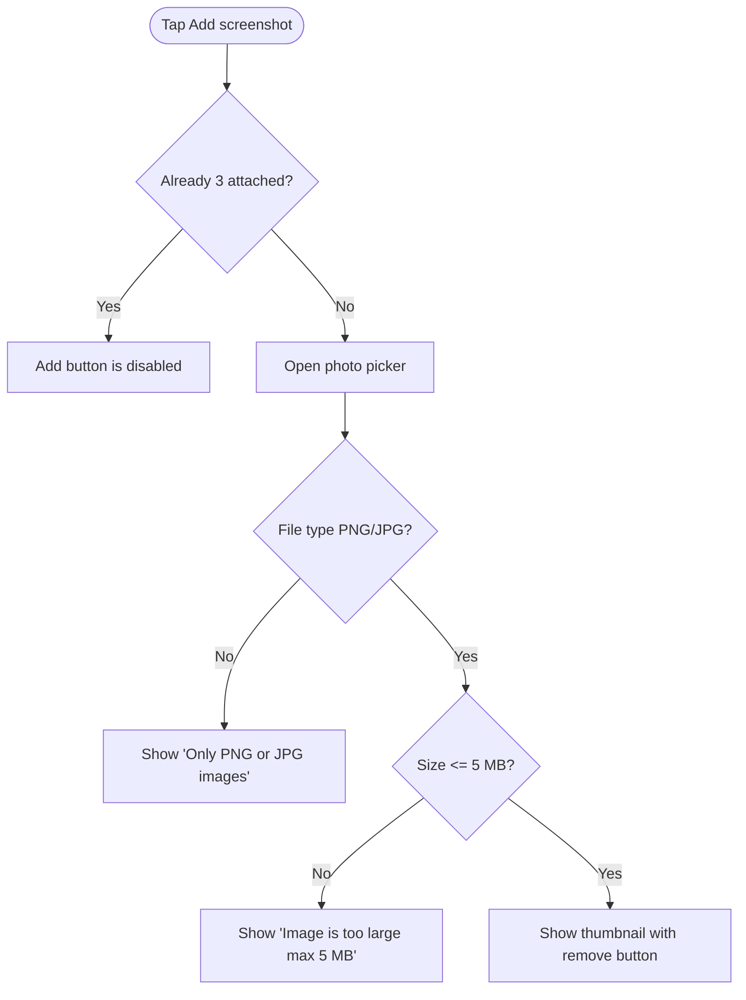

# In-App Feedback Center — Design Requirement Document (DRD)

> **Sample document.** This is a fictional, filled-in example of `DRD_Template.md`. It is the design companion to [PRD_Sample_In-App_Feedback.md](../PRD/PRD_Sample_In-App_Feedback.md), so the product ("LearnSphere"), people, limits, and message text match that PRD. Wireframes are shown as simple text sketches; in a real DRD they would be grayscale frames in your design tool.

| | |
|---|---|
| **Product / Team** | LearnSphere Mobile & Web, Learner Experience team |
| **Version** | v1.0 |
| **Author (UX / Interaction designer)** | Priya Nair |
| **Status** | Approved |
| **Last updated** | 2026-10-28 |
| **Related PRD** | In-App Feedback Center PRD v1.0 (2026-10-15) |
| **Design files** | Figma: "Feedback Center v1" (link in project folder) |
| **Stakeholders** | Product (Maya Chen), Engineering (Daniel Ortiz), Support Ops (Lena Fischer), Visual design, QA |

---

## 1. Change Log

| Version | Date | Owner | Changes |
|---------|------|-------|---------|
| v0.1 | 2026-10-01 | Priya Nair | Initial structure, flows, and form wireframes |
| v0.5 | 2026-10-12 | Priya Nair | Added My Feedback list, detail page, global states |
| v0.9 | 2026-10-22 | Priya Nair | Added offline draft, rate-limit state, tracking events; review with engineering |
| v1.0 | 2026-10-28 | Priya Nair | Resolved review comments; approved |

---

## 2. Requirement Analysis

### 2.1 Background

Paying learners cannot report a problem from inside the app, so only about 3% of affected learners report and most reports arrive without the details agents need (PRD 1.1). This DRD defines how the reporting entry point, the form, and status tracking look and behave, on mobile apps (iOS, Android) and web.

### 2.2 Design Scope

- **In this release**: Help & Feedback entry points (account menu, video player, quiz screen); feedback form; submission result states; My Feedback list and report detail; resolution rating; shared states for loading, empty, error, and offline.
- **Not covered**: visual redesign of the player or quiz screens; live chat; the help-center article pages (linked, not redesigned); free-tier experience.
- **Platforms**: iOS 16+, Android 10+, web (latest 2 versions of Chrome, Safari, Firefox, Edge).

### 2.3 Design Goals

| ID | Goal | How we'll judge it |
|----|------|--------------------|
| DG-001 | A learner can submit a report in under 30 seconds without leaving the lesson | Moderated usability test, 8 participants, median task time < 30 s |
| DG-002 | The entry point never gets in the way of playback or quiz-taking | Usability test: no mis-taps on player controls; guardrail "player start time" (PRD 4.3) |
| DG-003 | A learner always knows what happened to their report | Test: 7 of 8 participants can state their report's status unaided |
| DG-004 | The form works the same on mobile and web | Design review: shared component, same fields and rules |

### 2.4 Supporting Research

- Usability test of a paper prototype with 6 paying learners, Sept 2026 (link in project folder)
- Learner interview notes: why learners don't report problems today
- Competitor review: in-app support experiences, Aug 2026 (also referenced in the PRD)

---

## 3. Product Structure and Information Structure

### 3.1 Product Structure



### 3.2 Information Structure

Only dynamic data is listed.

| Page | Data element | Type | Source | Notes |
|------|--------------|------|--------|-------|
| Feedback form | Course name, lesson title | Text | Current lesson context | Shown in the "Context" summary; read-only; truncated after 1 line with "…" |
| Feedback form | Reply email | Text | Account profile | Pre-filled; editable; must be a valid email |
| Confirmation | Reference number | Text | Feedback API | Format `FB-YYYYMMDD-NNNN` |
| My Feedback list | Reference number, issue type, date, status | Text / date / enum | Feedback API (status mapped from Zendesk) | Newest first; date as `YYYY-MM-DD` |
| Report detail | Original description, screenshots, agent replies | Text / images | Feedback API | Replies show agent first name and timestamp |
| Report detail | Response-time promise | Text | Config | "We usually reply within 24 hours" |

---

## 4. Flows

### 4.1 Business Flow



### 4.2 Function Flow

#### 4.2.1 Attach a screenshot



---

## 5. Requirement List

| ID | Requirement | Platform | Page(s) | PRD reference | Priority | Possible impact |
|----|-------------|----------|---------|---------------|----------|-----------------|
| DR-001 | "Help & Feedback" entry in account menu, video player, quiz screen | iOS / Android / Web | Account menu, Player, Quiz | US-001, 3.2 | P0 | Player and quiz layouts gain one button; must not overlap playback controls |
| DR-002 | Feedback form with issue type, description, screenshots, reply email | iOS / Android / Web | Feedback form | US-001, US-002, 3.3.1 | P0 | New shared component library item |
| DR-003 | Auto-captured context summary shown before submit | iOS / Android / Web | Feedback form | US-003, 3.3.2 | P0 | Needs lesson/course IDs from player and quiz |
| DR-004 | Submission result states: confirmation, offline-saved, limit reached | iOS / Android / Web | Form, Confirmation | 3.3.1 | P0 | New toast/inline message patterns |
| DR-005 | My Feedback list and report detail | iOS / Android / Web | Account → My Feedback | US-004, 3.3.3 | P1 | New item in the account menu |
| DR-006 | Notification deep link opens the report detail | iOS / Android | Report detail | US-005, 3.3.4 | P1 | Deep-link route needed |
| DR-007 | Resolution rating | iOS / Android / Web | Report detail | US-007, 3.3.5 | P2 | Shown only for Resolved reports |

---

## 6. Global Design Specifications

### 6.1 Reusable Pages

| Page | Used by | Behavior |
|------|---------|----------|
| Empty-state page | My Feedback list | Illustration, "No reports yet", secondary text "Spotted a problem? Tap Help & Feedback in any lesson." |
| Network error page | My Feedback list, Report detail | Illustration, "Can't connect", "Try again" button |
| Sign-in prompt | Form (session expired) | Standard LearnSphere sign-in sheet; on success the form is restored |

### 6.2 Common Components

| Component | Variants and states | Rules |
|-----------|---------------------|-------|
| Button | Primary, secondary, text; default / pressed / disabled / loading | Min touch target 44 × 44 pt. Primary appears once per screen. Disabled buttons are used only for "Add screenshot" at the limit; Submit is never disabled (we validate on tap and explain what's missing). Loading shows a spinner and blocks double taps. |
| Text field / text area | Default / focus / filled / error | Error text appears directly below the field in the error color with an icon; field border changes; the keyboard stays open. |
| Selector (issue type) | Default / selected / error | Single choice; list of 6 options; selection shown with a check. |
| Bottom sheet (mobile) / modal (web) | Open / closing | Mobile: slides up to 90% height, drag handle, dismissed by swipe down, close icon, or back. Web: centered 560 px modal, closed with ✕ or Esc. |
| Dialog | Confirm | Used only for discard confirmation: "Discard this report?" with "Keep editing" (primary) and "Discard" (secondary). |
| Toast | Success / info / error | Shown at the bottom for 3 s; never used for errors that need an action. |
| Loading | Button loading; list skeleton | Lists use skeleton rows; no full-screen spinners. |
| Status tag | Received (gray) / In progress (blue) / Resolved (green) | Text always accompanies the color. |

### 6.3 Units and Formats

| Item | Format | Example |
|------|--------|---------|
| Date | YYYY-MM-DD | 2026-10-30 |
| Date and time (replies) | YYYY-MM-DD HH:mm, device time zone | 2026-10-30 14:05 |
| File size | MB, one decimal | 4.2 MB |
| Reference number | FB-YYYYMMDD-NNNN | FB-20261030-0042 |

### 6.4 Character and Input Limits

| Field | Min | Max | Allowed | Over-limit behavior |
|-------|-----|-----|---------|---------------------|
| Description | 10 | 1,000 | Any text | Counter appears at 900 characters ("940 / 1000"); extra input is blocked at 1,000. Under 10 on Submit: "Please describe the problem (at least 10 characters)". |
| Screenshots | 0 | 3 files | PNG, JPG; ≤ 5 MB each | See 4.2.1 |
| Reply email | 1 | 254 | Valid email format | "Please enter a valid email address" |
| Resolution comment (rating "No") | 0 | 300 | Any text | Counter at 250; extra input blocked |

---

## 7. Non-Functional Requirements

### 7.1 Security

| Item | Requirement |
|------|-------------|
| Identity and permissions | Only signed-in paying subscribers see the entry points. Free users see no change in the UI. |
| Sensitive data handling | A privacy notice above Submit lists what is attached automatically (see 8.3.1). The user can open "What's included?" before sending. Screenshot thumbnails are shown so the user can check them for personal information before submitting. |
| Form validation | The server always validates. The client checks required fields, length, file type, and file size so errors appear immediately. |
| Abuse protection | At most 10 reports per 24 hours per learner; the 11th attempt shows the limit message (8.3.1). |

### 7.2 Performance

| Item | Requirement | Behavior when exceeded |
|------|-------------|------------------------|
| Form open | < 500 ms from tap to visible sheet | If context is not ready in 500 ms, open the form and fill the context summary when it arrives |
| Submit | < 3 s at p95 on 4G | After 3 s, the Submit button keeps its loading state; after 15 s, treat as a network failure and save a draft |
| My Feedback list | First page visible < 1.5 s | Show skeleton rows until data arrives |

### 7.3 User Experience Conventions

| Item | Requirement |
|------|-------------|
| Data loading | List: skeleton rows, 20 items per page, load more on scroll. Detail: skeleton for text, then replies. |
| Dialog and Toast | Dialogs only for destructive or irreversible choices. Toasts for brief confirmations. Field problems use inline messages, never toasts. |
| Reusable components | The form is built once as a shared component for iOS, Android, and web; the only differences are the container (sheet vs. modal) and the photo picker. |
| Network handling | Offline on Submit: save a local draft and show "Saved. We'll send it when you're back online." (inline banner at the top of the sheet, then the sheet closes). The draft sends automatically within 60 s of connectivity returning; the report then appears in My Feedback. Network switch (Wi-Fi ↔ cellular) during upload: retry up to 3 times silently before saving as a draft. |

### 7.4 Other

| Item | Requirement |
|------|-------------|
| Compatibility | iOS 16+, Android 10+, latest 2 versions of Chrome/Safari/Firefox/Edge. Supports safe areas, dark mode, and screen widths from 320 px. |
| Accessibility | WCAG 2.1 AA. All controls have screen-reader labels (VoiceOver, TalkBack). Focus moves into the sheet on open and returns to the button on close. Text scales up to 200%. Status is never shown by color alone. |
| Upgrade strategy | Older app versions without the entry point continue using the support email. No forced upgrade. |
| Internationalization | English at launch. All strings in resource files; layouts must allow 40% longer text. |
| Analytics / tracking | Amplitude SDK events listed in Section 9. |

---

## 8. Page Interaction Specifications

### 8.1 Document Structure

```
Mobile app (iOS / Android) and Web
├── Entry points
│   ├── Account menu item
│   ├── Player button
│   └── Quiz button
├── Feedback form
│   ├── Form sheet / modal
│   ├── Confirmation
│   └── Limit reached
└── My Feedback
    ├── Report list
    └── Report detail
        └── Resolution rating
```

Frame names in Figma follow `Page_Screen_State`, for example `Form_Default`, `Form_ErrorIssueType`, `Detail_Resolved_Rating`.

### 8.2 What Every Page Includes

See the template: page title, screen title, grayscale content at 375 × 812 px, design notes, flow lines, and links.

### 8.3 Page Specifications

#### 8.3.1 Feedback Form

- **Related requirements**: DR-001, DR-002, DR-003, DR-004
- **Task the user completes here**: describe a problem and send it to support.
- **Entry points**: "Help & Feedback" in the account menu, the player, or the quiz screen.
- **Exit points**: Submit success → Confirmation; ✕ / swipe down / back → return to the lesson (with discard check if edited); limit reached → stays on the form with message.
- **Wireframes**: `Form_Default`, `Form_ErrorIssueType`, `Form_Offline`, `Form_Limit`

```
┌───────────────────────────────┐
│ ▬▬▬                      ✕    │  ← drag handle, close
│ Report a problem              │
│ We usually reply within       │
│ 24 hours.                     │
│                               │
│ What's wrong? *               │
│ ┌───────────────────────────┐ │
│ │ Choose an issue type    ▾ │ │
│ └───────────────────────────┘ │
│ Tell us more *                │
│ ┌───────────────────────────┐ │
│ │                           │ │
│ │                           │ │
│ └───────────────────────────┘ │
│ Screenshots (optional)        │
│ [ + ] [thumb ✕] [thumb ✕]     │
│ Reply email                   │
│ ┌───────────────────────────┐ │
│ │ sam@example.com           │ │
│ └───────────────────────────┘ │
│ Included: Intro to SQL ·      │
│ Lesson 4 · iPhone 14 · v5.8   │
│ What's included? ›            │
│                               │
│ ┌───────────────────────────┐ │
│ │          Submit           │ │
│ └───────────────────────────┘ │
└───────────────────────────────┘
```

**Elements and rules**

| # | Element | Description | States | Rules and behavior |
|---|---------|-------------|--------|--------------------|
| 1 | Title and promise | "Report a problem" and "We usually reply within 24 hours." | Static | Promise text comes from config |
| 2 | Issue type selector * | Required single choice | Empty / selected / error | Options in order: Video or audio problem · Quiz or grading error · Course content error · Billing or subscription · App crash or bug · Other. When opened from the player, "Video or audio problem" is pre-selected; from a quiz, "Quiz or grading error"; from the account menu, none. Error: "Please choose an issue type". |
| 3 | Description * | Multi-line text, 3 lines visible, grows to 6 then scrolls | Empty (placeholder "What happened?") / focus / filled / error | 10–1,000 characters (see 6.4). Error on Submit if under 10 characters. |
| 4 | Screenshots | Add button + up to 3 thumbnails | Empty / 1–2 attached / 3 attached (Add disabled) | Tap thumbnail to preview full screen. ✕ removes without confirmation. Rules in 4.2.1. |
| 5 | Reply email | Single-line text, pre-filled | Default / focus / error | Editable. Error: "Please enter a valid email address". |
| 6 | Included summary | One-line read-only summary of the auto-captured context | Static | Shows course and lesson (if any), device model, app version. "What's included?" opens a small sheet listing everything attached: user ID, plan type, course ID, lesson ID, device model, OS version, app version, locale, timestamp (PRD 3.3.2). |
| 7 | Submit button | Primary button | Default / loading | Never disabled. On tap: validate all fields from top to bottom; if any fail, scroll to the first error and show every error; if none fail, send. Loading state replaces the label with a spinner and blocks further taps. |

**Page states**

| State | Trigger | What the user sees |
|-------|---------|--------------------|
| Default | Form opened | Fields empty (except pre-filled), playback paused if from the player |
| Validation error | Submit with problems | Inline messages under each failing field; typed content preserved |
| Offline | Submit with no network | Banner "Saved. We'll send it when you're back online." then the sheet closes and a toast confirms; draft is sent automatically (PRD AC-3) |
| Limit reached | 11th submit in 24 h | Banner at the top of the form: "You've reached today's limit. Please try again tomorrow or email support." with "email support" as a link; no ticket created; form content preserved |
| Session expired | Token invalid on submit | Sign-in sheet; after sign-in the form returns with content restored |
| Screenshot too large | File > 5 MB | Inline message under the screenshot row: "Image is too large (max 5 MB)"; other form data untouched |

**Interaction notes**

- Opening from the player pauses the video; closing the form without submitting resumes it from the same position. Opening from a quiz does not reset answers or the timer.
- If the learner has typed anything and closes the form, show the discard dialog (6.2). If nothing has been typed, close immediately.
- Keyboard: Return in the email field dismisses the keyboard; the description field is multi-line so Return adds a new line.
- Long text: course names truncate with "…" on one line in the summary; no truncation in "What's included?".
- Rapid double-tap on Submit sends one report only.
- Back button (Android) and Esc (web) behave like ✕.

#### 8.3.2 Submission Confirmation

- **Related requirement**: DR-004
- **Task**: confirm the report was received and show what happens next.
- **Entry points**: successful submit. **Exit points**: "Back to lesson", "View my feedback".
- **Wireframes**: `Confirm_Default`

```
┌───────────────────────────────┐
│              ✓                │
│     Thanks, we got it.        │
│  Reference: FB-20261030-0042  │
│                               │
│  We usually reply within      │
│  24 hours. We'll notify you   │
│  here and by email.           │
│                               │
│  ┌─────────────────────────┐  │
│  │      Back to lesson     │  │
│  └─────────────────────────┘  │
│       View my feedback        │
└───────────────────────────────┘
```

| # | Element | Rules and behavior |
|---|---------|--------------------|
| 1 | Reference number | Appears within 3 seconds of Submit (PRD AC-1). Tap to copy; toast "Copied". |
| 2 | Back to lesson (primary) | Closes the sheet and resumes playback. |
| 3 | View my feedback (text link) | Opens the report detail for this report. |

#### 8.3.3 My Feedback List

- **Related requirement**: DR-005
- **Task**: check which reports are open and what their status is.
- **Entry points**: Account → My Feedback; notification tap (opens detail instead). **Exit points**: report detail; back to Account.
- **Wireframes**: `List_Populated`, `List_Empty`, `List_Loading`, `List_Error`

```
┌───────────────────────────────┐
│ ‹  My Feedback                │
├───────────────────────────────┤
│ FB-20261030-0042              │
│ Video or audio problem        │
│ 2026-10-30        [In progress]│
├───────────────────────────────┤
│ FB-20261012-0007              │
│ Billing or subscription       │
│ 2026-10-12          [Resolved] │
└───────────────────────────────┘
```

| # | Element | Rules and behavior |
|---|---------|--------------------|
| 1 | Report row | Reference number, issue type, date, status tag. Tap opens detail. Unread updates show a dot before the reference number. |
| 2 | Status tag | Received / In progress / Resolved (mapping in PRD 3.3.3). |
| 3 | Sorting | Newest first. Reports older than 12 months are not shown. |

**Page states**

| State | Trigger | What the user sees |
|-------|---------|--------------------|
| Loading | On entry | 4 skeleton rows |
| Empty | No reports | Empty-state page (6.1) |
| Error | Request fails | Network error page with "Try again" |
| Offline | No network | Cached list if available with a banner "You're offline. Showing saved reports."; otherwise network error page |

#### 8.3.4 Report Detail and Resolution Rating

- **Related requirements**: DR-005, DR-006, DR-007
- **Task**: read the conversation and, once resolved, say whether it helped.
- **Entry points**: tap on a list row; notification deep link. **Exit points**: back to list.
- **Wireframes**: `Detail_Received`, `Detail_Replied`, `Detail_Resolved_Rating`, `Detail_Reopened`

```
┌───────────────────────────────┐
│ ‹  FB-20261030-0042           │
│ [Resolved]                    │
│ Video or audio problem        │
│ "Video freezes at 3:42"       │
│ [thumb]                       │
├───────────────────────────────┤
│ Aisha · 2026-10-30 14:05      │
│ Thanks for the screenshot.    │
│ Please try clearing the app   │
│ cache; steps are here: ...    │
├───────────────────────────────┤
│ Did this solve your problem?  │
│  [  Yes  ]      [  No  ]      │
└───────────────────────────────┘
```

| # | Element | Rules and behavior |
|---|---------|--------------------|
| 1 | Header | Reference number, status tag, issue type |
| 2 | Original report | Description and screenshot thumbnails (tap to enlarge) |
| 3 | Replies | Agent first name, timestamp, message. Newest at the bottom. Learners cannot reply in v1; text under the last message: "Need more help? Email support." |
| 4 | Rating card | Shown only when status is Resolved and not yet rated. **Yes**: card is replaced by "Glad that helped." (stays visible). **No**: an optional comment field (0–300 characters) and a "Send" button appear; after Send, the card shows "Thanks, we're taking another look." and the status tag changes to In progress. |
| 5 | Received status | Shows the promise line "We usually reply within 24 hours." instead of replies. |

**Interaction notes**

- Opening an updated report clears its unread dot.
- The rating can be given once per resolution; if the report is reopened and resolved again, the card appears again.
- Rating is a small sheet on web (same content).

---

## 9. Tracking Requirements

| Event name | Page | Trigger | Properties | Purpose (PRD metric) |
|------------|------|---------|------------|----------------------|
| `feedback_entry_tap` | Account menu / Player / Quiz | Tap on Help & Feedback | `source` (menu, player, quiz) | Submission rate |
| `feedback_form_open` | Form | Form becomes visible | `source`, `issue_type_prefilled` | Form completion rate (denominator) |
| `feedback_validation_error` | Form | Submit blocked | `field` (issue_type, description, email) | Form friction |
| `feedback_screenshot_added` | Form | Thumbnail added | `count` | Screenshot attach rate |
| `feedback_submit` | Form | Report sent successfully | `issue_type`, `has_screenshot`, `source` | Form completion rate, submission rate |
| `feedback_submit_offline_saved` | Form | Draft saved locally | `issue_type` | Reliability |
| `feedback_limit_reached` | Form | Limit message shown | none | Abuse guardrail |
| `feedback_list_open` | My Feedback | List visible | `report_count` | Engagement with status |
| `feedback_detail_open` | Report detail | Detail visible | `status`, `from` (list, notification) | Status visibility |
| `feedback_rating` | Report detail | Yes / No tapped | `result` (yes, no) | Satisfaction (north star) |

---

## 10. Open Questions

| # | Question | Owner | Due date | Resolution |
|---|----------|-------|----------|------------|
| 1 | Can the form offer an "auto-hide personal details" tool on screenshots? | Priya Nair / Daniel Ortiz | 2026-11-20 | Open; linked to PRD open question 2 |
| 2 | Should learners be able to reply to an agent inside the report detail? | Maya Chen | 2026-12-15 | Open; out of v1, revisit with free-tier decision |
| 3 | Exact illustration set for empty and error states | Visual design | 2026-11-05 | Resolved: reuse the existing help-center illustrations |

---

## 11. Archive (Trash)

| Item | Date retired | Reason | Link |
|------|--------------|--------|------|
| Floating action button in the player corner | 2026-10-10 | In the prototype test, 3 of 6 participants mis-tapped it while using playback controls; replaced with a button in the player's overflow row | Figma page "Archive / FAB" |
| Single combined "Issue type + description" free-text form | 2026-10-05 | Too many reports arrived without a category; replaced with the issue-type selector | Figma page "Archive / Form v0" |
| Status shown as a progress bar (4 steps) | 2026-10-18 | Statuses map to only 3 Zendesk states; the bar implied steps that don't exist | Figma page "Archive / Status bar" |
