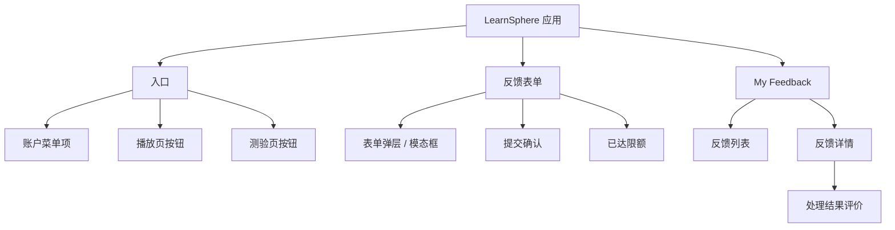
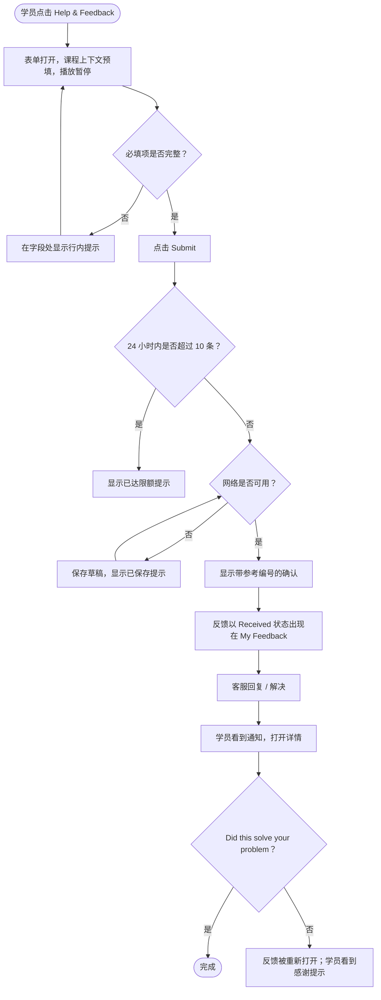
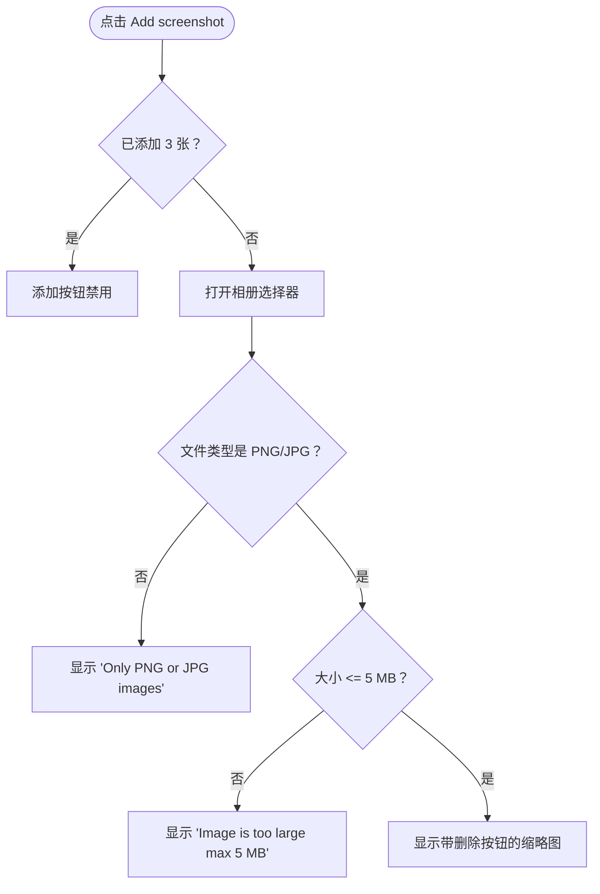

# 应用内反馈中心 — 设计需求文档（DRD）

> **示例文档。**这是 `DRD_Template_zh.md` 的一份虚构、完整填写的示例。它是 [PRD_Sample_In-App_Feedback_zh.md](../PRD/PRD_Sample_In-App_Feedback_zh.md) 的设计配套文档，因此产品（"LearnSphere"）、人物、限制和消息文案均与该 PRD 一致。线框图以简单的文字草图呈现；真实的 DRD 中它们会是设计工具里的灰度画板。产品界面文案（引号内的英文，如 "Please choose an issue type"）保持英文原样，因为该产品首发仅支持英文。

| | |
|---|---|
| **产品 / 团队** | LearnSphere 移动端与网页端，学员体验团队 |
| **版本** | v1.0 |
| **作者（UX / 交互设计师）** | Priya Nair |
| **状态** | 已批准 |
| **最后更新** | 2026-10-28 |
| **关联 PRD** | 应用内反馈中心 PRD v1.0（2026-10-15） |
| **设计文件** | Figma："Feedback Center v1"（链接在项目文件夹中） |
| **相关方** | 产品（Maya Chen）、研发（Daniel Ortiz）、客服运营（Lena Fischer）、视觉设计、测试 |

---

## 1. 变更记录

| 版本 | 日期 | 负责人 | 变更内容 |
|---------|------|-------|---------|
| v0.1 | 2026-10-01 | Priya Nair | 初始结构、流程和表单线框图 |
| v0.5 | 2026-10-12 | Priya Nair | 增加 My Feedback 列表、详情页和全局状态 |
| v0.9 | 2026-10-22 | Priya Nair | 增加离线草稿、限额状态、埋点事件；与研发评审 |
| v1.0 | 2026-10-28 | Priya Nair | 解决评审意见；已批准 |

---

## 2. 需求分析

### 2.1 背景

付费学员无法在应用内反馈问题，因此只有约 3% 的受影响学员会反馈，且大多数反馈缺少客服所需的细节（PRD 1.1）。本 DRD 定义了反馈入口、表单和状态跟踪在移动端应用（iOS、Android）和网页端的外观与行为。

### 2.2 设计范围

- **本次发布**：Help & Feedback 入口（账户菜单、视频播放页、测验页）；反馈表单；提交结果状态；My Feedback 列表和反馈详情；处理结果评价；加载、空、错误和离线的共享状态。
- **不覆盖**：播放页或测验页的视觉改版；在线聊天；帮助中心文章页（仅链接，不重新设计）；免费用户体验。
- **平台**：iOS 16+、Android 10+、网页端（Chrome、Safari、Firefox、Edge 最近 2 个版本）。

### 2.3 设计目标

| 编号 | 目标 | 如何判断 |
|----|------|--------------------|
| DG-001 | 学员可在不离开课程的前提下，30 秒内完成一次反馈 | 有主持人的可用性测试，8 名参与者，任务耗时中位数 < 30 秒 |
| DG-002 | 入口绝不干扰播放或答题 | 可用性测试：播放控件无误触；护栏指标"播放启动时间"（PRD 4.3） |
| DG-003 | 学员始终知道自己的反馈发生了什么 | 测试：8 人中有 7 人无需提示就能说出反馈的状态 |
| DG-004 | 表单在移动端和网页端表现一致 | 设计评审：共用组件，字段和规则相同 |

### 2.4 支撑调研

- 对 6 名付费学员进行的纸面原型可用性测试，2026 年 9 月（链接在项目文件夹中）
- 学员访谈记录：他们目前为什么不反馈问题
- 竞品调研：应用内客服体验，2026 年 8 月（PRD 中也有引用）

---

## 3. 产品结构与信息结构

### 3.1 产品结构



### 3.2 信息结构

仅列出动态数据。

| 页面 | 数据元素 | 类型 | 来源 | 备注 |
|------|--------------|------|--------|-------|
| 反馈表单 | 课程名称、课时标题 | 文本 | 当前课时上下文 | 显示在"上下文"摘要中；只读；超过 1 行用"…"截断 |
| 反馈表单 | 回复邮箱 | 文本 | 账户资料 | 预填；可编辑；必须是有效邮箱 |
| 提交确认 | 参考编号 | 文本 | 反馈 API | 格式 `FB-YYYYMMDD-NNNN` |
| My Feedback 列表 | 参考编号、问题类型、日期、状态 | 文本 / 日期 / 枚举 | 反馈 API（状态由 Zendesk 映射） | 最新的在前；日期格式 `YYYY-MM-DD` |
| 反馈详情 | 原始描述、截图、客服回复 | 文本 / 图片 | 反馈 API | 回复显示客服名字和时间戳 |
| 反馈详情 | 响应时间承诺 | 文本 | 配置 | "We usually reply within 24 hours" |

---

## 4. 流程

### 4.1 业务流程



### 4.2 功能流程

#### 4.2.1 添加截图



---

## 5. 需求列表

| 编号 | 需求 | 平台 | 页面 | PRD 引用 | 优先级 | 可能的影响 |
|----|-------------|----------|---------|---------------|----------|-----------------|
| DR-001 | 在账户菜单、视频播放页、测验页增加 "Help & Feedback" 入口 | iOS / Android / Web | 账户菜单、播放页、测验页 | US-001, 3.2 | P0 | 播放页和测验页布局各增加一个按钮；不得与播放控件重叠 |
| DR-002 | 带问题类型、描述、截图和回复邮箱的反馈表单 | iOS / Android / Web | 反馈表单 | US-001, US-002, 3.3.1 | P0 | 新增一个共享组件库条目 |
| DR-003 | 提交前展示自动采集的上下文摘要 | iOS / Android / Web | 反馈表单 | US-003, 3.3.2 | P0 | 需要播放页和测验页提供课程 / 课时 ID |
| DR-004 | 提交结果状态：确认、离线已保存、已达限额 | iOS / Android / Web | 表单、提交确认 | 3.3.1 | P0 | 新增轻提示 / 行内消息样式 |
| DR-005 | My Feedback 列表和反馈详情 | iOS / Android / Web | Account → My Feedback | US-004, 3.3.3 | P1 | 账户菜单增加一项 |
| DR-006 | 通知深链打开反馈详情 | iOS / Android | 反馈详情 | US-005, 3.3.4 | P1 | 需要新增深链路由 |
| DR-007 | 处理结果评价 | iOS / Android / Web | 反馈详情 | US-007, 3.3.5 | P2 | 仅对 Resolved 的反馈显示 |

---

## 6. 全局设计规范

### 6.1 可复用页面

| 页面 | 使用方 | 行为 |
|------|---------|----------|
| 空状态页 | My Feedback 列表 | 插画，"No reports yet"，次要文字 "Spotted a problem? Tap Help & Feedback in any lesson." |
| 网络异常页 | My Feedback 列表、反馈详情 | 插画，"Can't connect"，"Try again" 按钮 |
| 登录提示 | 表单（会话过期） | 标准 LearnSphere 登录弹层；成功后恢复表单 |

### 6.2 通用组件

| 组件 | 变体与状态 | 规则 |
|-----------|---------------------|-------|
| 按钮 | 主要、次要、文字按钮；默认 / 按下 / 禁用 / 加载中 | 最小点击区域 44 × 44 pt。每个界面只出现一个主要按钮。禁用按钮只用于已达上限时的 "Add screenshot"；Submit 永不禁用（点击后再校验并说明缺了什么）。加载中显示转圈并阻止重复点击。 |
| 文本框 / 多行文本框 | 默认 / 聚焦 / 已填 / 错误 | 错误文字显示在字段正下方，带图标，使用错误色；字段边框随之变化；键盘保持打开。 |
| 选择器（问题类型） | 默认 / 已选 / 错误 | 单选；6 个选项的列表；选中项显示对勾。 |
| 底部弹层（移动端）/ 模态框（网页端） | 打开 / 关闭中 | 移动端：升至 90% 高度，带拖拽条，可通过下滑、关闭图标或返回键关闭。网页端：居中的 560 px 模态框，通过 ✕ 或 Esc 关闭。 |
| 对话框 | 确认 | 仅用于放弃确认："Discard this report?"，按钮为 "Keep editing"（主要）和 "Discard"（次要）。 |
| Toast（轻提示） | 成功 / 信息 / 错误 | 显示在底部，持续 3 秒；不用于需要用户操作的错误。 |
| 加载 | 按钮加载；列表骨架屏 | 列表使用骨架行；不使用全屏转圈。 |
| 状态标签 | Received（灰）/ In progress（蓝）/ Resolved（绿） | 颜色必须配有文字。 |

### 6.3 单位与格式

| 项目 | 格式 | 示例 |
|------|--------|---------|
| 日期 | YYYY-MM-DD | 2026-10-30 |
| 日期与时间（回复） | YYYY-MM-DD HH:mm，设备时区 | 2026-10-30 14:05 |
| 文件大小 | MB，保留一位小数 | 4.2 MB |
| 参考编号 | FB-YYYYMMDD-NNNN | FB-20261030-0042 |

### 6.4 字符与输入限制

| 字段 | 最小 | 最大 | 允许 | 超限行为 |
|-------|-----|-----|---------|---------------------|
| 描述 | 10 | 1,000 | 任意文本 | 达到 900 字符时出现计数（"940 / 1000"）；到 1,000 时阻止继续输入。提交时少于 10 个字符："Please describe the problem (at least 10 characters)"。 |
| 截图 | 0 | 3 个文件 | PNG、JPG；每张 ≤ 5 MB | 见 4.2.1 |
| 回复邮箱 | 1 | 254 | 有效邮箱格式 | "Please enter a valid email address" |
| 处理结果评论（评价选 "No"） | 0 | 300 | 任意文本 | 达到 250 字符时出现计数；到 300 时阻止继续输入 |

---

## 7. 非功能需求

### 7.1 安全

| 事项 | 要求 |
|------|-------------|
| 身份与权限 | 只有已登录的付费订阅用户能看到入口。免费用户的界面没有变化。 |
| 敏感数据处理 | 提交按钮上方有隐私说明，列出会自动附带哪些内容（见 8.3.1）。用户发送前可以打开 "What's included?" 查看。截图缩略图会展示出来，方便用户在提交前检查其中是否含有个人信息。 |
| 表单校验 | 服务端始终校验。客户端检查必填项、长度、文件类型和文件大小，让错误即时出现。 |
| 防滥用 | 每位学员 24 小时内最多 10 条反馈；第 11 次尝试显示限额提示（8.3.1）。 |

### 7.2 性能

| 事项 | 要求 | 超出时的行为 |
|------|-------------|------------------------|
| 表单打开 | 从点击到弹层可见 < 500 ms | 若 500 ms 内上下文尚未就绪，则先打开表单，上下文到达后再填入摘要 |
| 提交 | 4G 下 p95 < 3 秒 | 超过 3 秒，Submit 按钮保持加载状态；超过 15 秒，视为网络故障并保存草稿 |
| My Feedback 列表 | 首页内容 < 1.5 秒可见 | 数据到达之前显示骨架行 |

### 7.3 用户体验约定

| 事项 | 要求 |
|------|-------------|
| 数据加载 | 列表：骨架行，每页 20 条，滚动加载更多。详情：文本先显示骨架，再显示回复。 |
| 对话框与 Toast | 对话框仅用于破坏性或不可逆的选择。Toast 用于简短的确认。字段问题用行内提示，绝不用 Toast。 |
| 复用组件 | 表单只构建一次，作为 iOS、Android 和网页端的共享组件；差异仅在容器（弹层 vs. 模态框）和相册选择器。 |
| 网络处理 | 提交时离线：保存本地草稿，并显示 "Saved. We'll send it when you're back online."（弹层顶部的行内横幅，随后弹层关闭）。网络恢复后 60 秒内自动发送草稿；之后该反馈出现在 My Feedback 中。上传过程中网络切换（Wi-Fi ↔ 蜂窝）：先静默重试最多 3 次，再保存为草稿。 |

### 7.4 其他

| 事项 | 要求 |
|------|-------------|
| 兼容性 | iOS 16+、Android 10+、Chrome / Safari / Firefox / Edge 最近 2 个版本。支持安全区、深色模式，以及 320 px 起的屏幕宽度。 |
| 无障碍 | WCAG 2.1 AA。所有控件都有读屏标签（VoiceOver、TalkBack）。打开弹层时焦点进入弹层，关闭时回到按钮。文字可放大至 200%。状态不能仅靠颜色表达。 |
| 升级策略 | 没有该入口的旧版应用继续使用客服邮箱。不强制升级。 |
| 国际化 | 首发英文。所有字符串放入资源文件；布局需容许文本长出 40%。 |
| 埋点 / 数据统计 | 使用 Amplitude SDK 事件，见第 9 章。 |

---

## 8. 页面交互说明

### 8.1 文档结构

```
移动端应用（iOS / Android）与网页端
├── 入口
│   ├── 账户菜单项
│   ├── 播放页按钮
│   └── 测验页按钮
├── 反馈表单
│   ├── 表单弹层 / 模态框
│   ├── 提交确认
│   └── 已达限额
└── My Feedback
    ├── 反馈列表
    └── 反馈详情
        └── 处理结果评价
```

Figma 中的画板命名遵循 `页面_界面_状态`，例如 `Form_Default`、`Form_ErrorIssueType`、`Detail_Resolved_Rating`。

### 8.2 每个页面包含什么

参见模板：页面标题、界面标题、375 × 812 px 的灰度内容、设计说明、流程线和链接。

### 8.3 页面规格

#### 8.3.1 反馈表单

- **关联需求**：DR-001、DR-002、DR-003、DR-004
- **用户在此完成的任务**：描述一个问题并发送给客服。
- **入口**：账户菜单、播放页或测验页中的 "Help & Feedback"。
- **出口**：提交成功 → 提交确认；✕ / 下滑 / 返回 → 回到课程（若有编辑则先做放弃确认）；已达限额 → 留在表单并显示提示。
- **线框图**：`Form_Default`、`Form_ErrorIssueType`、`Form_Offline`、`Form_Limit`

```
┌───────────────────────────────┐
│ ▬▬▬                      ✕    │  ← 拖拽条、关闭
│ Report a problem              │
│ We usually reply within       │
│ 24 hours.                     │
│                               │
│ What's wrong? *               │
│ ┌───────────────────────────┐ │
│ │ Choose an issue type    ▾ │ │
│ └───────────────────────────┘ │
│ Tell us more *                │
│ ┌───────────────────────────┐ │
│ │                           │ │
│ │                           │ │
│ └───────────────────────────┘ │
│ Screenshots (optional)        │
│ [ + ] [thumb ✕] [thumb ✕]     │
│ Reply email                   │
│ ┌───────────────────────────┐ │
│ │ sam@example.com           │ │
│ └───────────────────────────┘ │
│ Included: Intro to SQL ·      │
│ Lesson 4 · iPhone 14 · v5.8   │
│ What's included? ›            │
│                               │
│ ┌───────────────────────────┐ │
│ │          Submit           │ │
│ └───────────────────────────┘ │
└───────────────────────────────┘
```

**元素与规则**

| # | 元素 | 描述 | 状态 | 规则与行为 |
|---|---------|-------------|--------|--------------------|
| 1 | 标题与承诺 | "Report a problem" 和 "We usually reply within 24 hours." | 静态 | 承诺文案来自配置 |
| 2 | 问题类型选择器 * | 必填单选 | 空 / 已选 / 错误 | 选项顺序：Video or audio problem · Quiz or grading error · Course content error · Billing or subscription · App crash or bug · Other。从播放页打开时，预选 "Video or audio problem"；从测验页打开时，预选 "Quiz or grading error"；从账户菜单打开时，不预选。错误提示："Please choose an issue type"。 |
| 3 | 描述 * | 多行文本，显示 3 行，增长到 6 行后滚动 | 空（占位符 "What happened?"）/ 聚焦 / 已填 / 错误 | 10–1,000 个字符（见 6.4）。提交时少于 10 个字符则报错。 |
| 4 | 截图 | 添加按钮 + 最多 3 个缩略图 | 空 / 已添加 1–2 张 / 已添加 3 张（添加按钮禁用） | 点击缩略图可全屏预览。✕ 无需确认直接删除。规则见 4.2.1。 |
| 5 | 回复邮箱 | 单行文本，预填 | 默认 / 聚焦 / 错误 | 可编辑。错误提示："Please enter a valid email address"。 |
| 6 | 已包含内容摘要 | 单行只读摘要，展示自动采集的上下文 | 静态 | 显示课程和课时（如有）、设备型号、应用版本。"What's included?" 打开一个小弹层，列出所有附带的内容：用户 ID、套餐类型、课程 ID、课时 ID、设备型号、系统版本、应用版本、语言区域、时间戳（PRD 3.3.2）。 |
| 7 | Submit 按钮 | 主要按钮 | 默认 / 加载中 | 永不禁用。点击时：自上而下校验所有字段；若有失败，滚动到第一个错误并显示所有错误；若全部通过，则发送。加载中状态用转圈替换文字，并阻止继续点击。 |

**页面状态**

| 状态 | 触发条件 | 用户看到什么 |
|-------|---------|--------------------|
| 默认 | 表单打开 | 字段为空（预填项除外），若来自播放页则暂停播放 |
| 校验错误 | 带着问题提交 | 在每个未通过的字段下显示行内提示；已输入的内容被保留 |
| 离线 | 无网络时提交 | 横幅 "Saved. We'll send it when you're back online."，随后弹层关闭并出现轻提示确认；草稿自动发送（PRD AC-3） |
| 已达限额 | 24 小时内第 11 次提交 | 表单顶部横幅："You've reached today's limit. Please try again tomorrow or email support."，其中 "email support" 为链接；不创建工单；表单内容保留 |
| 会话过期 | 提交时令牌无效 | 登录弹层；登录后回到表单并恢复内容 |
| 截图过大 | 文件 > 5 MB | 截图行下方的行内提示："Image is too large (max 5 MB)"；其他表单数据不受影响 |

**交互说明**

- 从播放页打开会暂停视频；不提交就关闭表单，则从原位置恢复播放。从测验页打开不会重置答案或计时器。
- 如果学员输入过任何内容后关闭表单，显示放弃确认对话框（6.2）。如果什么都没输入，则直接关闭。
- 键盘：在邮箱字段按回车收起键盘；描述字段是多行的，回车换行。
- 长文本：摘要中的课程名称在一行内用"…"截断；"What's included?" 中不截断。
- 对 Submit 快速连点两次，只发送一条反馈。
- 返回键（Android）和 Esc（网页端）的行为与 ✕ 一致。

#### 8.3.2 提交确认

- **关联需求**：DR-004
- **任务**：确认反馈已收到，并说明接下来会发生什么。
- **入口**：提交成功。**出口**："Back to lesson"、"View my feedback"。
- **线框图**：`Confirm_Default`

```
┌───────────────────────────────┐
│              ✓                │
│     Thanks, we got it.        │
│  Reference: FB-20261030-0042  │
│                               │
│  We usually reply within      │
│  24 hours. We'll notify you   │
│  here and by email.           │
│                               │
│  ┌─────────────────────────┐  │
│  │      Back to lesson     │  │
│  └─────────────────────────┘  │
│       View my feedback        │
└───────────────────────────────┘
```

| # | 元素 | 规则与行为 |
|---|---------|--------------------|
| 1 | 参考编号 | 在 Submit 后 3 秒内出现（PRD AC-1）。点击可复制；轻提示 "Copied"。 |
| 2 | Back to lesson（主要） | 关闭弹层并恢复播放。 |
| 3 | View my feedback（文字链接） | 打开这条反馈的详情。 |

#### 8.3.3 My Feedback 列表

- **关联需求**：DR-005
- **任务**：查看哪些反馈仍未关闭，以及它们的状态。
- **入口**：Account → My Feedback；点击通知（则改为打开详情）。**出口**：反馈详情；返回 Account。
- **线框图**：`List_Populated`、`List_Empty`、`List_Loading`、`List_Error`

```
┌───────────────────────────────┐
│ ‹  My Feedback                │
├───────────────────────────────┤
│ FB-20261030-0042              │
│ Video or audio problem        │
│ 2026-10-30        [In progress]│
├───────────────────────────────┤
│ FB-20261012-0007              │
│ Billing or subscription       │
│ 2026-10-12          [Resolved] │
└───────────────────────────────┘
```

| # | 元素 | 规则与行为 |
|---|---------|--------------------|
| 1 | 反馈行 | 参考编号、问题类型、日期、状态标签。点击打开详情。有未读更新时，参考编号前显示一个圆点。 |
| 2 | 状态标签 | Received / In progress / Resolved（映射见 PRD 3.3.3）。 |
| 3 | 排序 | 最新的在前。超过 12 个月的反馈不显示。 |

**页面状态**

| 状态 | 触发条件 | 用户看到什么 |
|-------|---------|--------------------|
| 加载中 | 进入时 | 4 行骨架屏 |
| 空 | 没有反馈 | 空状态页（6.1） |
| 错误 | 请求失败 | 带 "Try again" 的网络异常页 |
| 离线 | 无网络 | 如果有缓存则显示缓存列表，并带横幅 "You're offline. Showing saved reports."；否则显示网络异常页 |

#### 8.3.4 反馈详情与处理结果评价

- **关联需求**：DR-005、DR-006、DR-007
- **任务**：阅读沟通内容，并在问题解决后评价是否有帮助。
- **入口**：点击列表行；通知深链。**出口**：返回列表。
- **线框图**：`Detail_Received`、`Detail_Replied`、`Detail_Resolved_Rating`、`Detail_Reopened`

```
┌───────────────────────────────┐
│ ‹  FB-20261030-0042           │
│ [Resolved]                    │
│ Video or audio problem        │
│ "Video freezes at 3:42"       │
│ [thumb]                       │
├───────────────────────────────┤
│ Aisha · 2026-10-30 14:05      │
│ Thanks for the screenshot.    │
│ Please try clearing the app   │
│ cache; steps are here: ...    │
├───────────────────────────────┤
│ Did this solve your problem?  │
│  [  Yes  ]      [  No  ]      │
└───────────────────────────────┘
```

| # | 元素 | 规则与行为 |
|---|---------|--------------------|
| 1 | 头部 | 参考编号、状态标签、问题类型 |
| 2 | 原始反馈 | 描述和截图缩略图（点击可放大） |
| 3 | 回复 | 客服名字、时间戳、消息。最新的在底部。v1 中学员不能回复；最后一条消息下方的文字："Need more help? Email support." |
| 4 | 评价卡片 | 仅在状态为 Resolved 且尚未评价时显示。**Yes**：卡片替换为 "Glad that helped."（保持可见）。**No**：出现可选评论框（0–300 个字符）和 "Send" 按钮；发送后，卡片显示 "Thanks, we're taking another look."，状态标签变为 In progress。 |
| 5 | Received 状态 | 显示承诺文字 "We usually reply within 24 hours."，而不是回复。 |

**交互说明**

- 打开有更新的反馈会清除它的未读圆点。
- 每次解决只能评价一次；如果反馈被重新打开后再次解决，评价卡片会再次出现。
- 评价在网页端是一个小弹层（内容相同）。

---

## 9. 埋点需求

| 事件名称 | 页面 | 触发时机 | 属性 | 用途（PRD 指标） |
|------------|------|---------|------------|----------------------|
| `feedback_entry_tap` | 账户菜单 / 播放页 / 测验页 | 点击 Help & Feedback | `source`（menu, player, quiz） | 提交率 |
| `feedback_form_open` | 表单 | 表单可见 | `source`, `issue_type_prefilled` | 表单完成率（分母） |
| `feedback_validation_error` | 表单 | 提交被拦截 | `field`（issue_type, description, email） | 表单阻力 |
| `feedback_screenshot_added` | 表单 | 添加缩略图 | `count` | 截图附带率 |
| `feedback_submit` | 表单 | 反馈发送成功 | `issue_type`, `has_screenshot`, `source` | 表单完成率、提交率 |
| `feedback_submit_offline_saved` | 表单 | 草稿保存到本地 | `issue_type` | 可靠性 |
| `feedback_limit_reached` | 表单 | 显示限额提示 | 无 | 滥用护栏 |
| `feedback_list_open` | My Feedback | 列表可见 | `report_count` | 对状态的使用 |
| `feedback_detail_open` | 反馈详情 | 详情可见 | `status`, `from`（list, notification） | 状态可见性 |
| `feedback_rating` | 反馈详情 | 点击 Yes / No | `result`（yes, no） | 满意度（北极星） |

---

## 10. 待决问题

| # | 问题 | 负责人 | 截止日期 | 结论 |
|---|----------|-------|----------|------------|
| 1 | 表单能否提供截图"自动隐藏个人信息"的工具？ | Priya Nair / Daniel Ortiz | 2026-11-20 | 未决；与 PRD 待决问题 2 关联 |
| 2 | 学员是否可以在反馈详情内回复客服？ | Maya Chen | 2026-12-15 | 未决；v1 不做，随免费用户决策一并重新评估 |
| 3 | 空状态和错误状态使用的插画 | 视觉设计 | 2026-11-05 | 已解决：复用现有帮助中心插画 |

---

## 11. 归档（废纸篓）

| 项目 | 弃用日期 | 原因 | 链接 |
|------|--------------|--------|------|
| 播放页角落的悬浮操作按钮 | 2026-10-10 | 原型测试中，6 名参与者里有 3 人在使用播放控件时误触；改为放在播放器的更多操作行中 | Figma 页面 "Archive / FAB" |
| 把"问题类型 + 描述"合并为单个自由文本的表单 | 2026-10-05 | 太多反馈没有分类；改为问题类型选择器 | Figma 页面 "Archive / Form v0" |
| 用进度条（4 步）展示状态 | 2026-10-18 | 状态只对应 3 个 Zendesk 状态；进度条暗示了并不存在的步骤 | Figma 页面 "Archive / Status bar" |
