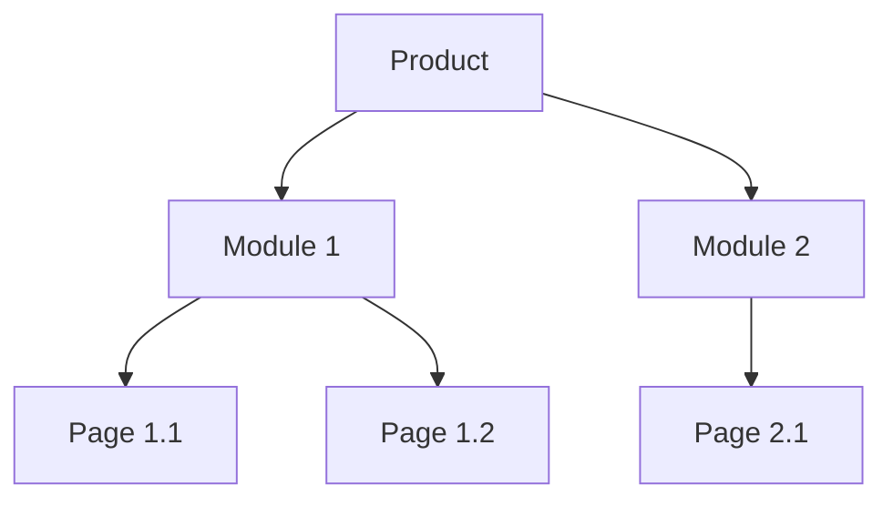
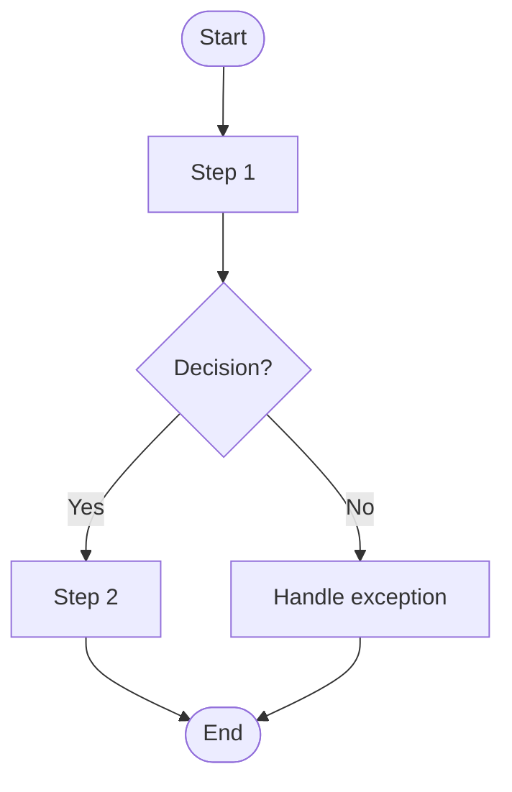
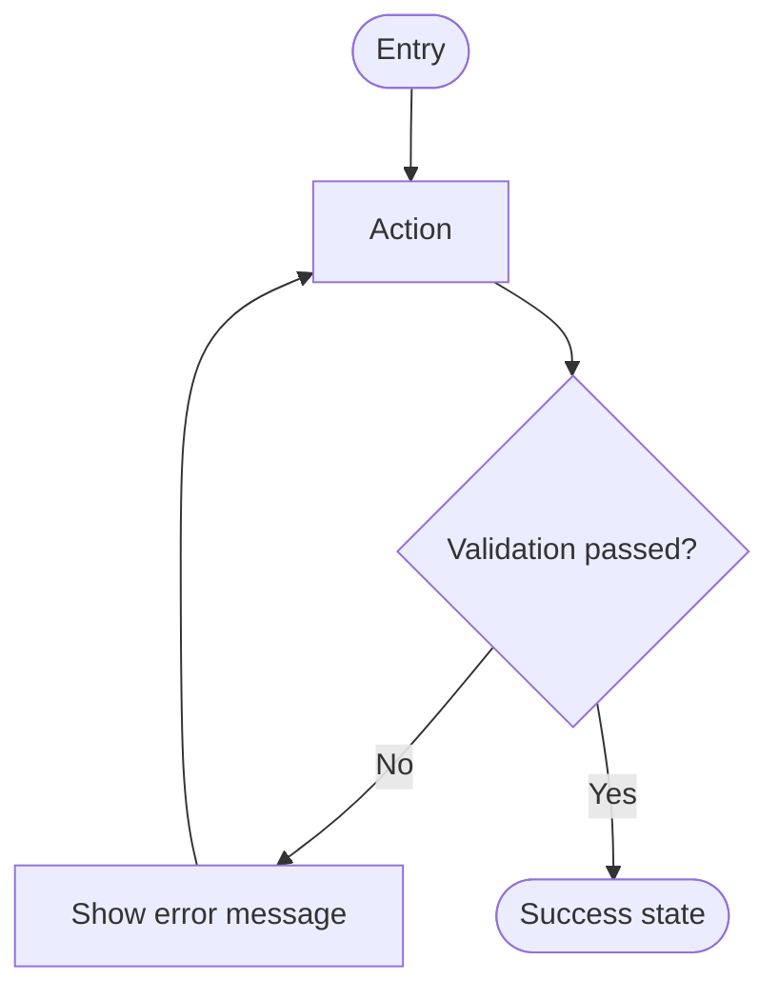

# [Project Name] — Design Requirement Document (DRD)

| | |
|---|---|
| **Product / Team** | [Product name, team] |
| **Version** | v0.1 (Draft) |
| **Author (UX / Interaction designer)** | [Name] |
| **Status** | Draft / In Review / Approved |
| **Last updated** | [YYYY-MM-DD] |
| **Related PRD** | [Link to PRD, with version] |
| **Design files** | [Link to Figma / Sketch / prototype] |
| **Stakeholders** | [Product, Engineering, QA, Visual design, ...] |

> **How to use this template**
> - Replace everything in `[brackets]`. Delete guidance lines (blockquotes) once a section is filled in.
> - The PRD says **what and why**; the DRD says **how it behaves on screen**. Link to the PRD for business logic instead of repeating it.
> - Keep wireframes grayscale (black, white, gray) at the base size (suggested 375 × 812 px for mobile) so readers focus on structure and behavior, not visual style.
> - Use realistic data in wireframes (real-length names, long text, large numbers) so layout problems show up early.
> - One page = one task, and each task has a clear start and end.
> - Sections 6 and 7 hold what is shared across pages, so you don't repeat it in every wireframe.
> - Adjust the template to your product and team. Delete sections that don't apply.

---

## 1. Change Log

> Update on every revision so changes can be traced to a person and a date.

| Version | Date | Owner | Changes |
|---------|------|-------|---------|
| v0.1 | [YYYY-MM-DD] | [Name] | Initial draft |

---

## 2. Requirement Analysis

> Goal: let anyone on the team understand in a few minutes what is being designed and why. Link to the PRD; don't copy it.

### 2.1 Background

[Why this design work is needed. One short paragraph.]

### 2.2 Design Scope

- **In this release**: [Pages, flows, or platforms covered]
- **Not covered**: [Items deliberately left out, e.g., visual redesign, other platforms]
- **Platforms**: [iOS / Android / Web / Mini-program / Desktop]

### 2.3 Design Goals

| ID | Goal | How we'll judge it |
|----|------|--------------------|
| DG-001 | [e.g., Users can complete the task in 3 steps or fewer] | [e.g., Usability test, task completion rate] |
| DG-002 | [Goal] | [Measure] |

### 2.4 Supporting Research (optional)

> Add what supports your design decisions and helps persuade the team.

- User research report: [link]
- Personas: [link]
- Competitor analysis: [link]
- Experience map / journey map: [link]

---

## 3. Product Structure and Information Structure

### 3.1 Product Structure

> List the modules and the pages under each. Don't list page contents here.



### 3.2 Information Structure

> For each page, list only the **dynamic** data elements (data that changes). Leave out fixed text, labels, and icons.

| Page | Data element | Type | Source | Notes (format, limit, empty value) |
|------|--------------|------|--------|-------------------------------------|
| [Page 1.1] | [e.g., User nickname] | Text | [User profile API] | [Max 12 chars; truncate with "…"] |
| [Page 1.1] | [e.g., Order amount] | Number | [Order API] | [2 decimals; currency symbol] |

---

## 4. Flows

### 4.1 Business Flow

> Overall business logic from the user's and the system's view. Include error and exit paths.



### 4.2 Function Flow

> The design logic of individual functions. Add one per complex function.

#### 4.2.1 [Function name]



---

## 5. Requirement List

> The work in this release, so engineering and QA can see the impact. Link each item to the PRD.

| ID | Requirement | Platform | Page(s) | PRD reference | Priority | Possible impact |
|----|-------------|----------|---------|---------------|----------|-----------------|
| DR-001 | [Requirement description] | [iOS / Android / Web] | [Page names] | [US-001 / 3.3.1] | P0 | [Effect on other pages, data, or flows] |
| DR-002 | [Requirement description] | [Platform] | [Page names] | [US-002 / 3.3.2] | P1 | [Impact] |

---

## 6. Global Design Specifications

> Things shared across the product. Define them once here and reference them from the page wireframes, rather than repeating them on every page.

### 6.1 Reusable Pages

| Page | Used by | Behavior / link to wireframe |
|------|---------|------------------------------|
| Share page | [Pages] | [Description / link] |
| Default / empty-state page | [Pages] | [Description / link] |
| Search page | [Pages] | [Description / link] |
| [Other] | [Pages] | [Description / link] |

### 6.2 Common Components

| Component | Variants and states | Rules |
|-----------|---------------------|-------|
| Button | [Primary / secondary / disabled / loading] | [Min touch target, when to use each, disabled-reason rule] |
| Input / list / selector | [Default / focus / error / disabled] | [Validation timing, error message position] |
| Navigation bar / tab bar | [Default / selected / badge] | [Max items, title length, back behavior] |
| Dialog | [Confirm / alert / destructive] | [Copy rules, button order, how to dismiss] |
| Toast | [Success / info / error] | [Copy rules, duration, position] |
| Loading | [Page / section / button / pull-to-refresh] | [Which type to use, when to show] |
| Empty state | [No data / no results / no permission] | [Illustration, copy, action] |
| Network error state | [Offline / timeout / server error] | [Copy, retry action] |

### 6.3 Units and Formats

| Item | Format | Example |
|------|--------|---------|
| Date | [YYYY-MM-DD] | 2026-10-30 |
| Time | [24-hour HH:mm] | 18:45 |
| Currency | [Symbol, thousands separator, decimals] | $1,234.50 |
| Distance / weight / other | [Unit and rounding] | [Example] |

### 6.4 Character and Input Limits

| Field | Min | Max | Allowed characters | Over-limit behavior |
|-------|-----|-----|--------------------|---------------------|
| [Nickname] | [2] | [12] | [Letters, numbers, CJK] | [Block extra input / truncate / show error] |
| [Field] | [ ] | [ ] | [ ] | [ ] |

---

## 7. Non-Functional Requirements

> Agree these with engineering **before** wireframes are finalized, to avoid disputes later. Delete rows that don't apply.

### 7.1 Security

| Item | Requirement |
|------|-------------|
| Identity and permissions | [Who can see or do what; what a user without permission sees] |
| Sensitive data handling | [Masking, copy / print / screenshot restrictions, clipboard rules] |
| Form validation | [Server-side always required; front-end checks for UX: which fields, when] |
| Abuse protection | [Rate limits, IP limits, CAPTCHA, lockout behavior and messages] |

### 7.2 Performance

| Item | Requirement | Behavior when exceeded |
|------|-------------|------------------------|
| Response time | [e.g., Page content visible in < 2 s on 4G] | [Show skeleton / timeout message after N s] |
| Concurrency | [Expected simultaneous users] | [Queue / degrade / error message] |
| Throughput | [Requests per second the feature must handle] | [Behavior] |

### 7.3 User Experience Conventions

| Item | Requirement |
|------|-------------|
| Data loading | [Sync vs. async, skeleton vs. spinner, pagination or infinite scroll] |
| Dialog and Toast | [When to use which; copy rules; see 6.2] |
| Reusable components | [Which components are shared and configurable, to avoid duplicate work] |
| Network handling | [Offline, network switch (Wi-Fi ↔ cellular), interruption mid-action: what the user sees and what is retried] |

### 7.4 Other

| Item | Requirement |
|------|-------------|
| Compatibility | [OS versions, browsers, screen sizes, notch / safe areas, dark mode] |
| Accessibility | [e.g., WCAG 2.1 AA, screen-reader labels, dynamic text size, contrast] |
| Upgrade strategy | [Forced vs. optional update, dialog copy, whether version is carried in URLs/APIs] |
| Internationalization | [Languages at launch, text expansion allowance, copy kept in resource files, RTL] |
| Analytics / tracking | [In-house vs. third-party platform; events to be defined in 9.x] |

---

## 8. Page Interaction Specifications

### 8.1 Document Structure

> Organize pages to match the product structure in Section 3.1: **Platform → Feature → Page → Sub-page → Sub-page branch**. Name pages consistently, e.g., `Feature_Page_State`.

```
[Platform]
└── [Feature]
    └── [Page]
        ├── [Sub-page]
        └── [Sub-page branch]
```

### 8.2 What Every Page Includes

| Element | What to put |
|---------|-------------|
| Page title | What this page is (matches the navigation-bar title) |
| Screen title | A unique name per screen/state so others can refer to it (e.g., "back to Screen B") |
| Screen content | Grayscale wireframe at the base size, with realistic data |
| Design notes | Logic, element states, and small flows that apply only to this screen |
| Flow lines | Arrows showing how screens connect |
| Links | Links to related pages, branch flows, or the global specs in Section 6 |

### 8.3 Page Specification

> Repeat this block for every page. One page = one task.

#### 8.3.1 [Page name]

- **Related requirement**: DR-001
- **Task the user completes here**: [One sentence: start and end of the task]
- **Entry points**: [How users arrive: from where, with what data]
- **Exit points**: [Where users can go next; back behavior]
- **Wireframes**: [Screen A, Screen B, ... or link to design file frames]

**Elements and rules**

| # | Element | Description | States | Rules and behavior |
|---|---------|-------------|--------|--------------------|
| 1 | [e.g., Submit button] | [Purpose] | [Default / pressed / disabled / loading] | [Tap action; when enabled; what happens next] |
| 2 | [e.g., Text field] | [Purpose] | [Empty / focus / filled / error] | [Limits (see 6.4); validation timing; error text] |
| 3 | [e.g., List] | [Purpose] | [Loading / populated / empty / error] | [Sort order; pagination; pull-to-refresh; long-text handling] |

**Page states**

| State | Trigger | What the user sees |
|-------|---------|--------------------|
| Loading | [On entry] | [See 6.2] |
| Empty | [No data] | [See 6.2] |
| Error | [Request fails] | [Message and retry] |
| No permission | [Not allowed] | [Message and next step] |
| Offline | [No network] | [See 7.3] |

**Interaction notes**

- [Gestures: tap, long-press, swipe, drag, and their results]
- [Transitions and feedback: animation, haptics, sounds, if any]
- [Edge cases: very long text, very large numbers, rapid taps, back during submit]
- [Tracking events: event name and trigger, if applicable]

> **Check before sending for review (interaction notes)**
> - [ ] Every tappable element has a defined result
> - [ ] Every element with changing state has all states shown (default, pressed, disabled, loading, error)
> - [ ] Empty, loading, error, offline, and no-permission cases are covered
> - [ ] Input limits and validation messages are written out
> - [ ] Entry points, exit points, and back behavior are clear
> - [ ] Wording could be verified by QA ("What should I see when I do X?")

> **Do not put in interaction notes**
> - Business reasoning (why this feature exists): belongs in the PRD and Section 2.
> - Visual specs (colors, spacing, font sizes): belongs in the visual design / design system.
> - Code logic (how it is implemented): belongs to engineering.

---

## 9. Tracking Requirements (optional)

| Event name | Page | Trigger | Properties | Purpose (metric it feeds) |
|------------|------|---------|------------|---------------------------|
| [e.g., feedback_submit_tap] | [Page] | [Tap on Submit] | [issue_type, has_screenshot] | [PRD metric: submission rate] |

---

## 10. Open Questions

| # | Question | Owner | Due date | Resolution |
|---|----------|-------|----------|------------|
| 1 | [Question] | [Name] | [Date] | [Open / Answer] |

---

## 11. Archive (Trash)

> Keep superseded or rejected designs here, labelled with the date and the reason, so the main document stays clean and abandoned options can be recovered or explained later.

| Item | Date retired | Reason | Link |
|------|--------------|--------|------|
| [Screen / flow name, version] | [YYYY-MM-DD] | [Why it was dropped] | [Link / frame] |
