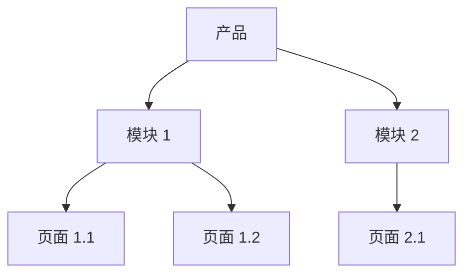
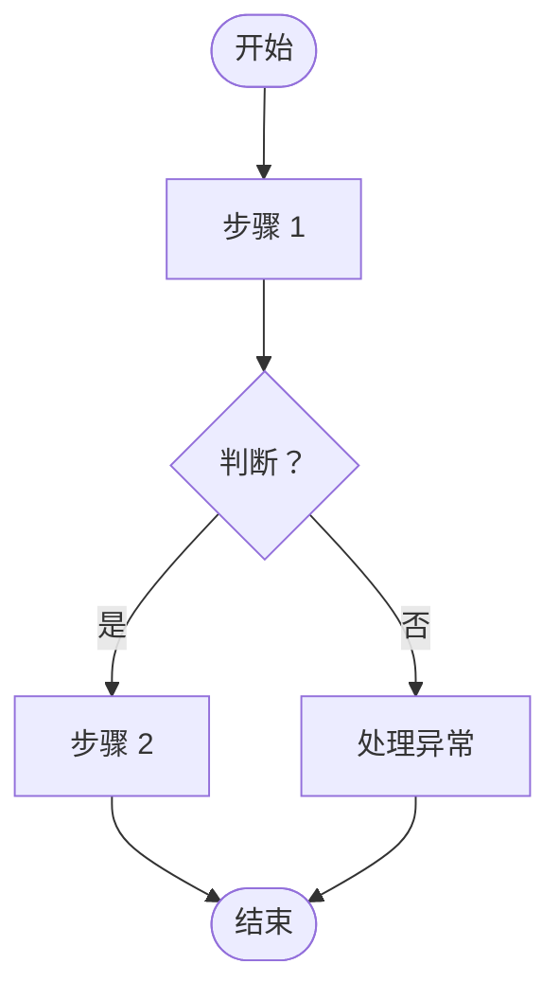
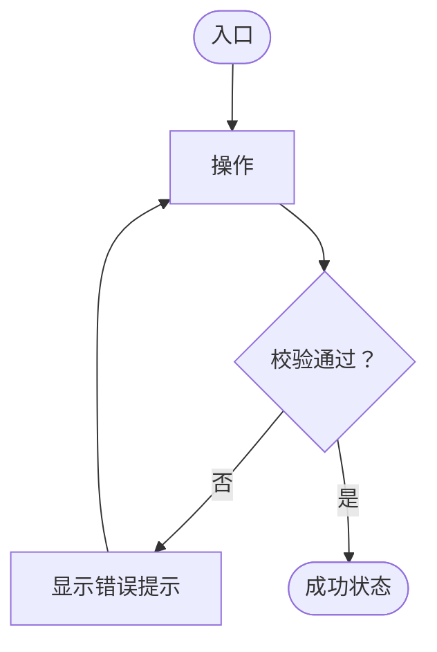

# [项目名称] — 设计需求文档（DRD）

| | |
|---|---|
| **产品 / 团队** | [产品名称、团队] |
| **版本** | v0.1（草稿） |
| **作者（UX / 交互设计师）** | [姓名] |
| **状态** | 草稿 / 评审中 / 已批准 |
| **最后更新** | [YYYY-MM-DD] |
| **关联 PRD** | [PRD 链接，含版本] |
| **设计文件** | [Figma / Sketch / 原型链接] |
| **相关方** | [产品、研发、测试、视觉设计……] |

> **模板使用说明**
> - 替换所有 `[方括号]` 中的内容。章节填写完成后，删除引导性文字（引用块）。
> - PRD 说明**做什么和为什么**；DRD 说明**在界面上如何表现**。业务逻辑请链接到 PRD，不要重复。
> - 线框图保持灰度（黑、白、灰），采用基准尺寸（移动端建议 375 × 812 px），让读者关注结构和行为，而不是视觉风格。
> - 线框图中使用真实数据（真实长度的名称、长文本、大数字），以便尽早暴露布局问题。
> - 一个页面 = 一个任务，每个任务有明确的开始和结束。
> - 第 6 和第 7 章存放跨页面共享的内容，避免在每个线框图里重复。
> - 根据你的产品和团队调整模板。删除不适用的章节。

---

## 1. 变更记录

> 每次修订都要更新，让变更可以追溯到具体的人和日期。

| 版本 | 日期 | 负责人 | 变更内容 |
|---------|------|-------|---------|
| v0.1 | [YYYY-MM-DD] | [姓名] | 初稿 |

---

## 2. 需求分析

> 目标：让团队中的任何人几分钟内理解正在设计什么、为什么设计。链接到 PRD，不要复制。

### 2.1 背景

[为什么需要这项设计工作。一小段话即可。]

### 2.2 设计范围

- **本次发布**：[覆盖的页面、流程或平台]
- **不覆盖**：[有意不做的事项，例如视觉改版、其他平台]
- **平台**：[iOS / Android / Web / 小程序 / 桌面端]

### 2.3 设计目标

| 编号 | 目标 | 如何判断 |
|----|------|--------------------|
| DG-001 | [例如：用户在 3 步以内完成任务] | [例如：可用性测试，任务完成率] |
| DG-002 | [目标] | [衡量方式] |

### 2.4 支撑调研（可选）

> 补充能支撑设计决策、帮助说服团队的材料。

- 用户研究报告：[链接]
- 用户画像：[链接]
- 竞品分析：[链接]
- 体验地图 / 旅程图：[链接]

---

## 3. 产品结构与信息结构

### 3.1 产品结构

> 列出各模块及其下的页面。此处不列页面内容。



### 3.2 信息结构

> 对每个页面，只列出**动态**数据元素（会变化的数据）。固定文案、标签和图标不用列。

| 页面 | 数据元素 | 类型 | 来源 | 备注（格式、限制、空值） |
|------|--------------|------|--------|-------------------------------------|
| [页面 1.1] | [例如：用户昵称] | 文本 | [用户资料接口] | [最多 12 个字符；超出用"…"截断] |
| [页面 1.1] | [例如：订单金额] | 数字 | [订单接口] | [2 位小数；货币符号] |

---

## 4. 流程

### 4.1 业务流程

> 从用户和系统两个视角展示整体业务逻辑。包含异常和退出路径。



### 4.2 功能流程

> 各个功能的设计逻辑。对每个复杂功能增加一张。

#### 4.2.1 [功能名称]



---

## 5. 需求列表

> 本次发布的工作内容，让研发和测试看到影响范围。每一项都链接到 PRD。

| 编号 | 需求 | 平台 | 页面 | PRD 引用 | 优先级 | 可能的影响 |
|----|-------------|----------|---------|---------------|----------|-----------------|
| DR-001 | [需求描述] | [iOS / Android / Web] | [页面名称] | [US-001 / 3.3.1] | P0 | [对其他页面、数据或流程的影响] |
| DR-002 | [需求描述] | [平台] | [页面名称] | [US-002 / 3.3.2] | P1 | [影响] |

---

## 6. 全局设计规范

> 整个产品共享的内容。在此定义一次，在各页面线框图中引用，而不是每页重复。

### 6.1 可复用页面

| 页面 | 使用方 | 行为 / 线框图链接 |
|------|---------|------------------------------|
| 分享页 | [页面] | [描述 / 链接] |
| 缺省 / 空状态页 | [页面] | [描述 / 链接] |
| 搜索页 | [页面] | [描述 / 链接] |
| [其他] | [页面] | [描述 / 链接] |

### 6.2 通用组件

| 组件 | 变体与状态 | 规则 |
|-----------|---------------------|-------|
| 按钮 | [主要 / 次要 / 禁用 / 加载中] | [最小点击区域、各类型的使用场景、禁用原因的说明规则] |
| 输入框 / 列表 / 选择器 | [默认 / 聚焦 / 错误 / 禁用] | [校验时机、错误提示位置] |
| 导航栏 / 标签栏 | [默认 / 选中 / 角标] | [最大项数、标题长度、返回行为] |
| 对话框 | [确认 / 提示 / 破坏性操作] | [文案规则、按钮顺序、关闭方式] |
| Toast（轻提示） | [成功 / 信息 / 错误] | [文案规则、时长、位置] |
| 加载 | [页面 / 区块 / 按钮 / 下拉刷新] | [使用哪种类型、何时显示] |
| 空状态 | [无数据 / 无结果 / 无权限] | [插画、文案、操作] |
| 网络异常状态 | [离线 / 超时 / 服务器错误] | [文案、重试操作] |

### 6.3 单位与格式

| 项目 | 格式 | 示例 |
|------|--------|---------|
| 日期 | [YYYY-MM-DD] | 2026-10-30 |
| 时间 | [24 小时制 HH:mm] | 18:45 |
| 货币 | [符号、千分位、小数位] | $1,234.50 |
| 距离 / 重量 / 其他 | [单位与取整] | [示例] |

### 6.4 字符与输入限制

| 字段 | 最小 | 最大 | 允许字符 | 超限行为 |
|-------|-----|-----|--------------------|---------------------|
| [昵称] | [2] | [12] | [字母、数字、中日韩文字] | [阻止继续输入 / 截断 / 显示错误] |
| [字段] | [ ] | [ ] | [ ] | [ ] |

---

## 7. 非功能需求

> 在线框图定稿**之前**与研发对齐，避免后期争议。删除不适用的行。

### 7.1 安全

| 事项 | 要求 |
|------|-------------|
| 身份与权限 | [谁能看到或做什么；无权限的用户看到什么] |
| 敏感数据处理 | [脱敏，复制 / 打印 / 截屏限制，剪贴板规则] |
| 表单校验 | [服务端必须校验；前端校验用于提升体验：哪些字段、何时校验] |
| 防滥用 | [频率限制、IP 限制、验证码、锁定行为及提示] |

### 7.2 性能

| 事项 | 要求 | 超出时的行为 |
|------|-------------|------------------------|
| 响应时间 | [例如：4G 下内容在 < 2 秒内可见] | [显示骨架屏 / N 秒后显示超时提示] |
| 并发 | [预期同时在线用户数] | [排队 / 降级 / 错误提示] |
| 吞吐量 | [功能需支持的每秒请求数] | [行为] |

### 7.3 用户体验约定

| 事项 | 要求 |
|------|-------------|
| 数据加载 | [同步或异步，骨架屏或转圈，分页或无限滚动] |
| 对话框与 Toast | [何时用哪个；文案规则；见 6.2] |
| 复用组件 | [哪些组件共用且可配置，避免重复开发] |
| 网络处理 | [离线、网络切换（Wi-Fi ↔ 蜂窝）、操作中断：用户看到什么、重试什么] |

### 7.4 其他

| 事项 | 要求 |
|------|-------------|
| 兼容性 | [系统版本、浏览器、屏幕尺寸、刘海 / 安全区、深色模式] |
| 无障碍 | [例如：WCAG 2.1 AA、读屏标签、动态字号、对比度] |
| 升级策略 | [强制或可选更新、弹窗文案、版本号是否带入 URL / 接口] |
| 国际化 | [首发语言、文字膨胀预留、文案放入资源文件、从右到左] |
| 埋点 / 数据统计 | [自建或第三方平台；事件在第 9 章定义] |

---

## 8. 页面交互说明

### 8.1 文档结构

> 页面的组织方式与 3.1 的产品结构保持一致：**平台 → 功能 → 页面 → 子页面 → 子页面分支**。页面命名保持一致，例如 `功能_页面_状态`。

```
[平台]
└── [功能]
    └── [页面]
        ├── [子页面]
        └── [子页面分支]
```

### 8.2 每个页面包含什么

| 元素 | 填写内容 |
|---------|-------------|
| 页面标题 | 这个页面是什么（与导航栏标题一致） |
| 界面标题 | 每个界面 / 状态的唯一名称，便于他人引用（例如"回到界面 B"） |
| 界面内容 | 基准尺寸下的灰度线框图，带真实数据 |
| 设计说明 | 仅适用于该界面的逻辑、元素状态和小流程 |
| 流程线 | 表示界面之间如何连接的箭头 |
| 链接 | 指向相关页面、分支流程或第 6 章的全局规范 |

### 8.3 页面规格

> 对每个页面重复此块。一个页面 = 一个任务。

#### 8.3.1 [页面名称]

- **关联需求**：DR-001
- **用户在此完成的任务**：[一句话：任务的起点和终点]
- **入口**：[用户如何到达：从哪里、带什么数据]
- **出口**：[用户接下来可以去哪里；返回行为]
- **线框图**：[界面 A、界面 B……或设计文件中的画板链接]

**元素与规则**

| # | 元素 | 描述 | 状态 | 规则与行为 |
|---|---------|-------------|--------|--------------------|
| 1 | [例如：提交按钮] | [用途] | [默认 / 按下 / 禁用 / 加载中] | [点击行为；何时可用；之后发生什么] |
| 2 | [例如：文本框] | [用途] | [空 / 聚焦 / 已填 / 错误] | [限制（见 6.4）；校验时机；错误文案] |
| 3 | [例如：列表] | [用途] | [加载中 / 有数据 / 空 / 错误] | [排序；分页；下拉刷新；长文本处理] |

**页面状态**

| 状态 | 触发条件 | 用户看到什么 |
|-------|---------|--------------------|
| 加载中 | [进入时] | [见 6.2] |
| 空 | [无数据] | [见 6.2] |
| 错误 | [请求失败] | [提示和重试] |
| 无权限 | [不允许] | [提示和下一步] |
| 离线 | [无网络] | [见 7.3] |

**交互说明**

- [手势：点击、长按、滑动、拖拽及其结果]
- [转场与反馈：动画、触觉、声音（如有）]
- [边界情况：超长文本、超大数字、快速连点、提交过程中返回]
- [埋点事件：事件名称和触发时机（如适用）]

> **评审前自查（交互说明）**
> - [ ] 每个可点击元素都有明确的结果
> - [ ] 每个会变化的元素都展示了全部状态（默认、按下、禁用、加载、错误）
> - [ ] 已覆盖空、加载、错误、离线和无权限情形
> - [ ] 输入限制和校验提示已写明
> - [ ] 入口、出口和返回行为清晰
> - [ ] 文字描述足以让测试验证（"我做 X，应该看到什么？"）

> **交互说明中不要写**
> - 商业逻辑（为什么要有这个功能）：属于 PRD 和第 2 章。
> - 视觉规范（颜色、间距、字号）：属于视觉设计 / 设计系统。
> - 代码逻辑（如何实现）：属于研发。

---

## 9. 埋点需求（可选）

| 事件名称 | 页面 | 触发时机 | 属性 | 用途（对应指标） |
|------------|------|---------|------------|---------------------------|
| [例如：feedback_submit_tap] | [页面] | [点击提交] | [issue_type, has_screenshot] | [PRD 指标：提交率] |

---

## 10. 待决问题

| # | 问题 | 负责人 | 截止日期 | 结论 |
|---|----------|-------|----------|------------|
| 1 | [问题] | [姓名] | [日期] | [未决 / 答案] |

---

## 11. 归档（废纸篓）

> 把被取代或被否决的设计保存在这里，注明日期和原因，让主文档保持整洁，也便于日后回溯被放弃的方案。

| 项目 | 弃用日期 | 原因 | 链接 |
|------|--------------|--------|------|
| [界面 / 流程名称，版本] | [YYYY-MM-DD] | [为什么被放弃] | [链接 / 画板] |
