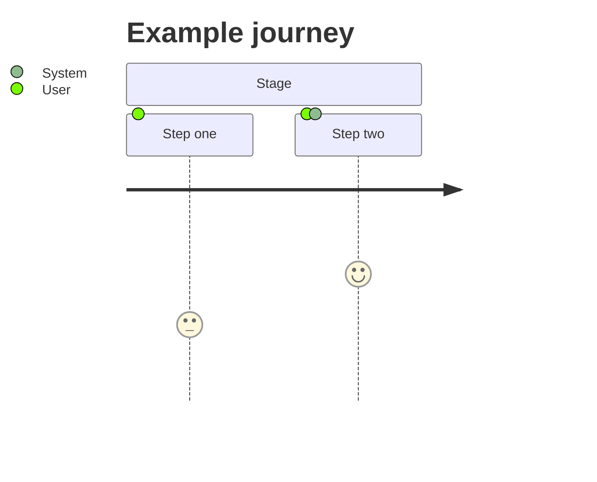
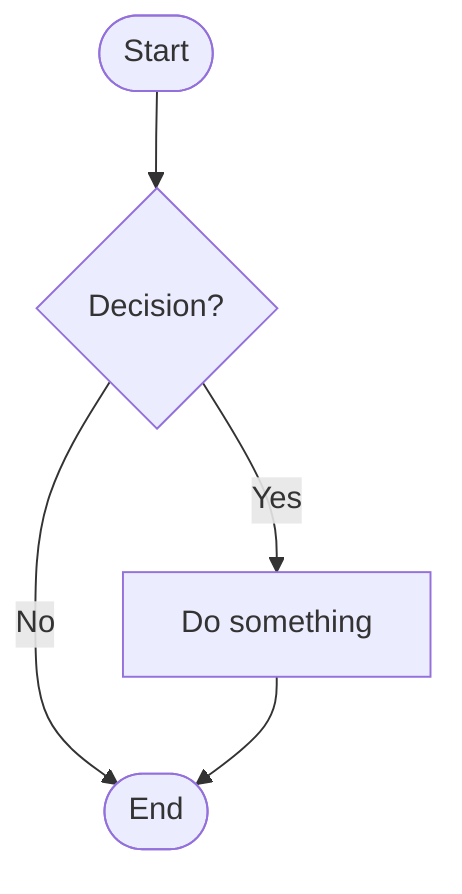

# How to Write a PRD — Guide

This guide explains what a Product Requirements Document (PRD) is, how to use the template, and what to write in each section.

**Use it together with:**
- [PRD_Template.md](PRD_Template.md): the blank template to copy and fill in
- [PRD_Sample_In-App_Feedback.md](PRD_Sample_In-App_Feedback.md): a completed example, so you can see what "good" looks like. It is fictional and describes a mobile/web subscription product, so treat its tech stack and integrations as illustrations, not defaults.

---

## Part 1: PRD Basics

### What is a PRD?

A PRD is the shared agreement on **what we're building, for whom, why, and how we'll know it worked**. Design, engineering, QA, operations, and legal all work from it.

### What a PRD is not

| A PRD is not... | Because... |
|-----------------|------------|
| A technical design doc | It says *what* and *why*, not *how* it's coded. Engineering decides the "how." |
| A UI spec | It describes behavior and rules; screens live in design files (link them). |
| A wish list | Every item needs a reason, a priority, and a way to verify it. |
| Written once and forgotten | It's a living document. Update it and record changes in the change log. |

### Who reads it, and what they look for

| Reader | Looking for |
|--------|-------------|
| Executives / stakeholders | Sections 1 and 4: why this, what success looks like |
| Designers | Sections 2 and 3: users, flows, rules |
| Engineers | Sections 3, 5, 6: requirements, edge cases, constraints |
| QA | Section 5: acceptance criteria |
| Ops / Support / Legal | Sections 6 and 7: impact, risk, compliance |

### Writing principles

1. **Be specific.** "Fast" is not a requirement; "submit completes in under 3 seconds at p95" is.
2. **Explain why.** Every requirement should trace back to a user need or objective.
3. **Be testable.** If QA can't tell whether it passed, rewrite it.
4. **Say what's out.** Naming exclusions prevents scope creep and misunderstandings.
5. **Use data.** Numbers beat adjectives. If you don't have data, say so and note how you'll get it.
6. **Keep it short enough to be read.** Delete sections that don't apply (see "Choosing a size" below).

---

## Part 2: The Writing Process

Don't fill the template top to bottom. A better order:

| Step | Do this | Sections |
|------|---------|----------|
| 1. Research | Talk to users, check data, review support tickets and competitors | Inputs for 1 and 2 |
| 2. Frame the problem | Write who, what pain, how bad | 1.1 |
| 3. Set objectives | Decide what success is, with numbers | 1.2, 4 |
| 4. Understand users | Personas, journey, stories | 2 |
| 5. Define scope | Decide in and out | 1.3 |
| 6. Specify requirements | Flows, features, rules, edge cases | 3 |
| 7. Define "done" | Acceptance criteria | 5 |
| 8. Capture constraints | Tech, integrations, risks | 6 |
| 9. Get reviews | Engineering, ops, business, legal | 7 |
| 10. Finalize | Summary, open questions, glossary, change log | Header, 8 |

### Choosing a size

| Situation | Include | Skip |
|-----------|---------|------|
| **Full**: large or risky feature, multiple teams | Everything | Nothing |
| **Standard**: typical feature (default) | Sections 1–6 and 8; Section 7 (review) if the feature touches other teams, data, or money | Optional items (secondary persona, guardrail metrics, if irrelevant) |
| **Quick**: small change or MVP | 1.1–1.3, 2.3, 3.2–3.3, 5.1 | Section 7, journey diagram, non-functional criteria |

---

## Part 3: Section-by-Section Guide

For each section: **what it's for**, **what to write**, **tips**, and **common mistakes**.

---

### Document Header

**What it's for:** Lets readers see at a glance whether this is the current, approved version and who to ask.

**Write:**
- Version (start at v0.1 or v0.9 for drafts; v1.0 when approved)
- Author, status (Draft / In Review / Approved), last-updated date
- Stakeholders: the people who must review or will build it

**Common mistake:** Leaving the status out, so people build from a draft.

---

### 1. Project Overview

**What it's for:** Lets any reader understand in about five minutes what this is, why it matters, and what "done" means.

#### 1.1 Background and Problem

**What it's for:** Justifies the project. If the problem isn't clear and real, nothing after it matters.

**Write:**
- **Who** is affected (a specific user group)
- **In what situation** the problem occurs
- **What goes wrong** and how it hurts them or the business
- **Evidence**: numbers, quotes, tickets, research

**Formula:** *[User group] currently [situation], which causes [problem], resulting in [measurable impact].*

| Weak | Strong |
|------|--------|
| "Users want a better way to give feedback." | "Only ~3% of affected learners report issues, and 61% of support emails lack the details needed to act, so first responses take 38 hours." |

**Common mistakes:** Describing the solution instead of the problem ("We need a feedback button"); no data.

#### 1.2 Objectives

**What it's for:** States what the project must achieve, in measurable terms.

**Write:** 3–5 objectives, each with an ID, a metric, a target, and a data source. Use SMART: Specific, Measurable, Achievable, Relevant, Time-bound.

**Tips:**
- Include a baseline ("from X to Y").
- Include a deadline ("within 90 days of launch").
- Every objective should be traceable to the problem in 1.1.

**Common mistakes:** Vague goals ("improve user experience"); objectives that are really features ("build a dashboard").

#### 1.3 Scope

**What it's for:** Draws the boundary so everyone agrees what is and isn't being delivered.

**Write:**
- **In scope**: modules or capabilities, one line each
- **Out of scope**: things people might reasonably expect but won't get, each with a reason

**Tips:** The out-of-scope list is often the most useful part. Include items stakeholders have asked for that you're deliberately deferring.

**Common mistakes:** Leaving out-of-scope blank, then fighting about it in week 6.

#### 1.4 Value Proposition

**What it's for:** A single sentence anyone can repeat to explain why users would care.

**Write:** One sentence, roughly 25 words or fewer, in terms of user benefit, not features.

**Example:** "Report a problem in under 30 seconds, without leaving the lesson, and always know what happens next."

---

### 2. User Analysis

**What it's for:** Keeps the team building for real people, not abstractions.

#### 2.1 User Personas

**What it's for:** Describes who the users are, what they're trying to do, and what gets in the way.

**Write, for each persona (usually 1 primary and 0–2 secondary):**

| Field | What to put |
|-------|-------------|
| Role | A specific role, optionally with a name and age |
| Background | How and when they use the product |
| Core goal | What they're trying to get done |
| Key pain points | What blocks them today |
| Usage frequency | How often they'd use this feature |

**Tips:** Base personas on real research or data, not imagination. Include internal users (support agents, admins) if they're affected.

**Common mistakes:** Generic personas ("everyone"); personas that don't connect to the problem in 1.1.

#### 2.2 User Journey

**What it's for:** Shows the user's path from noticing a need to getting the result, revealing where the experience breaks down.

**Write:**
1. **Main flow**: 4–6 stages (e.g., Discover → Evaluate → Act → Wait → Receive)
2. **Journey diagram** (optional): Mermaid `journey` chart; scores 1–5 for satisfaction at each step
3. **Touchpoint table**: for each stage, the touchpoint, behavior, need, pain point, and design opportunity

**Tips:** The "Design Opportunity" column is where the requirements in Section 3 come from.

**Common mistakes:** Describing the product's internal process instead of the user's experience.

#### 2.3 User Stories

**What it's for:** Expresses each need as a short statement that links people to requirements.

**Format:** *As a [role], I want [capability], so that [benefit].*

**Write:** An ID, role, story, priority (P0/P1/P2), and the section where it's specified.

**Tips:**
- The "so that" clause is required. It's the reason, and it helps designers and engineers choose between options.
- One story = one capability. Split any story containing "and."

| Weak | Strong |
|------|--------|
| "As a user, I want a button." | "As a learner, I want to report a problem without leaving my lesson, so that I don't lose my place." |

---

### 3. Detailed Requirements

**What it's for:** The core of the PRD: exactly what the product must do. Designers and engineers work from here.

#### 3.1 Business Flow

**What it's for:** Shows the logic and branching of the main process in one picture.

**Write:** A Mermaid flowchart with the start, main path, decisions, error paths, and end states.

**Tips:** If the flow has more than about 15 nodes, split it into sub-flows. Always show failure paths.

#### 3.2 Feature List (MoSCoW)

**What it's for:** Lists every feature with a priority so the team knows what to cut if time runs short.

**Priority definitions:**

| Priority | Meaning | Rule of thumb |
|----------|---------|---------------|
| **P0 / Must** | Launch is not acceptable without it | If removed, the product doesn't solve the core problem |
| **P1 / Should** | Important, but launch can survive without it | Painful to omit; workaround exists |
| **P2 / Could** | Nice to have | First to cut |
| **Won't** | Explicitly not in this release | Documented so nobody asks again |

**Tips:** If everything is P0, nothing is. Aim for no more than about 60% Must.

**Labels:** Must = P0, Should = P1, Could = P2. Won't has no P-level. Use the P-level in user stories and write "P0 / Must" in the feature list, so the two never disagree.

**Section 3 vs. Section 5:** Section 3 states the rules (what the product does, limits, edge cases). Section 5 states how each rule is tested. Write a rule once in 3.3 and test it in 5.1; don't restate it in both places.

#### 3.3 Feature Specifications

**What it's for:** Gives the detail behind each feature in 3.2 so no one has to guess.

**Write, per feature:**

| Field | What to put |
|-------|-------------|
| Related user story | Link back to Section 2.3 |
| Priority | From 3.2 |
| Description | What it does and how users interact with it |
| Fields / inputs | Names, types, limits, required or optional |
| Business rules | Permissions, limits, states, calculations |
| Edge cases and errors | What happens when things go wrong |
| Design references | Links to Figma or wireframes |

**Tips:**
- Think about: empty states, errors, no network, long text, permissions, concurrency, and rate limits.
- Write rules as testable statements ("max 3 screenshots, 5 MB each").

**Common mistakes:** Specifying only the happy path; hiding rules in design mockups only.

---

### 4. Success Metrics

**What it's for:** Defines how you'll know the project worked, and prevents declaring success by feel.

#### 4.1–4.2 North Star and Supporting Metrics

**Write:** For each metric: name, definition (how it's calculated), baseline, target, and type.

| Type | Meaning | Example |
|------|---------|---------|
| **Leading** | Early signal, available quickly, predicts the outcome | Form completion rate |
| **Lagging** | The actual outcome, available later | 90-day churn |

**Tips:**
- Choose 1–3 North Star metrics; they are the ones that decide whether the project succeeded.
- Include at least one leading metric so you can course-correct before lagging results arrive.
- Every metric needs a baseline. If you don't have one, say "to be measured at launch."

#### 4.3 Guardrail Metrics (optional)

**What it's for:** Protects against doing harm elsewhere while chasing the goal.

**Write:** Metrics that must not get worse (performance, support load, error rates), with thresholds.

**Common mistakes:** Metrics nobody can measure; targets with no baseline; counting vanity numbers (page views) instead of outcomes.

---

### 5. Acceptance Criteria

**What it's for:** Defines what "done" means in a way QA and engineering can verify, and avoids "that's not what I meant" at the end.

#### 5.1 Functional Criteria (Given / When / Then)

**Format:**

- **Given**: the starting state or precondition
- **When**: the action taken
- **Then**: the observable result

**Write:** For each P0/P1 feature, cover:
1. Happy path
2. Validation failures (missing/invalid input)
3. Error and edge cases (offline, limits, permissions)

**Tips:**
- Use concrete values ("a screenshot over 5 MB"), not "an invalid file."
- Include exact message text or timings where they matter.
- One scenario per criterion; one expected outcome per "Then" (use "and" for related results).

| Weak | Strong |
|------|--------|
| "Form should validate input." | **Given** the form is open, **When** the learner taps Submit without an issue type, **Then** "Please choose an issue type" is shown and typed content is preserved. |

#### 5.2 Non-Functional Criteria

**What it's for:** Quality requirements that aren't features: speed, reliability, accessibility, compatibility.

**Write:** Category, a measurable requirement, and how to verify it. Cover performance, availability, accessibility, compatibility, and, if Section 6.3 sets any, security and data retention (each requirement in 6.3 should have a way to verify it here).

**Common mistakes:** "Should be fast and secure" with no numbers or test method.

---

### 6. Technical Constraints

**What it's for:** Tells the team what boundaries they must work within, so you don't promise something infeasible.

**Write:**
- **Tech stack**: what's already decided or mandated (not a design, just constraints)
- **Integrations**: systems you depend on, how, and who owns them
- **Security and compliance**: authentication, encryption, retention, regulations
- **Assumptions, dependencies, risks**: what you're taking for granted, what you're waiting on, and what could go wrong

**Tips:** Ask engineering to review this section. Give each risk a mitigation, not just a description.

**Common mistakes:** Prescribing the implementation; skipping risks because they feel negative.

---

### 7. Cross-Functional Review (optional)

**What it's for:** Gets formal input from the four groups most likely to find problems before you build. (Add a fifth row, such as Design or Security, if your project needs one.)

**Write, for each review:**

| Review | Reviewer | Key questions |
|--------|----------|---------------|
| Technical feasibility | Engineering | How hard? How long? What could break? |
| Operational impact | Operations / Support | What's the cost, staffing, and rollout plan? |
| Business value | Business / Finance | What's the ROI? How do competitors compare? |
| Legal and compliance | Legal | What data, privacy, and policy issues exist? |

Then record each reviewer's decision, date, and comments in the sign-off table (7.5).

**When to skip:** Small, low-risk changes (Quick mode).

**Common mistakes:** Asking for review after the build has started; treating sign-off as a formality.

---

### 8. Appendix

**What it's for:** Holds supporting material so the main body stays readable.

| Subsection | Write |
|------------|-------|
| **Open questions** | Anything unresolved, with an owner and a due date. Revisit before approval. |
| **Glossary** | Domain terms or acronyms readers might not know. |
| **References** | Links to research, data, designs, related PRDs. |
| **Change log** | Version, date, author, and what changed. Update on every revision. |

---

## Part 4: Using the Mermaid Diagrams

Both diagrams in the template are text-based and render in GitHub, Notion, Obsidian, VS Code (with a preview extension), and the [Mermaid Live Editor](https://mermaid.live).

### User journey

Syntax: `Step name: score (1–5): actor(s)`. Score is satisfaction.

### Flowchart

| Shape | Syntax | Use for |
|-------|--------|---------|
| Rounded ends | `A([Text])` | Start / end |
| Rectangle | `B[Text]` | An action or step |
| Diamond | `C{Text}` | A decision |
| Labeled arrow | `A -->|label| B` | A condition on a branch |

---

## Part 5: Quality Checklist

Before sending for review, confirm:

**Problem and goals**
- [ ] The problem is stated with who, when, and evidence
- [ ] Every objective has a metric, baseline, and target
- [ ] Out-of-scope items are listed

**Users and requirements**
- [ ] Personas are based on real data
- [ ] Every user story has a "so that"
- [ ] Every feature has a priority, and not everything is P0
- [ ] Edge cases and error states are specified

**Verification**
- [ ] Every P0/P1 feature has Given/When/Then criteria
- [ ] Criteria use concrete values, not "appropriate" or "fast"
- [ ] Metrics have both leading and lagging indicators

**Completeness**
- [ ] Risks have mitigations
- [ ] Reviews are done (or consciously skipped)
- [ ] Open questions have owners and dates
- [ ] No `[brackets]` or guidance text left over
- [ ] Version, status, and change log are up to date

---

## Part 6: Common Mistakes at a Glance

| Mistake | Fix |
|---------|-----|
| Starting with the solution | Start with the problem and evidence |
| Vague words ("easy," "fast," "modern") | Replace with numbers or observable behavior |
| Only the happy path | Add validation, error, offline, and permission cases |
| Everything is high priority | Force-rank; use Won't |
| No baseline for metrics | Measure first, or write "to be measured" |
| Unclear ownership | Name owners for open questions and dependencies |
| Letting the PRD go stale | Update it and log changes |
| Dictating implementation | State the need and constraints; let engineering design |
