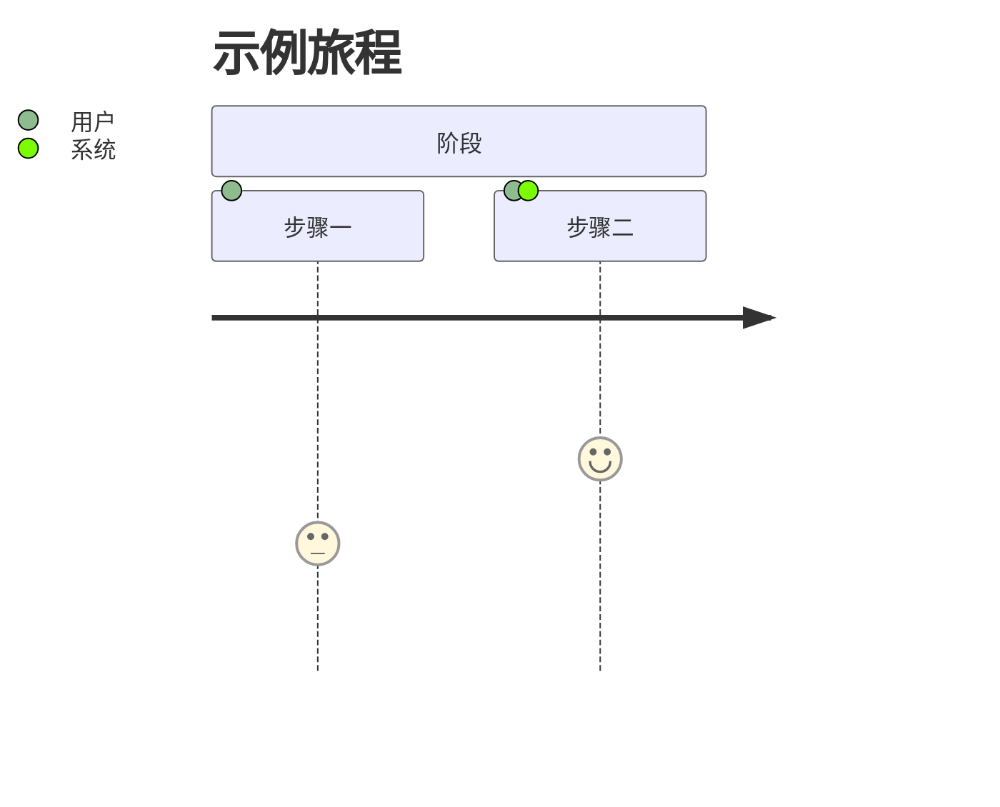
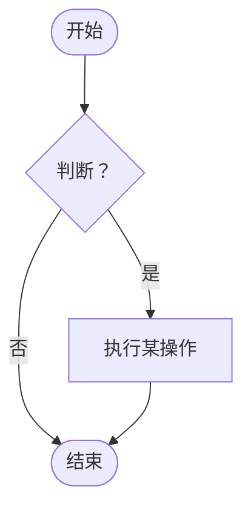

# 如何撰写 PRD — 指南

本指南说明什么是产品需求文档（PRD）、如何使用模板，以及每个章节应写什么。

**配合以下文件使用：**
- [PRD_Template_zh.md](PRD_Template_zh.md)：可复制并填写的空白模板
- [PRD_Sample_In-App_Feedback_zh.md](PRD_Sample_In-App_Feedback_zh.md)：一份完整示例，让你看到"好的 PRD"是什么样子。示例是虚构的，描述的是一款移动端 / 网页端订阅产品，因此其中的技术栈和集成仅作说明，不是默认选项。

---

## 第一部分：PRD 基础

### 什么是 PRD？

PRD 是关于**我们要做什么、为谁做、为什么做，以及如何判断是否成功**的共同约定。设计、研发、测试、运营和法务都以它为依据开展工作。

### PRD 不是什么

| PRD 不是…… | 原因 |
|-----------|------|
| 技术设计文档 | 它说明*做什么*和*为什么*，而不是代码*怎么写*。"怎么做"由研发决定。 |
| UI 规格说明 | 它描述行为和规则；界面放在设计文件里（附链接即可）。 |
| 愿望清单 | 每一项都需要理由、优先级和验证方式。 |
| 写完就丢的文档 | 它是活文档。请持续更新，并在变更记录中留痕。 |

### 谁会读它，关注什么

| 读者 | 关注点 |
|--------|-------------|
| 高管 / 相关方 | 第 1 和第 4 章：为什么做、成功是什么样 |
| 设计师 | 第 2 和第 3 章：用户、流程、规则 |
| 研发 | 第 3、5、6 章：需求、边界情况、约束 |
| 测试 | 第 5 章：验收标准 |
| 运营 / 客服 / 法务 | 第 6 和第 7 章：影响、风险、合规 |

### 写作原则

1. **具体。**"快"不是需求；"提交在 p95 下 3 秒内完成"才是。
2. **说明原因。**每条需求都应能追溯到用户需求或目标。
3. **可测试。**如果测试无法判断是否通过，就重写。
4. **写明不做什么。**明确排除项可以防止范围蔓延和误解。
5. **用数据。**数字胜过形容词。没有数据就如实说明，并写明如何获取。
6. **篇幅要让人愿意读完。**删掉不适用的章节（见下文"选择文档规模"）。

---

## 第二部分：撰写流程

不要从上到下依次填写模板。更好的顺序：

| 步骤 | 做什么 | 对应章节 |
|------|---------|----------|
| 1. 调研 | 访谈用户、查看数据、梳理客服工单和竞品 | 为第 1、2 章提供输入 |
| 2. 界定问题 | 写清楚谁、什么痛点、有多严重 | 1.1 |
| 3. 设定目标 | 确定成功的标准，并用数字表达 | 1.2、4 |
| 4. 理解用户 | 用户画像、旅程、用户故事 | 2 |
| 5. 划定范围 | 决定做什么、不做什么 | 1.3 |
| 6. 细化需求 | 流程、功能、规则、边界情况 | 3 |
| 7. 定义"完成" | 验收标准 | 5 |
| 8. 梳理约束 | 技术、集成、风险 | 6 |
| 9. 组织评审 | 研发、运营、业务、法务 | 7 |
| 10. 定稿 | 摘要、待决问题、术语表、变更记录 | 文档头部、8 |

### 选择文档规模

| 场景 | 包含 | 省略 |
|-----------|---------|------|
| **完整版**：大型或高风险功能，涉及多个团队 | 全部 | 无 |
| **标准版**：典型功能（默认） | 第 1–6 章和第 8 章；如果功能涉及其他团队、数据或资金，则加上第 7 章（评审） | 可选项（次要用户、护栏指标，若不相关） |
| **快速版**：小改动或 MVP | 1.1–1.3、2.3、3.2–3.3、5.1 | 第 7 章、旅程图、非功能标准 |

---

## 第三部分：逐章指南

每个章节包括：**作用**、**写什么**、**技巧**和**常见错误**。

---

### 文档头部

**作用：**让读者一眼看出这是不是当前的、已批准的版本，以及该找谁。

**写什么：**
- 版本（草稿从 v0.1 或 v0.9 开始；批准后为 v1.0）
- 作者、状态（草稿 / 评审中 / 已批准）、最后更新日期
- 相关方：必须评审或将要实施的人员

**常见错误：**漏写状态，导致大家按草稿去开发。

---

### 1. 项目概述

**作用：**让任何读者大约五分钟内理解这是什么、为什么重要，以及"完成"意味着什么。

#### 1.1 背景与问题

**作用：**论证项目的必要性。如果问题不清晰、不真实，后面的一切都没有意义。

**写什么：**
- **谁**受到影响（具体的用户群体）
- 在**什么场景**下出现问题
- **出了什么问题**，对用户或业务造成什么伤害
- **证据**：数据、用户原话、工单、调研

**公式：***[用户群体]目前[场景]，导致[问题]，造成[可衡量的影响]。*

| 较弱 | 较强 |
|------|------|
| "用户想要更好的反馈方式。" | "只有约 3% 遇到问题的学员会反馈，61% 的客服邮件缺少处理所需的信息，导致首次回复需要 38 小时。" |

**常见错误：**描述解决方案而不是问题（"我们需要一个反馈按钮"）；没有数据。

#### 1.2 项目目标

**作用：**用可衡量的方式说明项目必须达成什么。

**写什么：**3–5 个目标，每个包含编号、指标、目标值和数据来源。使用 SMART 原则：具体（Specific）、可衡量（Measurable）、可实现（Achievable）、相关（Relevant）、有时限（Time-bound）。

**技巧：**
- 包含基线（"从 X 到 Y"）。
- 包含期限（"上线后 90 天内"）。
- 每个目标都应能追溯到 1.1 中的问题。

**常见错误：**目标含糊（"改善用户体验"）；把功能当目标（"做一个看板"）。

#### 1.3 范围

**作用：**划清边界，让所有人对交付什么、不交付什么达成一致。

**写什么：**
- **范围内**：模块或能力，每项一句话
- **范围外**：人们可能合理期待但不会得到的事项，每项附原因

**技巧：**范围外清单往往是最有用的部分。把相关方提过、但你有意推迟的事项写进去。

**常见错误：**范围外留空，到第 6 周再来争论。

#### 1.4 价值主张

**作用：**一句话，让任何人都能复述用户为什么会在意。

**写什么：**一句话，约 25 字以内，从用户收益而不是功能出发。

**示例：**"不离开课程，30 秒内反馈问题，并随时知道后续进展。"

---

### 2. 用户分析

**作用：**让团队为真实的人而不是抽象概念做产品。

#### 2.1 用户画像

**作用：**描述用户是谁、想做什么、被什么阻碍。

**每个画像包含（通常 1 个主要、0–2 个次要）：**

| 字段 | 填写内容 |
|-------|-------------|
| 角色 | 具体角色，可附姓名和年龄 |
| 背景 | 如何、何时使用产品 |
| 核心目标 | 想要完成什么 |
| 主要痛点 | 目前被什么阻碍 |
| 使用频率 | 使用该功能的频次 |

**技巧：**画像应基于真实调研或数据，而不是想象。如果内部用户（客服、管理员）受到影响，也要包含进来。

**常见错误：**画像泛泛（"所有人"）；画像与 1.1 的问题无关。

#### 2.2 用户旅程

**作用：**展示用户从发现需求到得到结果的路径，揭示体验在哪里断裂。

**写什么：**
1. **主流程**：4–6 个阶段（例如：发现 → 评估 → 行动 → 等待 → 接收）
2. **旅程图**（可选）：Mermaid `journey` 图；每步满意度 1–5 分
3. **触点表**：对每个阶段，列出触点、行为、需求、痛点和设计机会

**技巧：**"设计机会"一列是第 3 章需求的来源。

**常见错误：**描述产品内部流程，而不是用户的体验。

#### 2.3 用户故事

**作用：**把每个需求表达为一句简短的话，连接人与需求。

**格式：***作为[角色]，我希望[能力]，以便[收益]。*

**写什么：**编号、角色、故事、优先级（P0/P1/P2）以及对应的详述章节。

**技巧：**
- "以便"部分必不可少。它是理由，帮助设计师和研发在多个方案间做选择。
- 一个故事 = 一种能力。包含"并且"的故事要拆分。

| 较弱 | 较强 |
|------|------|
| "作为用户，我希望有一个按钮。" | "作为学员，我希望不离开课程就能反馈问题，以便不丢失学习进度。" |

---

### 3. 详细需求

**作用：**PRD 的核心：产品必须做什么，精确到位。设计师和研发据此开展工作。

#### 3.1 业务流程

**作用：**用一张图展示主流程的逻辑和分支。

**写什么：**Mermaid 流程图，包含起点、主路径、判断、异常路径和终态。

**技巧：**流程超过约 15 个节点时，拆分为子流程。务必画出失败路径。

#### 3.2 功能清单（MoSCoW）

**作用：**列出每个功能及其优先级，让团队知道时间紧张时该砍什么。

**优先级定义：**

| 优先级 | 含义 | 经验法则 |
|----------|---------|---------------|
| **P0 / Must（必须）** | 缺少它不能上线 | 去掉后，产品无法解决核心问题 |
| **P1 / Should（应该）** | 重要，但没有它也能上线 | 缺失会很痛苦；存在变通办法 |
| **P2 / Could（可以）** | 锦上添花 | 最先被砍 |
| **Won't（不做）** | 明确不在本次发布 | 写明，免得有人再问 |

**技巧：**如果全是 P0，那就等于没有优先级。Must 控制在约 60% 以内。

**标签：**Must = P0，Should = P1，Could = P2。Won't 没有 P 级。用户故事使用 P 级，功能清单写成"P0 / Must"，这样两者不会冲突。

**第 3 章与第 5 章的分工：**第 3 章写规则（产品做什么、限制、边界情况）；第 5 章写每条规则如何测试。规则只在 3.3 写一次，在 5.1 测试，不要在两处重复。

#### 3.3 功能说明

**作用：**为 3.2 中的每个功能提供细节，避免任何人靠猜。

**每个功能包含：**

| 字段 | 填写内容 |
|-------|-------------|
| 关联用户故事 | 链接回 2.3 |
| 优先级 | 来自 3.2 |
| 描述 | 功能做什么、用户如何交互 |
| 字段 / 输入 | 名称、类型、限制、必填或选填 |
| 业务规则 | 权限、限制、状态、计算 |
| 边界情况与错误 | 出错时会发生什么 |
| 设计参考 | Figma 或线框图链接 |

**技巧：**
- 考虑：空状态、错误、无网络、长文本、权限、并发、频率限制。
- 把规则写成可测试的语句（"最多 3 张截图，每张 5 MB"）。

**常见错误：**只写主流程；把规则只藏在设计稿里。

---

### 4. 成功指标

**作用：**定义如何判断项目奏效，避免凭感觉宣布成功。

#### 4.1–4.2 北极星指标与支撑指标

**写什么：**每个指标包含名称、定义（如何计算）、基线、目标值和类型。

| 类型 | 含义 | 示例 |
|------|---------|---------|
| **领先** | 早期信号，快速可得，能预示结果 | 表单完成率 |
| **滞后** | 真正的结果，需要更久才能得到 | 90 天流失率 |

**技巧：**
- 选择 1–3 个北极星指标；它们决定项目是否成功。
- 至少包含一个领先指标，以便在滞后结果出来之前就能纠偏。
- 每个指标都需要基线。如果没有，写"上线时测量"。

#### 4.3 护栏指标（可选）

**作用：**防止在追求目标的同时对其他方面造成伤害。

**写什么：**不得恶化的指标（性能、客服负载、错误率），并给出阈值。

**常见错误：**没人能测量的指标；没有基线的目标；统计虚荣数字（页面浏览量）而不是结果。

---

### 5. 验收标准

**作用：**以测试和研发可验证的方式定义"完成"，避免最后出现"这不是我的意思"。

#### 5.1 功能验收标准（Given / When / Then）

**格式：**

- **Given**：起始状态或前置条件
- **When**：执行的操作
- **Then**：可观察的结果

**写什么：**对每个 P0/P1 功能，覆盖：
1. 主流程
2. 校验失败（缺失 / 无效输入）
3. 错误与边界情况（离线、限额、权限）

**技巧：**
- 使用具体取值（"一张超过 5 MB 的截图"），而不是"无效文件"。
- 在重要处写明精确的提示文案或耗时。
- 每条标准一个场景；每个"Then"一个预期结果（相关结果可用"并且"连接）。

| 较弱 | 较强 |
|------|------|
| "表单应校验输入。" | **Given** 表单已打开，**When** 学员未选择问题类型就点击提交，**Then** 显示"Please choose an issue type"，且已输入的内容被保留。 |

#### 5.2 非功能验收标准

**作用：**不属于功能的质量要求：速度、可靠性、无障碍、兼容性。

**写什么：**类别、可衡量的要求，以及如何验证。同时涵盖性能、可用性、无障碍、兼容性，以及（如果 6.3 有相关要求）安全和数据留存——6.3 中的每项要求都应在这里有对应的验证方式。

**常见错误：**"应该又快又安全"，却没有数字和测试方法。

---

### 6. 技术约束

**作用：**告诉团队必须在哪些边界内工作，避免承诺做不到的事。

**写什么：**
- **技术栈**：已经确定或被强制要求的（只是约束，不是设计）
- **集成**：所依赖的系统、方式及负责人
- **安全与合规**：认证、加密、留存、法规
- **假设、依赖与风险**：你默认成立的事项、你在等待的事项，以及可能出错的事项

**技巧：**请研发评审此章节。每个风险都要给出应对措施，而不只是描述。

**常见错误：**规定实现方式；因为风险"听起来负面"就跳过。

---

### 7. 跨职能评审（可选）

**作用：**在开发之前，从最可能发现问题的四个群体获得正式意见。

**每项评审包括：**

| 评审 | 评审人 | 关键问题 |
|--------|----------|---------------|
| 技术可行性 | 研发 | 难度如何？需要多久？什么可能出问题？ |
| 运营影响 | 运营 / 客服 | 成本、人力和上线计划如何？ |
| 商业价值 | 业务 / 财务 | ROI 如何？竞品怎么做？ |
| 法务与合规 | 法务 | 涉及哪些数据、隐私和政策问题？ |

然后在签字表（7.5）中记录每位评审人的结论、日期和意见。需要时可以增加第五行，例如设计或安全。

**何时跳过：**小型、低风险的改动（快速版）。

**常见错误：**开发开始后才请求评审；把签字当作形式。

---

### 8. 附录

**作用：**存放支撑材料，让正文保持易读。

| 小节 | 写什么 |
|------------|-------|
| **待决问题** | 所有未解决事项，附负责人和截止日期。批准前复查。 |
| **术语表** | 读者可能不了解的领域术语或缩写。 |
| **参考资料** | 调研、数据、设计、相关 PRD 的链接。 |
| **变更记录** | 版本、日期、作者及变更内容。每次修订都要更新。 |

---

## 第四部分：使用 Mermaid 图表

模板中的两种图表都是基于文本的，可在 GitHub、Notion、Obsidian、VS Code（需预览插件）和 [Mermaid Live Editor](https://mermaid.live) 中渲染。

### 用户旅程

语法：`步骤名称: 分数（1–5）: 参与者`。分数表示满意度。

### 流程图

| 形状 | 语法 | 用途 |
|-------|--------|---------|
| 圆角两端 | `A([文字])` | 开始 / 结束 |
| 矩形 | `B[文字]` | 动作或步骤 |
| 菱形 | `C{文字}` | 判断 |
| 带标签的箭头 | `A -->|标签| B` | 分支条件 |

---

## 第五部分：质量检查清单

提交评审前，请确认：

**问题与目标**
- [ ] 问题描述包含对象、场景和证据
- [ ] 每个目标都有指标、基线和目标值
- [ ] 已列出范围外事项

**用户与需求**
- [ ] 用户画像基于真实数据
- [ ] 每个用户故事都有"以便"
- [ ] 每个功能都有优先级，且并非全是 P0
- [ ] 已说明边界情况和错误状态

**验证**
- [ ] 每个 P0/P1 功能都有 Given/When/Then 标准
- [ ] 标准使用具体数值，而不是"合适的"或"快速"
- [ ] 指标同时包含领先和滞后指标

**完整性**
- [ ] 风险都有应对措施
- [ ] 评审已完成（或有意跳过）
- [ ] 待决问题有负责人和日期
- [ ] 没有遗留 `[方括号]` 或引导性文字
- [ ] 版本、状态和变更记录已更新

---

## 第六部分：常见错误一览

| 错误 | 解决办法 |
|---------|-----|
| 从方案开始写 | 从问题和证据开始 |
| 含糊用词（"简单""快速""现代"） | 替换为数字或可观察的行为 |
| 只有主流程 | 补充校验、错误、离线和权限情形 |
| 一切都是高优先级 | 强制排序；使用 Won't |
| 指标没有基线 | 先测量，或写"待测量" |
| 责任不明确 | 为待决问题和依赖指定负责人 |
| 任由 PRD 过时 | 更新并记录变更 |
| 规定实现方式 | 说明需求和约束，让研发去设计 |
