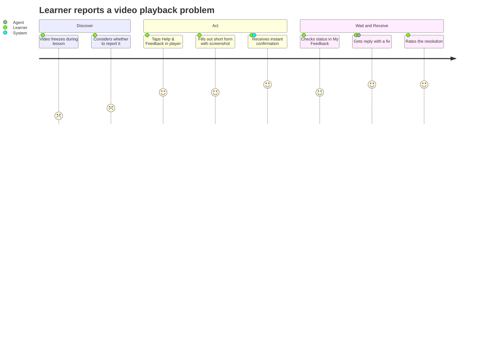
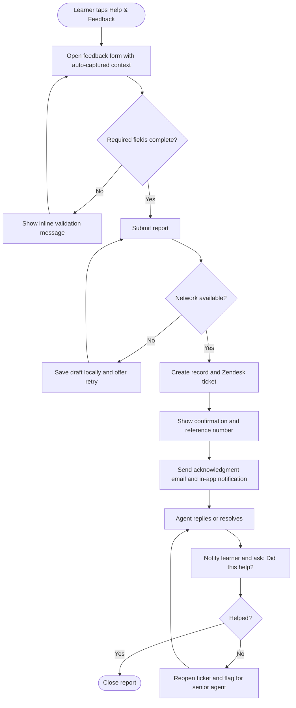

# In-App Feedback Center — Product Requirements Document

> **Sample document.** This is a fictional, fully filled-in example of `PRD_Template.md`. The company ("LearnSphere", an online learning platform), people, and numbers are invented for illustration. It is a mobile/web subscription product, so the tech stack, Zendesk integration, and compliance items in Sections 6–7 are examples, not defaults for your project.

| | |
|---|---|
| **Version** | v1.0 |
| **Author** | Maya Chen, Senior Product Manager |
| **Status** | Approved |
| **Last updated** | 2026-10-15 |
| **Stakeholders** | Product (Maya Chen), Engineering (Daniel Ortiz), Design (Priya Nair), Support Ops (Lena Fischer), Legal (Tom Abara) |

---

## 1. Project Overview

### 1.1 Background and Problem

LearnSphere has ~420,000 monthly active learners, about 85,000 of whom are paying subscribers. Today, a paying learner who hits a problem (a video that won't play, a wrong quiz answer, a billing error) has no way to report it from inside the app. They must leave the app, find the support email in the footer of the website, and describe the issue from memory.

The consequences, from the last quarter's support data:

- Only **~3% of affected learners** ever report an issue; the rest silently churn or complain on social media.
- **61% of support emails** lack the information needed to act on them (no course, no device, no screenshot), so agents spend a first reply just asking for details.
- Median time to first useful response is **38 hours**.
- Feedback arrives through four disconnected channels (email, social media, app-store reviews, a shared form), so Product cannot see which issues are most common.
- Learners who reported issues and received no response in 48 hours churned at **2.4x** the rate of those who got a reply within 24 hours.

### 1.2 Objectives

| ID | Objective | Metric | Target | Data Source |
|----|-----------|--------|--------|-------------|
| OBJ-001 | Make reporting an issue easy | % of learners with an issue who submit feedback | 3% → 15% within 90 days of launch | Product analytics (issue-signal events vs. submissions) |
| OBJ-002 | Make reports actionable | % of reports with enough context for agents to act on without follow-up | 39% → 85% | Support tool tag "needs-info" |
| OBJ-003 | Respond faster | Median time to first useful response | 38 h → 12 h | Support tool timestamps |
| OBJ-004 | Give Product visibility into top issues | Share of feedback captured in one system | ~25% → 90% | Support tool channel report |

### 1.3 Scope

#### 1.3.1 In Scope

- **Feedback entry point**: a persistent "Help & Feedback" button in the app's account menu and on the video player and quiz screens.
- **Feedback form**: issue type, description, optional screenshot (up to 3), and automatic context capture (course, lesson, device, app version).
- **Status tracking**: learners can see their submitted reports and status in a "My Feedback" list.
- **Notifications**: in-app and email notification when a report is acknowledged, updated, or resolved.
- **Satisfaction rating**: one-tap "Did this solve your problem?" on resolved reports.
- **Agent integration**: reports automatically create tickets in the existing support tool (Zendesk) with context attached.

#### 1.3.2 Out of Scope

- **Live chat / chatbot support**: separate initiative planned for Q2 2027.
- **Public roadmap or feature voting**: this release is about problem reports, not feature requests.
- **Feedback from free-tier users**: free users keep using the existing support email until we understand volume impact.
- **Video attachments**: screenshots only, to keep storage cost and moderation effort manageable.
- **Web-app redesign of the help center**: the existing help-center articles are linked, not rebuilt.

### 1.4 Value Proposition

Report a problem in under 30 seconds, without leaving the lesson, and always know what happens next.

---

## 2. User Analysis

### 2.1 User Personas

#### 2.1.1 Primary User

| Attribute | Detail |
|-----------|--------|
| Role | Paying learner ("Sam", 29, studying data analytics after work) |
| Background | Studies 4–5 evenings per week on a phone or laptop, usually in 30–45 minute sessions. Has a certificate deadline tied to a job application. |
| Core goal | Get unblocked quickly so study time isn't wasted. |
| Key pain points | Has to leave the lesson to find a support email; forgets details by the time they write; never knows if anyone read the report. |
| Usage frequency | Hits a problem about once every 2 months; wants to report it in under a minute. |

#### 2.1.2 Secondary User

| Attribute | Detail |
|-----------|--------|
| Role | Front-line support agent ("Jordan", 5 agents on the team) |
| Background | Handles ~60 tickets/day across email, social, and app-store reviews, using Zendesk. |
| Core goal | Resolve tickets on first reply. |
| Key pain points | Most tickets lack the course, device, and app version; screenshots are rare; a lot of time goes to back-and-forth questions. |

### 2.2 User Journey

#### 2.2.1 Main Flow

- **Stage 1 — Discover**: Sam is watching a lesson and the video freezes at the same spot three times.
- **Stage 2 — Evaluate**: Sam decides whether reporting is worth the effort. Today the answer is usually "no."
- **Stage 3 — Act**: Sam taps "Help & Feedback" in the player, picks "Video problem," adds a short note and a screenshot, and submits.
- **Stage 4 — Wait**: Sam sees the report in "My Feedback" with status "Received," and gets an acknowledgment within minutes.
- **Stage 5 — Receive**: Support replies with a workaround or fix; Sam gets a notification and rates whether it helped.

#### 2.2.2 Touchpoints and Pain Points

| Stage | Touchpoint | User Behavior | Core Need | Current Pain Point | Design Opportunity |
|-------|------------|---------------|-----------|--------------------|--------------------|
| Discover | Video player / quiz screen | Hits an error mid-lesson | Keep their place and momentum | No visible way to report | Entry point inside the lesson itself |
| Evaluate | Mental decision | Weighs effort vs. payoff | Confidence it will be read | Past reports vanished | Show response-time promise ("We reply within 24h") |
| Act | Feedback form | Describes the problem | Minimal typing | Has to recall course and device details | Auto-capture context; screenshot upload |
| Wait | My Feedback list | Checks for an update | Reassurance | Silence | Status tracker + acknowledgment notification |
| Receive | Notification / email | Reads the answer | A clear fix | Generic replies | Context-rich replies from agents; "Did this help?" rating |

### 2.3 User Stories

| ID | Role | User Story | Priority | Related Section |
|----|------|------------|----------|-----------------|
| US-001 | Learner | As a learner, I want to report a problem without leaving my lesson, so that I don't lose my place or momentum. | P0 | 3.3.1 |
| US-002 | Learner | As a learner, I want to attach a screenshot, so that support can see exactly what I see. | P0 | 3.3.1 |
| US-003 | Support agent | As a support agent, I want each report to include course, lesson, device, and app version, so that I can resolve it without asking follow-up questions. | P0 | 3.3.2 |
| US-004 | Learner | As a learner, I want to see the status of my reports, so that I know someone is working on it. | P1 | 3.3.3 |
| US-005 | Learner | As a learner, I want to be notified when my report is updated, so that I don't have to keep checking. | P1 | 3.3.4 |
| US-006 | Product manager | As a product manager, I want feedback categorized by issue type and course, so that I can spot the most common problems. | P1 | 3.3.2 |
| US-007 | Learner | As a learner, I want to say whether a resolution helped, so that unresolved problems get another look. | P2 | 3.3.5 |

---

## 3. Detailed Requirements

### 3.1 Business Flow

### 3.2 Feature List (MoSCoW)

| Module | Feature | Description | Priority | Notes |
|--------|---------|-------------|----------|-------|
| Entry | Help & Feedback button | Visible in account menu, video player, and quiz screens | P0 / Must | Must not block playback controls |
| Form | Issue form with categories | Issue type, description, screenshots | P0 / Must | 6 issue types (see 3.3.1) |
| Form | Automatic context capture | Course, lesson, device, OS, app version, plan, timestamp | P0 / Must | Disclosed to the user before submit |
| Integration | Zendesk ticket creation | Create ticket with context and attachments | P0 / Must | Via existing Zendesk API |
| Tracking | My Feedback list | Status per report: Received, In progress, Resolved | P1 / Should | Required before full rollout |
| Notifications | Acknowledgment and update notices | In-app plus email | P1 / Should | Email via existing mail service |
| Offline | Draft saving on network failure | Retry when connection returns | P1 / Should | |
| Rating | "Did this help?" | One tap, with optional comment on "No" | P2 / Could | Ship in v1.1 if time is short |
| Analytics | Internal dashboard of top issues | Counts by type, course, and week | P2 / Could | Can use Zendesk reports initially |
| Channels | Free-tier feedback | Extend to free users | Won't | Revisit after 60 days of data |
| Support | Live chat | Real-time support | Won't | Separate Q2 2027 initiative |

### 3.3 Feature Specifications

#### 3.3.1 Feedback Form

- **Related user stories**: US-001, US-002
- **Priority**: P0 / Must
- **Description**: A bottom sheet (mobile) or modal (web) opened from any "Help & Feedback" entry point. When opened from the player or a quiz, the lesson context is pre-filled and playback is paused.
- **Fields**:
  - *Issue type* (required): Video or audio problem · Quiz or grading error · Course content error · Billing or subscription · App crash or bug · Other
  - *Description* (required): 10–1,000 characters
  - *Screenshots* (optional): up to 3 images, PNG/JPG, max 5 MB each
  - *Reply email* (pre-filled from account, editable)
- **Business rules**:
  - Only paying subscribers see the entry point in v1.
  - A learner may submit at most 10 reports per 24 hours (abuse protection).
  - Reference numbers use the format `FB-YYYYMMDD-NNNN`.
- **Edge cases and errors**:
  - Network failure on submit → draft is saved locally and the user sees "Saved. We'll send it when you're back online."
  - Screenshot over 5 MB → inline error, form content preserved.
  - Session expires mid-form → prompt to sign in again, then restore the draft.
- **UI / design references**: Figma file "Feedback Center v1" (link in project folder).

#### 3.3.2 Context Capture and Routing

- **Related user stories**: US-003, US-006
- **Priority**: P0 / Must
- **Description**: On submit, the client attaches: user ID, plan type, course ID and lesson ID (if applicable), device model, OS version, app version, locale, and timestamp. The backend creates a Zendesk ticket with these as custom fields and tags it by issue type.
- **Business rules**:
  - Billing issues route to the Billing queue; all others route to General Support.
  - Tickets from learners with an active certificate deadline within 7 days get a "priority" tag.
  - A short privacy notice lists what is attached; no data beyond this list is collected.
- **Edge cases and errors**:
  - Zendesk API unavailable → the report is stored in our database and retried up to 5 times over 1 hour; alert Support Ops if it still fails.

#### 3.3.3 My Feedback List

- **Related user story**: US-004
- **Priority**: P1 / Should
- **Description**: A list under Account → My Feedback showing reference number, issue type, date, and status. Tapping a report shows the original text and agent replies.
- **Business rules**: statuses map from Zendesk (New → Received; Open or Pending → In progress; Solved → Resolved). Reports are visible for 12 months.

#### 3.3.4 Notifications

- **Related user story**: US-005
- **Priority**: P1 / Should
- **Description**: Send an acknowledgment (within 5 minutes of submission), an update notice when an agent replies, and a resolution notice. Delivered by in-app notification and email; learners can disable email in settings.

#### 3.3.5 Resolution Rating

- **Related user story**: US-007
- **Priority**: P2 / Could
- **Description**: On resolution, ask "Did this solve your problem?" (Yes / No). "No" reopens the ticket, flags it for a senior agent, and offers an optional comment.

---

## 4. Success Metrics

### 4.1 North Star Metrics

| Metric | Definition | Baseline | Target | Type |
|--------|------------|----------|--------|------|
| Report-to-resolution satisfaction | % of resolved reports rated "Yes, this helped" | n/a (new) | ≥ 80% | Lagging |
| Median time to first useful response | Submission to first agent reply that contains an answer or action | 38 h | ≤ 12 h | Lagging |
| Feedback submission rate | Learners submitting ÷ learners hitting an issue signal (player error, repeated quiz failure, refund page visit) | ~3% | ≥ 15% | Leading |

### 4.2 Supporting Metrics

| Metric | Definition | Baseline | Target | Type |
|--------|------------|----------|--------|------|
| Actionable-report rate | Reports resolved without a "needs-info" follow-up | 39% | ≥ 85% | Leading |
| Form completion rate | Submissions ÷ form opens | n/a | ≥ 70% | Leading |
| Screenshot attach rate | Reports with ≥ 1 screenshot | ~5% | ≥ 35% | Leading |
| 90-day churn of reporters | Churn rate of learners who submitted a report, relative to learners who did not | 2.4x for reports unanswered after 48 h | ≤ 1.0x | Lagging |
| Single-system capture | Share of all feedback arriving in Zendesk with context | ~25% | ≥ 90% | Lagging |

### 4.3 Guardrail Metrics

| Metric | Threshold | Notes |
|--------|-----------|-------|
| Support ticket volume per agent | ≤ 80 tickets/day | Alert if the new channel overwhelms the team; trigger staffing review |
| Video player start time | No regression > 100 ms | Entry point must not slow playback |
| Spam / abusive submissions | < 2% of reports | Rate limit and moderation rules apply |

---

## 5. Acceptance Criteria

### 5.1 Functional Acceptance Criteria

#### 5.1.1 Submit Feedback

**AC-1: Successful submission from the video player**

- **Given**: a paying learner is watching lesson 4 of "Intro to SQL" on iOS app 5.8
- **When**: they tap "Help & Feedback," choose "Video or audio problem," type "Video freezes at 3:42," attach one screenshot, and tap "Submit"
- **Then**: a confirmation shows reference number `FB-YYYYMMDD-NNNN` within 3 seconds, a Zendesk ticket is created containing the course, lesson, device, OS, and app version, and the learner receives an acknowledgment within 5 minutes

**AC-2: Required-field validation**

- **Given**: the feedback form is open
- **When**: the learner taps "Submit" without selecting an issue type
- **Then**: the message "Please choose an issue type" is shown, nothing is submitted, and everything already typed is preserved

**AC-3: Offline submission**

- **Given**: the learner has no network connection
- **When**: they tap "Submit" on a completed form
- **Then**: the report is saved locally with the message "Saved. We'll send it when you're back online," and it is sent automatically within 60 seconds of connectivity returning

**AC-4: Oversized screenshot**

- **Given**: the learner is attaching a screenshot
- **When**: they choose an image larger than 5 MB
- **Then**: the message "Image is too large (max 5 MB)" is shown and no other form data is lost

**AC-5: Rate limit**

- **Given**: a learner has submitted 10 reports in the last 24 hours
- **When**: they try to submit an 11th
- **Then**: the message "You've reached today's limit. Please try again tomorrow or email support." is shown and no ticket is created

#### 5.1.2 Track and Receive Updates

**AC-6: Status visible to the learner**

- **Given**: the learner has a report whose Zendesk ticket status is "Open"
- **When**: they open Account → My Feedback
- **Then**: the report appears with status "In progress," and opening it shows the original text and any agent replies

**AC-7: Resolution rating reopens a ticket**

- **Given**: a report has been marked Resolved and the learner sees "Did this solve your problem?"
- **When**: they tap "No"
- **Then**: the ticket status returns to Open, it is tagged "reopened," it appears in the senior-agent queue, and the learner sees "Thanks, we're taking another look."

### 5.2 Non-Functional Acceptance Criteria

| Category | Requirement | How to Verify |
|----------|-------------|---------------|
| Performance | Form opens in < 500 ms; submit completes in < 3 s at p95 on 4G | Load and device-lab tests |
| Availability | Feedback API 99.9% monthly; Zendesk outages never lose a report | Monitoring; failure-injection test |
| Accessibility | WCAG 2.1 AA; fully usable with VoiceOver and TalkBack | Accessibility audit |
| Compatibility | iOS 16+, Android 10+, latest 2 versions of Chrome, Safari, Firefox, Edge | Test matrix |
| Localization | English at launch; all strings externalized for later translation | Code review |

---

## 6. Technical Constraints

### 6.1 Tech Stack

| Category | Technology | Notes |
|----------|------------|-------|
| Mobile | React Native 0.76 | Shared feedback module for iOS and Android |
| Web | React 18 + TypeScript | Reuses the same form component library |
| Backend | Node.js (NestJS) | New `feedback-service` microservice |
| Database | PostgreSQL 15 | Stores reports, attachments metadata, and retry queue |
| File storage | AWS S3 | Private bucket, signed URLs, 12-month lifecycle |
| Queue | AWS SQS | Retry for Zendesk calls |

### 6.2 Integrations and Dependencies

| System / Service | Integration Method | Purpose | Owner |
|------------------|--------------------|---------|-------|
| Zendesk | REST API + webhooks | Ticket creation, status sync | Support Ops (Lena Fischer) |
| SendGrid | API | Acknowledgment and update emails | Platform team |
| Analytics (Amplitude) | SDK events | Funnel and issue-signal tracking | Data team |
| Auth service | Internal API | Plan type and identity | Identity team |

### 6.3 Security and Compliance

- All requests authenticated with the learner's session token; attachments are uploaded via short-lived signed URLs.
- Screenshots are stored encrypted at rest (AES-256) and are accessible only to support staff via audited access.
- Context data collected is limited to the list in 3.3.2 and disclosed before submit.
- Reports and attachments are retained for 12 months, then deleted. Deletion requests (GDPR/CCPA) must remove reports within 30 days.

### 6.4 Assumptions, Dependencies, and Risks

| Type | Description | Impact | Mitigation |
|------|-------------|--------|------------|
| Assumption | Learners will attach screenshots if it takes one tap | Low attach rate would limit the actionable-report goal | A/B test prompt wording in week 2 |
| Dependency | Zendesk custom fields must be created by Support Ops before QA | Blocks integration testing | Fields requested by Nov 6 |
| Risk | Ticket volume rises sharply after launch | Higher response times, agent burnout | Phased rollout (10% → 50% → 100%); temporary contractor coverage |
| Risk | Screenshots contain personal information | Privacy exposure | Privacy notice; restricted, audited access; auto-deletion at 12 months |

---

## 7. Cross-Functional Review

### 7.1 Technical Feasibility

| Item | Assessment | Risk Level |
|------|------------|------------|
| Technical difficulty | Moderate. Shared RN module plus one new service; Zendesk integration is well understood. | Medium |
| Estimated effort | 3 engineers × 7 weeks (2 mobile/web, 1 backend), plus 1 week QA | — |
| Technical risks | Zendesk rate limits during spikes; attachment upload reliability on poor networks | Medium |
| Mitigation plan | Queue with retries and backoff; resumable uploads; load test at 3x expected volume | — |

### 7.2 Operational Impact

| Item | Assessment | Notes |
|------|------------|-------|
| Operating cost | ~$1,800/month (storage, email, Zendesk seats) | Within approved budget |
| Staffing needs | +1 agent expected once volume reaches 8% submission rate | Review at day 60 |
| Launch plan | Internal dogfood (week 6) → 10% (week 7) → 50% (week 8) → 100% (week 9) | Rollback via feature flag |
| Impact on existing processes | Email-only support remains available; macros updated for new ticket fields | Training session for agents before launch |

### 7.3 Business Value

| Item | Assessment | Notes |
|------|------------|-------|
| ROI | Reducing churn of reporters from 2.4x to baseline retains an estimated 1,100 subscribers/year (~$190K ARR, at ~$173 average annual plan) against ~$22K/year run cost (~$1,800/month) plus build | Break-even ≈ month 9 |
| Competitive comparison | Two main competitors offer in-app reporting; neither shows status tracking | Status tracking is a differentiator |
| User value | Faster resolution, less frustration, visible responsiveness | Supports retention and review ratings |

### 7.4 Legal and Compliance

| Item | Assessment | Notes |
|------|------------|-------|
| Data compliance | Device and account context is personal data under GDPR; lawful basis is legitimate interest for support | DPA with Zendesk already in place |
| Privacy policy | Update to describe feedback data and 12-month retention | Legal to publish before launch |
| Terms of service | No change required | — |
| Other regulatory concerns | Accessibility obligations (EU Accessibility Act) are covered by WCAG 2.1 AA requirement | — |

### 7.5 Review Sign-off

| Reviewer | Role | Decision | Date | Comments |
|----------|------|----------|------|----------|
| Daniel Ortiz | Engineering | Approved | 2026-10-09 | Needs Zendesk custom fields by Nov 6 |
| Lena Fischer | Operations | Approved | 2026-10-10 | Wants staffing review at day 60 |
| Aisha Rahman | Business | Approved | 2026-10-12 | Confirm ARR assumptions after pilot |
| Tom Abara | Legal | Approved with changes | 2026-10-14 | Privacy policy update must ship with launch |

---

## 8. Appendix

### 8.1 Open Questions

| # | Question | Owner | Due Date | Resolution |
|---|----------|-------|----------|------------|
| 1 | Should free-tier users get access in v1.1? | Maya Chen | 2026-12-15 | Open; decide after 60 days of data |
| 2 | Can we auto-redact obvious personal data in screenshots? | Daniel Ortiz | 2026-11-20 | Open; spike scheduled |
| 3 | Final wording of the response-time promise ("within 24h") | Lena Fischer | 2026-10-30 | Resolved: "We usually reply within 24 hours" |

### 8.2 Glossary

| Term | Definition |
|------|------------|
| Actionable report | A report an agent can resolve without asking the learner for more information |
| Issue signal | An in-product event that suggests a learner has a problem (player error, repeated quiz failure, refund page visit) |
| Leading metric | An early indicator that predicts the final outcome |
| Lagging metric | A measure of the final outcome, available only after some delay |
| MoSCoW | Prioritization method: Must, Should, Could, Won't |
| Needs-info | Zendesk tag applied when an agent must ask the learner for missing details |

### 8.3 References

- Q3 2026 Support Operations report (internal)
- Churn analysis: "Unanswered reports vs. retention," Data team, Sept 2026
- Figma: "Feedback Center v1"
- Competitor review: in-app support experiences, Aug 2026

### 8.4 Change Log

| Version | Date | Author | Changes |
|---------|------|--------|---------|
| v0.9 | 2026-09-22 | Maya Chen | Initial draft |
| v0.95 | 2026-10-08 | Maya Chen | Added rate limit, offline handling, and metrics baselines |
| v1.0 | 2026-10-15 | Maya Chen | Incorporated review feedback; approved |
