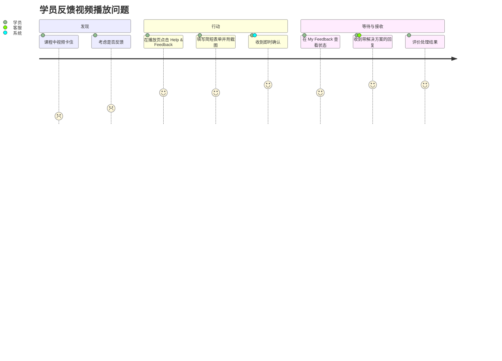
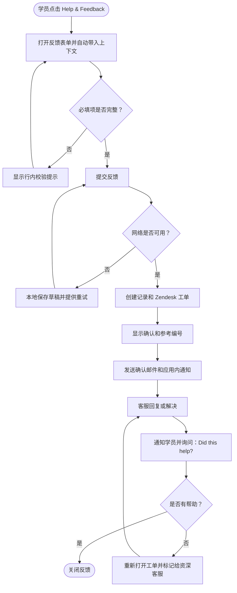

# 应用内反馈中心 — 产品需求文档（PRD）

> **示例文档。**这是 `PRD_Template_zh.md` 的一份虚构、完整填写的示例。公司（"LearnSphere"，一个在线学习平台）、人物和数字均为虚构，仅用于说明。这是一款移动端 / 网页端订阅产品，因此第 6–7 章的技术栈、Zendesk 集成和合规事项只是示例，不是你项目的默认选项。产品界面文案（引号内的英文，如 "Please choose an issue type"）保持英文原样，因为该产品首发仅支持英文。

| | |
|---|---|
| **版本** | v1.0 |
| **作者** | Maya Chen，高级产品经理 |
| **状态** | 已批准 |
| **最后更新** | 2026-10-15 |
| **相关方** | 产品（Maya Chen）、研发（Daniel Ortiz）、设计（Priya Nair）、客服运营（Lena Fischer）、法务（Tom Abara） |

---

## 1. 项目概述

### 1.1 背景与问题

LearnSphere 月活学员约 42 万，其中约 8.5 万为付费订阅用户。目前，付费学员遇到问题（视频无法播放、测验答案有误、账单错误）时，无法在应用内反馈。他们必须离开应用，在网站页脚找到客服邮箱，再凭记忆描述问题。

根据上季度客服数据，后果如下：

- 只有**约 3% 的受影响学员**会反馈问题；其余人要么默默流失，要么在社交媒体上抱怨。
- **61% 的客服邮件**缺少处理所需的信息（没有课程、没有设备、没有截图），客服第一次回复往往只是追问细节。
- 首次有效回复的中位时间为 **38 小时**。
- 反馈通过四个互不相通的渠道到达（邮件、社交媒体、应用商店评价、一个共享表单），产品团队无法看出哪些问题最常见。
- 反馈后 48 小时内没有收到回复的学员，流失率是 24 小时内得到回复学员的 **2.4 倍**。

### 1.2 项目目标

| 编号 | 目标 | 指标 | 目标值 | 数据来源 |
|----|-----------|--------|--------|-------------|
| OBJ-001 | 让反馈问题变得容易 | 遇到问题的学员中提交反馈的比例 | 上线后 90 天内 3% → 15% | 产品分析（问题信号事件 vs. 提交数） |
| OBJ-002 | 让反馈可处理 | 客服无需追问即可处理的反馈占比 | 39% → 85% | 客服系统标签 "needs-info" |
| OBJ-003 | 更快响应 | 首次有效回复的中位时间 | 38 小时 → 12 小时 | 客服系统时间戳 |
| OBJ-004 | 让产品团队看清主要问题 | 汇集在同一系统中的反馈占比 | 约 25% → 90% | 客服系统渠道报表 |

### 1.3 范围

#### 1.3.1 范围内

- **反馈入口**：应用账户菜单、视频播放页和测验页中常驻的 "Help & Feedback" 按钮。
- **反馈表单**：问题类型、描述、可选截图（最多 3 张），以及自动采集的上下文（课程、课时、设备、应用版本）。
- **状态跟踪**：学员可在 "My Feedback" 列表中查看已提交的反馈及其状态。
- **通知**：反馈被确认、更新或解决时，发送应用内和邮件通知。
- **满意度评价**：对已解决的反馈，提供一键 "Did this solve your problem?"。
- **客服集成**：反馈自动在现有客服系统（Zendesk）中创建工单，并附带上下文。

#### 1.3.2 范围外

- **在线聊天 / 聊天机器人客服**：另一项举措，计划于 2027 年第二季度。
- **公开路线图或功能投票**：本次发布针对问题反馈，而不是功能建议。
- **免费用户的反馈**：免费用户继续使用现有客服邮箱，直到我们了解其对量级的影响。
- **视频附件**：仅支持截图，以控制存储成本和审核工作量。
- **帮助中心的网页端改版**：现有帮助中心文章只做链接，不重建。

### 1.4 价值主张

不离开课程，30 秒内反馈问题，并随时知道后续进展。

---

## 2. 用户分析

### 2.1 用户画像

#### 2.1.1 主要用户

| 属性 | 详情 |
|-----------|--------|
| 角色 | 付费学员（"Sam"，29 岁，下班后学习数据分析） |
| 背景 | 每周有 4–5 个晚上学习，使用手机或笔记本电脑，每次通常 30–45 分钟。有一个与求职申请相关的证书截止日期。 |
| 核心目标 | 尽快解决阻碍，不浪费学习时间。 |
| 主要痛点 | 必须离开课程才能找到客服邮箱；写邮件时已经忘了细节；不知道有没有人看过自己的反馈。 |
| 使用频率 | 大约每 2 个月遇到一次问题；希望一分钟内完成反馈。 |

#### 2.1.2 次要用户

| 属性 | 详情 |
|-----------|--------|
| 角色 | 一线客服（"Jordan"，团队共 5 名客服） |
| 背景 | 使用 Zendesk，每天处理约 60 张工单，来源包括邮件、社交媒体和应用商店评价。 |
| 核心目标 | 首次回复即解决工单。 |
| 主要痛点 | 大多数工单缺少课程、设备和应用版本；很少有截图；大量时间花在来回追问上。 |

### 2.2 用户旅程

#### 2.2.1 主流程

- **阶段 1 — 发现**：Sam 在看一节课，视频在同一位置卡住了三次。
- **阶段 2 — 评估**：Sam 判断是否值得反馈。目前答案通常是"不值得"。
- **阶段 3 — 行动**：Sam 在播放页点击 "Help & Feedback"，选择 "Video problem"，补充一句说明并附上截图，然后提交。
- **阶段 4 — 等待**：Sam 在 "My Feedback" 中看到状态为 "Received" 的反馈，并在几分钟内收到确认。
- **阶段 5 — 接收**：客服回复了变通办法或修复方案；Sam 收到通知，并评价是否有帮助。

#### 2.2.2 触点与痛点

| 阶段 | 触点 | 用户行为 | 核心需求 | 当前痛点 | 设计机会 |
|-------|------------|---------------|-----------|--------------------|--------------------|
| 发现 | 视频播放页 / 测验页 | 在学习中途遇到错误 | 保持进度和学习节奏 | 没有可见的反馈方式 | 把入口放在课程内部 |
| 评估 | 心理决策 | 权衡投入与回报 | 确信会被看到 | 以往的反馈石沉大海 | 展示响应承诺（"We reply within 24h"） |
| 行动 | 反馈表单 | 描述问题 | 尽量少打字 | 需要回忆课程和设备信息 | 自动采集上下文；支持上传截图 |
| 等待 | My Feedback 列表 | 查看是否有更新 | 获得安心感 | 没有任何消息 | 状态跟踪 + 确认通知 |
| 接收 | 通知 / 邮件 | 阅读回复 | 明确的解决办法 | 回复千篇一律 | 带上下文的客服回复；"Did this help?" 评价 |

### 2.3 用户故事

| 编号 | 角色 | 用户故事 | 优先级 | 关联章节 |
|----|------|------------|----------|-----------------|
| US-001 | 学员 | 作为学员，我希望不离开课程就能反馈问题，以便不丢失学习进度和节奏。 | P0 | 3.3.1 |
| US-002 | 学员 | 作为学员，我希望附上截图，以便客服能准确看到我所看到的内容。 | P0 | 3.3.1 |
| US-003 | 客服 | 作为客服，我希望每条反馈都包含课程、课时、设备和应用版本，以便无需追问就能解决。 | P0 | 3.3.2 |
| US-004 | 学员 | 作为学员，我希望看到反馈的处理状态，以便知道有人在跟进。 | P1 | 3.3.3 |
| US-005 | 学员 | 作为学员，我希望反馈有更新时收到通知，以便不用反复查看。 | P1 | 3.3.4 |
| US-006 | 产品经理 | 作为产品经理，我希望反馈按问题类型和课程分类，以便发现最常见的问题。 | P1 | 3.3.2 |
| US-007 | 学员 | 作为学员，我希望说明处理结果是否有帮助，以便未解决的问题得到再次关注。 | P2 | 3.3.5 |

---

## 3. 详细需求

### 3.1 业务流程

### 3.2 功能清单（MoSCoW）

| 模块 | 功能 | 描述 | 优先级 | 备注 |
|--------|---------|-------------|----------|-------|
| 入口 | Help & Feedback 按钮 | 显示在账户菜单、视频播放页和测验页 | P0 / Must | 不得遮挡播放控件 |
| 表单 | 带分类的问题表单 | 问题类型、描述、截图 | P0 / Must | 6 种问题类型（见 3.3.1） |
| 表单 | 自动采集上下文 | 课程、课时、设备、系统、应用版本、套餐、时间戳 | P0 / Must | 提交前向用户披露 |
| 集成 | 创建 Zendesk 工单 | 创建带上下文和附件的工单 | P0 / Must | 通过现有 Zendesk API |
| 跟踪 | My Feedback 列表 | 每条反馈的状态：Received、In progress、Resolved | P1 / Should | 全量发布前必须完成 |
| 通知 | 确认和更新通知 | 应用内 + 邮件 | P1 / Should | 邮件通过现有邮件服务 |
| 离线 | 网络故障时保存草稿 | 网络恢复后重试 | P1 / Should | |
| 评价 | "Did this help?" | 一键评价，选 "No" 时可补充评论 | P2 / Could | 时间紧张可在 v1.1 上线 |
| 分析 | 内部热点问题看板 | 按类型、课程和周统计 | P2 / Could | 初期可使用 Zendesk 报表 |
| 渠道 | 免费用户反馈 | 向免费用户开放 | Won't | 积累 60 天数据后再评估 |
| 客服 | 在线聊天 | 实时客服 | Won't | 2027 年第二季度的独立项目 |

### 3.3 功能说明

#### 3.3.1 反馈表单

- **关联用户故事**：US-001、US-002
- **优先级**：P0 / Must
- **描述**：从任意 "Help & Feedback" 入口打开的底部弹层（移动端）或模态框（网页端）。从播放页或测验页打开时，课程上下文会预先填好，并暂停播放。
- **字段**：
  - *问题类型*（必填）：Video or audio problem · Quiz or grading error · Course content error · Billing or subscription · App crash or bug · Other
  - *描述*（必填）：10–1,000 个字符
  - *截图*（选填）：最多 3 张图片，PNG/JPG，每张最大 5 MB
  - *回复邮箱*（从账户预填，可编辑）
- **业务规则**：
  - v1 中只有付费订阅用户能看到入口。
  - 每位学员 24 小时内最多提交 10 条反馈（防滥用）。
  - 参考编号格式为 `FB-YYYYMMDD-NNNN`。
- **边界情况与错误**：
  - 提交时网络故障 → 草稿保存在本地，用户看到 "Saved. We'll send it when you're back online."
  - 截图超过 5 MB → 显示行内错误，表单内容保留。
  - 填写过程中会话过期 → 提示重新登录，然后恢复草稿。
- **UI / 设计参考**：Figma 文件 "Feedback Center v1"（链接在项目文件夹中）。

#### 3.3.2 上下文采集与分派

- **关联用户故事**：US-003、US-006
- **优先级**：P0 / Must
- **描述**：提交时，客户端附带：用户 ID、套餐类型、课程 ID 和课时 ID（如适用）、设备型号、系统版本、应用版本、语言区域和时间戳。后端创建 Zendesk 工单，把这些信息写入自定义字段，并按问题类型打标签。
- **业务规则**：
  - 账单类问题分派到 Billing 队列；其余分派到通用客服队列。
  - 证书截止日在 7 天内的学员，其工单会打上 "priority" 标签。
  - 一段简短的隐私说明列出会附带哪些信息；不会收集此清单之外的数据。
- **边界情况与错误**：
  - Zendesk API 不可用 → 反馈存入我们的数据库，并在 1 小时内最多重试 5 次；若仍失败，则向客服运营告警。

#### 3.3.3 My Feedback 列表

- **关联用户故事**：US-004
- **优先级**：P1 / Should
- **描述**：位于 Account → My Feedback 的列表，显示参考编号、问题类型、日期和状态。点击一条反馈可查看原始文字和客服回复。
- **业务规则**：状态与 Zendesk 的映射为（New → Received；Open 或 Pending → In progress；Solved → Resolved）。反馈保留可见 12 个月。

#### 3.3.4 通知

- **关联用户故事**：US-005
- **优先级**：P1 / Should
- **描述**：发送确认通知（提交后 5 分钟内）、客服回复时的更新通知，以及解决通知。通过应用内通知和邮件发送；学员可在设置中关闭邮件。

#### 3.3.5 处理结果评价

- **关联用户故事**：US-007
- **优先级**：P2 / Could
- **描述**：问题解决后，询问 "Did this solve your problem?"（Yes / No）。选 "No" 会重新打开工单，标记给资深客服，并提供可选的评论框。

---

## 4. 成功指标

### 4.1 北极星指标

| 指标 | 定义 | 基线 | 目标值 | 类型 |
|--------|------------|----------|--------|------|
| 反馈到解决的满意度 | 已解决反馈中评价为 "Yes, this helped" 的占比 | 无（新功能） | ≥ 80% | 滞后 |
| 首次有效回复的中位时间 | 从提交到首次包含答案或行动的客服回复 | 38 小时 | ≤ 12 小时 | 滞后 |
| 反馈提交率 | 提交反馈的学员 ÷ 触发问题信号的学员（播放错误、测验反复失败、访问退款页） | 约 3% | ≥ 15% | 领先 |

### 4.2 支撑指标

| 指标 | 定义 | 基线 | 目标值 | 类型 |
|--------|------------|----------|--------|------|
| 可处理反馈率 | 无需 "needs-info" 追问就已解决的反馈占比 | 39% | ≥ 85% | 领先 |
| 表单完成率 | 提交数 ÷ 表单打开数 | 无 | ≥ 70% | 领先 |
| 截图附带率 | 至少带 1 张截图的反馈占比 | 约 5% | ≥ 35% | 领先 |
| 反馈用户 90 天流失率 | 提交过反馈的学员的流失率，相对未反馈学员 | 48 小时后仍未回复的反馈为 2.4 倍 | ≤ 1.0 倍 | 滞后 |
| 单一系统汇集率 | 带上下文进入 Zendesk 的反馈占全部反馈的比例 | 约 25% | ≥ 90% | 滞后 |

### 4.3 护栏指标

| 指标 | 阈值 | 备注 |
|--------|-----------|-------|
| 每位客服每日工单量 | ≤ 80 张 / 天 | 如果新渠道压垮团队则告警，并触发人力评估 |
| 视频播放启动时间 | 回退不超过 100 ms | 入口不得拖慢播放 |
| 垃圾 / 滥用提交 | < 2% 的反馈 | 适用频率限制和审核规则 |

---

## 5. 验收标准

### 5.1 功能验收标准

#### 5.1.1 提交反馈

**AC-1：从视频播放页成功提交**

- **Given**：一位付费学员在 iOS 应用 5.8 中观看 "Intro to SQL" 的第 4 课
- **When**：他们点击 "Help & Feedback"，选择 "Video or audio problem"，输入 "Video freezes at 3:42"，附上一张截图，然后点击 "Submit"
- **Then**：3 秒内显示参考编号 `FB-YYYYMMDD-NNNN`；创建一张包含课程、课时、设备、系统和应用版本的 Zendesk 工单；学员在 5 分钟内收到确认

**AC-2：必填项校验**

- **Given**：反馈表单已打开
- **When**：学员未选择问题类型就点击 "Submit"
- **Then**：显示 "Please choose an issue type"，不提交任何内容，且已输入的所有内容均被保留

**AC-3：离线提交**

- **Given**：学员没有网络连接
- **When**：他们在填写完整的表单上点击 "Submit"
- **Then**：反馈保存在本地并显示 "Saved. We'll send it when you're back online."，网络恢复后 60 秒内自动发送

**AC-4：截图过大**

- **Given**：学员正在添加截图
- **When**：他们选择了一张超过 5 MB 的图片
- **Then**：显示 "Image is too large (max 5 MB)"，且不丢失其他表单数据

**AC-5：频率限制**

- **Given**：学员在过去 24 小时内已提交 10 条反馈
- **When**：他们尝试提交第 11 条
- **Then**：显示 "You've reached today's limit. Please try again tomorrow or email support."，且不创建工单

#### 5.1.2 跟踪与接收更新

**AC-6：学员可见状态**

- **Given**：学员有一条反馈，其 Zendesk 工单状态为 "Open"
- **When**：他们打开 Account → My Feedback
- **Then**：该反馈显示状态 "In progress"，打开后可看到原始文字和所有客服回复

**AC-7：评价后重新打开工单**

- **Given**：一条反馈已被标记为 Resolved，学员看到 "Did this solve your problem?"
- **When**：他们点击 "No"
- **Then**：工单状态回到 Open，被打上 "reopened" 标签，出现在资深客服队列中，学员看到 "Thanks, we're taking another look."

### 5.2 非功能验收标准

| 类别 | 要求 | 验证方式 |
|----------|-------------|---------------|
| 性能 | 表单打开 < 500 ms；4G 网络下提交在 p95 < 3 秒内完成 | 压力测试和真机实验室测试 |
| 可用性 | 反馈 API 月度 99.9%；Zendesk 故障不丢失任何反馈 | 监控；故障注入测试 |
| 无障碍 | WCAG 2.1 AA；可完全通过 VoiceOver 和 TalkBack 使用 | 无障碍审计 |
| 兼容性 | iOS 16+、Android 10+、Chrome / Safari / Firefox / Edge 最近 2 个版本 | 测试矩阵 |
| 本地化 | 首发英文；所有字符串外置，便于后续翻译 | 代码评审 |

---

## 6. 技术约束

### 6.1 技术栈

| 类别 | 技术 | 备注 |
|----------|------------|-------|
| 移动端 | React Native 0.76 | iOS 与 Android 共用的反馈模块 |
| 网页端 | React 18 + TypeScript | 复用同一套表单组件库 |
| 后端 | Node.js（NestJS） | 新建 `feedback-service` 微服务 |
| 数据库 | PostgreSQL 15 | 存储反馈、附件元数据和重试队列 |
| 文件存储 | AWS S3 | 私有桶、签名 URL、12 个月生命周期 |
| 队列 | AWS SQS | 用于 Zendesk 调用的重试 |

### 6.2 集成与依赖

| 系统 / 服务 | 集成方式 | 用途 | 负责人 |
|------------------|--------------------|---------|-------|
| Zendesk | REST API + webhook | 创建工单、同步状态 | 客服运营（Lena Fischer） |
| SendGrid | API | 确认和更新邮件 | 平台团队 |
| 分析（Amplitude） | SDK 事件 | 漏斗和问题信号追踪 | 数据团队 |
| 认证服务 | 内部 API | 套餐类型和身份 | 身份团队 |

### 6.3 安全与合规

- 所有请求均使用学员的会话令牌认证；附件通过短时效签名 URL 上传。
- 截图静态加密存储（AES-256），仅客服人员可通过受审计的访问方式查看。
- 采集的上下文数据仅限于 3.3.2 中的清单，并在提交前披露。
- 反馈和附件保留 12 个月后删除。删除请求（GDPR/CCPA）必须在 30 天内完成对反馈的删除。

### 6.4 假设、依赖与风险

| 类型 | 描述 | 影响 | 应对措施 |
|------|-------------|--------|------------|
| 假设 | 如果只需一键，学员就会附带截图 | 附带率低会限制"可处理反馈"目标 | 第 2 周对提示文案做 A/B 测试 |
| 依赖 | Zendesk 自定义字段须由客服运营在 QA 前创建 | 阻塞集成测试 | 11 月 6 日前提出需求 |
| 风险 | 上线后工单量急剧上升 | 响应时间变长，客服倦怠 | 分阶段发布（10% → 50% → 100%）；临时外包人力 |
| 风险 | 截图含有个人信息 | 隐私暴露 | 隐私说明；受限且审计的访问；12 个月后自动删除 |

---

## 7. 跨职能评审

### 7.1 技术可行性

| 事项 | 评估 | 风险等级 |
|------|------------|------------|
| 技术难度 | 中等。共用 RN 模块加一个新服务；Zendesk 集成已有成熟经验。 | 中 |
| 预估工作量 | 3 名工程师 × 7 周（2 名移动端 / 网页端，1 名后端），外加 1 周 QA | — |
| 技术风险 | 流量高峰时 Zendesk 的频率限制；弱网下附件上传的可靠性 | 中 |
| 缓解方案 | 带重试和退避的队列；可续传上传；以预期量的 3 倍做压测 | — |

### 7.2 运营影响

| 事项 | 评估 | 备注 |
|------|------------|-------|
| 运营成本 | 约 1,800 美元 / 月（存储、邮件、Zendesk 席位） | 在已批准预算内 |
| 人力需求 | 当提交率达到 8% 时，预计需增加 1 名客服 | 第 60 天评估 |
| 上线计划 | 内部试用（第 6 周）→ 10%（第 7 周）→ 50%（第 8 周）→ 100%（第 9 周） | 通过功能开关回滚 |
| 对现有流程的影响 | 仅邮件的客服方式仍可使用；更新新工单字段对应的话术宏 | 上线前为客服做培训 |

### 7.3 商业价值

| 事项 | 评估 | 备注 |
|------|------------|-------|
| ROI | 把反馈用户的流失率从 2.4 倍降至基线，预计每年留住 1,100 名订阅用户（约 19 万美元 ARR，按人均年费约 173 美元计），而年运行成本约 2.2 万美元（约 1,800 美元 / 月），另有开发成本 | 约第 9 个月回本 |
| 竞品对比 | 两家主要竞品提供应用内反馈；均无状态跟踪 | 状态跟踪是差异化亮点 |
| 用户价值 | 更快解决、更少沮丧、可见的响应 | 有助于留存和评分 |

### 7.4 法务与合规

| 事项 | 评估 | 备注 |
|------|------------|-------|
| 数据合规 | 设备和账户上下文属于 GDPR 下的个人数据；客服场景的合法依据为合法利益 | 与 Zendesk 的 DPA 已签署 |
| 隐私政策 | 更新以说明反馈数据和 12 个月的留存 | 法务需在上线前发布 |
| 服务条款 | 无需修改 | — |
| 其他监管事项 | 无障碍义务（欧盟无障碍法案）由 WCAG 2.1 AA 要求覆盖 | — |

### 7.5 评审签字

| 评审人 | 角色 | 结论 | 日期 | 意见 |
|----------|------|----------|------|----------|
| Daniel Ortiz | 研发 | 通过 | 2026-10-09 | 需要 11 月 6 日前提供 Zendesk 自定义字段 |
| Lena Fischer | 运营 | 通过 | 2026-10-10 | 希望在第 60 天评估人力 |
| Aisha Rahman | 业务 | 通过 | 2026-10-12 | 试点后确认 ARR 假设 |
| Tom Abara | 法务 | 修改后通过 | 2026-10-14 | 隐私政策更新必须随上线一起发布 |

---

## 8. 附录

### 8.1 待决问题

| # | 问题 | 负责人 | 截止日期 | 结论 |
|---|----------|-------|----------|------------|
| 1 | v1.1 是否向免费用户开放？ | Maya Chen | 2026-12-15 | 未决；积累 60 天数据后决定 |
| 2 | 能否对截图中明显的个人数据做自动遮盖？ | Daniel Ortiz | 2026-11-20 | 未决；已安排技术预研 |
| 3 | 响应时间承诺（"within 24h"）的最终措辞 | Lena Fischer | 2026-10-30 | 已解决："We usually reply within 24 hours" |

### 8.2 术语表

| 术语 | 定义 |
|------|------------|
| 可处理反馈（Actionable report） | 客服无需向学员追问更多信息即可解决的反馈 |
| 问题信号（Issue signal） | 提示学员可能遇到问题的产品内事件（播放错误、测验反复失败、访问退款页） |
| 领先指标（Leading metric） | 能预示最终结果的早期指标 |
| 滞后指标（Lagging metric） | 衡量最终结果、需要延迟一段时间才能得到的指标 |
| MoSCoW | 优先级方法：Must、Should、Could、Won't |
| Needs-info | 客服必须向学员追问缺失信息时，在 Zendesk 中打上的标签 |

### 8.3 参考资料

- 2026 年第三季度客服运营报告（内部）
- 流失分析："未回复的反馈 vs. 留存"，数据团队，2026 年 9 月
- Figma："Feedback Center v1"
- 竞品调研：应用内客服体验，2026 年 8 月

### 8.4 变更记录

| 版本 | 日期 | 作者 | 变更内容 |
|---------|------|--------|---------|
| v0.9 | 2026-09-22 | Maya Chen | 初稿 |
| v0.95 | 2026-10-08 | Maya Chen | 增加频率限制、离线处理和指标基线 |
| v1.0 | 2026-10-15 | Maya Chen | 纳入评审意见；已批准 |
