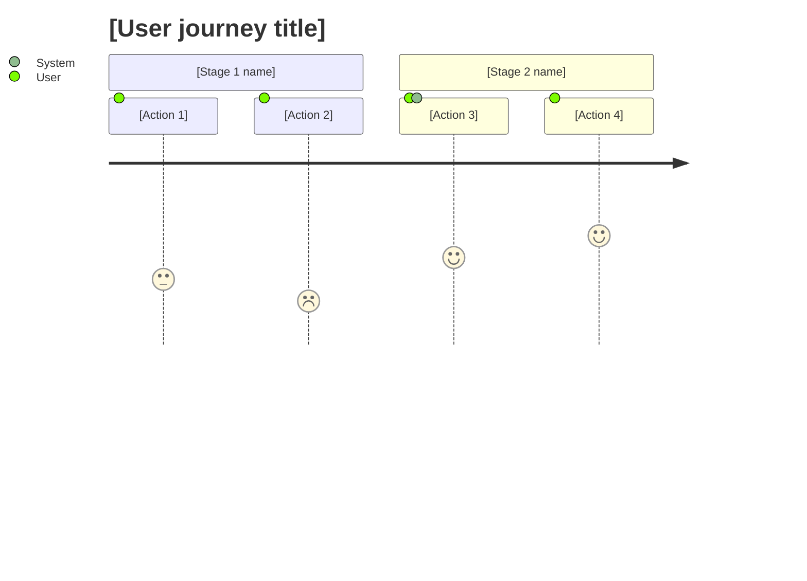
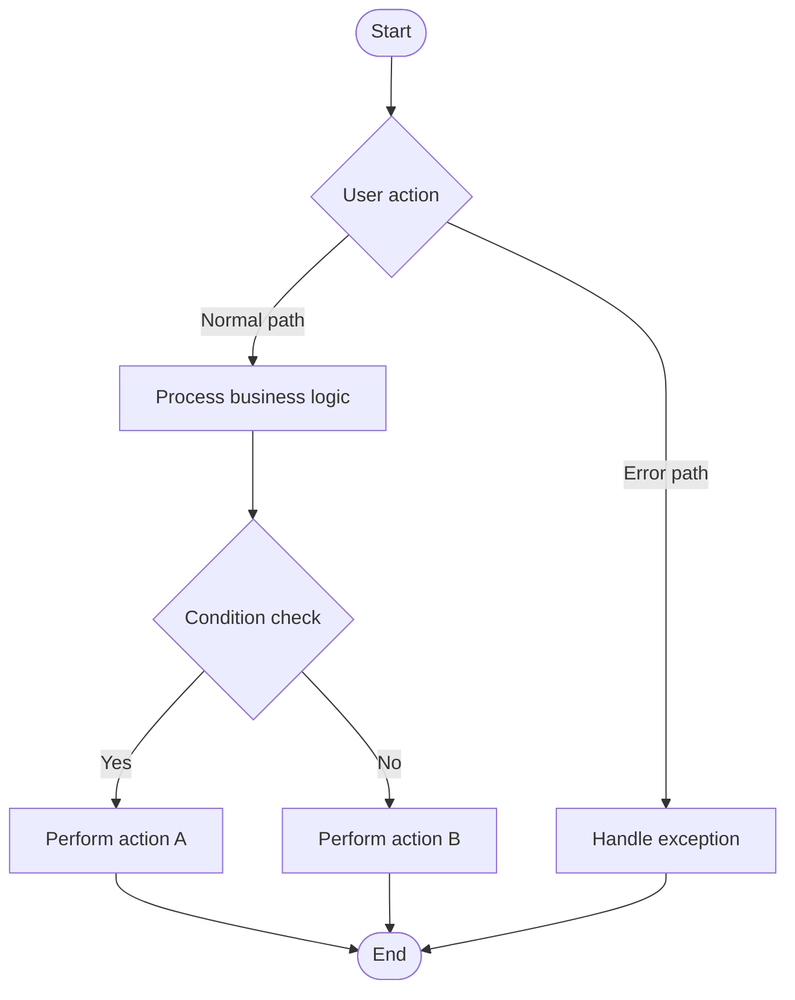

# [Project Name] — Product Requirements Document

| | |
|---|---|
| **Version** | v0.9 (Draft) |
| **Author** | [Name] |
| **Status** | Draft / In Review / Approved |
| **Last updated** | [YYYY-MM-DD] |
| **Stakeholders** | [Product, Engineering, Design, Ops, Legal, ...] |

> **How to use this template**
> - Replace everything in `[brackets]`. Delete guidance lines (blockquotes) once a section is filled in.
> - Priorities use MoSCoW, mapped to P-levels: **Must = P0, Should = P1, Could = P2, Won't = no P-level**. Use the P-level in user stories and write "P0 / Must" in the feature list.
> - Acceptance criteria use Given / When / Then.
> - Metrics are split into **Leading** (early signals) and **Lagging** (outcome results).
> - Chapter 7 (Cross-Functional Review) is optional; skip it for quick, MVP-style PRDs.
> - Section 3 states the rules; Section 5 states how each rule is tested. Don't repeat rules in both.
> - Diagrams use Mermaid, which renders in GitHub, Notion, Obsidian, and most modern Markdown tools.

---

## 1. Project Overview

> Goal: a reader should understand in 5 minutes what this is, why we're building it, and what "success" means.

### 1.1 Background and Problem

[Describe the main pain point: **who** is affected, **in what situation**, and **what problem** they run into.]
[Support with data: how severe is the problem and how many users does it affect?]

### 1.2 Objectives

> Define 3–5 SMART objectives, each with a measurable target.

| ID | Objective | Metric | Target | Data Source |
|----|-----------|--------|--------|-------------|
| OBJ-001 | [Objective 1] | [Metric name] | [Target value] | [Where the data comes from] |
| OBJ-002 | [Objective 2] | [Metric name] | [Target value] | [Where the data comes from] |
| OBJ-003 | [Objective 3] | [Metric name] | [Target value] | [Where the data comes from] |

### 1.3 Scope

#### 1.3.1 In Scope

- **[Module 1]**: [One-line description of the core capability]
- **[Module 2]**: [One-line description of the core capability]

#### 1.3.2 Out of Scope

> List things people might assume are included but are not.

- **[Excluded item]**: [Reason]
- **[Possible future work]**: [Why not in this release]

### 1.4 Value Proposition

[One sentence (max ~25 words) answering: "Why do users need this?"]

---

## 2. User Analysis

> Goal: understand who the users are, what they want, and where they struggle today.

### 2.1 User Personas

#### 2.1.1 Primary User

| Attribute | Detail |
|-----------|--------|
| Role | [e.g., Paying subscriber] |
| Background | [How they use the product today; context where the problem appears] |
| Core goal | [What they want to achieve with this feature] |
| Key pain points | [Main obstacles in the current flow] |
| Usage frequency | [e.g., 1–2 times per month] |

#### 2.1.2 Secondary User (optional)

| Attribute | Detail |
|-----------|--------|
| Role | [e.g., Front-line support agent] |
| Background | [Daily responsibilities and workflow] |
| Core goal | [What efficiency gain they want] |
| Key pain points | [Specific problems with the current process] |

### 2.2 User Journey

#### 2.2.1 Main Flow

> Describe the end-to-end flow from the user's point of view in 4–6 stages.

- **Stage 1 — Discover**: [What problem does the user run into?]
- **Stage 2 — Evaluate**: [How do they decide whether it's worth acting on?]
- **Stage 3 — Act**: [How do they find the entry point and complete the task?]
- **Stage 4 — Wait**: [What happens while the request is processed?]
- **Stage 5 — Receive**: [How do they get the outcome and respond to it?]

*Scores 1–5 indicate user satisfaction at each step (1 = frustrated, 5 = delighted).*

#### 2.2.2 Touchpoints and Pain Points

| Stage | Touchpoint | User Behavior | Core Need | Current Pain Point | Design Opportunity |
|-------|------------|---------------|-----------|--------------------|--------------------|
| [Stage] | [Where the user meets the product] | [What they do] | [What they truly need] | [What blocks them] | [How the product can improve it] |

### 2.3 User Stories

> Format: "As a [role], I want [capability], so that [benefit]."

| ID | Role | User Story | Priority | Related Section |
|----|------|------------|----------|-----------------|
| US-001 | [Role] | As a [role], I want [capability], so that [benefit]. | P0 | 3.3.1 |
| US-002 | [Role] | As a [role], I want [capability], so that [benefit]. | P1 | 3.3.2 |

---

## 3. Detailed Requirements

### 3.1 Business Flow

*Replace with the core flow of your feature. Show main path, branches, and error handling.*

### 3.2 Feature List (MoSCoW)

| Module | Feature | Description | Priority | Notes |
|--------|---------|-------------|----------|-------|
| [Module 1] | [Feature 1] | [Description] | P0 / Must | Required for launch |
| [Module 1] | [Feature 2] | [Description] | P1 / Should | Important, not blocking |
| [Module 2] | [Feature 3] | [Description] | P2 / Could | Nice to have |
| [Module 2] | [Feature 4] | [Description] | Won't | Not in this release |

### 3.3 Feature Specifications

> Repeat this block for each feature in 3.2.

#### 3.3.1 [Feature Name]

- **Related user story**: US-001
- **Priority**: P0 / Must
- **Description**: [What the feature does and how users interact with it]
- **Business rules**:
  - [Rule 1: e.g., field limits, permissions, state transitions]
  - [Rule 2]
- **Edge cases and errors**:
  - [Case 1: e.g., network failure → show retry prompt]
  - [Case 2]
- **UI / design references**: [Link to Figma, wireframes, or screenshots]

---

## 4. Success Metrics

> Goal: define how we'll know the project worked. Pair **Leading** indicators (early, predictive) with **Lagging** indicators (final outcomes).

### 4.1 North Star Metrics

| Metric | Definition | Baseline | Target | Type |
|--------|------------|----------|--------|------|
| [Metric 1] | [How it's calculated] | [Current value] | [Target value] | Lagging |
| [Metric 2] | [How it's calculated] | [Current value] | [Target value] | Leading |

### 4.2 Supporting Metrics

| Metric | Definition | Baseline | Target | Type |
|--------|------------|----------|--------|------|
| [Metric 3] | [How it's calculated] | [Current value] | [Target value] | Lagging |
| [Metric 4] | [How it's calculated] | [Current value] | [Target value] | Leading |

### 4.3 Guardrail Metrics (optional)

> Metrics that must **not** get worse as a result of this project.

| Metric | Threshold | Notes |
|--------|-----------|-------|
| [e.g., Page load time] | [e.g., < 2s p95] | [Why it matters] |

---

## 5. Acceptance Criteria

> Use Given / When / Then. Cover the happy path, validation, and key error cases for each feature.

### 5.1 Functional Acceptance Criteria

#### 5.1.1 [Feature Name]

**AC-1: [Scenario — happy path]**

- **Given**: [Precondition]
- **When**: [Trigger action]
- **Then**: [Expected result]

**AC-2: [Scenario — validation]**

- **Given**: [Precondition]
- **When**: [Trigger action]
- **Then**: [Expected result]

**AC-3: [Scenario — error case]**

- **Given**: [Precondition]
- **When**: [Trigger action]
- **Then**: [Expected result]

### 5.2 Non-Functional Acceptance Criteria

| Category | Requirement | How to Verify |
|----------|-------------|---------------|
| Performance | [e.g., Response time < 500 ms at p95] | [Load test] |
| Availability | [e.g., 99.9% uptime] | [Monitoring] |
| Accessibility | [e.g., WCAG 2.1 AA] | [Audit] |
| Compatibility | [Browsers, OS versions, devices] | [Test matrix] |
| Security | [e.g., data encrypted at rest and in transit; access limited to named roles] | [Security review / pen test] |
| Data retention | [e.g., records deleted after 12 months; deletion requests honored within 30 days] | [Scheduled-job test; deletion drill] |

---

## 6. Technical Constraints

### 6.1 Tech Stack

| Category | Technology | Notes |
|----------|------------|-------|
| Frontend | [Technology] | [Notes] |
| Backend | [Technology] | [Notes] |
| Database | [Technology] | [Notes] |
| Infrastructure | [Technology] | [Notes] |

### 6.2 Integrations and Dependencies

| System / Service | Integration Method | Purpose | Owner |
|------------------|--------------------|---------|-------|
| [Service] | [API / SDK / Webhook] | [Purpose] | [Team / contact] |

### 6.3 Security and Compliance

- [Security requirement: e.g., authentication, encryption, access control]
- [Compliance requirement: e.g., GDPR, SOC 2, data retention]

### 6.4 Assumptions, Dependencies, and Risks

| Type | Description | Impact | Mitigation |
|------|-------------|--------|------------|
| Assumption | [What we're assuming to be true] | [If wrong…] | [How we'll validate] |
| Dependency | [Other team / system we rely on] | [If delayed…] | [Fallback] |
| Risk | [What could go wrong] | [High / Med / Low] | [Mitigation plan] |

---

## 7. Cross-Functional Review (Optional)

> Include for full or standard PRDs; omit for quick MVP PRDs.

### 7.1 Technical Feasibility

| Item | Assessment | Risk Level |
|------|------------|------------|
| Technical difficulty | [Assessment] | [High / Medium / Low] |
| Estimated effort | [Assessment] | — |
| Technical risks | [Description] | [High / Medium / Low] |
| Mitigation plan | [Plan] | — |

### 7.2 Operational Impact

| Item | Assessment | Notes |
|------|------------|-------|
| Operating cost | [Description] | — |
| Staffing needs | [Description] | — |
| Launch plan | [Description: phased rollout, rollback, comms] | — |
| Impact on existing processes | [Description] | — |

### 7.3 Business Value

| Item | Assessment | Notes |
|------|------------|-------|
| ROI | [Expected return vs. cost] | — |
| Competitive comparison | [How competitors handle this] | — |
| User value | [Benefit to target users] | — |

### 7.4 Legal and Compliance

| Item | Assessment | Notes |
|------|------------|-------|
| Data compliance | [Description] | — |
| Privacy policy | [Changes required?] | — |
| Terms of service | [Changes required?] | — |
| Other regulatory concerns | [Description] | — |

### 7.5 Review Sign-off

| Reviewer | Role | Decision | Date | Comments |
|----------|------|----------|------|----------|
| [Name] | Engineering | Approved / Changes requested | [Date] | [Comments] |
| [Name] | Operations | Approved / Changes requested | [Date] | [Comments] |
| [Name] | Business | Approved / Changes requested | [Date] | [Comments] |
| [Name] | Legal | Approved / Changes requested | [Date] | [Comments] |

---

## 8. Appendix

### 8.1 Open Questions

| # | Question | Owner | Due Date | Resolution |
|---|----------|-------|----------|------------|
| 1 | [Question] | [Name] | [Date] | [Open / Answer] |

### 8.2 Glossary

| Term | Definition |
|------|------------|
| [Term 1] | [Definition] |
| [Term 2] | [Definition] |

### 8.3 References

- [Link: research, competitor analysis, designs, related PRDs]

### 8.4 Change Log

| Version | Date | Author | Changes |
|---------|------|--------|---------|
| v0.9 | [YYYY-MM-DD] | [Name] | Initial draft |
