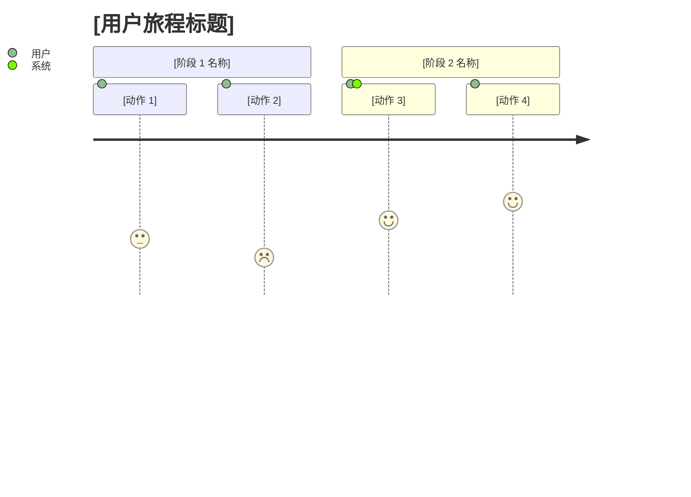
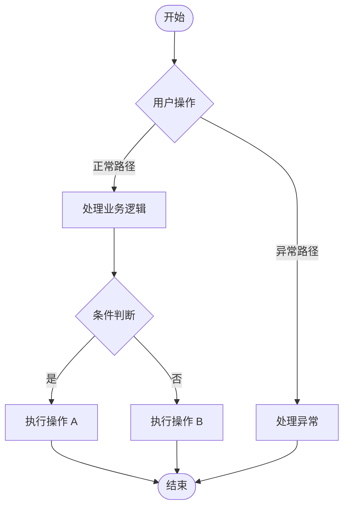

# [项目名称] — 产品需求文档（PRD）

| | |
|---|---|
| **版本** | v0.9（草稿） |
| **作者** | [姓名] |
| **状态** | 草稿 / 评审中 / 已批准 |
| **最后更新** | [YYYY-MM-DD] |
| **相关方** | [产品、研发、设计、运营、法务……] |

> **模板使用说明**
> - 替换所有 `[方括号]` 中的内容。章节填写完成后，删除引导性文字（引用块）。
> - 优先级采用 MoSCoW 并映射为 P 级：**必须（Must）= P0，应该（Should）= P1，可以（Could）= P2，不做（Won't）= 无 P 级**。用户故事中使用 P 级，功能清单中写作"P0 / Must"。
> - 验收标准采用 Given / When / Then 格式。
> - 指标分为**领先指标**（早期信号）和**滞后指标**（结果指标）。
> - 第 7 章（跨职能评审）为可选项；快速、MVP 型 PRD 可以跳过。
> - 图表使用 Mermaid，可在 GitHub、Notion、Obsidian 及大多数现代 Markdown 工具中渲染。

---

## 1. 项目概述

> 目标：读者应能在 5 分钟内理解这是什么、为什么要做、"成功"意味着什么。

### 1.1 背景与问题

[描述核心痛点：**谁**受到影响、在**什么场景**下、遇到**什么问题**。]
[用数据支撑：问题有多严重？影响多少用户？]

### 1.2 项目目标

> 定义 3–5 个 SMART 目标，每个目标都有可衡量的指标值。

| 编号 | 目标 | 指标 | 目标值 | 数据来源 |
|----|-----------|--------|--------|-------------|
| OBJ-001 | [目标 1] | [指标名称] | [目标值] | [数据来源] |
| OBJ-002 | [目标 2] | [指标名称] | [目标值] | [数据来源] |
| OBJ-003 | [目标 3] | [指标名称] | [目标值] | [数据来源] |

### 1.3 范围

#### 1.3.1 范围内

- **[模块 1]**：[一句话描述核心能力]
- **[模块 2]**：[一句话描述核心能力]

#### 1.3.2 范围外

> 列出人们可能默认包含、但实际不包含的事项。

- **[排除项]**：[原因]
- **[后续可能的工作]**：[为何不在本次发布]

### 1.4 价值主张

[一句话（不超过约 25 字）回答："用户为什么需要这个？"]

---

## 2. 用户分析

> 目标：了解用户是谁、想要什么、目前在哪里遇到困难。

### 2.1 用户画像

#### 2.1.1 主要用户

| 属性 | 详情 |
|-----------|--------|
| 角色 | [例如：付费订阅用户] |
| 背景 | [目前如何使用产品；问题出现的场景] |
| 核心目标 | [希望通过该功能达成什么] |
| 主要痛点 | [当前流程中的主要障碍] |
| 使用频率 | [例如：每月 1–2 次] |

#### 2.1.2 次要用户（可选）

| 属性 | 详情 |
|-----------|--------|
| 角色 | [例如：一线客服] |
| 背景 | [日常职责与工作流程] |
| 核心目标 | [希望获得什么效率提升] |
| 主要痛点 | [当前流程中的具体问题] |

### 2.2 用户旅程

#### 2.2.1 主流程

> 从用户视角描述端到端流程，分为 4–6 个阶段。

- **阶段 1 — 发现**：[用户遇到了什么问题？]
- **阶段 2 — 评估**：[如何判断是否值得采取行动？]
- **阶段 3 — 行动**：[如何找到入口并完成任务？]
- **阶段 4 — 等待**：[请求处理期间发生了什么？]
- **阶段 5 — 接收**：[如何获得结果并作出回应？]

*分数 1–5 表示每一步的用户满意度（1 = 沮丧，5 = 愉悦）。*

#### 2.2.2 触点与痛点

| 阶段 | 触点 | 用户行为 | 核心需求 | 当前痛点 | 设计机会 |
|-------|------------|---------------|-----------|--------------------|--------------------|
| [阶段] | [用户接触产品的位置] | [用户做什么] | [真正需要什么] | [阻碍是什么] | [产品如何改善] |

### 2.3 用户故事

> 格式："作为[角色]，我希望[能力]，以便[收益]。"

| 编号 | 角色 | 用户故事 | 优先级 | 关联章节 |
|----|------|------------|----------|-----------------|
| US-001 | [角色] | 作为[角色]，我希望[能力]，以便[收益]。 | P0 | 3.3.1 |
| US-002 | [角色] | 作为[角色]，我希望[能力]，以便[收益]。 | P1 | 3.3.2 |

---

## 3. 详细需求

### 3.1 业务流程

*替换为你的功能的核心流程。展示主路径、分支和异常处理。*

### 3.2 功能清单（MoSCoW）

| 模块 | 功能 | 描述 | 优先级 | 备注 |
|--------|---------|-------------|----------|-------|
| [模块 1] | [功能 1] | [描述] | P0 / Must | 上线必需 |
| [模块 1] | [功能 2] | [描述] | P1 / Should | 重要，但不阻塞上线 |
| [模块 2] | [功能 3] | [描述] | P2 / Could | 锦上添花 |
| [模块 2] | [功能 4] | [描述] | Won't | 本次不做 |

### 3.3 功能说明

> 对 3.2 中的每个功能重复此块。

#### 3.3.1 [功能名称]

- **关联用户故事**：US-001
- **优先级**：P0 / Must
- **描述**：[功能做什么，用户如何与之交互]
- **业务规则**：
  - [规则 1：例如字段限制、权限、状态流转]
  - [规则 2]
- **边界情况与错误**：
  - [情况 1：例如网络故障 → 显示重试提示]
  - [情况 2]
- **UI / 设计参考**：[Figma、线框图或截图链接]

---

## 4. 成功指标

> 目标：定义如何判断项目是否成功。将**领先**指标（早期、可预测）与**滞后**指标（最终结果）搭配使用。

### 4.1 北极星指标

| 指标 | 定义 | 基线 | 目标值 | 类型 |
|--------|------------|----------|--------|------|
| [指标 1] | [如何计算] | [当前值] | [目标值] | 滞后 |
| [指标 2] | [如何计算] | [当前值] | [目标值] | 领先 |

### 4.2 支撑指标

| 指标 | 定义 | 基线 | 目标值 | 类型 |
|--------|------------|----------|--------|------|
| [指标 3] | [如何计算] | [当前值] | [目标值] | 滞后 |
| [指标 4] | [如何计算] | [当前值] | [目标值] | 领先 |

### 4.3 护栏指标（可选）

> 项目实施后**不得**恶化的指标。

| 指标 | 阈值 | 备注 |
|--------|-----------|-------|
| [例如：页面加载时间] | [例如：p95 < 2 秒] | [为何重要] |

---

## 5. 验收标准

> 使用 Given / When / Then。为每个功能覆盖主流程、校验和关键错误情形。

### 5.1 功能验收标准

#### 5.1.1 [功能名称]

**AC-1：[场景 — 主流程]**

- **Given（前置条件）**：[前置条件]
- **When（触发动作）**：[触发动作]
- **Then（预期结果）**：[预期结果]

**AC-2：[场景 — 校验]**

- **Given**：[前置条件]
- **When**：[触发动作]
- **Then**：[预期结果]

**AC-3：[场景 — 异常情形]**

- **Given**：[前置条件]
- **When**：[触发动作]
- **Then**：[预期结果]

### 5.2 非功能验收标准

| 类别 | 要求 | 验证方式 |
|----------|-------------|---------------|
| 性能 | [例如：p95 响应时间 < 500 ms] | [压力测试] |
| 可用性 | [例如：99.9% 可用] | [监控] |
| 无障碍 | [例如：WCAG 2.1 AA] | [审计] |
| 兼容性 | [浏览器、操作系统版本、设备] | [测试矩阵] |
| 安全 | [例如：数据传输与存储均加密；仅指定角色可访问] | [安全评审 / 渗透测试] |
| 数据留存 | [例如：记录 12 个月后删除；删除请求 30 天内完成] | [定时任务测试；删除演练] |

---

## 6. 技术约束

### 6.1 技术栈

| 类别 | 技术 | 备注 |
|----------|------------|-------|
| 前端 | [技术] | [备注] |
| 后端 | [技术] | [备注] |
| 数据库 | [技术] | [备注] |
| 基础设施 | [技术] | [备注] |

### 6.2 集成与依赖

| 系统 / 服务 | 集成方式 | 用途 | 负责人 |
|------------------|--------------------|---------|-------|
| [服务] | [API / SDK / Webhook] | [用途] | [团队 / 联系人] |

### 6.3 安全与合规

- [安全要求：例如身份认证、加密、访问控制]
- [合规要求：例如 GDPR、SOC 2、数据留存]

### 6.4 假设、依赖与风险

| 类型 | 描述 | 影响 | 应对措施 |
|------|-------------|--------|------------|
| 假设 | [我们假定为真的事项] | [若不成立……] | [如何验证] |
| 依赖 | [所依赖的其他团队 / 系统] | [若延期……] | [备选方案] |
| 风险 | [可能出错的事项] | [高 / 中 / 低] | [缓解计划] |

---

## 7. 跨职能评审（可选）

> 完整版和标准版 PRD 建议包含；快速 MVP 型 PRD 可省略。

### 7.1 技术可行性

| 事项 | 评估 | 风险等级 |
|------|------------|------------|
| 技术难度 | [评估] | [高 / 中 / 低] |
| 预估工作量 | [评估] | — |
| 技术风险 | [描述] | [高 / 中 / 低] |
| 缓解方案 | [方案] | — |

### 7.2 运营影响

| 事项 | 评估 | 备注 |
|------|------------|-------|
| 运营成本 | [描述] | — |
| 人力需求 | [描述] | — |
| 上线计划 | [描述：分阶段发布、回滚、沟通] | — |
| 对现有流程的影响 | [描述] | — |

### 7.3 商业价值

| 事项 | 评估 | 备注 |
|------|------------|-------|
| 投资回报（ROI） | [预期回报与成本] | — |
| 竞品对比 | [竞品如何处理] | — |
| 用户价值 | [对目标用户的收益] | — |

### 7.4 法务与合规

| 事项 | 评估 | 备注 |
|------|------------|-------|
| 数据合规 | [描述] | — |
| 隐私政策 | [是否需要修改？] | — |
| 服务条款 | [是否需要修改？] | — |
| 其他监管事项 | [描述] | — |

### 7.5 评审签字

| 评审人 | 角色 | 结论 | 日期 | 意见 |
|----------|------|----------|------|----------|
| [姓名] | 研发 | 通过 / 需修改 | [日期] | [意见] |
| [姓名] | 运营 | 通过 / 需修改 | [日期] | [意见] |
| [姓名] | 业务 | 通过 / 需修改 | [日期] | [意见] |
| [姓名] | 法务 | 通过 / 需修改 | [日期] | [意见] |

---

## 8. 附录

### 8.1 待决问题

| # | 问题 | 负责人 | 截止日期 | 结论 |
|---|----------|-------|----------|------------|
| 1 | [问题] | [姓名] | [日期] | [未决 / 答案] |

### 8.2 术语表

| 术语 | 定义 |
|------|------------|
| [术语 1] | [定义] |
| [术语 2] | [定义] |

### 8.3 参考资料

- [链接：调研、竞品分析、设计稿、相关 PRD]

### 8.4 变更记录

| 版本 | 日期 | 作者 | 变更内容 |
|---------|------|--------|---------|
| v0.9 | [YYYY-MM-DD] | [姓名] | 初稿 |
