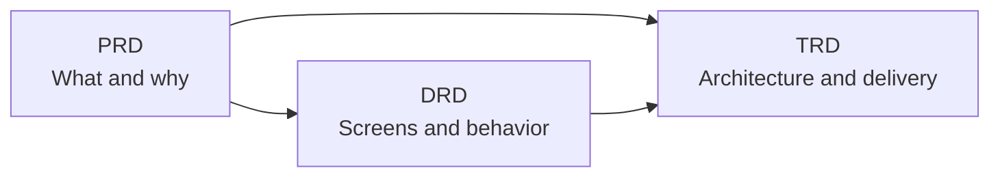

# Project Docs

A set of Markdown templates, writing guides, and filled-in samples for the three core documents of a software project:

| Document | Stands for | Answers | Written by |
|----------|------------|---------|------------|
| **PRD** | Product Requirements Document | *What* are we building, for whom, *why*, and how will we know it worked? | Product manager |
| **DRD** | Design Requirement Document | *How* does it look and behave on screen? | UX / interaction designer |
| **TRD** | Technical Requirements Document | *How* do we build and run it? | Technical lead |

Copy a template, read the matching guide, and look at the sample to see what a finished document looks like.

## How the documents fit together



1. Write the **PRD** first: the problem, goals, users, requirements, and metrics.
2. The **DRD** turns those requirements into structure, flows, wireframes, and page behavior.
3. The **TRD** describes how to build it: architecture, data, APIs, security, testing, and rollout.

Each later document links back to the earlier ones by ID (for example `US-001` in the PRD, `DR-003` in the DRD), so every design and technical decision can be traced to a requirement.

## Repository structure

```
project_docs/
├── PRD/
│   ├── PRD_Template.md
│   ├── PRD_Guide.md
│   └── PRD_Sample_In-App_Feedback.md
├── DRD/
│   ├── DRD_Template.md
│   ├── DRD_Guide.md
│   └── DRD_Sample_In-App_Feedback.md
├── TRD/
│   ├── TRD_Template.md
│   ├── TRD_Guide.md
│   └── TRD_Sample_In-App_Feedback.md
└── README.md
```

Every folder has the same three files:

| File | Purpose |
|------|---------|
| `*_Template.md` | The blank document. Copy it and replace everything in `[brackets]`. |
| `*_Guide.md` | How to write the document: what each section is for, what to put in it, tips, common mistakes, and a quality checklist. |
| `*_Sample_*.md` | A completed example, so you can see what "good" looks like. |

## The documents

### [PRD](PRD/): Product Requirements Document

Defines the problem and what success looks like.

- **Template** has 8 sections: overview and objectives, user analysis, detailed requirements, success metrics, acceptance criteria, technical constraints, an optional cross-functional review, and an appendix.
- **Guide** covers the writing process, Full / Standard / Quick sizes, and a section-by-section walkthrough.
- **Sample:** [PRD_Sample_In-App_Feedback.md](PRD/PRD_Sample_In-App_Feedback.md)

### [DRD](DRD/): Design Requirement Document

Describes the interaction design for UI and UX work.

- **Template** covers requirement analysis, product and information structure, flows, requirement list, global specifications (components, formats, limits), non-functional requirements, page-by-page interaction specs, tracking, and an archive of retired designs.
- **Guide** covers the PRD vs. DRD split, grayscale wireframe conventions, and how to specify every page state.
- **Sample:** [DRD_Sample_In-App_Feedback.md](DRD/DRD_Sample_In-App_Feedback.md)

### [TRD](TRD/): Technical Requirements Document

Describes how the requirements will be built and operated.

- **Template** covers traceability, system architecture and decisions, data model, technical functional requirements, APIs, events and messaging, security and threat model, non-functional targets, observability, testing, deployment and rollback, risks, and optional agent instructions.
- **Guide** covers how to size the work, record decisions, design for failure, and set measurable targets.
- **Sample:** [TRD_Sample_In-App_Feedback.md](TRD/TRD_Sample_In-App_Feedback.md)

## 中文版 (Chinese versions)

Every file has a Chinese translation next to it, named with a `_zh` suffix (for example `PRD/PRD_Template_zh.md`). The Chinese files link to each other, not to the English ones. Product UI strings inside the samples (for example "Please choose an issue type") stay in English because the sample product launches in English.

| | 模板 Template | 指南 Guide | 示例 Sample |
|---|---|---|---|
| PRD | [PRD_Template_zh.md](PRD/PRD_Template_zh.md) | [PRD_Guide_zh.md](PRD/PRD_Guide_zh.md) | [PRD_Sample_In-App_Feedback_zh.md](PRD/PRD_Sample_In-App_Feedback_zh.md) |
| DRD | [DRD_Template_zh.md](DRD/DRD_Template_zh.md) | [DRD_Guide_zh.md](DRD/DRD_Guide_zh.md) | [DRD_Sample_In-App_Feedback_zh.md](DRD/DRD_Sample_In-App_Feedback_zh.md) |
| TRD | [TRD_Template_zh.md](TRD/TRD_Template_zh.md) | [TRD_Guide_zh.md](TRD/TRD_Guide_zh.md) | [TRD_Sample_In-App_Feedback_zh.md](TRD/TRD_Sample_In-App_Feedback_zh.md) |

## About the samples

All three samples describe the **same fictional feature**: an In-App Feedback Center for "LearnSphere", an online learning platform. This lets you follow one idea from requirement to design to implementation. The company, people, and numbers are invented, and the tech stack and integrations are illustrations, not recommendations.

## How to use this repo

1. Copy the template you need into your project.
2. Read its guide. The "Writing Process" part gives a better order than filling the template top to bottom.
3. Use the sample for tone and level of detail.
4. Check your draft against the guide's quality checklist before review.

**Diagrams** use [Mermaid](https://mermaid.js.org), which renders on GitHub, in Notion, Obsidian, and VS Code (with a preview extension), and in the [Mermaid Live Editor](https://mermaid.live).

## License

Released under the [MIT License](LICENSE).
