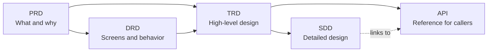

# Project Docs

A set of Markdown templates, writing guides, and filled-in samples for the five core documents of a software project:

| Document | Stands for | Answers | Written by |
|----------|------------|---------|------------|
| **PRD** | Product Requirements Document | *What* are we building, for whom, *why*, and how will we know it worked? | Product manager |
| **DRD** | Design Requirement Document | *How* does it look and behave on screen? | UX / interaction designer |
| **TRD** | Technical Requirements Document | *What architecture and technical targets?* The high-level design (HLD). | Tech lead |
| **SDD** | Software Design Document | *How is each part built?* The low-level design (LLD) and the team's tech spec. | Engineers |
| **API** | API Reference | *How do I call this service?* The reference for people outside the team, generated from OpenAPI. | Engineers (service team) |

Copy a template, read the matching guide, and look at the sample to see what a finished document looks like.

## How the documents fit together



1. Write the **PRD** first: the problem, goals, users, requirements, and metrics.
2. The **DRD** turns those requirements into structure, flows, wireframes, and page behavior.
3. The tech lead writes the **TRD**: architecture, decisions, data entities, interfaces, security, targets, and rollout. It is reviewed and approved before development.
4. Engineers write the **SDD** underneath it: modules, flows, tables, endpoints, logic, error handling, and tests. They keep it up to date while building, and it ends as the record of what was built.
5. The **API reference** is for everyone who calls the service from outside the team. It is generated from the OpenAPI file, the contract is agreed early so callers can build in parallel, and it stays up to date for as long as the API is in use.

Each later document links back to the earlier ones by ID (for example `US-001` in the PRD, `DR-003` in the DRD, a TRD section number in the SDD), so every design and technical decision can be traced to a requirement.

## Terminology

Words like "TRD" and "tech spec" mean different things at different companies. In this repo:

| Term | Meaning here |
|------|--------------|
| **TRD** | The high-level design, written by the tech lead and approved before development. The approved baseline. |
| **SDD** | The low-level design, written and updated by the engineers. Also called the **tech spec**. Required for every project, sized to the work. |
| **HLD / LLD** | High-level design / low-level design. The TRD is the HLD; the SDD is the LLD. |
| **API reference** | The caller-facing description of the service's API. The OpenAPI file is its source of truth; the SDD links to it and does not copy it. Needed when anyone outside the team calls the service. |

**Update rule:** engineers change the SDD freely while they build. A change that affects the TRD (architecture, a decision, security, a target, or an interface other teams use) needs the tech lead's agreement, a line in the SDD's deviation log, and a TRD change-log entry.

## Repository structure

```
project_docs/
├── PRD/
│   ├── PRD_Template.md
│   ├── PRD_Guide.md
│   └── PRD_Sample_In-App_Feedback.md
├── DRD/
│   ├── DRD_Template.md
│   ├── DRD_Guide.md
│   └── DRD_Sample_In-App_Feedback.md
├── TRD/
│   ├── TRD_Template.md
│   ├── TRD_Guide.md
│   └── TRD_Sample_In-App_Feedback.md
├── SDD/
│   ├── SDD_Template.md
│   ├── SDD_Guide.md
│   └── SDD_Sample_In-App_Feedback.md
├── API/
│   ├── API_Template.md
│   ├── API_Guide.md
│   ├── API_Sample_In-App_Feedback.md
│   └── openapi_Sample_In-App_Feedback.yaml
└── README.md
```

Every folder has the same three Markdown files (plus a Chinese `_zh` copy of each). The `API/` folder also has the OpenAPI file the sample is built from:

| File | Purpose |
|------|---------|
| `*_Template.md` | The blank document. Copy it and replace everything in `[brackets]`. |
| `*_Guide.md` | How to write the document: what each section is for, what to put in it, tips, common mistakes, and a quality checklist. |
| `*_Sample_*.md` | A completed example, so you can see what "good" looks like. |

## The documents

### [PRD](PRD/): Product Requirements Document

Defines the problem and what success looks like.

- **Template** has 8 sections: overview and objectives, user analysis, detailed requirements, success metrics, acceptance criteria, technical constraints, an optional cross-functional review, and an appendix.
- **Guide** covers the writing process, Full / Standard / Quick sizes, and a section-by-section walkthrough.
- **Sample:** [PRD_Sample_In-App_Feedback.md](PRD/PRD_Sample_In-App_Feedback.md)

### [DRD](DRD/): Design Requirement Document

Describes the interaction design for UI and UX work.

- **Template** covers requirement analysis, product and information structure, flows, requirement list, global specifications (components, formats, limits), non-functional requirements, page-by-page interaction specs, tracking, and an archive of retired designs.
- **Guide** covers the PRD vs. DRD split, grayscale wireframe conventions, and how to specify every page state.
- **Sample:** [DRD_Sample_In-App_Feedback.md](DRD/DRD_Sample_In-App_Feedback.md)

### [TRD](TRD/): Technical Requirements Document (high-level design)

Sets the approved architecture and technical targets. Written by the tech lead.

- **Template** covers traceability, system architecture and decisions, a high-level data model, feature-level technical requirements, an interface overview, events and reliability policy, security and threat model, non-functional targets, observability, testing strategy, deployment and rollback, risks, and the handoff to the SDD.
- **Guide** covers the TRD vs. SDD split, how to size the work, record decisions, design for failure, and set measurable targets.
- **Sample:** [TRD_Sample_In-App_Feedback.md](TRD/TRD_Sample_In-App_Feedback.md)

### [SDD](SDD/): Software Design Document (low-level design / tech spec)

Records how each part is built. Written and kept up to date by the engineers.

- **Template** covers module and class design, key flows (sequence diagrams), field-level data design, interface detail, detailed logic, error handling, configuration, observability detail, test design, performance and capacity detail, a log of deviations from the TRD, agent instructions, and as-built notes.
- **Guide** covers the update rule, how to size an SDD, and what to link rather than copy.
- **Sample:** [SDD_Sample_In-App_Feedback.md](SDD/SDD_Sample_In-App_Feedback.md) (shown in progress, with two logged deviations)

### [API](API/): API Reference

Tells people outside the team how to call the service. Generated from OpenAPI, kept up to date for as long as the API is used.

- **Template** covers an overview with a quick start, authentication, conventions (versioning, pagination, rate limits), errors and retry advice, endpoints, webhooks, changelog and deprecation, and support.
- **Guide** covers API reference vs. SDD, keeping the OpenAPI file as the single source of truth, whether you need one, and working with OpenAPI.
- **Sample:** [API_Sample_In-App_Feedback.md](API/API_Sample_In-App_Feedback.md), built from [openapi_Sample_In-App_Feedback.yaml](API/openapi_Sample_In-App_Feedback.yaml)

## 中文版 (Chinese versions)

Every file has a Chinese translation next to it, named with a `_zh` suffix (for example `PRD/PRD_Template_zh.md`). The Chinese files link to each other, not to the English ones. Product UI strings inside the samples (for example "Please choose an issue type") stay in English because the sample product launches in English.

| | 模板 Template | 指南 Guide | 示例 Sample |
|---|---|---|---|
| PRD | [PRD_Template_zh.md](PRD/PRD_Template_zh.md) | [PRD_Guide_zh.md](PRD/PRD_Guide_zh.md) | [PRD_Sample_In-App_Feedback_zh.md](PRD/PRD_Sample_In-App_Feedback_zh.md) |
| DRD | [DRD_Template_zh.md](DRD/DRD_Template_zh.md) | [DRD_Guide_zh.md](DRD/DRD_Guide_zh.md) | [DRD_Sample_In-App_Feedback_zh.md](DRD/DRD_Sample_In-App_Feedback_zh.md) |
| TRD | [TRD_Template_zh.md](TRD/TRD_Template_zh.md) | [TRD_Guide_zh.md](TRD/TRD_Guide_zh.md) | [TRD_Sample_In-App_Feedback_zh.md](TRD/TRD_Sample_In-App_Feedback_zh.md) |
| SDD | [SDD_Template_zh.md](SDD/SDD_Template_zh.md) | [SDD_Guide_zh.md](SDD/SDD_Guide_zh.md) | [SDD_Sample_In-App_Feedback_zh.md](SDD/SDD_Sample_In-App_Feedback_zh.md) |
| API | [API_Template_zh.md](API/API_Template_zh.md) | [API_Guide_zh.md](API/API_Guide_zh.md) | [API_Sample_In-App_Feedback_zh.md](API/API_Sample_In-App_Feedback_zh.md) |

## About the samples

All five samples describe the **same fictional feature**: an In-App Feedback Center for "LearnSphere", an online learning platform. This lets you follow one idea from requirement to design to high-level design to detailed design to the API that callers use. The company, people, and numbers are invented, and the tech stack and integrations are illustrations, not recommendations.

## How to use this repo

1. Copy the template you need into your project.
2. Read its guide. The "Writing Process" part gives a better order than filling the template top to bottom.
3. Use the sample for tone and level of detail.
4. Check your draft against the guide's quality checklist before review.

**Diagrams** use [Mermaid](https://mermaid.js.org), which renders on GitHub, in Notion, Obsidian, and VS Code (with a preview extension), and in the [Mermaid Live Editor](https://mermaid.live).

## License

Released under the [MIT License](LICENSE).
