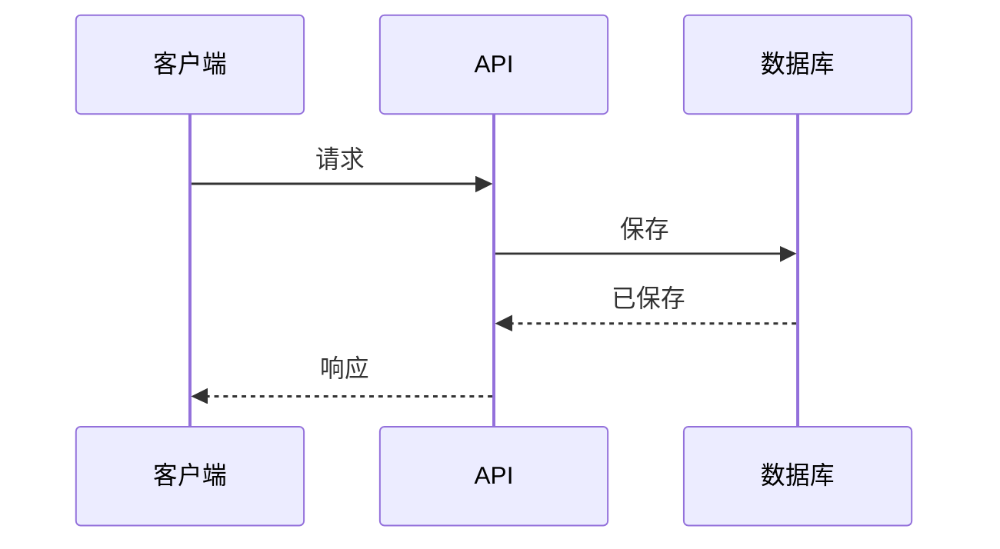
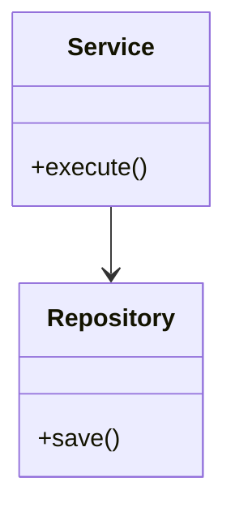
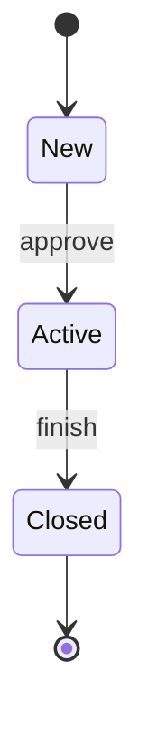

# 如何撰写 SDD — 指南

本指南说明什么是软件设计文档（SDD）、它与 TRD 的关系、如何使用模板，以及每个章节应写什么。

**配合以下文件使用：**
- [SDD_Template_zh.md](SDD_Template_zh.md)：可复制并填写的空白模板
- [SDD_Sample_In-App_Feedback_zh.md](SDD_Sample_In-App_Feedback_zh.md)：一份完整示例，让你看到"好的 SDD"是什么样子。示例是虚构的，与 PRD、DRD、TRD 示例相匹配，因此其中的技术栈、数字和名称仅作说明，不是默认选项。
- [TRD_Guide_zh.md](../TRD/TRD_Guide_zh.md)：SDD 所依托的概要设计。

---

## 第一部分：SDD 基础

### 什么是 SDD？

SDD 描述**系统的每个部分具体如何构建**：模块和类、它们之间调用的先后顺序、表和索引的定义、详细的规则和算法、错误处理、配置和测试用例。它是**详细设计（低层设计，LLD）**。在这套文档中，它同时也是团队的**技术方案（tech spec）**：工程师撰写、在构建过程中持续更新，并最终作为"实际构建了什么"的记录留存下来。

### 四份文档如何配合

| | PRD | DRD | TRD | SDD |
|---|-----|-----|-----|-----|
| 回答 | 做什么、为谁做、为什么？ | 界面上长什么样、怎么表现？ | 什么架构、什么技术目标？ | 每个部分具体怎么构建？ |
| 层级 | 产品 | 交互 | **概要设计（HLD）** | **详细设计（LLD）** |
| 作者 | 产品经理 | UX / 交互设计师 | **技术负责人** | **工程师** |
| 状态 | 已批准的基线 | 已批准的基线 | **已批准的基线** | **活文档，最终成为实际构建的记录** |
| 每个项目都需要？ | 是 | 有界面工作时需要 | 是 | **是**（按项目规模调整） |

### TRD 与 SDD

| | TRD（技术负责人） | SDD（工程师） |
|---|-----------------|-----------------|
| 目的 | 确定已批准的架构、约束和目标 | 详细说明如何构建 |
| 典型内容 | 架构、组件、技术栈、决策、数据实体、API 概览、安全、非功能目标、发布、风险 | 类和模块设计、时序图、字段级的表、DDL、端点细节、算法、并发、错误处理、配置、可观测性细节、测试用例 |
| 变更 | 很少，且需经负责人同意 | 经常，随工程师构建而变化 |
| 审批 | 开发前评审并批准 | 由技术负责人评审；只有偏离 TRD 的部分需要签字确认 |

一个快速判断：如果读者需要它来**判断设计是否合理**，放进 TRD。如果读者需要它来**实现或维护代码**，放进 SDD。

### 更新规则

工程师在构建过程中可以自由修改 SDD。但是：
- 如果某个变更影响了 TRD 已作出的决策——架构、安全规则、某项目标，或其他团队依赖的接口——工程师要**告知技术负责人**，记录在**第 12 章（偏差）**，由负责人同意并更新 TRD。
- 对细节的小修正无需审批。

这样既让已批准的 TRD 保持可信，又让 SDD 保持最新。

### SDD 不是什么

| SDD 不是…… | 原因 |
|------------------|------------|
| TRD 的副本 | 按编号链接到 TRD，并在其下补充细节。 |
| 自动生成文档的副本 | 如果 OpenAPI 或 schema 文档可以由代码生成，就链接它们。手工复制的内容会过时。 |
| 用文字写成的源代码 | 描述设计和规则。精确实现由代码体现。 |
| 一次性文档 | 它随构建而变化，并以实际构建说明收尾。 |

### 谁会读它，关注什么

| 读者 | 关注点 |
|--------|-------------|
| 构建项目的工程师 | 第 2–8 章：模块、流程、数据、接口、逻辑、错误 |
| 其他工程师、评审人 | 第 3、6、7、12 章：流程、规则、故障处理、偏差 |
| 技术负责人 | 1.3 节和第 12 章：构建是否遵循 TRD？ |
| 测试 | 第 5、6、7、10 章：行为、错误情形、测试设计 |
| SRE / 值班 | 第 7、8、9 章：故障处理、配置、指标、告警 |
| 新成员 | 第 2、3、14 章：代码如何组织，以及构建了什么 |

### 写作原则

1. **细化 TRD，而不是重复它。**每个章节都应是对 TRD 中某件事的细化。
2. **精确到可以实现。**另一位工程师应该能仅凭某个章节就开始构建，不必来问你。
3. **展示先后顺序。**时序图比文字更容易让人评审流程、重试和失败。
4. **覆盖失败和并发。**说明超时、重复、重试以及两个请求同时到达时会发生什么。
5. **链接，不要复制。**自动生成的和外部来源仍然是权威。
6. **如实记录偏差。**记录在案的偏差是一个决策；没记录的偏差会变成意外。
7. **标注估算。**把猜测的数字标为估算，并用实测值替换。
8. **保持最新。**设计变化时，与代码同步更新。

---

## 第二部分：撰写流程

SDD 在 TRD 获批之后开始。不要从上到下依次填写；更好的顺序：

| 步骤 | 做什么 | 对应章节 |
|------|---------|----------|
| 1. 阅读 TRD、PRD 和 DRD | 列出你这部分必须交付什么；记下你实现的 TRD 条目 | 1 |
| 2. 拆分模块 | 确定模块或类，以及谁依赖谁 | 2 |
| 3. 画关键流程 | 为成功、失败和重试画时序图 | 3 |
| 4. 设计数据 | 表、索引、事务、缓存、迁移 | 4 |
| 5. 说明接口 | 端点、错误、消息 | 5 |
| 6. 写详细逻辑 | 规则、算法、状态机、幂等性、并发 | 6 |
| 7. 列出故障与边界情况 | 按模块，写明检测、处理和结果 | 7 |
| 8. 定义配置与可观测性 | 配置项、开关、密钥、日志、指标、追踪、告警 | 8、9 |
| 9. 设计测试 | 用例和验收标准映射 | 10 |
| 10. 检查性能 | 估算每个组件的负载，找出瓶颈 | 11 |
| 11. 与技术负责人评审 | 解决差异；记录偏差 | 12 |
| 12. 构建，并保持 SDD 最新 | 边做边更新；上线时补充实际构建说明 | 13、14 |

### 选择文档规模

每个项目都需要 SDD，但篇幅应与工作量匹配。

| 场景 | 包含 | 省略 |
|-----------|---------|------|
| **完整版**：新服务、复杂模块、多名工程师、敏感数据 | 全部 | 无 |
| **标准版**：典型功能（默认） | 第 1–12 章和第 14 章 | 仅由人类实现时省略 agent 指令（13）；空的小节 |
| **简版**：现有服务内的小改动 | 1、5 或 6（仅变更部分）、7、10、12、14 | 其余。1–2 页即可。 |

---

## 第三部分：逐章指南

每个章节包括：**作用**、**写什么**、**技巧**和**常见错误**。

---

### 文档头部

**写什么：**版本、负责的工程师、评审人（技术负责人）、状态（草稿 / 进行中 / 评审中 / 已按实际构建更新）、最后更新日期、PRD、DRD 和 TRD 的链接（注明所基于的 TRD 版本）、代码仓库，以及自动生成的 API 和 schema 文档。

**常见错误：**没有记录 SDD 基于哪个已批准的 TRD 版本。

---

### 1. 目的、范围与追溯

**作用：**说明本 SDD 覆盖什么，以及实现哪些 TRD 条目。

**写什么：**目的、覆盖和不覆盖的内容，以及一张把你实现的每个 TRD 条目映射到详述它的 SDD 章节的表。

**技巧：**如果某个 TRD 条目还没有对应的 SDD 章节，那是开工前要补上的缺口。如果某个 SDD 章节没有对应的 TRD 条目，要想想它是否该放在这里。

---

### 2. 模块与组件设计

**作用：**展示每个 TRD 组件内部的代码是如何组织的。

**写什么：**一张类或模块图；一张包含职责、对外接口和依赖的模块表；设计说明（所用模式、共享库）。

**技巧：**每个模块只承担一项工作。让依赖保持单向。写出你依赖的模式名称（outbox、repository、strategy），因为它们能说明很多事。

**常见错误：**把每个类都画出来（只画重要的）；一个模块承担两三项职责。

---

### 3. 关键流程

**作用：**展示模块和服务之间调用的先后顺序，包括出错时的情形。

**写什么：**主要成功路径，以及重要失败和重试路径的时序图。

**技巧：**只有当顺序重要时才画流程：调用其他服务、事务、队列、重试。包含数据被保存的位置和消息被发送的位置。

**常见错误：**只有主流程；图与代码不一致。

---

### 4. 数据设计

**作用：**与数据存储相关的一切，细到列。

**写什么：**
- **表**（4.1）：DDL 或字段表，含类型、是否必填、约束和备注。标出个人数据。
- **索引与查询计划**（4.2）：真实的查询、各自对应的索引，以及执行计划说明。
- **约束与事务**（4.3）：哪些数据一起写入、锁和隔离级别、由数据库保证 vs. 由代码保证的规则。
- **缓存**（4.4）：缓存什么、放在哪、多久、如何失效。
- **迁移与回填**（4.5）：文件、每次迁移的回滚、如何转换现有数据。

**技巧：**如果可以，从迁移脚本生成 DDL 并链接。想想两个写入方同时修改同一行会怎样。

**常见错误：**没有对应查询的索引；没有回滚的迁移；忘记回填。

---

### 5. 接口详情

**作用：**这段代码与调用方之间的精确契约。

**写什么：**
- **端点**（5.1）：链接自动生成的 OpenAPI 文件；补充谁能调用、副作用和特殊规则。如果没有自动生成的文件，则为每个端点写请求、响应和校验。如果团队之外的调用方使用该 API，他们阅读的是由该文件生成的已发布 API 参考文档（[API_Guide_zh.md](../API/API_Guide_zh.md)）；链接过去即可，不要复制。
- **错误目录**（5.2）：HTTP 状态码、错误码、条件、消息 key，以及客户端的行为。
- **消息与事件**（5.3）：载荷 schema、生产者、消费者、顺序、大小、版本。

**技巧：**整个服务使用同一种错误码格式。把消息文案放在客户端的 i18n 文件里，这里引用 key。

**常见错误：**手工重新输入已自动生成的规范；错误码没有对应的客户端行为。

---

### 6. 详细逻辑

**作用：**每个功能背后的规则和逻辑，精确到可以实现。

**每个功能包含：**所追溯的 TRD 条目；编号步骤；对复杂之处给出伪代码；如果对象有生命周期则给出状态机；幂等性；并发；超时与重试。

**技巧：**
- 说明是什么让重复请求变得安全，以及你如何检测它。
- 说明两个请求同时到达时会发生什么，由哪个锁或约束保护你。
- 给出确切的数字：超时、重试延迟、限制。

**常见错误：**只描述主流程；把并发交给运气。

---

### 7. 错误处理与边界情况

**作用：**在一个地方看到每种故障，以及系统对它的处理。

**写什么：**对每个模块：故障、如何检测、如何处理、对用户或系统的结果，以及如何记录或告警。

**技巧：**包含依赖故障、部分失败、错误输入、重复、凭据过期，以及极大或极小的值。

**常见错误：**"适当处理错误"；被捕获却从不记录的故障。

---

### 8. 配置

**写什么：**配置项的含义、默认值和各环境的取值；带用途、负责人和移除计划的功能开关；密钥名称及存放位置（绝不写值）。

**技巧：**每个开关都应有移除日期。让密钥远离配置文件。

---

### 9. 可观测性详情

**写什么：**日志事件和必含字段（以及不得出现的内容）；指标名称、类型和标签；追踪 span 名称和属性；以及一张把每条 TRD 告警对应到指标、阈值和运行手册的告警对接表。

**技巧：**指标命名保持一致。日志里记录标识符，而不是个人数据。

---

### 10. 测试设计

**写什么：**测试用例（类型、场景、数据、预期结果以及所覆盖的内容）；一张把每条 PRD 验收标准映射到测试编号的表；测试数据以及哪些被 mock。

**技巧：**不要只测主流程，还要包含并发、重试、重复、故障和格式错误输入的用例。第 6 章的每条规则都应有测试。

---

### 11. 性能与容量详情

**写什么：**对每个组件或查询：预期负载、资源使用和瓶颈、基准测试结果、调优说明。

**技巧：**把算术过程写出来，包括每个请求对外部服务的调用次数。与 TRD 中的限制对比。把估算标为估算，再用实测值替换。如果数字无法达到某项 TRD 目标，那就是要立刻提出的偏差。

---

### 12. 与 TRD 的偏差

**作用：**在 SDD 不断变化的同时，让已批准的 TRD 保持可信。

**写什么：**对每处差异：TRD 引用、差异内容、原因、影响（对其他部分、团队或目标）、批准人、日期，以及 TRD 是否已更新。

**技巧：**如果你不确定某件事是不是偏差，那它很可能就是：记下来。凡涉及架构、安全、某项目标，或其他团队使用的接口，都需要技术负责人签字确认。

---

### 13. 实现说明与 Agent 指令

**作用：**帮助人类和 AI 编码 agent 从正确的位置开始，并遵守规则。

**写什么：**从哪里开始、先读什么、不要碰什么；必须做什么、禁止做什么；能验证工作的确切命令。

**技巧：**规则要简短且可检查。命令应当原样可运行。

---

### 14. 实际构建说明与附录

**写什么：**
- **实际构建说明**（上线时填写）：实际交付了什么、与计划的差异、已知限制和技术债、后续工作。
- **待决问题**：负责人和截止日期。
- **变更记录**：版本、日期、作者、变更内容。

**技巧：**实际构建说明让 SDD 从计划变成记录。趁记忆还新鲜，在上线当周完成。

---

## 第四部分：使用 Mermaid 图表

模板使用 Mermaid，可在 GitHub、Notion、Obsidian、VS Code（需预览插件）和 [Mermaid Live Editor](https://mermaid.live) 中渲染。

**时序图**

| 语法 | 含义 |
|--------|---------|
| `A->>B: 文字` | A 调用 B |
| `B-->>A: 文字` | B 回复 A |
| `participant X as 名称` | 声明并命名一个参与者 |
| `alt … else … end` | 分支路径 |
| `loop … end` | 重复的步骤 |
| `Note over A,B: 文字` | 跨参与者的备注 |

**类图**

**状态图**

对于大型图表，可以在图表工具里绘制并链接文件。

---

## 第五部分：质量检查清单

**追溯**
- [ ] SDD 写明了所基于的已批准 TRD 版本
- [ ] 你实现的每个 TRD 条目都映射到一个 SDD 章节
- [ ] 偏差已记录，且需要的地方已有技术负责人签字确认

**设计**
- [ ] 每个模块职责清晰单一
- [ ] 关键流程有时序图，包括失败和重试路径
- [ ] 表、索引、事务和迁移（含回滚）已定义
- [ ] 自动生成的文档是链接，而不是重新手写

**逻辑与故障**
- [ ] 每个功能都有精确的步骤、幂等性、并发和超时规则
- [ ] 每种故障和边界情况都有检测、处理和结果
- [ ] 数字（超时、重试、限制）是确切的

**运维与质量**
- [ ] 已列出配置项、开关和密钥名称；没有密钥值
- [ ] 已定义日志、指标、追踪和告警对接
- [ ] 测试用例覆盖失败路径，并映射到 PRD 验收标准
- [ ] 展示了容量的计算；估算已标注

**完整性**
- [ ] 没有遗留 `[方括号]` 或引导性文字
- [ ] 待决问题有负责人和日期
- [ ] 上线时已填写实际构建说明
- [ ] 版本、状态和变更记录是最新的

---

## 第六部分：常见错误一览

| 错误 | 解决办法 |
|---------|-----|
| 重复 TRD | 按编号链接；在其下补充细节 |
| 手工重新输入自动生成的 API 或 schema 文档 | 直接链接 |
| 只有主流程 | 补充失败、重试、重复和并发情形 |
| "适当处理错误" | 说明检测什么、发生什么、记录什么 |
| 悄悄改动设计 | 记录在第 12 章，并告知技术负责人 |
| 看起来像事实的估算 | 标注出来；用实测值替换 |
| 文档里放配置值和密钥 | 只列 key 名；值放在配置和密钥管理器中 |
| 上线后再没更新 | 上线时补充实际构建说明；后续变更继续更新 |
| 一份巨大的 SDD 包罗万象 | 每个项目写一份，篇幅与工作量匹配 |

---

## 第七部分：让 SDD 持续有用

SDD 的价值在于：另一位工程师能接手代码，理解它为什么这样运作，并且信任这份文档。

- **随代码更新。**如果设计变化，在同一个 pull request 或同一天更新 SDD。
- **在固定时点评审。**技术负责人在构建开始前读一次 SDD，构建中途读一次，上线时再读一次。
- **形成闭环。**上线时，填写实际构建说明，并把估算与实测值对比。
- **尽早上报。**当构建无法遵循 TRD 时，立刻说出来并记录偏差，而不是指望没人发现。
