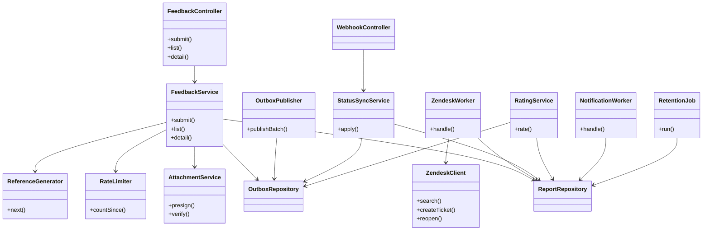
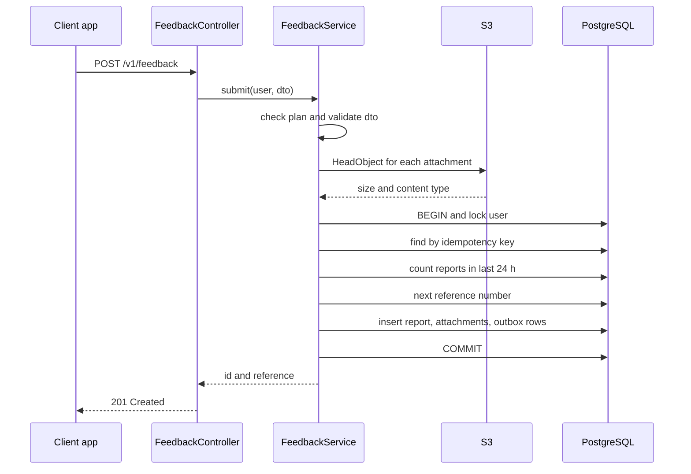
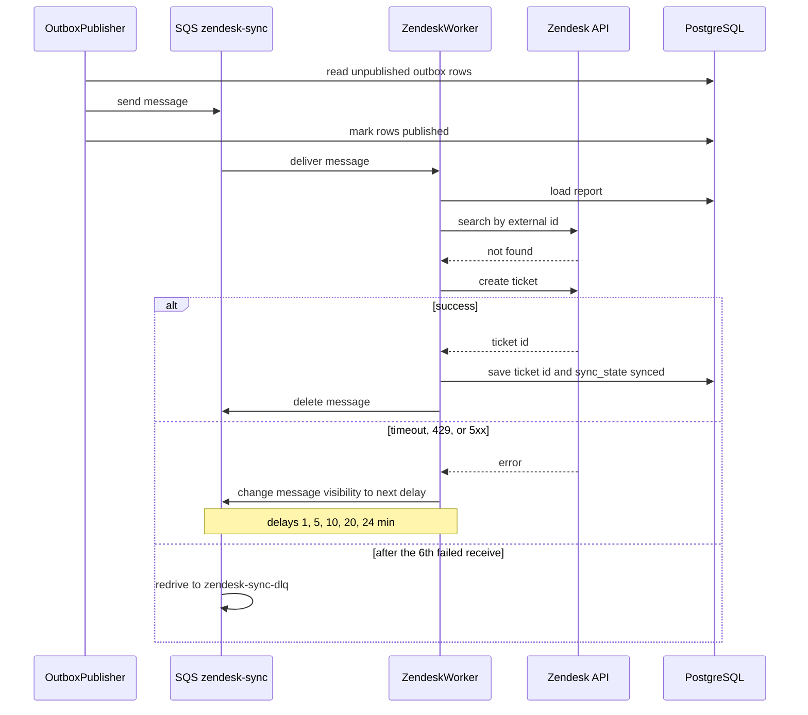
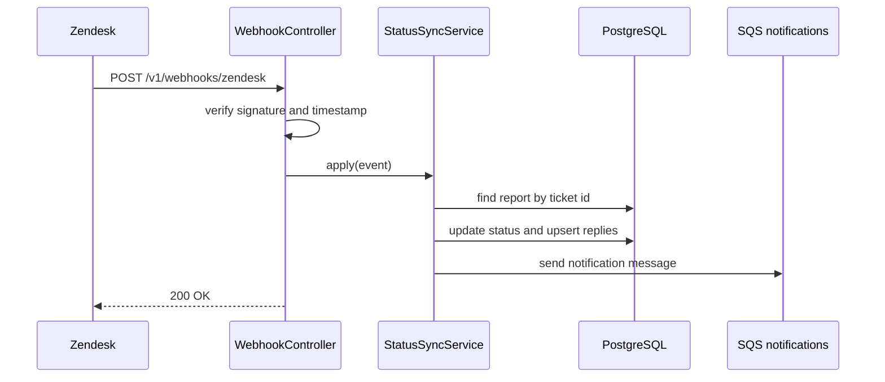
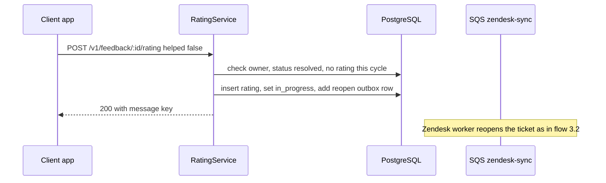
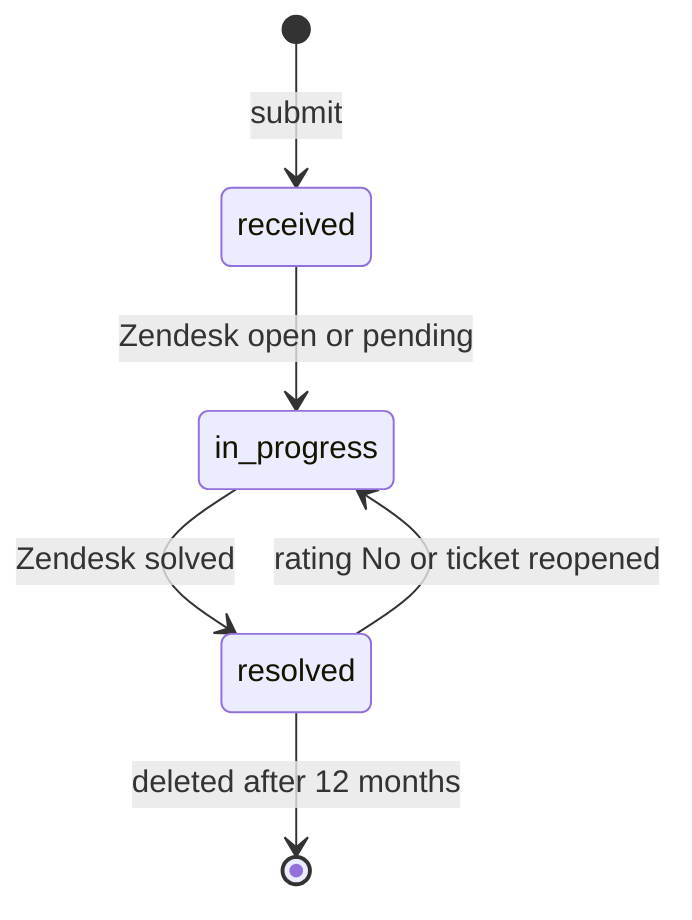

# In-App Feedback Center — Software Design Document (SDD)

> **Sample document.** This is a fictional, filled-in example of `SDD_Template.md`. It is the detailed design that sits under [TRD_Sample_In-App_Feedback.md](../TRD/TRD_Sample_In-App_Feedback.md), and it follows the [PRD](../PRD/PRD_Sample_In-App_Feedback.md) and [DRD](../DRD/DRD_Sample_In-App_Feedback.md) samples, so the product ("LearnSphere"), limits, names, and error messages match. People, numbers, and systems are invented, and numbers marked *estimate* are guesses to be replaced by measurements. Product UI strings (for example "Please choose an issue type") stay in English because the sample product launches in English.
>
> This sample shows an SDD **in progress**: the as-built notes in Section 14 are empty because the project has not launched.

| | |
|---|---|
| **Version** | v0.3 |
| **Author (owning engineer)** | Mei Tan (Backend); Carlos Reyes (Mobile/Web client module) |
| **Reviewer (tech lead)** | Daniel Ortiz |
| **Status** | In Progress (build week 1) |
| **Last updated** | 2026-10-30 |
| **Related PRD** | In-App Feedback Center PRD v1.0 (2026-10-15) |
| **Related DRD** | In-App Feedback Center DRD v1.0 (2026-10-28) |
| **Related TRD** | In-App Feedback Center TRD v1.1 (2026-10-30) |
| **Code repository** | `learnsphere/feedback-service`, `learnsphere/app` (feedback module) |
| **API docs / schema docs** | `openapi/feedback.yaml` (generated from NestJS decorators; sample copy: [openapi_Sample_In-App_Feedback.yaml](../API/openapi_Sample_In-App_Feedback.yaml)); published reference for callers: [API_Sample_In-App_Feedback.md](../API/API_Sample_In-App_Feedback.md); schema docs generated from `db/migrations/` |

---

## 1. Purpose, Scope, and Traceability

### 1.1 Purpose

Design the `feedback-service` API, workers, and jobs, and the network and draft layer of the shared client feedback module, so that the approved TRD can be implemented without further questions.

### 1.2 Scope of This Document

- **Covers**: `feedback-api`, the outbox publisher, the Zendesk worker, the webhook handler, the notification worker, the retention and deletion jobs, and the client module's submit, upload, and draft-resend logic.
- **Does not cover**: the form's screens and behavior (DRD); Zendesk configuration beyond the fields and groups listed in Section 8; the privacy service that emits deletion events; email templates.

### 1.3 TRD Traceability

| TRD reference | What the TRD requires | SDD section |
|---------------|-----------------------|-------------|
| 4.1 Submit a report | Store durably, enqueue ticket, rate limit, idempotency | 3.1, 4, 5.1, 6.1 |
| 4.2 Context capture and routing | Ticket fields, tags, routing, priority | 3.2, 6.2 |
| 4.3 List and view | Owner-only access, 12-month window, status mapping | 5.1, 6.3 |
| 4.4 Status sync and notifications | Webhook, dedupe, ack within 5 min | 3.3, 6.4 |
| 4.5 Resolution rating | Rate once per cycle, "No" reopens | 3.4, 6.5 |
| 6.2 Reliability (retry, DLQ) | 5 retries over about 1 hour, then alert | 3.2, 6.2, 7, 9.4 |
| 3.3 Data lifecycle | 12-month retention, deletion requests | 4, 6.6 |
| 8 Non-functional | Latency, throughput, recovery | 11, 12 |
| 9.3 Alerting | DLQ, outbox lag, error rate | 9.4 |
| 10 Testing strategy | Levels and AC mapping | 10 |
| DRD DR-004 | Offline draft sent within 60 s | 6.7 |

---

## 2. Module and Component Design

### 2.1 Module Overview



### 2.2 Module Responsibilities

| Component (from TRD) | Module / class | Responsibility | Public interface | Depends on |
|----------------------|----------------|----------------|------------------|------------|
| `feedback-api` | `FeedbackController` | HTTP routes, auth guard, DTO validation, error mapping | REST `/v1/feedback...` | `FeedbackService`, `RatingService` |
| `feedback-api` | `FeedbackService` | Submit, list, and detail use cases | `submit(user, dto)`, `list(user, cursor)`, `detail(user, id)` | Repositories, `AttachmentService`, `RateLimiter`, `ReferenceGenerator` |
| `feedback-api` | `AttachmentService` | Presigned POST creation; verifies uploaded objects | `presign(user, type, size)`, `verify(user, keys)` | S3 client |
| `feedback-api` | `RateLimiter` | Counts a user's reports in the window | `countSince(userId, since)` | `ReportRepository` |
| `feedback-api` | `ReferenceGenerator` | Next `FB-YYYYMMDD-NNNN` reference, inside the caller's transaction | `next(tx, day)` | PostgreSQL |
| `feedback-api` | `RatingService` | Rating rules, reopen request | `rate(user, id, dto)` | Repositories |
| `feedback-api` | `ReportRepository`, `OutboxRepository` | Data access (parameterized SQL only) | CRUD per table | PostgreSQL |
| Outbox publisher | `OutboxPublisher` | Moves unpublished outbox rows to SQS | `publishBatch()` (every 1 s) | `OutboxRepository`, SQS |
| Zendesk worker | `ZendeskWorker`, `ZendeskClient` | Creates or reopens tickets; retry and backoff; rate limiting toward Zendesk | `handle(message)` | Zendesk API, S3, Learner API |
| Zendesk webhook handler | `WebhookController`, `StatusSyncService` | Verifies events; applies status and replies | `POST /v1/webhooks/zendesk`, `apply(event)` | Repositories, SQS |
| Notification worker | `NotificationWorker` | Sends in-app, push, and email once per event | `handle(message)` | SendGrid, push service, user settings API |
| Retention job | `RetentionJob` | Daily deletion of expired data; handles deletion events | `run(day)`, `onUserDeletion(event)` | Repositories, S3, Zendesk |
| Client module | `FeedbackClient`, `DraftStore` | Presign, upload, submit, local drafts, resend | `submitReport(draft)` | Feedback API |

### 2.3 Design Notes

- **Outbox pattern** (TRD ADR-002): a report and its outbox rows are written in one transaction. Nothing calls SQS or Zendesk inside the user's request.
- **Data access** uses the team's standard PostgreSQL library with parameterized queries only; no string-built SQL.
- **Shared libraries** reused: `@learnsphere/validation` (DTO validators), `@learnsphere/logging` (structured logger with field allowlist), `@learnsphere/auth` (JWT guard).
- **One image, three processes**: the same service image runs as `api`, `worker` (Zendesk and notification consumers, outbox publisher), and `jobs` (retention), selected by an environment variable.

---

## 3. Key Flows

### 3.1 Submit a Report — Success Path



### 3.2 Zendesk Sync — Success, Retry, and Failure



### 3.3 Status Update From Zendesk



### 3.4 Rating "No" Reopens the Ticket



---

## 4. Data Design

### 4.1 Tables

All tables live in schema `feedback`. Generated schema docs are the reference; the DDL below is the design.

```sql
CREATE TABLE feedback.feedback_report (
  id                   UUID PRIMARY KEY,
  reference            TEXT NOT NULL UNIQUE,
  user_id              UUID NOT NULL,
  idempotency_key      UUID NOT NULL,
  plan_type            TEXT NOT NULL,
  issue_type           TEXT NOT NULL CHECK (issue_type IN
                         ('video_audio','quiz_grading','course_content','billing','app_bug','other')),
  description          TEXT NOT NULL CHECK (char_length(description) BETWEEN 10 AND 1000),
  reply_email          TEXT NOT NULL CHECK (char_length(reply_email) <= 254),
  course_id            TEXT,
  lesson_id            TEXT,
  device_model         TEXT NOT NULL,
  os_version           TEXT NOT NULL,
  app_version          TEXT NOT NULL,
  locale               TEXT NOT NULL,
  client_submitted_at  TIMESTAMPTZ NOT NULL,
  status               TEXT NOT NULL DEFAULT 'received'
                         CHECK (status IN ('received','in_progress','resolved')),
  queue                TEXT NOT NULL CHECK (queue IN ('billing','general')),
  priority             BOOLEAN NOT NULL DEFAULT false,
  zendesk_ticket_id    TEXT UNIQUE,
  zendesk_updated_at   TIMESTAMPTZ,
  sync_state           TEXT NOT NULL DEFAULT 'pending'
                         CHECK (sync_state IN ('pending','synced','failed')),
  resolution_seq       INT NOT NULL DEFAULT 0,
  last_viewed_at       TIMESTAMPTZ,
  created_at           TIMESTAMPTZ NOT NULL DEFAULT now(),
  updated_at           TIMESTAMPTZ NOT NULL DEFAULT now(),
  resolved_at          TIMESTAMPTZ,
  deleted_at           TIMESTAMPTZ,
  UNIQUE (user_id, idempotency_key)
);

CREATE TABLE feedback.outbox (
  id            BIGSERIAL PRIMARY KEY,
  report_id     UUID NOT NULL,
  type          TEXT NOT NULL CHECK (type IN ('zendesk_create','zendesk_reopen','notification')),
  payload       JSONB NOT NULL,
  created_at    TIMESTAMPTZ NOT NULL DEFAULT now(),
  published_at  TIMESTAMPTZ
);
```

| Table | Column | Type | Required | Constraints | Notes |
|-------|--------|------|----------|-------------|-------|
| `feedback_attachment` | id | uuid | Yes | PK | |
| | report_id | uuid | Yes | FK → report, `ON DELETE CASCADE` | At most 3 per report (checked in code) |
| | s3_key | text | Yes | Unique | `feedback/{userId}/{uuid}.{ext}` |
| | content_type | text | Yes | `image/png` or `image/jpeg` | |
| | size_bytes | int | Yes | 1 to 5,242,880 | |
| | created_at | timestamptz | Yes | default now() | |
| `feedback_reply` | id | uuid | Yes | PK | |
| | report_id | uuid | Yes | FK, cascade | |
| | zendesk_comment_id | text | Yes | Unique | Idempotency for replies |
| | agent_first_name | text | Yes | | First word of the agent's name |
| | body | text | Yes | | Public comments only |
| | posted_at | timestamptz | Yes | | |
| `feedback_rating` | id | uuid | Yes | PK | |
| | report_id | uuid | Yes | FK, cascade | |
| | resolution_seq | int | Yes | Unique with `report_id` | One rating per resolution cycle |
| | helped | boolean | Yes | | |
| | comment | text | No | ≤ 300 characters | **Personal data** |
| | created_at | timestamptz | Yes | default now() | |
| `reference_counter` | day | date | Yes | PK | UTC day |
| | last_value | int | Yes | | Incremented by upsert |
| `notification_log` | dedupe_key | text | Yes | PK | `{type}:{reportId}:{commentId or resolution_seq}` |
| | sent_at | timestamptz | Yes | default now() | Kept 30 days |

Personal data columns: `user_id`, `description`, `reply_email`, `comment`, reply bodies, and S3 objects.

### 4.2 Indexes and Query Plans

| Query | Index | Expected rows | Notes |
|-------|-------|---------------|-------|
| List a user's reports, newest first | `feedback_report (user_id, created_at DESC) WHERE deleted_at IS NULL` | ≤ 20 per page | Index-only ordering; cursor on `(created_at, id)` |
| Rate-limit count (last 24 h) | Same index | ≤ 10 | `created_at > now() - interval '24 hours'` |
| Idempotency lookup | Unique `(user_id, idempotency_key)` | 0 or 1 | |
| Find by ticket (webhook) | Unique `zendesk_ticket_id` | 0 or 1 | |
| Replies for a report | `feedback_reply (report_id, posted_at)` | Tens | |
| Unpublished outbox rows | `outbox (id) WHERE published_at IS NULL` | ≤ 100 per poll | Partial index keeps it tiny |
| Retention scan | `feedback_report (created_at) WHERE deleted_at IS NULL` | ≤ 500 per batch | Runs at 02:00 UTC |
| Product analysis (replica) | `(issue_type, created_at)`, `(course_id, created_at)` | Aggregates | Read replica only |

### 4.3 Constraints and Transactions

- **Submit transaction order**: (1) `pg_advisory_xact_lock(hashtextextended(user_id::text, 0))` to serialize this user's submits; (2) idempotency lookup; (3) rate-limit count; (4) reference upsert; (5) insert report, attachments, and outbox rows; (6) commit.
- **Isolation**: `READ COMMITTED`. The per-user advisory lock, not a stricter isolation level, prevents two parallel submits from both passing the rate-limit check.
- **Hot row**: all submits on the same UTC day update one `reference_counter` row, so they queue briefly on that row lock. Transactions are short (see Section 11), so this is acceptable up to the design burst.
- **Outbox claiming**: the publisher reads with `FOR UPDATE SKIP LOCKED`, so several publishers never take the same row.
- **Database enforces**: enums, length checks, uniqueness, foreign keys. **Code enforces**: plan, attachment ownership and type, attachment count, rate limit, state rules.

### 4.4 Caching

| Data | Where cached | TTL | Invalidation | Why |
|------|--------------|-----|--------------|-----|
| JWT public keys | In memory | 10 min | Refresh on unknown key ID | Avoid a call to the Auth service per request |
| Feature flag value | In memory | 30 s | Expiry | Fast kill-switch without a call per request |
| User email setting | In memory | 60 s | Expiry | Notification worker avoids repeated calls |
| Reports and replies | Not cached | n/a | n/a | Low volume; ownership checks must be exact |

### 4.5 Migrations and Backfill

- **Migration files** (Flyway): `V1__schema_and_report.sql`, `V2__attachment_reply_rating.sql`, `V3__outbox_counter_log.sql`, `V4__indexes.sql`.
- **Rollback**: paired `U1`–`U4` scripts run manually, because Flyway Community has no automatic undo. Before launch, rollback means dropping the schema. After launch, the flag is turned off and migrations stay.
- **Backfill**: none.

---

## 5. Interface Detail

### 5.1 Endpoints

**OpenAPI file**: `openapi/feedback.yaml` (generated; takes precedence over examples here). Callers outside the team read the published [API reference](../API/API_Sample_In-App_Feedback.md), which is built from it, so this section keeps only design notes. All endpoints require a valid JWT unless noted.

#### `POST /v1/feedback/attachments/presign`

- **Who can call it**: any signed-in learner. Limit 30 per hour per user.
- **Request**: `{ "contentType": "image/png", "sizeBytes": 2048000 }`
- **Response (200)**:

```json
{
  "attachmentKey": "feedback/{userId}/{uuid}.png",
  "upload": { "url": "https://…s3…", "fields": { "key": "…", "policy": "…", "x-amz-signature": "…" } },
  "expiresInSeconds": 300
}
```

- **Rules**: `contentType` must be `image/png` or `image/jpeg`, else `VAL-002`. The POST policy fixes the key, fixes the content type, and sets `content-length-range` to 1–5,242,880.
- **Side effects**: none.

#### `POST /v1/feedback`

- **Who can call it**: paying learners only (`plan` claim); else `AUTH-002`. Limit 10 reports per 24 hours per user.
- **Request**:

```json
{
  "idempotencyKey": "6f0c0e8e-…",
  "issueType": "video_audio",
  "description": "Video freezes at 3:42",
  "replyEmail": "sam@example.com",
  "attachmentKeys": ["feedback/…/a1.png"],
  "context": {
    "courseId": "sql-101", "lessonId": "l-004",
    "deviceModel": "iPhone14,5", "osVersion": "iOS 17.4",
    "appVersion": "5.8.0", "locale": "en-US",
    "clientSubmittedAt": "2026-10-30T14:05:11Z"
  }
}
```

| Field | Type | Required | Validation |
|-------|------|----------|------------|
| idempotencyKey | uuid | Yes | Valid UUID v4 |
| issueType | string | Yes | One of the 6 enum values |
| description | string | Yes | 10–1,000 characters after trimming |
| replyEmail | string | Yes | Valid email, ≤ 254 characters |
| attachmentKeys | string[] | No | ≤ 3; each starts with `feedback/{userId}/` |
| context.deviceModel, osVersion, appVersion, locale, clientSubmittedAt | string | Yes | Non-empty; timestamp is ISO 8601 |
| context.courseId, lessonId | string | No | Both or neither |

- **Response (201)**: `{ "id": "b1c7…", "reference": "FB-20261030-0042", "status": "received" }`
- **Side effects**: one `zendesk_create` and one `notification` (ack) outbox row. A repeat with the same idempotency key returns the original `201` and creates nothing.

#### `GET /v1/feedback` and `GET /v1/feedback/:id`

- **Who can call it**: the owner only. Another user's ID returns `404`.
- **List item**: `id`, `reference`, `issueType`, `status`, `createdAt`, `hasUnreadUpdate`. Cursor pagination, 20 per page, newest first, last 12 months only.
- **Detail adds**: `description`, `attachments[]` (signed GET URLs, 5 minutes), `replies[]` (`agentFirstName`, `body`, `postedAt`), `rating`.
- **Side effects**: the detail call sets `last_viewed_at = now()`, which clears `hasUnreadUpdate`.

#### `POST /v1/feedback/:id/rating`

- **Who can call it**: the owner. Limit 10 per minute.
- **Request**: `{ "helped": false, "comment": "Still freezing" }` (`comment` optional, ≤ 300 characters).
- **Response (200)**: `{ "status": "in_progress", "messageKey": "feedback.rating.reopened" }` (or `"status": "resolved"` with `feedback.rating.thanks` for `helped: true`).
- **Side effects**: for `helped: false`, a `zendesk_reopen` outbox row.

#### `POST /v1/webhooks/zendesk`

- **Who can call it**: Zendesk only (IP allowlist at the gateway plus signature). No JWT.
- **Rules**: see 6.4. Always returns `200` for valid signed events, even when the ticket is unknown.

### 5.2 Error Catalog

| HTTP | Code | Condition | Message key | Client behavior |
|------|------|-----------|-------------|-----------------|
| 400 | VAL-001 | Missing or invalid field; `details.field` names it | `feedback.validation.{field}` | Show the field's message; keep content |
| 400 | VAL-002 | Attachment missing, wrong type, wrong owner, too many, or over 5 MB | `feedback.attachment.invalid` | "Image is too large (max 5 MB)" or type message |
| 401 | AUTH-001 | Token expired or invalid | `auth.expired` | Show sign-in sheet, restore draft |
| 403 | AUTH-002 | Not a paying plan | `feedback.not_available` | Generic error (entry point should be hidden) |
| 404 | NOTFOUND-001 | Report not found or not owned | `feedback.not_found` | Show not-found state |
| 409 | STATE-001 | Rating not allowed (not resolved or already rated) | `feedback.rating.not_allowed` | Hide the rating card |
| 429 | RATE-001 | 10 reports in the last 24 hours, or another endpoint limit in TRD 5.1 | `feedback.rate_limit` | "You've reached today's limit. Please try again tomorrow or email support." |
| 503 | SYS-001 | Database or dependency unavailable | `feedback.unavailable` | Save draft, retry automatically |

### 5.3 Messages and Events

| Queue | Payload (schema) | Producer | Consumer | Notes |
|-------|------------------|----------|----------|-------|
| `zendesk-sync` | `{ "v": 1, "reportId": "uuid", "action": "create \| reopen" }` | `OutboxPublisher` | `ZendeskWorker` | < 1 KB; unordered; redrive after 6 receives to `zendesk-sync-dlq` |
| `notifications` | `{ "v": 1, "userId": "uuid", "reportId": "uuid", "type": "ack \| reply \| resolved", "dedupeKey": "string" }` | Submit path (via outbox), `StatusSyncService` | `NotificationWorker` | < 1 KB; redrive after 3 receives to `notifications-dlq` |
| `retention` | `{ "v": 1, "day": "YYYY-MM-DD" }` | Scheduler | `RetentionJob` | One message per day |
| `user.deletion_requested` (from privacy service) | `{ "userId": "uuid" }` | Privacy service | `RetentionJob.onUserDeletion` | Owned by another team |

---

## 6. Detailed Logic

### 6.1 Submit a Report

- **Traces to**: TRD 4.1
- **Steps**:
  1. Authenticate; read `sub` and `plan` from the JWT. Non-paying plan → `AUTH-002`.
  2. Validate the DTO (Section 5.1). Failure → `VAL-001`.
  3. Verify attachments outside the transaction (keeps the lock short): each key starts with `feedback/{userId}/`; S3 `HeadObject` shows size ≤ 5,242,880 and content type PNG or JPEG; at most 3. Failure → `VAL-002`.
  4. Open a transaction and take the per-user advisory lock.
  5. Look up `(user_id, idempotency_key)`. If found, return the stored response and stop (before the rate-limit check, so a retry of an accepted report is never blocked).
  6. Count the user's reports from the last 24 hours. If ≥ 10 → `RATE-001`.
  7. Get the next reference (counter upsert for today's UTC date).
  8. Insert the report, its attachments, and two outbox rows (`zendesk_create`, `notification` ack). Queue is `billing` for `issue_type = billing`, else `general`.
  9. Commit and return `201`.
- **Pseudocode**:

```text
submit(user, dto):
  require user.plan in PAID_PLANS            else AUTH-002
  validate(dto)                              else VAL-001
  verifyAttachments(user.id, dto.keys)       else VAL-002
  tx:
    lock(user.id)
    existing = reports.findByKey(user.id, dto.idempotencyKey)
    if existing: return existing.response()
    if reports.countSince(user.id, now - 24h) >= 10: throw RATE-001
    ref = counter.next(utcToday())           # FB-YYYYMMDD-NNNN
    report = reports.insert(dto, ref, queue = route(dto.issueType))
    attachments.insert(report.id, dto.keys)
    outbox.add(report.id, 'zendesk_create')
    outbox.add(report.id, 'notification', type = 'ack')
  return report.response()
```

- **Status lifecycle**:



- **Idempotency**: by `(user_id, idempotency_key)`. The reference counter is incremented inside the same transaction as the insert, so a failed insert does not burn a number.
- **Concurrency**: the advisory lock serializes one user's submits. Different users only share the short counter-row lock.
- **Timeouts and retries**: database statement timeout 2 s; S3 `HeadObject` timeout 2 s with one retry; whole request limit 10 s. No call to Zendesk or the Learner API happens in this request.

### 6.2 Zendesk Sync (Context Capture and Routing)

- **Traces to**: TRD 4.2, 6.2
- **Outbox publisher**: every 1 s, select up to 100 unpublished rows with `FOR UPDATE SKIP LOCKED`, send them with `SendMessageBatch`, then set `published_at`. A crash between send and mark causes a duplicate message; consumers are idempotent.
- **Worker steps** (`action = create`):
  1. Load the report. If `zendesk_ticket_id` is already set, delete the message and stop.
  2. Search Zendesk for a ticket whose external ID equals the report's `reference`. If found, save its ID and stop (covers a crash after creation).
  3. Look up the certificate deadline from the Learner API (timeout 500 ms, no retry). If it is within 7 days, set `priority = true`. On failure or timeout, leave it false (DEV-002).
  4. Upload each attachment: stream from S3 to Zendesk's upload endpoint and keep the upload tokens.
  5. Create the ticket: external ID = reference; subject `[{reference}] {issue label}`; comment = description with upload tokens; requester = reply email; group by queue (General or Billing); tags `app-feedback`, issue type, `plan-{type}`, and `priority` if set; custom fields for reference, course, lesson, device, OS, app version, locale, user ID.
  6. Save `zendesk_ticket_id`, `sync_state = synced`, and delete the message.
- **Worker steps** (`action = reopen`): set the ticket status to Open, add tag `reopened`, assign the senior-agent group, and add the learner's comment (if any) as a private note.
- **Retry rule**: on timeout, `429`, or `5xx`, change the message visibility to the delay for its receive count, then leave it in the queue:

| Receive count | Next delay | Elapsed since first failure |
|---------------|------------|-----------------------------|
| 1 | 60 s | 1 min |
| 2 | 300 s | 6 min |
| 3 | 600 s | 16 min |
| 4 | 1,200 s | 36 min |
| 5 | 1,440 s | 60 min |
| 6 | Redrive to `zendesk-sync-dlq` | — |

  On `429`, use the larger of this delay and the `Retry-After` header. SQS `DelaySeconds` allows only 15 minutes, so retries use `ChangeMessageVisibility` (up to 12 hours). Other `4xx` errors are not retried: the report goes straight to the DLQ.
- **DLQ handler**: sets `sync_state = failed`, increments `feedback_dlq_depth`, and posts to the Support Ops channel. A replay tool re-queues DLQ messages after a fix.
- **Rate limiting toward Zendesk**: a token bucket of 70 requests per minute per worker replica (2 replicas = 140 per minute, 70% of the assumed 200). It is a static share; revisit if the replica count or Zendesk plan changes.
- **Idempotency**: the external ID lookup before creation (step 2) means a retry never creates a second ticket.
- **Concurrency**: each replica processes 5 messages at a time.

### 6.3 List and View Reports

- **Traces to**: TRD 4.3
- **Rules**:
  - Every query includes `user_id = :caller AND deleted_at IS NULL AND created_at > now() - interval '12 months'`. No row → `404` (never `403`).
  - Cursor is base64 of `(created_at, id)`; the next page uses `(created_at, id) < cursor`.
  - `hasUnreadUpdate = updated_at > COALESCE(last_viewed_at, created_at)`.
  - Attachment URLs are presigned GET URLs valid 5 minutes, with the stored content type and `inline` disposition.
  - Private Zendesk notes are never stored in `feedback_reply`.

### 6.4 Status Sync and Notifications

- **Traces to**: TRD 4.4
- **Webhook steps**:
  1. Compute HMAC-SHA256 over `timestamp + body` with the webhook secret; compare in constant time. Mismatch → `401`.
  2. Reject if the timestamp is more than 300 seconds old → `401`.
  3. Find the report by `zendesk_ticket_id`. Unknown ticket → `200`, no change.
  4. Map status: `new` → `received`; `open`, `pending` → `in_progress`; `solved`, `closed` → `resolved`.
  5. Apply only if the event time is newer than `zendesk_updated_at` (ignores late or duplicate events). On a change to `resolved`, increment `resolution_seq` and set `resolved_at`.
  6. Upsert public comments by `zendesk_comment_id`; `agent_first_name` is the first word of the author's name.
  7. Add a notification message (`reply` or `resolved`) and return `200`.
- **Notification worker**: dedupe key = `{type}:{reportId}:{commentId or resolution_seq}`. Insert into `notification_log ON CONFLICT DO NOTHING`; send only if a row was inserted. Send an in-app notification and a push with deep link `learnsphere://feedback/{id}`; send email unless the learner disabled it or the email kill-switch flag is off. The acknowledgment is sent within 5 minutes of submit; the typical delay is under 30 seconds (*estimate*).
- **Timeouts and retries**: SendGrid 5 s timeout, 3 retries; push 3 s, 3 retries; then DLQ after 3 receives.

### 6.5 Resolution Rating

- **Traces to**: TRD 4.5
- **Steps**:
  1. Ownership check (`404` if not owner).
  2. Require `status = resolved` and `resolution_seq > 0`; else `STATE-001`.
  3. Insert the rating with `(report_id, resolution_seq)`; a unique violation → `STATE-001` (covers a double tap).
  4. If `helped = false`: in the same transaction set `status = in_progress`, update `updated_at`, and add a `zendesk_reopen` outbox row.
  5. Return the new status and message key.
- **Concurrency**: the unique constraint, not an application check, protects against two simultaneous ratings.

### 6.6 Retention and Deletion

- **Traces to**: TRD 3.3
- **Daily job (02:00 UTC)**: repeat in batches of 500: select reports with `created_at < now() - 12 months`; collect their S3 keys; `DeleteObjects` in S3; delete the rows (replies, ratings, and attachments cascade); log counts. The S3 lifecycle rule at 12 months is a backstop.
- **User deletion event**: delete all of the user's reports and S3 objects, and redact personal fields on the matching Zendesk tickets. Target 7 days; legal limit 30 days. The deletion is logged with report IDs only.
- **Idempotency**: deleting already-deleted data is a no-op.

### 6.7 Client Draft and Resend

- **Traces to**: DRD DR-004; TRD 5.3
- **Steps**:
  1. When the form opens, generate an idempotency key and store it with the draft.
  2. On Submit, upload each screenshot (presign, then upload), then call `POST /v1/feedback`.
  3. On a network error or `503`, save the full draft (fields, upload state, key) locally and show the offline message.
  4. When connectivity returns, send saved drafts one at a time, oldest first, within 60 seconds. If a presigned URL expired, request a new one.
  5. Retry up to 5 times with backoff (15 s, 30 s, 60 s, 2 min, 5 min); after that, keep the draft and show a "Couldn't send" notification with a retry button.
  6. Drafts older than 7 days are deleted.
- **Idempotency**: the same key is sent every time, so a draft sent twice creates one report.

---

## 7. Error Handling and Edge Cases

| Module | Failure / edge case | How it is detected | Handling | Result for user / system | Logged / alerted as |
|--------|---------------------|--------------------|----------|--------------------------|---------------------|
| `FeedbackService` | Database unavailable | Connection or statement timeout | Return `503 SYS-001` | Client saves a draft and retries | `feedback_submit_total{result="error"}`; API error-rate alert |
| `FeedbackService` | Two submits at once for one user | Advisory lock | Second waits, then counts again | At most 10 reports | `feedback_rate_limit_hits_total` |
| `AttachmentService` | Object missing, wrong type, or too large | `HeadObject` result | `400 VAL-002` | Inline image error | `feedback_submit_rejected` (reason) |
| `AttachmentService` | S3 timeout on `HeadObject` | 2 s timeout | One retry, then `503` | Draft saved | Error log, S3 error metric |
| `OutboxPublisher` | Crash after send, before mark | Row stays unpublished | Re-sent next poll | Duplicate message, ignored by the worker | Outbox lag metric |
| `ZendeskWorker` | Zendesk timeout, `429`, `5xx` | HTTP result | Backoff per 6.2 | Report stays "Received" | `feedback_zendesk_sync_total{result="retry"}` |
| `ZendeskWorker` | Zendesk `4xx` (not 429) | HTTP status | No retry; to DLQ | `sync_state = failed` | DLQ alert |
| `ZendeskWorker` | Crash after ticket creation | Retry finds ticket by external ID | Save ID, stop | No duplicate ticket | Info log |
| `ZendeskWorker` | S3 object missing at upload | `NoSuchKey` | Create ticket without it, add a note | Ticket still created | Warn log |
| `WebhookController` | Bad signature or old timestamp | HMAC / timestamp check | `401`, no change | None | `webhook_rejected` |
| `StatusSyncService` | Duplicate or out-of-order event | `zendesk_updated_at` comparison | Ignore stale event | State ends at the newest event | Debug log |
| `NotificationWorker` | SendGrid or push failure | HTTP error | Retry 3 times, then DLQ | Missing notification (in-app copy remains) | Notification failure rate |
| `RatingService` | Double tap | Unique constraint | `409 STATE-001` | Rating card hidden | Info log |
| `RetentionJob` | S3 delete fails mid-batch | Error from `DeleteObjects` | Skip the database delete for that batch, retry next run | Data kept one more day | Job-failure alert |
| Client module | Presigned URL expired | S3 `403` | Request a new URL and re-upload | None visible | Client event |

---

## 8. Configuration

### 8.1 Settings

| Key | Meaning | Default | Dev | Staging | Production |
|-----|---------|---------|-----|---------|------------|
| `RATE_LIMIT_MAX_REPORTS` | Reports per window | 10 | 100 | 10 | 10 |
| `RATE_LIMIT_WINDOW_HOURS` | Window length | 24 | 24 | 24 | 24 |
| `ATTACHMENT_MAX_COUNT` | Screenshots per report | 3 | 3 | 3 | 3 |
| `ATTACHMENT_MAX_BYTES` | Bytes per screenshot | 5242880 | same | same | same |
| `PRESIGN_EXPIRY_SECONDS` | Upload URL lifetime | 300 | same | same | same |
| `SIGNED_GET_EXPIRY_SECONDS` | Download URL lifetime | 300 | same | same | same |
| `OUTBOX_POLL_INTERVAL_MS` | Publisher poll | 1000 | same | same | same |
| `OUTBOX_BATCH_SIZE` | Rows per poll | 100 | same | same | same |
| `ZENDESK_RETRY_DELAYS_SECONDS` | Backoff by receive count | 60,300,600,1200,1440 | 5,5,5,5,5 | 60,300,600,1200,1440 | 60,300,600,1200,1440 |
| `ZENDESK_RATE_LIMIT_PER_REPLICA_PER_MIN` | Outgoing Zendesk calls | 70 | 20 | 70 | 70 |
| `ZENDESK_GROUP_ID_GENERAL`, `_BILLING`, `_SENIOR` | Agent groups | none | sandbox IDs | sandbox IDs | production IDs |
| `ZENDESK_FIELD_IDS` | Custom field ID map | none | sandbox | sandbox | production |
| `LEARNER_API_TIMEOUT_MS` | Priority lookup timeout | 500 | same | same | same |
| `WEBHOOK_MAX_AGE_SECONDS` | Allowed event age | 300 | same | same | same |
| `DB_STATEMENT_TIMEOUT_MS` | Query limit | 2000 | same | same | same |
| `JWT_KEYS_CACHE_SECONDS` | Key cache time | 600 | same | same | same |
| `RETENTION_MONTHS` | Retention | 12 | 1 | 12 | 12 |
| `RETENTION_BATCH_SIZE` | Rows per delete batch | 500 | same | same | same |

### 8.2 Feature Flags

| Flag | Purpose | Default | Who can change it | Removal plan |
|------|---------|---------|-------------------|--------------|
| `feedback_center_enabled` | Percentage rollout and kill switch for the entry points | 0% | Engineering lead, Product | Remove 4 weeks after 100% |
| `feedback_email_notifications_enabled` | Kill switch for email sends | On | Engineering on-call | Keep as a permanent kill switch |

### 8.3 Secrets

| Secret name | Used by | Stored in | Rotation |
|-------------|---------|-----------|----------|
| `ZENDESK_API_TOKEN` | Zendesk worker | Secret manager: `feedback/zendesk` | 90 days |
| `ZENDESK_WEBHOOK_SECRET` | Webhook handler | Secret manager: `feedback/zendesk` | 90 days |
| `SENDGRID_API_KEY` | Notification worker | Secret manager: `feedback/sendgrid` | 90 days |
| Database credentials | All processes | Platform-managed | Platform schedule |

---

## 9. Observability Detail

### 9.1 Logs

| Event | Level | Required fields | Must not contain |
|-------|-------|-----------------|------------------|
| `feedback_submit_ok` | info | request_id, trace_id, user_hash, report_id, issue_type, attachment_count | Description, email, file names |
| `feedback_submit_rejected` | warn | request_id, user_hash, code | Description, email |
| `zendesk_sync_attempt` | info | report_id, receive_count, result, duration_ms | Ticket body |
| `zendesk_sync_failed` | error | report_id, receive_count, http_status | Ticket body |
| `webhook_rejected` | warn | reason, source_ip | Request body |
| `notification_sent` | info | report_id, type, channel | Message body |
| `retention_run` | info | day, deleted_reports, deleted_objects | Any report content |

### 9.2 Metrics

| Metric name | Type | Labels | Meaning |
|-------------|------|--------|---------|
| `feedback_submit_total` | Counter | result (`ok`, `rejected`, `error`) | Submit outcomes |
| `feedback_submit_duration_seconds` | Histogram | none | Server-side submit time |
| `feedback_rate_limit_hits_total` | Counter | none | Requests rejected by the limit |
| `feedback_outbox_lag_seconds` | Gauge | none | Age of the oldest unpublished row |
| `feedback_zendesk_sync_total` | Counter | result (`ok`, `retry`, `failed`) | Sync outcomes |
| `feedback_dlq_depth` | Gauge | queue | Messages in each DLQ |
| `zendesk_api_429_total` | Counter | none | Zendesk rate-limit responses |
| `feedback_ack_delay_seconds` | Histogram | none | Submit to acknowledgment |
| `feedback_spam_tag_total` | Counter | none | Reports tagged `spam` by agents (from webhook) |

### 9.3 Traces

| Span name | Where | Attributes |
|-----------|-------|------------|
| `feedback.submit` | `FeedbackService` | report_id, attachment_count |
| `feedback.db.tx` | `FeedbackService` | none |
| `zendesk.sync` | `ZendeskWorker` | report_id, receive_count |
| `zendesk.http` | `ZendeskClient` | endpoint, status |
| `webhook.apply` | `StatusSyncService` | ticket_status |

The trace ID is carried in SQS message attributes so a report can be followed from the API request to the worker.

### 9.4 Alert Wiring

| TRD alert | Metric / query | Threshold | Runbook |
|-----------|----------------|-----------|---------|
| DLQ not empty | `feedback_dlq_depth{queue="zendesk-sync-dlq"}` | > 0 for 15 min | `runbooks/feedback-dlq.md` |
| Outbox lag | `feedback_outbox_lag_seconds` | > 300 | `runbooks/feedback-outbox.md` |
| API error rate | share of 5xx among requests | > 1% for 5 min | `runbooks/feedback-api.md` |
| Zendesk 429s | `increase(zendesk_api_429_total[5m])` | > 20 | `runbooks/feedback-zendesk.md` |
| Spam rate | `feedback_spam_tag_total` ÷ `feedback_submit_total{result="ok"}` | > 2% over 1 h | `runbooks/feedback-abuse.md` |
| Ack delay | `feedback_ack_delay_seconds` | p99 > 300 s for 30 min | `runbooks/feedback-notify.md` |

---

## 10. Test Design

### 10.1 Test Cases

| ID | Type | Scenario | Setup / data | Expected result | Covers |
|----|------|----------|--------------|-----------------|--------|
| T-001 | Unit | Valid submit | Valid DTO, paid plan | Report `received`, queue `general`, two outbox rows | 6.1 |
| T-002 | Unit | Reference generation | Counter at 41; then next day | `FB-20261030-0042`; resets next UTC day | 6.1 |
| T-003 | Unit | Description length | 9, 10, 1,000, and 1,001 characters | 9 and 1,001 → `VAL-001`; others pass | 5.1 |
| T-004 | Unit | Missing issue type | DTO without `issueType` | `VAL-001`, field `issueType` | 5.1 |
| T-005 | Integration | Oversized screenshot | Object of 5,242,881 bytes | S3 policy refuses upload; `HeadObject` check → `VAL-002` | 6.1 |
| T-006 | Integration | Too many screenshots | 4 keys | `VAL-002` | 6.1 |
| T-007 | Integration | Foreign attachment key | Key under another user's prefix | `VAL-002` | 6.1 |
| T-008 | Integration | Rate limit | 10 submits, then an 11th | 11th → `RATE-001`; no report or outbox row | 6.1 |
| T-009 | Integration | Concurrent submits | 20 parallel submits, one user, distinct keys | Exactly 10 succeed, 10 → `RATE-001` | 4.3, 6.1 |
| T-010 | Integration | Idempotent retry | Same key twice, also when the limit is reached | Same `id` and `reference`; one row | 6.1 |
| T-011 | Integration | Free plan | Token with free plan | `AUTH-002` | 6.1 |
| T-012 | Integration | Ticket creation | Zendesk sandbox; one general and one billing report | Fields, tags, and group correct | 6.2 |
| T-013 | Resilience | Transient Zendesk errors | `503` three times, then `200` (shortened delays) | One ticket; delays follow the table | 6.2 |
| T-014 | Resilience | Zendesk down | `503` on every attempt | After 6 receives: DLQ, `sync_state = failed`, alert | 6.2 |
| T-015 | Resilience | Crash after create | Kill worker before saving the ID | Retry finds the ticket; no duplicate | 6.2 |
| T-016 | Integration | Status and replies | Webhooks: open, public comment, private note | `in_progress`; public reply stored; private note ignored | 6.4 |
| T-017 | Integration | Forged webhook | Wrong signature; stale timestamp | `401`, no change | 6.4 |
| T-018 | Integration | Duplicate / out-of-order webhooks | Same event twice; older event last | State matches the newest event | 6.4 |
| T-019 | Integration | Rating "No" | Resolved report | `in_progress`, reopen row; sandbox ticket reopened with tag and senior group | 6.5 |
| T-020 | Integration | Rating rules | Rate twice; re-resolve then rate | Second → `STATE-001`; after re-resolve allowed | 6.5 |
| T-021 | Integration | Another user's report | GET with a different user | `404` | 6.3 |
| T-022 | Integration | Retention | Reports at 11 and 13 months | Only the 13-month report and its objects deleted | 6.6 |
| T-023 | Integration | User deletion | Deletion event for a user with 3 reports | All reports and objects removed | 6.6 |
| T-024 | E2E | Offline draft | Airplane mode submit, then reconnect | One report within 60 s; same idempotency key | 6.7 |
| T-025 | Performance | Load and burst | 3× expected volume; 10 reports/s for 10 min (staging) | Meets TRD 8; backlog drains as in Section 11 | 11 |

### 10.2 Acceptance Criteria Mapping

| PRD criterion | Test IDs |
|---------------|----------|
| AC-1 Successful submission | T-001, T-002, T-012 |
| AC-2 Required-field validation | T-003, T-004 |
| AC-3 Offline submission | T-010, T-024 |
| AC-4 Oversized screenshot | T-005 |
| AC-5 Rate limit | T-008, T-009 |
| AC-6 Status visible | T-016 |
| AC-7 Rating reopens ticket | T-019, T-020 |

### 10.3 Test Data and Mocks

- Zendesk sandbox account with the same custom fields and groups as production; seed users for free and paying plans.
- S3 and SQS run in a local stack for integration tests; real SQS in staging for the burst test.
- The Learner API, SendGrid, and the push service are mocked in integration tests.
- A fake clock is used for retry-delay tests; delays are shortened through `ZENDESK_RETRY_DELAYS_SECONDS`.

---

## 11. Performance and Capacity Detail

| Area | Expected load | Resource use / bottleneck | Benchmark result | Tuning notes |
|------|---------------|---------------------------|------------------|--------------|
| `POST /feedback` | About 210 reports/day at launch; burst design 10/s | Up to 3 parallel `HeadObject` calls (about 20–40 ms each, *estimate*) plus one short transaction (about 15–25 ms, *estimate*) | *Estimate*: server p95 about 120–200 ms against the 400 ms target; measure in week 2 | Connection pool 20 per API replica; statement timeout 2 s |
| Counter row | Same as above | Row lock held during each submit transaction | *Estimate*: well above 100 submits/s | Revisit only if the burst target grows |
| `GET /feedback` | Low | One indexed query returning ≤ 20 rows (*estimate* 2–5 ms) | To be measured | None |
| Webhook handler | Roughly one event per ticket update | 3 short queries | *Estimate* < 20 ms | None |
| Zendesk worker | See below | Zendesk calls per report: search 1 + create 1 + uploads (35% have a screenshot, about 1.5 on average) ≈ 2.5 on average, 5 at most | To be measured against the sandbox | 140 calls/min total (2 replicas × 70) |
| Retention job | Few hundred rows/day | One batch of 500 per loop | To be measured | Run off-peak |

**Zendesk throughput under the assumed limit** (*estimate*, limit still to be confirmed): 140 calls/min ÷ 2.5 calls/report ≈ 56 reports/min ≈ 0.93 reports/s. The design burst is 10 reports/s for 10 minutes = 6,000 reports. The queue accepts them without errors, but the backlog drains in about 6,000 ÷ 56 ≈ 107 minutes (about 2 hours). At normal volume (about 9 reports/hour) the queue is always empty, and after a Zendesk outage of a few hours the backlog clears in minutes.

This does not meet the original TRD target ("synced within 1 hour of Zendesk recovery") for the burst case. See DEV-001.

---

## 12. Deviations from the TRD

| ID | TRD reference | What differs | Why | Impact | Approved by | Date | TRD updated? |
|----|---------------|--------------|-----|--------|-------------|------|--------------|
| DEV-001 | TRD 8 (Reliability row) | Recovery target split in two: normal volume synced within 1 hour of Zendesk recovery; after the design burst (10/s for 10 min) the backlog clears in about 2 hours (*estimate*) | Zendesk call budget (Section 11) makes a 1-hour drain impossible for 6,000 reports under the assumed limit | Reports stay "Received" longer after a mass incident; acknowledgments are unaffected because they do not depend on Zendesk. Re-check when Support Ops confirms the real limit; if it is lower, evaluate Zendesk's batch ticket-creation endpoint | Daniel Ortiz | 2026-10-30 | Yes (TRD v1.1) |
| DEV-002 | TRD 4.2 and appendix question 3 | The certificate-deadline (priority) lookup moves from the submit request to the Zendesk worker | A Learner API call (up to 500 ms) in the submit path could break the 400 ms p95 target and ties submits to another team's service | `priority` is set a few seconds to minutes after submit instead of at submit; ticket creation is the same. If the lookup fails the tag is skipped, as before | Daniel Ortiz | 2026-10-30 | Yes (TRD v1.1) |

---

## 13. Implementation Notes and Agent Instructions

### 13.1 Context Scoping

- **Start from**: `src/feedback/` (controller, service, repositories), `src/zendesk/` (worker, client), `src/notifications/`, `src/jobs/`, `db/migrations/`.
- **Read before coding**: the TRD (especially ADR-001 to ADR-006), `docs/adr/`, `docs/engineering-standards.md`, `openapi/feedback.yaml`, and Sections 3 and 6 of this document.
- **Do not touch**: the Auth service client library, the shared mail library, generated API client files.

### 13.2 Implementation Constraints

- **Required**: validate all inputs with the shared DTO validators; write a test from Section 10 for every rule in Section 6; use the idempotency key, the outbox, and the advisory lock as designed; use error codes from 5.2; read settings from configuration, not constants.
- **Prohibited**: calling Zendesk or the Learner API in the submit request; logging descriptions, emails, or file names; building SQL with string concatenation; adding dependencies without approval; storing secrets in code or config files.

### 13.3 Verification Commands

```bash
npm run lint
npm run typecheck
npm run test:unit
npm run test:contract
npm run test:integration
npm run build
```

---

## 14. As-Built Notes and Appendix

### 14.1 As-Built Notes

> To be filled in at launch.

- **What shipped**: *(pending)*
- **Differences from the plan**: see Section 12 (DEV-001, DEV-002 so far)
- **Known limitations / technical debt**: *(pending)*
- **Follow-up work**: *(pending)*

### 14.2 Open Questions

| # | Question | Owner | Due date | Resolution |
|---|----------|-------|----------|------------|
| 1 | What is the Zendesk plan's real API limit? (affects Section 11 and DEV-001) | Lena Fischer | 2026-11-02 | Open; assumed 200 requests/min |
| 2 | How do we redact personal fields on Zendesk tickets for deletion requests? | Mei Tan / Lena Fischer | 2026-11-13 | Open |
| 3 | Should upload verification also check the file's first bytes, not just the declared content type? | Mei Tan / Security | 2026-11-06 | Open; leaning yes |
| 4 | Should the 70 requests/min per-replica share become a shared limiter if replicas change? | Mei Tan | 2026-11-20 | Open |

### 14.3 Change Log

| Version | Date | Author | Changes |
|---------|------|--------|---------|
| v0.1 | 2026-10-29 | Mei Tan | Outline from the approved TRD v1.0 |
| v0.3 | 2026-10-30 | Mei Tan, Carlos Reyes | Data design, endpoints, flows, retry design; logged DEV-001 and DEV-002 (approved); TRD updated to v1.1 |
