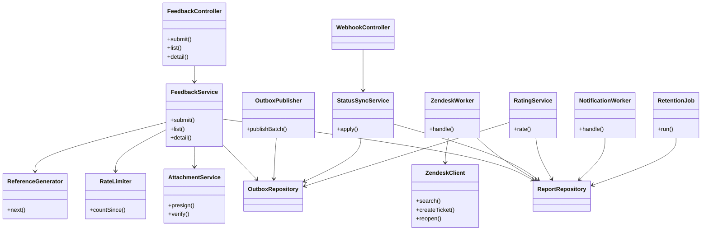
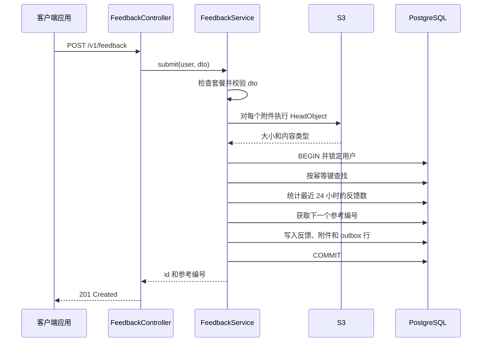
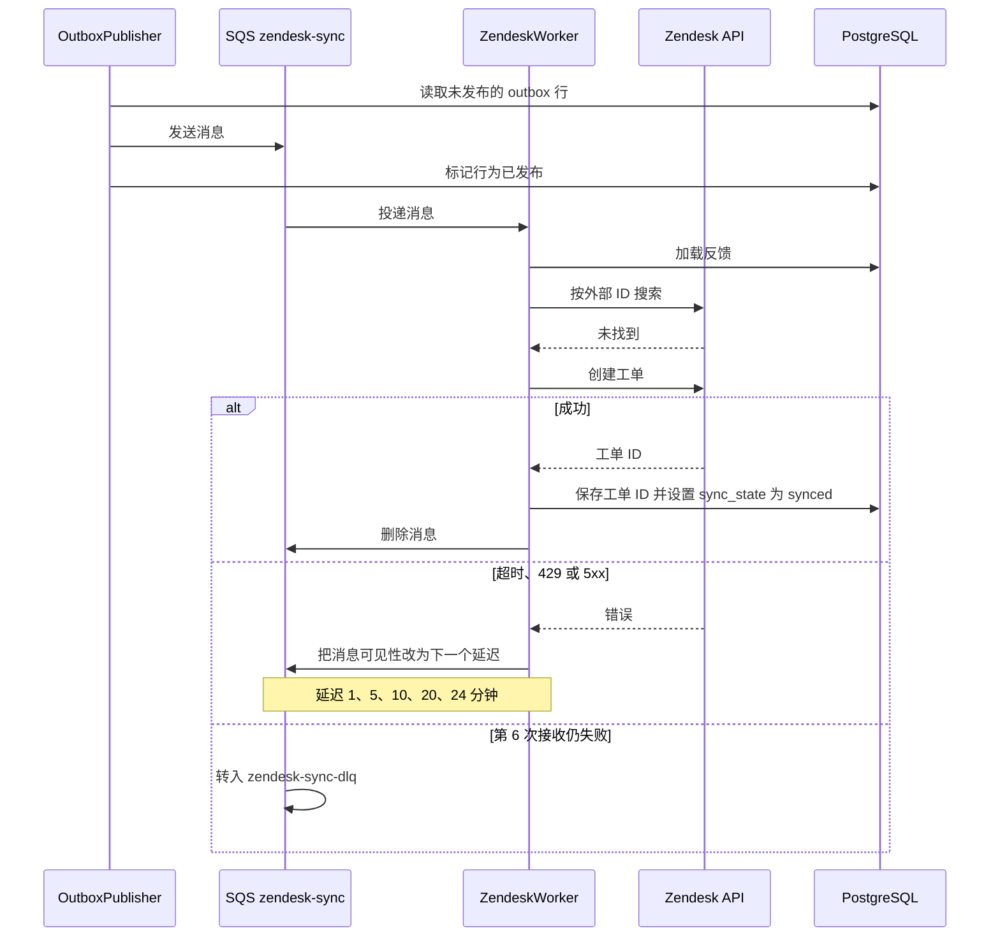
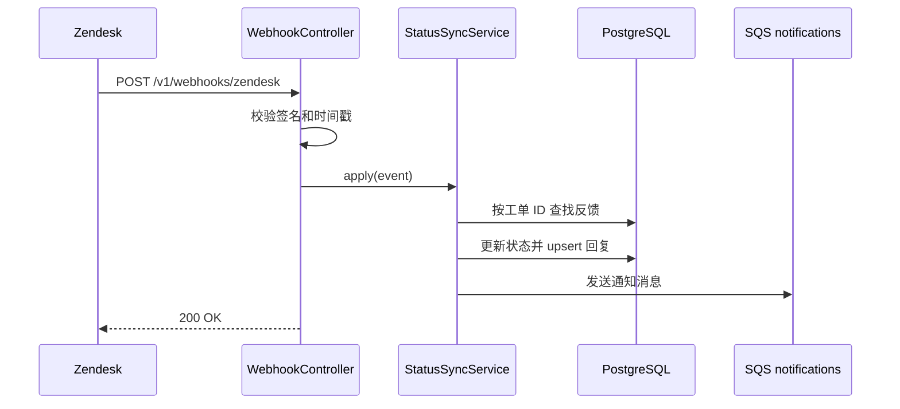
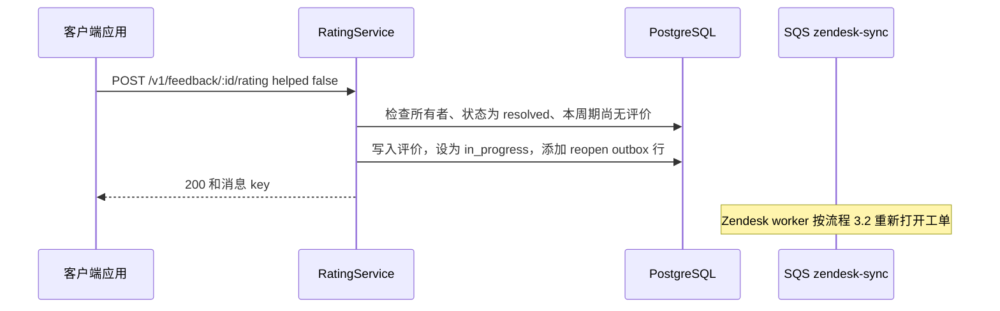
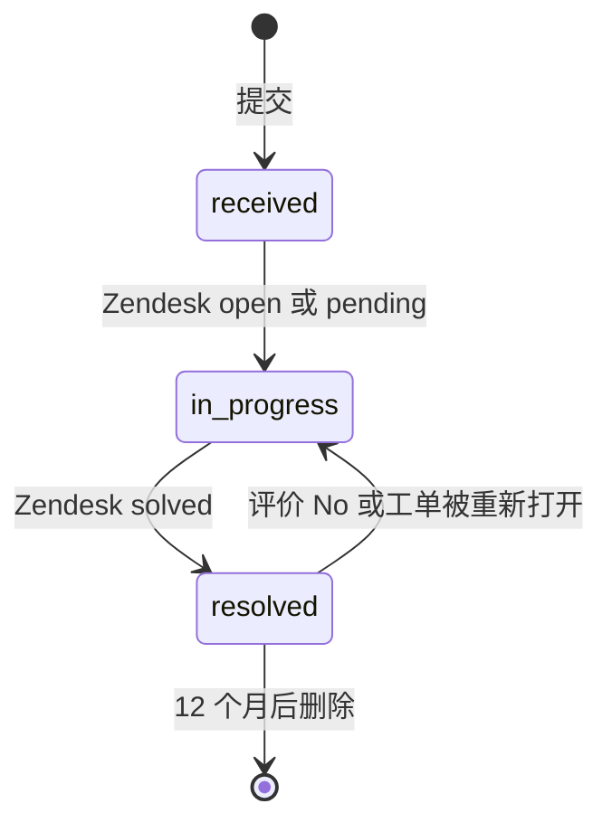

# 应用内反馈中心 — 软件设计文档（SDD）

> **示例文档。**这是 `SDD_Template_zh.md` 的一份虚构、完整填写的示例。它是 [TRD_Sample_In-App_Feedback_zh.md](../TRD/TRD_Sample_In-App_Feedback_zh.md) 之下的详细设计，并遵循 [PRD](../PRD/PRD_Sample_In-App_Feedback_zh.md) 和 [DRD](../DRD/DRD_Sample_In-App_Feedback_zh.md) 示例，因此产品（"LearnSphere"）、限制、名称和错误提示均保持一致。人物、数字和系统均为虚构；标注*估算*的数字只是猜测，需用实测值替换。产品界面文案（如 "Please choose an issue type"）保持英文原样，因为该产品首发仅支持英文。
>
> 本示例展示的是一份**进行中**的 SDD：因为项目尚未上线，第 14 章的实际构建说明是空的。

| | |
|---|---|
| **版本** | v0.3 |
| **作者（负责的工程师）** | Mei Tan（后端）；Carlos Reyes（移动端 / 网页端客户端模块） |
| **评审人（技术负责人）** | Daniel Ortiz |
| **状态** | 进行中（构建第 1 周） |
| **最后更新** | 2026-10-30 |
| **关联 PRD** | 应用内反馈中心 PRD v1.0（2026-10-15） |
| **关联 DRD** | 应用内反馈中心 DRD v1.0（2026-10-28） |
| **关联 TRD** | 应用内反馈中心 TRD v1.1（2026-10-30） |
| **代码仓库** | `learnsphere/feedback-service`、`learnsphere/app`（反馈模块） |
| **API 文档 / Schema 文档** | `openapi/feedback.yaml`（由 NestJS 装饰器生成）；schema 文档由 `db/migrations/` 生成 |

---

## 1. 目的、范围与追溯

### 1.1 目的

设计 `feedback-service` 的 API、worker 和定时任务，以及共享客户端反馈模块的网络层和草稿层，使已批准的 TRD 无需再追问即可实现。

### 1.2 本文档范围

- **覆盖**：`feedback-api`、outbox 发布器、Zendesk worker、webhook 处理器、通知 worker、留存与删除任务，以及客户端模块的提交、上传和草稿重发逻辑。
- **不覆盖**：表单的界面和行为（DRD）；除第 8 章所列字段和组之外的 Zendesk 配置；发出删除事件的隐私服务；邮件模板。

### 1.3 TRD 追溯

| TRD 引用 | TRD 的要求 | SDD 章节 |
|---------------|-----------------------|-------------|
| 4.1 提交反馈 | 持久化存储、工单入队、频率限制、幂等 | 3.1、4、5.1、6.1 |
| 4.2 上下文采集与分派 | 工单字段、标签、分派、优先级 | 3.2、6.2 |
| 4.3 列表与查看 | 仅所有者可访问、12 个月窗口、状态映射 | 5.1、6.3 |
| 4.4 状态同步与通知 | webhook、去重、5 分钟内确认 | 3.3、6.4 |
| 4.5 处理结果评价 | 每个周期评价一次，"No" 重新打开 | 3.4、6.5 |
| 6.2 可靠性（重试、死信队列） | 约 1 小时内重试 5 次，然后告警 | 3.2、6.2、7、9.4 |
| 3.3 数据生命周期 | 12 个月留存、删除请求 | 4、6.6 |
| 8 非功能 | 延迟、吞吐量、恢复 | 11、12 |
| 9.3 告警 | 死信队列、outbox 滞后、错误率 | 9.4 |
| 10 测试策略 | 测试层级和 AC 映射 | 10 |
| DRD DR-004 | 离线草稿 60 秒内发送 | 6.7 |

---

## 2. 模块与组件设计

### 2.1 模块概览



### 2.2 模块职责

| 组件（来自 TRD） | 模块 / 类 | 职责 | 对外接口 | 依赖 |
|----------------------|----------------|----------------|------------------|------------|
| `feedback-api` | `FeedbackController` | HTTP 路由、认证守卫、DTO 校验、错误映射 | REST `/v1/feedback...` | `FeedbackService`、`RatingService` |
| `feedback-api` | `FeedbackService` | 提交、列表和详情的用例 | `submit(user, dto)`、`list(user, cursor)`、`detail(user, id)` | 各 Repository、`AttachmentService`、`RateLimiter`、`ReferenceGenerator` |
| `feedback-api` | `AttachmentService` | 创建预签名 POST；校验已上传的对象 | `presign(user, type, size)`、`verify(user, keys)` | S3 客户端 |
| `feedback-api` | `RateLimiter` | 统计用户在时间窗口内的反馈数 | `countSince(userId, since)` | `ReportRepository` |
| `feedback-api` | `ReferenceGenerator` | 在调用方事务内生成下一个 `FB-YYYYMMDD-NNNN` 参考编号 | `next(tx, day)` | PostgreSQL |
| `feedback-api` | `RatingService` | 评价规则、重新打开请求 | `rate(user, id, dto)` | 各 Repository |
| `feedback-api` | `ReportRepository`、`OutboxRepository` | 数据访问（仅使用参数化 SQL） | 每张表的增删改查 | PostgreSQL |
| Outbox 发布器 | `OutboxPublisher` | 把未发布的 outbox 行发送到 SQS | `publishBatch()`（每 1 秒） | `OutboxRepository`、SQS |
| Zendesk worker | `ZendeskWorker`、`ZendeskClient` | 创建或重新打开工单；重试与退避；对 Zendesk 的限流 | `handle(message)` | Zendesk API、S3、学员 API |
| Zendesk webhook 处理器 | `WebhookController`、`StatusSyncService` | 校验事件；应用状态和回复 | `POST /v1/webhooks/zendesk`、`apply(event)` | 各 Repository、SQS |
| 通知 worker | `NotificationWorker` | 每个事件只发送一次应用内、推送和邮件通知 | `handle(message)` | SendGrid、推送服务、用户设置 API |
| 留存任务 | `RetentionJob` | 每日删除过期数据；处理删除事件 | `run(day)`、`onUserDeletion(event)` | 各 Repository、S3、Zendesk |
| 客户端模块 | `FeedbackClient`、`DraftStore` | 预签名、上传、提交、本地草稿、重发 | `submitReport(draft)` | 反馈 API |

### 2.3 设计说明

- **Outbox 模式**（TRD ADR-002）：反馈及其 outbox 行在同一个事务中写入。用户的请求里不会调用 SQS 或 Zendesk。
- **数据访问**使用团队标准的 PostgreSQL 库，仅使用参数化查询；不拼接 SQL 字符串。
- **复用的共享库**：`@learnsphere/validation`（DTO 校验器）、`@learnsphere/logging`（带字段白名单的结构化日志）、`@learnsphere/auth`（JWT 守卫）。
- **一个镜像，三种进程**：同一个服务镜像以 `api`、`worker`（Zendesk 和通知消费者、outbox 发布器）和 `jobs`（留存任务）三种方式运行，通过环境变量选择。

---

## 3. 关键流程

### 3.1 提交反馈 — 成功路径



### 3.2 Zendesk 同步 — 成功、重试与失败



### 3.3 来自 Zendesk 的状态更新



### 3.4 评价 "No" 重新打开工单



---

## 4. 数据设计

### 4.1 表

所有表位于 schema `feedback`。以自动生成的 schema 文档为准；下面的 DDL 是设计稿。

```sql
CREATE TABLE feedback.feedback_report (
  id                   UUID PRIMARY KEY,
  reference            TEXT NOT NULL UNIQUE,
  user_id              UUID NOT NULL,
  idempotency_key      UUID NOT NULL,
  plan_type            TEXT NOT NULL,
  issue_type           TEXT NOT NULL CHECK (issue_type IN
                         ('video_audio','quiz_grading','course_content','billing','app_bug','other')),
  description          TEXT NOT NULL CHECK (char_length(description) BETWEEN 10 AND 1000),
  reply_email          TEXT NOT NULL CHECK (char_length(reply_email) <= 254),
  course_id            TEXT,
  lesson_id            TEXT,
  device_model         TEXT NOT NULL,
  os_version           TEXT NOT NULL,
  app_version          TEXT NOT NULL,
  locale               TEXT NOT NULL,
  client_submitted_at  TIMESTAMPTZ NOT NULL,
  status               TEXT NOT NULL DEFAULT 'received'
                         CHECK (status IN ('received','in_progress','resolved')),
  queue                TEXT NOT NULL CHECK (queue IN ('billing','general')),
  priority             BOOLEAN NOT NULL DEFAULT false,
  zendesk_ticket_id    TEXT UNIQUE,
  zendesk_updated_at   TIMESTAMPTZ,
  sync_state           TEXT NOT NULL DEFAULT 'pending'
                         CHECK (sync_state IN ('pending','synced','failed')),
  resolution_seq       INT NOT NULL DEFAULT 0,
  last_viewed_at       TIMESTAMPTZ,
  created_at           TIMESTAMPTZ NOT NULL DEFAULT now(),
  updated_at           TIMESTAMPTZ NOT NULL DEFAULT now(),
  resolved_at          TIMESTAMPTZ,
  deleted_at           TIMESTAMPTZ,
  UNIQUE (user_id, idempotency_key)
);

CREATE TABLE feedback.outbox (
  id            BIGSERIAL PRIMARY KEY,
  report_id     UUID NOT NULL,
  type          TEXT NOT NULL CHECK (type IN ('zendesk_create','zendesk_reopen','notification')),
  payload       JSONB NOT NULL,
  created_at    TIMESTAMPTZ NOT NULL DEFAULT now(),
  published_at  TIMESTAMPTZ
);
```

| 表 | 列 | 类型 | 必填 | 约束 | 备注 |
|-------|--------|------|----------|-------------|-------|
| `feedback_attachment` | id | uuid | 是 | 主键 | |
| | report_id | uuid | 是 | 外键 → report，`ON DELETE CASCADE` | 每条反馈最多 3 个（在代码中检查） |
| | s3_key | text | 是 | 唯一 | `feedback/{userId}/{uuid}.{ext}` |
| | content_type | text | 是 | `image/png` 或 `image/jpeg` | |
| | size_bytes | int | 是 | 1 至 5,242,880 | |
| | created_at | timestamptz | 是 | 默认 now() | |
| `feedback_reply` | id | uuid | 是 | 主键 | |
| | report_id | uuid | 是 | 外键，级联 | |
| | zendesk_comment_id | text | 是 | 唯一 | 回复的幂等键 |
| | agent_first_name | text | 是 | | 客服姓名的第一个词 |
| | body | text | 是 | | 仅公开评论 |
| | posted_at | timestamptz | 是 | | |
| `feedback_rating` | id | uuid | 是 | 主键 | |
| | report_id | uuid | 是 | 外键，级联 | |
| | resolution_seq | int | 是 | 与 `report_id` 联合唯一 | 每个解决周期一条评价 |
| | helped | boolean | 是 | | |
| | comment | text | 否 | ≤ 300 个字符 | **个人数据** |
| | created_at | timestamptz | 是 | 默认 now() | |
| `reference_counter` | day | date | 是 | 主键 | UTC 日期 |
| | last_value | int | 是 | | 通过 upsert 递增 |
| `notification_log` | dedupe_key | text | 是 | 主键 | `{type}:{reportId}:{commentId 或 resolution_seq}` |
| | sent_at | timestamptz | 是 | 默认 now() | 保留 30 天 |

个人数据列：`user_id`、`description`、`reply_email`、`comment`、回复正文以及 S3 对象。

### 4.2 索引与查询计划

| 查询 | 索引 | 预期行数 | 备注 |
|-------|-------|---------------|-------|
| 列出某用户的反馈，最新的在前 | `feedback_report (user_id, created_at DESC) WHERE deleted_at IS NULL` | 每页 ≤ 20 | 索引直接提供排序；游标为 `(created_at, id)` |
| 频率限制计数（最近 24 小时） | 同一索引 | ≤ 10 | `created_at > now() - interval '24 hours'` |
| 幂等键查找 | 唯一 `(user_id, idempotency_key)` | 0 或 1 | |
| 按工单查找（webhook） | 唯一 `zendesk_ticket_id` | 0 或 1 | |
| 某条反馈的回复 | `feedback_reply (report_id, posted_at)` | 几十条 | |
| 未发布的 outbox 行 | `outbox (id) WHERE published_at IS NULL` | 每次轮询 ≤ 100 | 部分索引让它保持极小 |
| 留存扫描 | `feedback_report (created_at) WHERE deleted_at IS NULL` | 每批 ≤ 500 | 在 UTC 02:00 运行 |
| 产品分析（只读副本） | `(issue_type, created_at)`、`(course_id, created_at)` | 聚合 | 仅限只读副本 |

### 4.3 约束与事务

- **提交事务顺序**：(1) `pg_advisory_xact_lock(hashtextextended(user_id::text, 0))`，让同一用户的提交串行；(2) 幂等键查找；(3) 频率限制计数；(4) 参考编号 upsert；(5) 写入反馈、附件和 outbox 行；(6) 提交。
- **隔离级别**：`READ COMMITTED`。防止两个并行提交同时通过频率限制检查的是按用户的 advisory lock，而不是更严格的隔离级别。
- **热点行**：同一 UTC 日期的所有提交都会更新同一行 `reference_counter`，因此会在该行锁上短暂排队。事务很短（见第 11 章），所以在设计的突发量以内可以接受。
- **Outbox 认领**：发布器使用 `FOR UPDATE SKIP LOCKED` 读取，因此多个发布器不会取到同一行。
- **数据库保证**：枚举、长度检查、唯一性、外键。**代码保证**：套餐、附件归属与类型、附件数量、频率限制、状态规则。

### 4.4 缓存

| 数据 | 缓存位置 | TTL | 失效方式 | 原因 |
|------|--------------|-----|--------------|-----|
| JWT 公钥 | 内存 | 10 分钟 | 遇到未知 key ID 时刷新 | 避免每个请求都调用认证服务 |
| 功能开关取值 | 内存 | 30 秒 | 到期 | 无需每个请求都调用即可快速生效的紧急开关 |
| 用户邮件设置 | 内存 | 60 秒 | 到期 | 通知 worker 避免重复调用 |
| 反馈与回复 | 不缓存 | 不适用 | 不适用 | 量小；归属检查必须精确 |

### 4.5 迁移与回填

- **迁移文件**（Flyway）：`V1__schema_and_report.sql`、`V2__attachment_reply_rating.sql`、`V3__outbox_counter_log.sql`、`V4__indexes.sql`。
- **回滚**：配套的 `U1`–`U4` 脚本需手动执行，因为 Flyway 社区版没有自动撤销功能。上线前，回滚就是删除整个 schema。上线后，改为关闭开关，迁移保持不动。
- **回填**：无。

---

## 5. 接口详情

### 5.1 端点

**OpenAPI 文件**：`openapi/feedback.yaml`（自动生成；与此处示例不一致时以它为准）。除非另有说明，所有端点都需要有效的 JWT。

#### `POST /v1/feedback/attachments/presign`

- **谁可以调用**：任何已登录的学员。每用户每小时限 30 次。
- **请求**：`{ "contentType": "image/png", "sizeBytes": 2048000 }`
- **响应（200）**：

```json
{
  "attachmentKey": "feedback/{userId}/{uuid}.png",
  "upload": { "url": "https://…s3…", "fields": { "key": "…", "policy": "…", "x-amz-signature": "…" } },
  "expiresInSeconds": 300
}
```

- **规则**：`contentType` 必须是 `image/png` 或 `image/jpeg`，否则返回 `VAL-002`。POST 策略固定了 key 和内容类型，并把 `content-length-range` 设为 1–5,242,880。
- **副作用**：无。

#### `POST /v1/feedback`

- **谁可以调用**：仅付费学员（`plan` 声明）；否则 `AUTH-002`。每用户每 24 小时限 10 条反馈。
- **请求**：

```json
{
  "idempotencyKey": "6f0c0e8e-…",
  "issueType": "video_audio",
  "description": "Video freezes at 3:42",
  "replyEmail": "sam@example.com",
  "attachmentKeys": ["feedback/…/a1.png"],
  "context": {
    "courseId": "sql-101", "lessonId": "l-004",
    "deviceModel": "iPhone14,5", "osVersion": "iOS 17.4",
    "appVersion": "5.8.0", "locale": "en-US",
    "clientSubmittedAt": "2026-10-30T14:05:11Z"
  }
}
```

| 字段 | 类型 | 必填 | 校验 |
|-------|------|----------|------------|
| idempotencyKey | uuid | 是 | 有效的 UUID v4 |
| issueType | string | 是 | 6 个枚举值之一 |
| description | string | 是 | 去除首尾空白后 10–1,000 个字符 |
| replyEmail | string | 是 | 有效邮箱，≤ 254 个字符 |
| attachmentKeys | string[] | 否 | ≤ 3；每个都以 `feedback/{userId}/` 开头 |
| context.deviceModel, osVersion, appVersion, locale, clientSubmittedAt | string | 是 | 非空；时间戳为 ISO 8601 |
| context.courseId, lessonId | string | 否 | 要么都有，要么都没有 |

- **响应（201）**：`{ "id": "b1c7…", "reference": "FB-20261030-0042", "status": "received" }`
- **副作用**：一条 `zendesk_create` 和一条 `notification`（确认）outbox 行。使用相同幂等键的重复请求会返回原来的 `201`，且不创建任何内容。

#### `GET /v1/feedback` 和 `GET /v1/feedback/:id`

- **谁可以调用**：仅所有者。他人的 ID 返回 `404`。
- **列表项**：`id`、`reference`、`issueType`、`status`、`createdAt`、`hasUnreadUpdate`。游标分页，每页 20 条，最新的在前，仅最近 12 个月。
- **详情额外包含**：`description`、`attachments[]`（签名 GET URL，5 分钟）、`replies[]`（`agentFirstName`、`body`、`postedAt`）、`rating`。
- **副作用**：详情调用会设置 `last_viewed_at = now()`，从而清除 `hasUnreadUpdate`。

#### `POST /v1/feedback/:id/rating`

- **谁可以调用**：所有者。每分钟限 10 次。
- **请求**：`{ "helped": false, "comment": "Still freezing" }`（`comment` 选填，≤ 300 个字符）。
- **响应（200）**：`{ "status": "in_progress", "messageKey": "feedback.rating.reopened" }`（`helped: true` 时为 `"status": "resolved"` 和 `feedback.rating.thanks`）。
- **副作用**：当 `helped: false` 时，写入一条 `zendesk_reopen` outbox 行。

#### `POST /v1/webhooks/zendesk`

- **谁可以调用**：仅 Zendesk（网关 IP 白名单 + 签名）。不使用 JWT。
- **规则**：见 6.4。对有效签名的事件始终返回 `200`，即使工单未知。

### 5.2 错误目录

| HTTP | 错误码 | 条件 | 消息 key | 客户端行为 |
|------|------|-----------|-------------|-----------------|
| 400 | VAL-001 | 字段缺失或无效；`details.field` 指明字段 | `feedback.validation.{field}` | 显示该字段的提示；保留内容 |
| 400 | VAL-002 | 附件缺失、类型错误、归属错误、数量过多或超过 5 MB | `feedback.attachment.invalid` | "Image is too large (max 5 MB)" 或类型提示 |
| 401 | AUTH-001 | 令牌过期或无效 | `auth.expired` | 显示登录弹层，恢复草稿 |
| 403 | AUTH-002 | 非付费套餐 | `feedback.not_available` | 通用错误（入口本应隐藏） |
| 404 | NOTFOUND-001 | 反馈不存在或不属于调用者 | `feedback.not_found` | 显示未找到状态 |
| 409 | STATE-001 | 不允许评价（未解决或已评价） | `feedback.rating.not_allowed` | 隐藏评价卡片 |
| 429 | RATE-001 | 最近 24 小时已有 10 条反馈 | `feedback.rate_limit` | "You've reached today's limit. Please try again tomorrow or email support." |
| 503 | SYS-001 | 数据库或依赖不可用 | `feedback.unavailable` | 保存草稿，自动重试 |

### 5.3 消息与事件

| 队列 | 载荷（schema） | 生产者 | 消费者 | 备注 |
|-------|------------------|----------|----------|-------|
| `zendesk-sync` | `{ "v": 1, "reportId": "uuid", "action": "create \| reopen" }` | `OutboxPublisher` | `ZendeskWorker` | < 1 KB；无序；接收 6 次后转入 `zendesk-sync-dlq` |
| `notifications` | `{ "v": 1, "userId": "uuid", "reportId": "uuid", "type": "ack \| reply \| resolved", "dedupeKey": "string" }` | 提交路径（经 outbox）、`StatusSyncService` | `NotificationWorker` | < 1 KB；接收 3 次后转入 `notifications-dlq` |
| `retention` | `{ "v": 1, "day": "YYYY-MM-DD" }` | 调度器 | `RetentionJob` | 每天一条消息 |
| `user.deletion_requested`（来自隐私服务） | `{ "userId": "uuid" }` | 隐私服务 | `RetentionJob.onUserDeletion` | 由其他团队负责 |

---

## 6. 详细逻辑

### 6.1 提交反馈

- **追溯至**：TRD 4.1
- **步骤**：
  1. 认证；从 JWT 读取 `sub` 和 `plan`。非付费套餐 → `AUTH-002`。
  2. 校验 DTO（见 5.1）。失败 → `VAL-001`。
  3. 在事务之外校验附件（让锁保持很短）：每个 key 以 `feedback/{userId}/` 开头；S3 `HeadObject` 显示大小 ≤ 5,242,880 且内容类型为 PNG 或 JPEG；最多 3 个。失败 → `VAL-002`。
  4. 开启事务，获取按用户的 advisory lock。
  5. 查找 `(user_id, idempotency_key)`。如果找到，返回已保存的响应并停止（在频率限制检查之前，这样已被接受的反馈的重试绝不会被拦截）。
  6. 统计该用户最近 24 小时的反馈数。若 ≥ 10 → `RATE-001`。
  7. 获取下一个参考编号（对今天的 UTC 日期做计数器 upsert）。
  8. 写入反馈、其附件和两条 outbox 行（`zendesk_create`、`notification` 确认）。当 `issue_type = billing` 时 queue 为 `billing`，否则为 `general`。
  9. 提交并返回 `201`。
- **伪代码**：

```text
submit(user, dto):
  require user.plan in PAID_PLANS            else AUTH-002
  validate(dto)                              else VAL-001
  verifyAttachments(user.id, dto.keys)       else VAL-002
  tx:
    lock(user.id)
    existing = reports.findByKey(user.id, dto.idempotencyKey)
    if existing: return existing.response()
    if reports.countSince(user.id, now - 24h) >= 10: throw RATE-001
    ref = counter.next(utcToday())           # FB-YYYYMMDD-NNNN
    report = reports.insert(dto, ref, queue = route(dto.issueType))
    attachments.insert(report.id, dto.keys)
    outbox.add(report.id, 'zendesk_create')
    outbox.add(report.id, 'notification', type = 'ack')
  return report.response()
```

- **状态生命周期**：



- **幂等性**：通过 `(user_id, idempotency_key)`。参考编号计数器与插入处于同一个事务内递增，因此插入失败不会白白消耗编号。
- **并发**：advisory lock 让同一用户的提交串行。不同用户之间只共享很短的计数器行锁。
- **超时与重试**：数据库语句超时 2 秒；S3 `HeadObject` 超时 2 秒，重试一次；整个请求上限 10 秒。此请求中不会调用 Zendesk 或学员 API。

### 6.2 Zendesk 同步（上下文采集与分派）

- **追溯至**：TRD 4.2、6.2
- **Outbox 发布器**：每 1 秒，用 `FOR UPDATE SKIP LOCKED` 选出最多 100 条未发布的行，通过 `SendMessageBatch` 发送，然后设置 `published_at`。在发送和标记之间崩溃会产生重复消息；消费者具备幂等性。
- **Worker 步骤**（`action = create`）：
  1. 加载反馈。如果 `zendesk_ticket_id` 已设置，删除消息并停止。
  2. 在 Zendesk 中搜索外部 ID 等于该反馈 `reference` 的工单。如果找到，保存它的 ID 并停止（覆盖"创建后崩溃"的情形）。
  3. 从学员 API 查询证书截止日（超时 500 ms，不重试）。如果在 7 天内，设置 `priority = true`。失败或超时则保持 false（DEV-002）。
  4. 上传每个附件：从 S3 流式传输到 Zendesk 的上传端点，并保留上传令牌。
  5. 创建工单：外部 ID = 参考编号；主题 `[{reference}] {问题类型名称}`；评论 = 描述加上传令牌；请求人 = 回复邮箱；按队列分到组（General 或 Billing）；标签 `app-feedback`、问题类型、`plan-{type}`，如有则加 `priority`；参考编号、课程、课时、设备、系统、应用版本、语言区域、用户 ID 写入自定义字段。
  6. 保存 `zendesk_ticket_id`、`sync_state = synced`，并删除消息。
- **Worker 步骤**（`action = reopen`）：把工单状态设为 Open，添加标签 `reopened`，分配给资深客服组，并把学员的评论（如有）作为私有备注添加。
- **重试规则**：遇到超时、`429` 或 `5xx` 时，把消息可见性改为其接收次数对应的延迟，然后让它留在队列中：

| 接收次数 | 下次延迟 | 自首次失败起经过 |
|---------------|------------|-----------------------------|
| 1 | 60 秒 | 1 分钟 |
| 2 | 300 秒 | 6 分钟 |
| 3 | 600 秒 | 16 分钟 |
| 4 | 1,200 秒 | 36 分钟 |
| 5 | 1,440 秒 | 60 分钟 |
| 6 | 转入 `zendesk-sync-dlq` | — |

  遇到 `429` 时，取该延迟与 `Retry-After` 头中较大的值。SQS 的 `DelaySeconds` 最多只允许 15 分钟，所以重试使用 `ChangeMessageVisibility`（最长 12 小时）。其他 `4xx` 错误不重试：反馈直接进入死信队列。
- **死信队列处理器**：设置 `sync_state = failed`，增加 `feedback_dlq_depth`，并通知客服运营的渠道。修复后，由重放工具把死信消息重新入队。
- **对 Zendesk 的限流**：每个 worker 副本使用每分钟 70 个请求的令牌桶（2 个副本 = 每分钟 140 个，为假设的 200 的 70%）。这是静态分配；如果副本数或 Zendesk 套餐变化，需要重新评估。
- **幂等性**：创建前按外部 ID 查找（步骤 2），意味着重试绝不会创建第二张工单。
- **并发**：每个副本一次处理 5 条消息。

### 6.3 列表与查看反馈

- **追溯至**：TRD 4.3
- **规则**：
  - 每个查询都包含 `user_id = :caller AND deleted_at IS NULL AND created_at > now() - interval '12 months'`。无结果 → `404`（绝不返回 `403`）。
  - 游标是 `(created_at, id)` 的 base64；下一页使用 `(created_at, id) < cursor`。
  - `hasUnreadUpdate = updated_at > COALESCE(last_viewed_at, created_at)`。
  - 附件 URL 是有效期 5 分钟的预签名 GET URL，带已保存的内容类型和 `inline` 展示方式。
  - Zendesk 的私有备注绝不会存入 `feedback_reply`。

### 6.4 状态同步与通知

- **追溯至**：TRD 4.4
- **Webhook 步骤**：
  1. 用 webhook 密钥对 `timestamp + body` 计算 HMAC-SHA256；用常量时间比较。不匹配 → `401`。
  2. 如果时间戳超过 300 秒，拒绝 → `401`。
  3. 按 `zendesk_ticket_id` 查找反馈。未知工单 → `200`，不做任何改动。
  4. 映射状态：`new` → `received`；`open`、`pending` → `in_progress`；`solved`、`closed` → `resolved`。
  5. 仅当事件时间比 `zendesk_updated_at` 新时才应用（忽略迟到或重复的事件）。变为 `resolved` 时，递增 `resolution_seq` 并设置 `resolved_at`。
  6. 按 `zendesk_comment_id` upsert 公开评论；`agent_first_name` 是作者姓名的第一个词。
  7. 添加一条通知消息（`reply` 或 `resolved`），返回 `200`。
- **通知 worker**：去重键 = `{type}:{reportId}:{commentId 或 resolution_seq}`。向 `notification_log` 执行 `INSERT … ON CONFLICT DO NOTHING`；只有插入了行才发送。发送应用内通知和带深链 `learnsphere://feedback/{id}` 的推送；除非学员已关闭邮件或邮件紧急开关处于关闭状态，否则发送邮件。确认通知在提交后 5 分钟内发出；典型延迟低于 30 秒（*估算*）。
- **超时与重试**：SendGrid 超时 5 秒，重试 3 次；推送超时 3 秒，重试 3 次；接收 3 次后转入死信队列。

### 6.5 处理结果评价

- **追溯至**：TRD 4.5
- **步骤**：
  1. 归属检查（不是所有者则 `404`）。
  2. 要求 `status = resolved` 且 `resolution_seq > 0`；否则 `STATE-001`。
  3. 以 `(report_id, resolution_seq)` 写入评价；唯一约束冲突 → `STATE-001`（覆盖双击的情形）。
  4. 如果 `helped = false`：在同一事务中设置 `status = in_progress`，更新 `updated_at`，并添加一条 `zendesk_reopen` outbox 行。
  5. 返回新的状态和消息 key。
- **并发**：由唯一约束（而不是应用层检查）防止两次同时的评价。

### 6.6 留存与删除

- **追溯至**：TRD 3.3
- **每日任务（UTC 02:00）**：按每批 500 条循环：选出 `created_at < now() - 12 months` 的反馈；收集其 S3 key；在 S3 中 `DeleteObjects`；删除行（回复、评价和附件级联删除）；记录数量。12 个月的 S3 生命周期规则作为兜底。
- **用户删除事件**：删除该用户的所有反馈和 S3 对象，并脱敏对应 Zendesk 工单上的个人字段。目标 7 天；法定上限 30 天。删除只用反馈 ID 记录。
- **幂等性**：删除已删除的数据不会产生任何效果。

### 6.7 客户端草稿与重发

- **追溯至**：DRD DR-004；TRD 5.3
- **步骤**：
  1. 表单打开时，生成一个幂等键，并与草稿一起保存。
  2. 点击提交时，先上传每张截图（先预签名，再上传），然后调用 `POST /v1/feedback`。
  3. 遇到网络错误或 `503`，在本地保存完整草稿（字段、上传状态、幂等键）并显示离线提示。
  4. 网络恢复后，按从旧到新的顺序逐个发送已保存的草稿，60 秒内完成。如果预签名 URL 已过期，则重新申请。
  5. 带退避重试最多 5 次（15 秒、30 秒、60 秒、2 分钟、5 分钟）；之后保留草稿，并显示带重试按钮的 "Couldn't send" 通知。
  6. 超过 7 天的草稿会被删除。
- **幂等性**：每次都发送同一个键，所以草稿被发送两次也只会创建一条反馈。

---

## 7. 错误处理与边界情况

| 模块 | 故障 / 边界情况 | 如何检测 | 处理方式 | 对用户 / 系统的结果 | 记录 / 告警为 |
|--------|---------------------|--------------------|----------|--------------------------|---------------------|
| `FeedbackService` | 数据库不可用 | 连接或语句超时 | 返回 `503 SYS-001` | 客户端保存草稿并重试 | `feedback_submit_total{result="error"}`；API 错误率告警 |
| `FeedbackService` | 同一用户同时提交两次 | advisory lock | 第二个等待，然后重新计数 | 最多 10 条反馈 | `feedback_rate_limit_hits_total` |
| `AttachmentService` | 对象缺失、类型错误或过大 | `HeadObject` 结果 | `400 VAL-002` | 行内图片错误 | `feedback_submit_rejected`（原因） |
| `AttachmentService` | `HeadObject` 的 S3 超时 | 2 秒超时 | 重试一次，然后返回 `503` | 保存草稿 | 错误日志、S3 错误指标 |
| `OutboxPublisher` | 发送后、标记前崩溃 | 行仍为未发布 | 下次轮询时重新发送 | 重复消息，被 worker 忽略 | Outbox 滞后指标 |
| `ZendeskWorker` | Zendesk 超时、`429`、`5xx` | HTTP 结果 | 按 6.2 退避 | 反馈保持 "Received" | `feedback_zendesk_sync_total{result="retry"}` |
| `ZendeskWorker` | Zendesk `4xx`（非 429） | HTTP 状态码 | 不重试；转入死信队列 | `sync_state = failed` | 死信队列告警 |
| `ZendeskWorker` | 创建工单后崩溃 | 重试时按外部 ID 找到工单 | 保存 ID，停止 | 没有重复工单 | info 日志 |
| `ZendeskWorker` | 上传时 S3 对象缺失 | `NoSuchKey` | 创建不含该附件的工单，并添加备注 | 工单仍被创建 | warn 日志 |
| `WebhookController` | 签名错误或时间戳过旧 | HMAC / 时间戳检查 | `401`，不做任何改动 | 无 | `webhook_rejected` |
| `StatusSyncService` | 重复或乱序的事件 | `zendesk_updated_at` 比较 | 忽略过时的事件 | 状态以最新事件为准 | debug 日志 |
| `NotificationWorker` | SendGrid 或推送失败 | HTTP 错误 | 重试 3 次，然后进入死信队列 | 缺少一条通知（应用内副本仍在） | 通知失败率 |
| `RatingService` | 双击 | 唯一约束 | `409 STATE-001` | 隐藏评价卡片 | info 日志 |
| `RetentionJob` | 批处理中途 S3 删除失败 | `DeleteObjects` 返回错误 | 跳过该批的数据库删除，下次运行重试 | 数据多保留一天 | 任务失败告警 |
| 客户端模块 | 预签名 URL 已过期 | S3 `403` | 申请新 URL 并重新上传 | 用户无感 | 客户端事件 |

---

## 8. 配置

### 8.1 配置项

| Key | 含义 | 默认值 | 开发 | 预发布 | 生产 |
|-----|---------|---------|-----|---------|------------|
| `RATE_LIMIT_MAX_REPORTS` | 窗口内最多反馈数 | 10 | 100 | 10 | 10 |
| `RATE_LIMIT_WINDOW_HOURS` | 窗口长度 | 24 | 24 | 24 | 24 |
| `ATTACHMENT_MAX_COUNT` | 每条反馈的截图数 | 3 | 3 | 3 | 3 |
| `ATTACHMENT_MAX_BYTES` | 每张截图的字节数 | 5242880 | 相同 | 相同 | 相同 |
| `PRESIGN_EXPIRY_SECONDS` | 上传 URL 有效期 | 300 | 相同 | 相同 | 相同 |
| `SIGNED_GET_EXPIRY_SECONDS` | 下载 URL 有效期 | 300 | 相同 | 相同 | 相同 |
| `OUTBOX_POLL_INTERVAL_MS` | 发布器轮询间隔 | 1000 | 相同 | 相同 | 相同 |
| `OUTBOX_BATCH_SIZE` | 每次轮询的行数 | 100 | 相同 | 相同 | 相同 |
| `ZENDESK_RETRY_DELAYS_SECONDS` | 按接收次数的退避 | 60,300,600,1200,1440 | 5,5,5,5,5 | 60,300,600,1200,1440 | 60,300,600,1200,1440 |
| `ZENDESK_RATE_LIMIT_PER_REPLICA_PER_MIN` | 对 Zendesk 的出站调用 | 70 | 20 | 70 | 70 |
| `ZENDESK_GROUP_ID_GENERAL`、`_BILLING`、`_SENIOR` | 客服组 | 无 | 沙箱 ID | 沙箱 ID | 生产 ID |
| `ZENDESK_FIELD_IDS` | 自定义字段 ID 映射 | 无 | 沙箱 | 沙箱 | 生产 |
| `LEARNER_API_TIMEOUT_MS` | 优先级查询超时 | 500 | 相同 | 相同 | 相同 |
| `WEBHOOK_MAX_AGE_SECONDS` | 允许的事件时长 | 300 | 相同 | 相同 | 相同 |
| `DB_STATEMENT_TIMEOUT_MS` | 查询上限 | 2000 | 相同 | 相同 | 相同 |
| `JWT_KEYS_CACHE_SECONDS` | 密钥缓存时间 | 600 | 相同 | 相同 | 相同 |
| `RETENTION_MONTHS` | 留存期 | 12 | 1 | 12 | 12 |
| `RETENTION_BATCH_SIZE` | 每批删除行数 | 500 | 相同 | 相同 | 相同 |

### 8.2 功能开关

| 开关 | 用途 | 默认值 | 谁能修改 | 移除计划 |
|------|---------|---------|-------------------|--------------|
| `feedback_center_enabled` | 入口的百分比放量和紧急关闭开关 | 0% | 研发负责人、产品 | 100% 放量 4 周后移除 |
| `feedback_email_notifications_enabled` | 邮件发送的紧急开关 | 开启 | 研发值班 | 作为长期紧急开关保留 |

### 8.3 密钥

| 密钥名称 | 使用方 | 存放位置 | 轮换 |
|-------------|---------|-----------|----------|
| `ZENDESK_API_TOKEN` | Zendesk worker | 密钥管理器：`feedback/zendesk` | 90 天 |
| `ZENDESK_WEBHOOK_SECRET` | Webhook 处理器 | 密钥管理器：`feedback/zendesk` | 90 天 |
| `SENDGRID_API_KEY` | 通知 worker | 密钥管理器：`feedback/sendgrid` | 90 天 |
| 数据库凭据 | 所有进程 | 平台管理 | 平台计划 |

---

## 9. 可观测性详情

### 9.1 日志

| 事件 | 级别 | 必含字段 | 不得包含 |
|-------|-------|-----------------|------------------|
| `feedback_submit_ok` | info | request_id, trace_id, user_hash, report_id, issue_type, attachment_count | 描述、邮箱、文件名 |
| `feedback_submit_rejected` | warn | request_id, user_hash, code | 描述、邮箱 |
| `zendesk_sync_attempt` | info | report_id, receive_count, result, duration_ms | 工单正文 |
| `zendesk_sync_failed` | error | report_id, receive_count, http_status | 工单正文 |
| `webhook_rejected` | warn | reason, source_ip | 请求体 |
| `notification_sent` | info | report_id, type, channel | 消息正文 |
| `retention_run` | info | day, deleted_reports, deleted_objects | 任何反馈内容 |

### 9.2 指标

| 指标名称 | 类型 | 标签 | 含义 |
|-------------|------|--------|---------|
| `feedback_submit_total` | Counter | result（`ok`、`rejected`、`error`） | 提交结果 |
| `feedback_submit_duration_seconds` | Histogram | 无 | 服务端提交耗时 |
| `feedback_rate_limit_hits_total` | Counter | 无 | 被频率限制拒绝的请求 |
| `feedback_outbox_lag_seconds` | Gauge | 无 | 最早未发布行的年龄 |
| `feedback_zendesk_sync_total` | Counter | result（`ok`、`retry`、`failed`） | 同步结果 |
| `feedback_dlq_depth` | Gauge | queue | 每个死信队列中的消息数 |
| `zendesk_api_429_total` | Counter | 无 | Zendesk 限流响应 |
| `feedback_ack_delay_seconds` | Histogram | 无 | 从提交到确认的耗时 |
| `feedback_spam_tag_total` | Counter | 无 | 被客服标记为 `spam` 的反馈（来自 webhook） |

### 9.3 链路追踪

| Span 名称 | 位置 | 属性 |
|-----------|-------|------------|
| `feedback.submit` | `FeedbackService` | report_id, attachment_count |
| `feedback.db.tx` | `FeedbackService` | 无 |
| `zendesk.sync` | `ZendeskWorker` | report_id, receive_count |
| `zendesk.http` | `ZendeskClient` | endpoint, status |
| `webhook.apply` | `StatusSyncService` | ticket_status |

trace ID 通过 SQS 消息属性传递，因此可以从 API 请求一直追踪到 worker。

### 9.4 告警对接

| TRD 告警 | 指标 / 查询 | 阈值 | 运行手册 |
|-----------|----------------|-----------|---------|
| 死信队列非空 | `feedback_dlq_depth{queue="zendesk-sync-dlq"}` | > 0 持续 15 分钟 | `runbooks/feedback-dlq.md` |
| Outbox 滞后 | `feedback_outbox_lag_seconds` | > 300 | `runbooks/feedback-outbox.md` |
| API 错误率 | 请求中 5xx 的占比 | > 1% 持续 5 分钟 | `runbooks/feedback-api.md` |
| Zendesk 429 | `increase(zendesk_api_429_total[5m])` | > 20 | `runbooks/feedback-zendesk.md` |
| 垃圾占比 | `feedback_spam_tag_total` ÷ `feedback_submit_total{result="ok"}` | 1 小时内 > 2% | `runbooks/feedback-abuse.md` |
| 确认延迟 | `feedback_ack_delay_seconds` | p99 > 300 秒持续 30 分钟 | `runbooks/feedback-notify.md` |

---

## 10. 测试设计

### 10.1 测试用例

| 编号 | 类型 | 场景 | 准备 / 数据 | 预期结果 | 覆盖 |
|----|------|----------|--------------|-----------------|--------|
| T-001 | 单元 | 有效提交 | 有效 DTO，付费套餐 | 反馈为 `received`，队列 `general`，两条 outbox 行 | 6.1 |
| T-002 | 单元 | 参考编号生成 | 计数器为 41；然后到下一天 | `FB-20261030-0042`；下一个 UTC 日期重置 | 6.1 |
| T-003 | 单元 | 描述长度 | 9、10、1,000 和 1,001 个字符 | 9 和 1,001 → `VAL-001`；其余通过 | 5.1 |
| T-004 | 单元 | 缺少问题类型 | 不含 `issueType` 的 DTO | `VAL-001`，字段 `issueType` | 5.1 |
| T-005 | 集成 | 截图过大 | 5,242,881 字节的对象 | S3 策略拒绝上传；`HeadObject` 检查 → `VAL-002` | 6.1 |
| T-006 | 集成 | 截图过多 | 4 个 key | `VAL-002` | 6.1 |
| T-007 | 集成 | 他人的附件 key | 位于其他用户前缀下的 key | `VAL-002` | 6.1 |
| T-008 | 集成 | 频率限制 | 提交 10 次，然后第 11 次 | 第 11 次 → `RATE-001`；不产生反馈或 outbox 行 | 6.1 |
| T-009 | 集成 | 并发提交 | 同一用户并行提交 20 次，幂等键各不相同 | 恰好 10 次成功，10 次 → `RATE-001` | 4.3、6.1 |
| T-010 | 集成 | 幂等重试 | 同一键提交两次，包括已达限额时 | 相同的 `id` 和 `reference`；只有一行 | 6.1 |
| T-011 | 集成 | 免费套餐 | 免费套餐的令牌 | `AUTH-002` | 6.1 |
| T-012 | 集成 | 创建工单 | Zendesk 沙箱；一条 general、一条 billing 反馈 | 字段、标签和组都正确 | 6.2 |
| T-013 | 韧性 | 暂时性 Zendesk 错误 | `503` 三次，然后 `200`（缩短延迟） | 只有一张工单；延迟符合表格 | 6.2 |
| T-014 | 韧性 | Zendesk 宕机 | 每次尝试都返回 `503` | 第 6 次接收后：进入死信队列，`sync_state = failed`，告警 | 6.2 |
| T-015 | 韧性 | 创建后崩溃 | 在保存 ID 之前终止 worker | 重试时找到工单；没有重复 | 6.2 |
| T-016 | 集成 | 状态与回复 | Webhook：open、公开评论、私有备注 | `in_progress`；公开回复被保存；私有备注被忽略 | 6.4 |
| T-017 | 集成 | 伪造 webhook | 签名错误；时间戳过旧 | `401`，不做任何改动 | 6.4 |
| T-018 | 集成 | 重复 / 乱序 webhook | 同一事件两次；旧事件最后到达 | 状态与最新事件一致 | 6.4 |
| T-019 | 集成 | 评价 "No" | 已解决的反馈 | `in_progress`，reopen 行；沙箱工单被重新打开，带标签和资深客服组 | 6.5 |
| T-020 | 集成 | 评价规则 | 评价两次；重新解决后再评价 | 第二次 → `STATE-001`；重新解决后允许 | 6.5 |
| T-021 | 集成 | 他人的反馈 | 用另一个用户 GET | `404` | 6.3 |
| T-022 | 集成 | 留存 | 11 个月和 13 个月的反馈 | 只有 13 个月的反馈及其对象被删除 | 6.6 |
| T-023 | 集成 | 用户删除 | 针对有 3 条反馈的用户的删除事件 | 所有反馈和对象均被移除 | 6.6 |
| T-024 | 端到端 | 离线草稿 | 飞行模式下提交，然后重新联网 | 60 秒内产生一条反馈；幂等键相同 | 6.7 |
| T-025 | 性能 | 负载与突发 | 3 倍预期量；每秒 10 条持续 10 分钟（预发布） | 满足 TRD 8；积压按第 11 章所述消化 | 11 |

### 10.2 验收标准映射

| PRD 标准 | 测试编号 |
|---------------|----------|
| AC-1 成功提交 | T-001, T-002, T-012 |
| AC-2 必填项校验 | T-003, T-004 |
| AC-3 离线提交 | T-010, T-024 |
| AC-4 截图过大 | T-005 |
| AC-5 频率限制 | T-008, T-009 |
| AC-6 状态可见 | T-016 |
| AC-7 评价后重新打开工单 | T-019, T-020 |

### 10.3 测试数据与 Mock

- 与生产环境拥有相同自定义字段和组的 Zendesk 沙箱账号；免费和付费套餐的种子用户。
- 集成测试中 S3 和 SQS 在本地模拟栈里运行；突发测试在预发布环境使用真实 SQS。
- 学员 API、SendGrid 和推送服务在集成测试中被 mock。
- 重试延迟测试使用假时钟；延迟通过 `ZENDESK_RETRY_DELAYS_SECONDS` 缩短。

---

## 11. 性能与容量详情

| 领域 | 预期负载 | 资源使用 / 瓶颈 | 基准测试结果 | 调优说明 |
|------|---------------|---------------------------|------------------|--------------|
| `POST /feedback` | 上线时约每天 210 条；突发设计值每秒 10 条 | 最多 3 个并行 `HeadObject` 调用（每个约 20–40 ms，*估算*）加一个短事务（约 15–25 ms，*估算*） | *估算*：服务端 p95 约 120–200 ms，对比 400 ms 目标；第 2 周实测 | 每个 API 副本的连接池为 20；语句超时 2 秒 |
| 计数器行 | 同上 | 每次提交事务期间持有的行锁 | *估算*：远高于每秒 100 次提交 | 只有突发目标增大时才重新评估 |
| `GET /feedback` | 低 | 一个返回 ≤ 20 行的索引查询（*估算* 2–5 ms） | 待实测 | 无 |
| Webhook 处理器 | 大致每次工单更新一个事件 | 3 个短查询 | *估算* < 20 ms | 无 |
| Zendesk worker | 见下文 | 每条反馈的 Zendesk 调用数：搜索 1 + 创建 1 + 上传（35% 带截图，平均约 1.5 张）≈ 平均 2.5 次，最多 5 次 | 待对沙箱实测 | 总计每分钟 140 次调用（2 个副本 × 70） |
| 留存任务 | 每天几百行 | 每次循环一批 500 条 | 待实测 | 在非高峰时段运行 |

**假设限制下的 Zendesk 吞吐量**（*估算*，限制仍待确认）：每分钟 140 次调用 ÷ 每条反馈 2.5 次调用 ≈ 每分钟 56 条反馈 ≈ 每秒 0.93 条。设计的突发量是每秒 10 条持续 10 分钟 = 6,000 条反馈。队列可以无错误地接收它们，但积压需要约 6,000 ÷ 56 ≈ 107 分钟（约 2 小时）才能消化完。在正常量下（约每小时 9 条），队列始终为空；Zendesk 宕机几个小时后，积压在几分钟内即可清空。

对于突发情形，这达不到原来的 TRD 目标（"Zendesk 恢复后 1 小时内全部同步"）。见 DEV-001。

---

## 12. 与 TRD 的偏差

| 编号 | TRD 引用 | 差异内容 | 原因 | 影响 | 批准人 | 日期 | TRD 是否已更新？ |
|----|---------------|--------------|-----|--------|-------------|------|--------------|
| DEV-001 | TRD 8（可靠性一行） | 恢复目标一分为二：正常量下 Zendesk 恢复后 1 小时内同步完成；设计的突发量（每秒 10 条持续 10 分钟）之后，积压约 2 小时清空（*估算*） | Zendesk 调用预算（第 11 章）使得在假设的限制下，6,000 条反馈无法在 1 小时内消化完 | 大规模事件后，反馈会更久地停留在 "Received"；确认通知不受影响，因为它们不依赖 Zendesk。客服运营确认真实限制后需重新核对；如果限制更低，评估 Zendesk 的批量创建工单端点 | Daniel Ortiz | 2026-10-30 | 是（TRD v1.1） |
| DEV-002 | TRD 4.2 和附录问题 3 | 证书截止日（priority）查询从提交请求移到 Zendesk worker | 提交路径中的学员 API 调用（最长 500 ms）可能破坏 400 ms 的 p95 目标，并使提交依赖于另一个团队的服务 | `priority` 在提交后几秒到几分钟才被设置，而不是在提交时；工单创建不变。如果查询失败，跳过标签，与之前一致 | Daniel Ortiz | 2026-10-30 | 是（TRD v1.1） |

---

## 13. 实现说明与 Agent 指令

### 13.1 上下文范围

- **从哪里开始**：`src/feedback/`（controller、service、repository）、`src/zendesk/`（worker、client）、`src/notifications/`、`src/jobs/`、`db/migrations/`。
- **编码前先阅读**：TRD（尤其是 ADR-001 至 ADR-006）、`docs/adr/`、`docs/engineering-standards.md`、`openapi/feedback.yaml`，以及本文档的第 3 和第 6 章。
- **不要改动**：认证服务客户端库、共享邮件库、生成的 API 客户端文件。

### 13.2 实现约束

- **必须**：所有输入使用共享的 DTO 校验器；第 6 章的每条规则都配一个第 10 章中的测试；按设计使用幂等键、outbox 和 advisory lock；使用 5.2 中的错误码；配置项从配置中读取，而不是写成常量。
- **禁止**：在提交请求中调用 Zendesk 或学员 API；在日志中记录描述、邮箱或文件名；用字符串拼接构造 SQL；未经批准新增依赖；把密钥存放在代码或配置文件中。

### 13.3 验证命令

```bash
npm run lint
npm run typecheck
npm run test:unit
npm run test:contract
npm run test:integration
npm run build
```

---

## 14. 实际构建说明与附录

### 14.1 实际构建说明

> 上线时填写。

- **实际交付了什么**：*（待填）*
- **与计划的差异**：见第 12 章（目前有 DEV-001、DEV-002）
- **已知限制 / 技术债**：*（待填）*
- **后续工作**：*（待填）*

### 14.2 待决问题

| # | 问题 | 负责人 | 截止日期 | 结论 |
|---|----------|-------|----------|------------|
| 1 | Zendesk 套餐的真实 API 限制是多少？（影响第 11 章和 DEV-001） | Lena Fischer | 2026-11-02 | 未决；假设为 200 次请求 / 分钟 |
| 2 | 处理删除请求时，如何脱敏 Zendesk 工单上的个人字段？ | Mei Tan / Lena Fischer | 2026-11-13 | 未决 |
| 3 | 上传校验是否也应检查文件的头几个字节，而不仅是声明的内容类型？ | Mei Tan / 安全 | 2026-11-06 | 未决；倾向于要检查 |
| 4 | 如果副本数变化，每个副本每分钟 70 个请求的份额是否应改为共享限流器？ | Mei Tan | 2026-11-20 | 未决 |

### 14.3 变更记录

| 版本 | 日期 | 作者 | 变更内容 |
|---------|------|--------|---------|
| v0.1 | 2026-10-29 | Mei Tan | 基于已批准 TRD v1.0 的大纲 |
| v0.3 | 2026-10-30 | Mei Tan、Carlos Reyes | 数据设计、端点、流程、重试设计；记录 DEV-001 和 DEV-002（已批准）；TRD 更新至 v1.1 |
