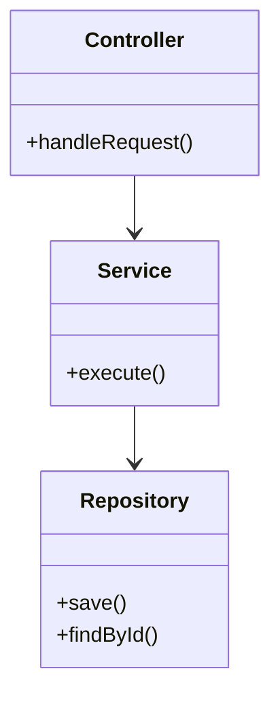
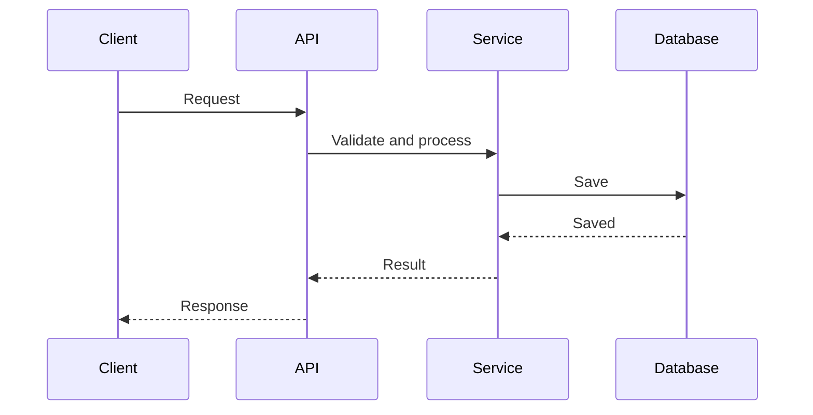
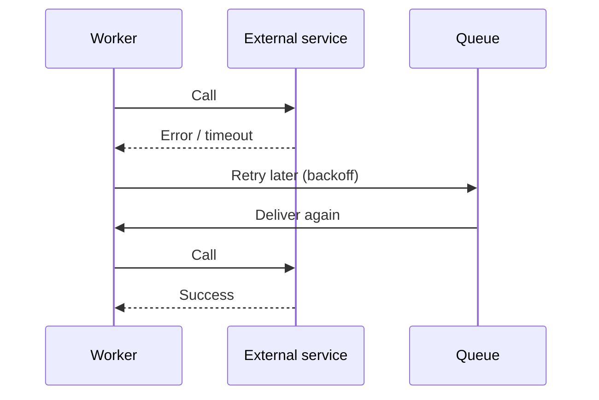
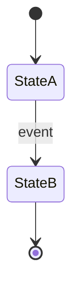

# [Project Name] — Software Design Document (SDD)

| | |
|---|---|
| **Version** | v0.1 (Draft) |
| **Author (owning engineer)** | [Name] |
| **Reviewer (tech lead)** | [Name] |
| **Status** | Draft / In Progress / In Review / As built |
| **Last updated** | [YYYY-MM-DD] |
| **Related PRD** | [Link, with version] |
| **Related DRD** | [Link, with version] |
| **Related TRD** | [Link, with the approved version this SDD is based on] |
| **Code repository** | [Link] |
| **API docs / schema docs** | [Links to generated OpenAPI and schema docs] |

> **How to use this template**
> - The SDD is the **low-level design** and the team's **tech spec**. The tech lead's **TRD** sets the approved architecture; the SDD says exactly how each part is built. Every project has one.
> - It is written and kept up to date by the **engineers building the project**. It starts as a plan, changes as you build, and ends as the record of what was built.
> - Replace everything in `[brackets]`. Delete guidance lines (blockquotes) and sections that don't apply once you've decided. A small change can have a short SDD (see the guide).
> - Don't repeat the TRD. Link to it by ID and add the detail underneath.
> - **Update rule:** edit this document freely as you build. If a change affects a decision in the TRD (architecture, security, a target, an interface other teams use), tell the tech lead and record it in Section 12.
> - Don't copy what tools can generate. Link to OpenAPI and schema docs instead of retyping them.
> - Diagrams use Mermaid, which renders in GitHub, Notion, Obsidian, and most modern Markdown tools.

---

## 1. Purpose, Scope, and Traceability

### 1.1 Purpose

[Two or three sentences: what this SDD designs, and which part of the TRD it implements.]

### 1.2 Scope of This Document

- **Covers**: [Components, modules, and flows designed here]
- **Does not cover**: [Related parts owned by other SDDs or teams]

### 1.3 TRD Traceability

> Map each TRD item you implement to the SDD section that details it.

| TRD reference | What the TRD requires | SDD section |
|---------------|-----------------------|-------------|
| [TRD 4.1] | [Feature or requirement summary] | 3.1, 5.1, 6.1 |
| [TRD 8: performance] | [Target] | 11 |

---

## 2. Module and Component Design

### 2.1 Module Overview

> Show the main modules or classes inside each component from the TRD, and how they depend on each other.



### 2.2 Module Responsibilities

| Component (from TRD) | Module / class | Responsibility | Public interface | Depends on |
|----------------------|----------------|----------------|------------------|------------|
| [Component] | [Module] | [One clear responsibility] | [Methods / endpoints / messages] | [Other modules, libraries, services] |

### 2.3 Design Notes

- [Patterns used (e.g., outbox, repository), and why]
- [Shared libraries reused, and where they live]
- [Anything a new engineer needs to know before touching this code]

---

## 3. Key Flows

> Show the order of calls between modules and services for the important flows. Draw the success path and the main failure paths.

### 3.1 [Flow name] — Success Path



### 3.2 [Flow name] — Failure and Retry Path



---

## 4. Data Design

### 4.1 Tables

> Field-level detail for every table. Paste the DDL or generate it from migrations; don't hand-copy it if a tool can produce it.

```sql
CREATE TABLE [table_name] (
  id UUID PRIMARY KEY,
  [column] [type] NOT NULL,
  created_at TIMESTAMPTZ NOT NULL DEFAULT now()
);
```

| Table | Column | Type | Required | Constraints | Notes (personal data? source? default?) |
|-------|--------|------|----------|-------------|------------------------------------------|
| [Table] | [column] | [type] | Yes / No | [Unique, FK, enum values, max length] | [ ] |

### 4.2 Indexes and Query Plans

| Query | Index | Expected rows | Notes (explain plan, partial index, ordering) |
|-------|-------|---------------|-----------------------------------------------|
| [Query description] | [Index definition] | [Count] | [ ] |

### 4.3 Constraints and Transactions

- **Transaction boundaries**: [What is written together, and in which order]
- **Isolation and locking**: [Locks or isolation level, and why]
- **Integrity rules**: [Rules the database enforces vs. rules the code enforces]

### 4.4 Caching

| Data | Where cached | TTL | Invalidation | Why |
|------|--------------|-----|--------------|-----|
| [Data] | [In-memory / Redis] | [Time] | [How it is cleared] | [ ] |

### 4.5 Migrations and Backfill

- **Migration files**: [Names / order]
- **Rollback for each migration**: [Down script or manual steps]
- **Backfill**: [Existing data to convert, batch size, how to verify]

---

## 5. Interface Detail

### 5.1 Endpoints

> If an OpenAPI file is generated from code, link it and list only what the file can't say (permissions, side effects, special rules). Otherwise fill in one block per endpoint.

**OpenAPI file**: [Link]

#### `[METHOD] /v1/[resource]`

- **Who can call it**: [Roles / ownership check]
- **Request**:

```json
{
  "field": "value"
}
```

| Field | Type | Required | Validation |
|-------|------|----------|------------|
| field | string | Yes | [Rule] |

- **Response ([status])**:

```json
{
  "id": "uuid"
}
```

- **Side effects**: [Writes, messages sent, third-party calls]

### 5.2 Error Catalog

| HTTP | Code | Condition | Message key | Client behavior |
|------|------|-----------|-------------|-----------------|
| 400 | VAL-001 | [Condition] | [i18n key] | [What the client does] |

### 5.3 Messages and Events

| Queue / topic | Payload (schema) | Producer | Consumer | Notes |
|---------------|------------------|----------|----------|-------|
| [Name] | `{ "field": "type" }` | [Module] | [Module] | [Ordering, size, version] |

---

## 6. Detailed Logic

> For each feature in the TRD, write the rules and logic precisely enough that another engineer could implement it without asking you.

### 6.1 [Feature name]

- **Traces to**: [TRD 4.1]
- **Steps**:
  1. [Step one]
  2. [Step two]
  3. [Step three]
- **Pseudocode** *(for anything tricky)*:

```text
[pseudocode]
```

- **State machine** *(if the object has a lifecycle)*:



- **Idempotency**: [How a repeated request or message is detected and handled]
- **Concurrency**: [What happens if two requests arrive at once; locks used]
- **Timeouts and retries**: [Per call: timeout, retries, backoff]

---

## 7. Error Handling and Edge Cases

| Module | Failure / edge case | How it is detected | Handling | Result for user / system | Logged / alerted as |
|--------|---------------------|--------------------|----------|--------------------------|---------------------|
| [Module] | [e.g., external API timeout] | [Timeout after N ms] | [Retry N times, then queue] | [User sees …] | [Log event / metric / alert] |

---

## 8. Configuration

### 8.1 Settings

| Key | Meaning | Default | Dev | Staging | Production |
|-----|---------|---------|-----|---------|------------|
| [KEY_NAME] | [What it controls] | [Value] | [ ] | [ ] | [ ] |

### 8.2 Feature Flags

| Flag | Purpose | Default | Who can change it | Removal plan |
|------|---------|---------|-------------------|--------------|
| [flag_name] | [ ] | [Off] | [Role] | [When to delete] |

### 8.3 Secrets

> List names and where they are stored. Never write values.

| Secret name | Used by | Stored in | Rotation |
|-------------|---------|-----------|----------|
| [SECRET_NAME] | [Module] | [Secret manager path] | [Period] |

---

## 9. Observability Detail

### 9.1 Logs

| Event | Level | Required fields | Must not contain |
|-------|-------|-----------------|------------------|
| [event_name] | [info / warn / error] | [request_id, report_id, …] | [Personal data, secrets] |

### 9.2 Metrics

| Metric name | Type | Labels | Meaning |
|-------------|------|--------|---------|
| [metric_total] | Counter | [result] | [What it counts] |

### 9.3 Traces

| Span name | Where | Attributes |
|-----------|-------|------------|
| [service.operation] | [Module] | [Attributes] |

### 9.4 Alert Wiring

| TRD alert | Metric / query | Threshold | Runbook |
|-----------|----------------|-----------|---------|
| [Alert name] | [Query] | [Value and duration] | [Link] |

---

## 10. Test Design

### 10.1 Test Cases

| ID | Type | Scenario | Setup / data | Expected result | Covers |
|----|------|----------|--------------|-----------------|--------|
| T-001 | Unit | [Scenario] | [Data] | [Result] | [PRD AC / TRD ref / section 6.1] |

### 10.2 Acceptance Criteria Mapping

| PRD criterion | Test IDs |
|---------------|----------|
| AC-1 | T-001, T-010 |

### 10.3 Test Data and Mocks

- [Fixtures, seed data, sandbox accounts]
- [What is mocked, and what runs for real]

---

## 11. Performance and Capacity Detail

| Area | Expected load | Resource use / bottleneck | Benchmark result | Tuning notes |
|------|---------------|---------------------------|------------------|--------------|
| [Component or query] | [Requests per second] | [CPU, DB time, API calls] | [Measured or *estimate*] | [Pool size, concurrency, batch size] |

> Label estimates as estimates and replace them with measurements.

---

## 12. Deviations from the TRD

> Record every place where the build differs from the approved TRD. Anything that touches an architecture, security, or interface decision needs the tech lead's sign-off.

| ID | TRD reference | What differs | Why | Impact | Approved by | Date | TRD updated? |
|----|---------------|--------------|-----|--------|-------------|------|--------------|
| DEV-001 | [TRD 8] | [Difference] | [Reason] | [Effect on other parts, teams, targets] | [Tech lead] | [Date] | Yes / No |

---

## 13. Implementation Notes and Agent Instructions

> Use the agent block if an AI coding agent will implement from this document.

### 13.1 Context Scoping

- **Start from**: [Entry-point files / directories]
- **Read before coding**: [Coding standards, TRD, ADRs, schema files]
- **Do not touch**: [Generated code, unrelated services]

### 13.2 Implementation Constraints

- **Required**: [e.g., shared validation library; a test with every rule in Section 6]
- **Prohibited**: [e.g., calling an external service inside the user request; logging personal data; adding dependencies without approval]

### 13.3 Verification Commands

```bash
# Replace with your project's commands
[lint / type-check command]
[unit test command]
[contract test command]
[build command]
```

---

## 14. As-Built Notes and Appendix

### 14.1 As-Built Notes

> Fill in at launch. Compare what shipped with the plan and record the differences, lessons, and known limitations.

- **What shipped**: [Summary]
- **Differences from the plan**: [Link to Section 12 items]
- **Known limitations / technical debt**: [List, with owners]
- **Follow-up work**: [List]

### 14.2 Open Questions

| # | Question | Owner | Due date | Resolution |
|---|----------|-------|----------|------------|
| 1 | [Question] | [Name] | [Date] | [Open / Answer] |

### 14.3 Change Log

| Version | Date | Author | Changes |
|---------|------|--------|---------|
| v0.1 | [YYYY-MM-DD] | [Name] | Initial draft from the approved TRD |
