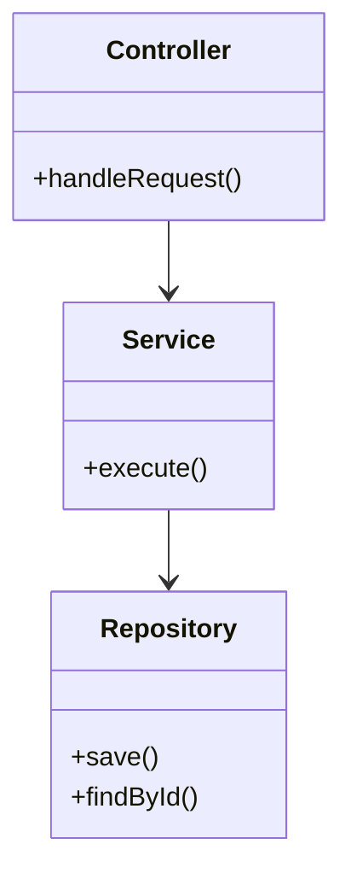
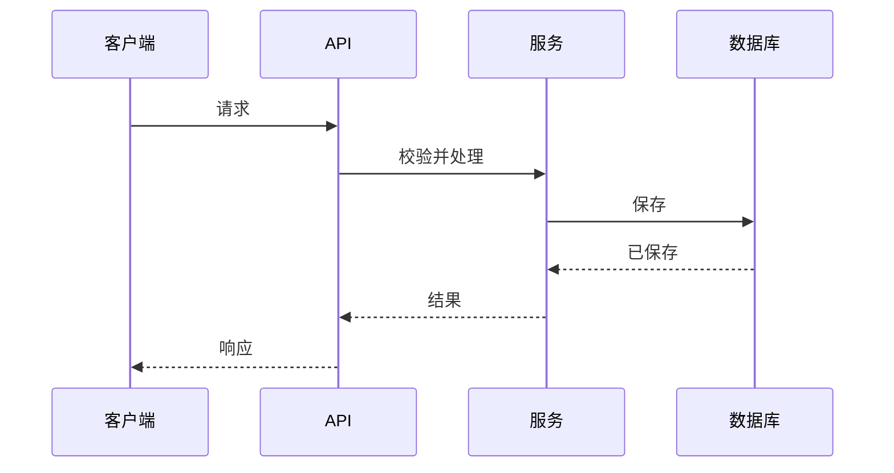
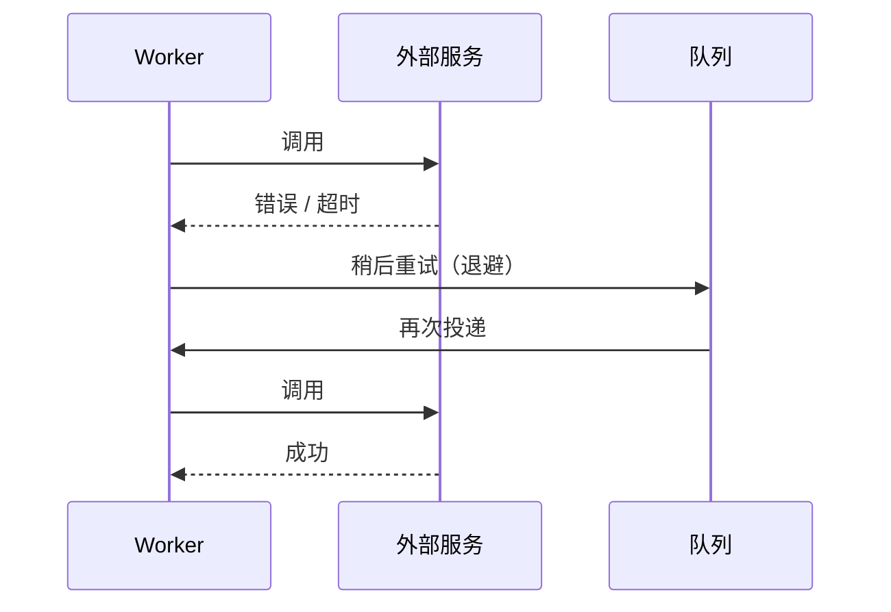
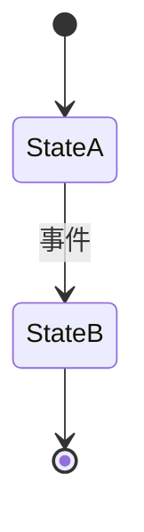

# [项目名称] — 软件设计文档（SDD）

| | |
|---|---|
| **版本** | v0.1（草稿） |
| **作者（负责的工程师）** | [姓名] |
| **评审人（技术负责人）** | [姓名] |
| **状态** | 草稿 / 进行中 / 评审中 / 已按实际构建更新 |
| **最后更新** | [YYYY-MM-DD] |
| **关联 PRD** | [链接，含版本] |
| **关联 DRD** | [链接，含版本] |
| **关联 TRD** | [链接，注明本 SDD 所基于的已批准版本] |
| **代码仓库** | [链接] |
| **API 文档 / Schema 文档** | [自动生成的 OpenAPI 和 schema 文档链接] |

> **模板使用说明**
> - SDD 是**详细设计（低层设计）**，也是团队的**技术方案（tech spec）**。技术负责人的 **TRD** 确定已批准的架构；SDD 说明每个部分具体如何构建。每个项目都要有一份。
> - 由**负责构建的工程师**撰写并持续更新。它起初是计划，在构建过程中不断变化，最终成为"实际构建了什么"的记录。
> - 替换所有 `[方括号]` 中的内容。决定之后，删除引导性文字（引用块）和不适用的章节。小改动可以只写一份简短的 SDD（见指南）。
> - 不要重复 TRD。按编号链接到 TRD，并在其下补充细节。
> - **更新规则：**构建过程中可以自由修改本文档。如果某个变更影响了 TRD 中的决策（架构、安全、某项目标、其他团队依赖的接口），要告知技术负责人，并记录在第 12 章。
> - 不要复制工具能自动生成的内容。链接到 OpenAPI 和 schema 文档，而不是重新手写。
> - 图表使用 Mermaid，可在 GitHub、Notion、Obsidian 及大多数现代 Markdown 工具中渲染。

---

## 1. 目的、范围与追溯

### 1.1 目的

[用两三句话说明：本 SDD 设计什么，以及它实现 TRD 的哪个部分。]

### 1.2 本文档范围

- **覆盖**：[此处设计的组件、模块和流程]
- **不覆盖**：[由其他 SDD 或团队负责的相关部分]

### 1.3 TRD 追溯

> 把你实现的每个 TRD 条目映射到详述它的 SDD 章节。

| TRD 引用 | TRD 的要求 | SDD 章节 |
|---------------|-----------------------|-------------|
| [TRD 4.1] | [功能或需求摘要] | 3.1、5.1、6.1 |
| [TRD 8：性能] | [目标值] | 11 |

---

## 2. 模块与组件设计

### 2.1 模块概览

> 展示 TRD 中每个组件内部的主要模块或类，以及它们之间的依赖。



### 2.2 模块职责

| 组件（来自 TRD） | 模块 / 类 | 职责 | 对外接口 | 依赖 |
|----------------------|----------------|----------------|------------------|------------|
| [组件] | [模块] | [单一明确的职责] | [方法 / 端点 / 消息] | [其他模块、库、服务] |

### 2.3 设计说明

- [使用的模式（例如 outbox、repository）及原因]
- [复用的共享库及其位置]
- [新工程师在改动这部分代码之前需要知道的事]

---

## 3. 关键流程

> 对重要流程，展示模块和服务之间调用的先后顺序。要画出成功路径和主要的失败路径。

### 3.1 [流程名称] — 成功路径



### 3.2 [流程名称] — 失败与重试路径



---

## 4. 数据设计

### 4.1 表

> 每张表的字段级细节。粘贴 DDL，或从迁移脚本生成；如果工具能生成，就不要手工复制。

```sql
CREATE TABLE [table_name] (
  id UUID PRIMARY KEY,
  [column] [type] NOT NULL,
  created_at TIMESTAMPTZ NOT NULL DEFAULT now()
);
```

| 表 | 列 | 类型 | 必填 | 约束 | 备注（是否个人数据？来源？默认值？） |
|-------|--------|------|----------|-------------|------------------------------------------|
| [表] | [列] | [类型] | 是 / 否 | [唯一、外键、枚举值、最大长度] | [ ] |

### 4.2 索引与查询计划

| 查询 | 索引 | 预期行数 | 备注（执行计划、部分索引、排序） |
|-------|-------|---------------|-----------------------------------------------|
| [查询描述] | [索引定义] | [数量] | [ ] |

### 4.3 约束与事务

- **事务边界**：[哪些数据一起写入，顺序如何]
- **隔离级别与锁**：[使用的锁或隔离级别，以及原因]
- **完整性规则**：[由数据库保证的规则 vs. 由代码保证的规则]

### 4.4 缓存

| 数据 | 缓存位置 | TTL | 失效方式 | 原因 |
|------|--------------|-----|--------------|-----|
| [数据] | [内存 / Redis] | [时间] | [如何清除] | [ ] |

### 4.5 迁移与回填

- **迁移文件**：[名称 / 顺序]
- **每次迁移的回滚**：[down 脚本或手动步骤]
- **回填**：[需要转换的现有数据、批大小、如何验证]

---

## 5. 接口详情

### 5.1 端点

> 如果 OpenAPI 文件由代码生成，就链接它，只列出文件里表达不了的内容（权限、副作用、特殊规则）。否则每个端点填写一个块。

**OpenAPI 文件**：[链接]

#### `[METHOD] /v1/[resource]`

- **谁可以调用**：[角色 / 归属检查]
- **请求**：

```json
{
  "field": "value"
}
```

| 字段 | 类型 | 必填 | 校验 |
|-------|------|----------|------------|
| field | string | 是 | [规则] |

- **响应（[状态码]）**：

```json
{
  "id": "uuid"
}
```

- **副作用**：[写入、发送的消息、第三方调用]

### 5.2 错误目录

| HTTP | 错误码 | 条件 | 消息 key | 客户端行为 |
|------|------|-----------|-------------|-----------------|
| 400 | VAL-001 | [条件] | [i18n key] | [客户端做什么] |

### 5.3 消息与事件

| 队列 / 主题 | 载荷（schema） | 生产者 | 消费者 | 备注 |
|---------------|------------------|----------|----------|-------|
| [名称] | `{ "field": "type" }` | [模块] | [模块] | [顺序、大小、版本] |

---

## 6. 详细逻辑

> 对 TRD 中的每个功能，把规则和逻辑写得足够精确，让另一位工程师无需问你就能实现。

### 6.1 [功能名称]

- **追溯至**：[TRD 4.1]
- **步骤**：
  1. [第一步]
  2. [第二步]
  3. [第三步]
- **伪代码** *（针对复杂之处）*：

```text
[伪代码]
```

- **状态机** *（如果对象有生命周期）*：



- **幂等性**：[如何识别并处理重复的请求或消息]
- **并发**：[如果两个请求同时到达会怎样；使用的锁]
- **超时与重试**：[每个调用：超时、重试次数、退避]

---

## 7. 错误处理与边界情况

| 模块 | 故障 / 边界情况 | 如何检测 | 处理方式 | 对用户 / 系统的结果 | 记录 / 告警为 |
|--------|---------------------|--------------------|----------|--------------------------|---------------------|
| [模块] | [例如：外部 API 超时] | [N 毫秒后超时] | [重试 N 次，然后入队] | [用户看到……] | [日志事件 / 指标 / 告警] |

---

## 8. 配置

### 8.1 配置项

| Key | 含义 | 默认值 | 开发 | 预发布 | 生产 |
|-----|---------|---------|-----|---------|------------|
| [KEY_NAME] | [控制什么] | [值] | [ ] | [ ] | [ ] |

### 8.2 功能开关

| 开关 | 用途 | 默认值 | 谁能修改 | 移除计划 |
|------|---------|---------|-------------------|--------------|
| [flag_name] | [ ] | [关闭] | [角色] | [何时删除] |

### 8.3 密钥

> 只列名称和存放位置。绝不写值。

| 密钥名称 | 使用方 | 存放位置 | 轮换 |
|-------------|---------|-----------|----------|
| [SECRET_NAME] | [模块] | [密钥管理器路径] | [周期] |

---

## 9. 可观测性详情

### 9.1 日志

| 事件 | 级别 | 必含字段 | 不得包含 |
|-------|-------|-----------------|------------------|
| [event_name] | [info / warn / error] | [request_id, report_id, …] | [个人数据、密钥] |

### 9.2 指标

| 指标名称 | 类型 | 标签 | 含义 |
|-------------|------|--------|---------|
| [metric_total] | Counter | [result] | [统计什么] |

### 9.3 链路追踪

| Span 名称 | 位置 | 属性 |
|-----------|-------|------------|
| [service.operation] | [模块] | [属性] |

### 9.4 告警对接

| TRD 告警 | 指标 / 查询 | 阈值 | 运行手册 |
|-----------|----------------|-----------|---------|
| [告警名称] | [查询] | [数值和持续时间] | [链接] |

---

## 10. 测试设计

### 10.1 测试用例

| 编号 | 类型 | 场景 | 准备 / 数据 | 预期结果 | 覆盖 |
|----|------|----------|--------------|-----------------|--------|
| T-001 | 单元 | [场景] | [数据] | [结果] | [PRD AC / TRD 引用 / 6.1 节] |

### 10.2 验收标准映射

| PRD 标准 | 测试编号 |
|---------------|----------|
| AC-1 | T-001, T-010 |

### 10.3 测试数据与 Mock

- [测试夹具、种子数据、沙箱账号]
- [哪些被 mock，哪些真实运行]

---

## 11. 性能与容量详情

| 领域 | 预期负载 | 资源使用 / 瓶颈 | 基准测试结果 | 调优说明 |
|------|---------------|---------------------------|------------------|--------------|
| [组件或查询] | [每秒请求数] | [CPU、数据库耗时、API 调用数] | [实测值或*估算*] | [连接池大小、并发数、批大小] |

> 估算要标明是估算，并用实测值替换。

---

## 12. 与 TRD 的偏差

> 记录构建与已批准 TRD 不一致的每一处。凡涉及架构、安全或接口决策的，都需要技术负责人签字确认。

| 编号 | TRD 引用 | 差异内容 | 原因 | 影响 | 批准人 | 日期 | TRD 是否已更新？ |
|----|---------------|--------------|-----|--------|-------------|------|--------------|
| DEV-001 | [TRD 8] | [差异] | [原因] | [对其他部分、团队、目标的影响] | [技术负责人] | [日期] | 是 / 否 |

---

## 13. 实现说明与 Agent 指令

> 如果将由 AI 编码 agent 根据本文档实现，请使用 agent 块。

### 13.1 上下文范围

- **从哪里开始**：[入口文件 / 目录]
- **编码前先阅读**：[编码规范、TRD、ADR、schema 文件]
- **不要改动**：[生成的代码、无关服务]

### 13.2 实现约束

- **必须**：[例如：使用共享校验库；第 6 章的每条规则都有对应测试]
- **禁止**：[例如：在用户请求中调用外部服务；记录个人数据；未经批准新增依赖]

### 13.3 验证命令

```bash
# 替换为你项目的命令
[lint / 类型检查命令]
[单元测试命令]
[契约测试命令]
[构建命令]
```

---

## 14. 实际构建说明与附录

### 14.1 实际构建说明

> 上线时填写。把实际交付的内容与计划对比，记录差异、经验教训和已知限制。

- **实际交付了什么**：[摘要]
- **与计划的差异**：[链接到第 12 章条目]
- **已知限制 / 技术债**：[列表，附负责人]
- **后续工作**：[列表]

### 14.2 待决问题

| # | 问题 | 负责人 | 截止日期 | 结论 |
|---|----------|-------|----------|------------|
| 1 | [问题] | [姓名] | [日期] | [未决 / 答案] |

### 14.3 变更记录

| 版本 | 日期 | 作者 | 变更内容 |
|---------|------|--------|---------|
| v0.1 | [YYYY-MM-DD] | [姓名] | 基于已批准 TRD 的初稿 |
