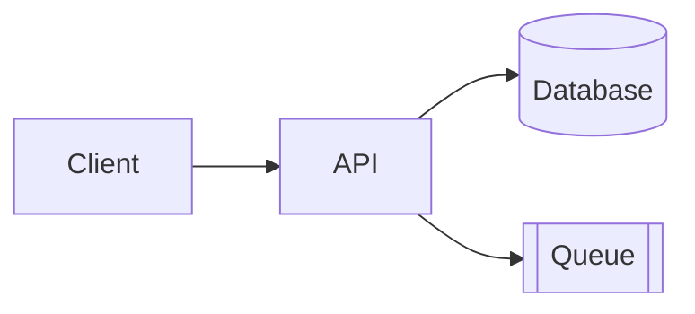
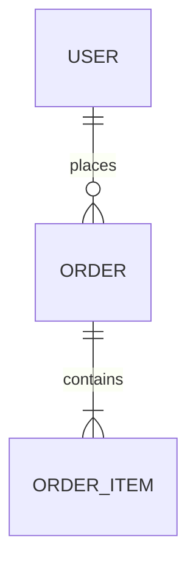
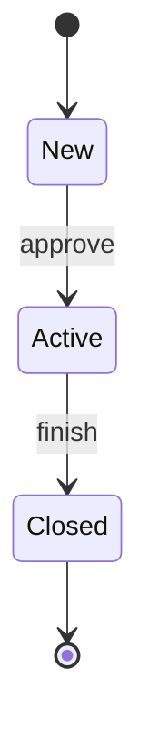

# How to Write a TRD — Guide

This guide explains what a Technical Requirements Document (TRD) is, how to use the template, and what to write in each section.

**Use it together with:**
- [TRD_Template.md](TRD_Template.md): the blank template to copy and fill in
- [TRD_Sample_In-App_Feedback.md](TRD_Sample_In-App_Feedback.md): a completed example, so you can see what "good" looks like. It is fictional and matches the PRD and DRD samples, so its stack, volumes, and thresholds are illustrations, not defaults.
- [PRD_Guide.md](../PRD/PRD_Guide.md) and [DRD_Guide.md](../DRD/DRD_Guide.md): the documents the TRD builds on.

---

## Part 1: TRD Basics

### What is a TRD?

A TRD describes **how a product requirement will be built**: the architecture, data, interfaces, security, reliability, testing, and rollout. It is the contract between the product requirements and the code. Engineers build from it, reviewers challenge it before work starts, and QA, SRE, and security use it to plan their work.

It is usually written by the technical lead or an engineer on the feature, with input from architecture, security, and operations.

### How the three documents fit together

| | PRD | DRD | TRD |
|---|-----|-----|-----|
| Answers | What are we building, for whom, why, how will we measure it? | How does it look and behave on screen? | How do we build and run it? |
| Author | Product manager | Interaction / UX designer | Technical lead |
| Core content | Problem, objectives, stories, rules, metrics | Structure, flows, wireframes, states, global rules | Architecture, data, APIs, security, testing, rollout |
| Main readers | Everyone | Engineers, QA, visual design | Engineers, QA, SRE, security, architects |

The TRD should not repeat the other two. Link to them by ID (US-001, DR-003) and state the technical consequences.

### What a TRD is not

| A TRD is not... | Because... |
|-----------------|------------|
| A product spec | Why the feature exists and who needs it belongs in the PRD. |
| A UI spec | Layouts and screen behavior belong in the DRD. |
| A code dump | It describes design and contracts, not implementation line by line. |
| A place for vague wishes | "Scalable and secure" means nothing without numbers and a test. |
| Finished at kickoff | Keep it current as decisions change; log the changes. |

### Who reads it, and what they look for

| Reader | Looking for |
|--------|-------------|
| Engineers | Sections 2–6: architecture, data, behavior, interfaces |
| Architects / reviewers | Sections 2.4, 7, 8, 12: decisions, security, non-functional targets, risks |
| QA | Sections 4, 5, 10: behavior, error codes, test plan |
| SRE / operations | Sections 8, 9, 11: targets, alerts, deployment, rollback |
| Security / compliance | Sections 3.4, 7: data lifecycle, threat model, controls |
| Product / design | Sections 1.2, 8: does the technical plan cover the requirements and the quality targets? |

### Writing principles

1. **Trace everything.** Each technical item should come from a PRD or DRD requirement, or from a stated non-functional need. If you can't say why it exists, question it.
2. **Use numbers.** "p95 < 300 ms," "99.9% monthly," "5 retries over 1 hour." If you don't know yet, write the question and an owner.
3. **Design for failure.** For every dependency, say what happens when it is slow, down, or wrong.
4. **Record decisions and alternatives.** A decision without the options rejected is hard to challenge or revisit.
5. **State contracts exactly.** Inputs, outputs, error codes, limits, and versions leave no room for guessing.
6. **Make it testable and operable.** Every requirement needs a way to verify it; every launch needs dashboards, alerts, and a rollback.
7. **Be honest about assumptions.** Label estimates as estimates and say how you'll check them.
8. **Keep it proportionate.** Skip sections that don't apply (see "Choosing a size").

---

## Part 2: The Writing Process

Don't fill the template top to bottom. A better order:

| Step | Do this | Sections |
|------|---------|----------|
| 1. Read the PRD and DRD | List every requirement with a technical consequence; note constraints and open questions | 1.2, 1.4 |
| 2. Size the problem | Estimate volumes, peaks, growth, data size | 1.4, 8 |
| 3. Sketch the architecture | Context and containers, then components and technology | 2 |
| 4. Make and record decisions | For each real choice, list options and why | 2.4 |
| 5. Model the data | Entities, constraints, access patterns, lifecycle | 3 |
| 6. Specify behavior | Per-feature inputs, outputs, rules, states, errors | 4 |
| 7. Define interfaces | APIs, error catalog, versioning, integrations, queues | 5, 6 |
| 8. Add security | Authentication, data protection, threats, audit | 7 |
| 9. Set quality targets | Performance, availability, reliability, SLOs | 8, 9 |
| 10. Plan testing and rollout | Test levels, pipeline, rollout, rollback | 10, 11 |
| 11. List risks and plan the work | Risks with mitigations; milestones | 12, 13 |
| 12. Review | Walk through the checklist with architecture, security, SRE, and Support/Ops | 15 |

### Choosing a size

| Situation | Include | Skip |
|-----------|---------|------|
| **Full**: new service, multi-team, sensitive data, or high scale | Everything | Nothing |
| **Standard**: typical feature (default) | Sections 1–5, 7–13, 15–16 | Events (6) if no queues; agent instructions (14) if humans only |
| **Quick**: small change inside an existing service | 1, 2.1, 3 (changed tables), 4, 5 (changed endpoints), 8, 11 | Architecture decisions, events, threat model beyond new risks, implementation plan |

---

## Part 3: Section-by-Section Guide

For each section: **what it's for**, **what to write**, **tips**, and **common mistakes**.

---

### Document Header

**What it's for:** Shows which version this is, who owns it, and which PRD and DRD it is based on.

**Write:** Version, author, technical lead, reviewers, status, date, links to the PRD (with version), DRD (with version), repositories and design docs.

**Common mistake:** Not recording the PRD/DRD versions, so nobody knows when requirements moved.

---

### 1. Overview and Scope

#### 1.1 Purpose

Two or three sentences: what is built, and which product need it serves.

#### 1.2 Requirement Traceability

**Write:** A table mapping each PRD/DRD item that has a technical consequence (including objectives and non-functional criteria) to the TRD section that implements it.

**Tips:** Do it early and update it as you go. A requirement with no TRD section is a gap; a TRD section with no requirement may be scope creep.

#### 1.3 Technical Scope

**Write:** What's in scope, what's out (with reasons), and environment assumptions (cloud, existing platform services).

#### 1.4 Constraints and Assumptions

**Write:** Fixed choices, assumptions with their impact if wrong and how you'll validate them, and dependencies on other teams with fallbacks.

**Tips:** Put the volume estimate here, with its derivation ("85,000 subscribers ÷ 60 days × 15%"). Reviewers can then challenge the reasoning instead of a bare number.

**Common mistakes:** Unlabeled guesses; dependencies with no owner or date.

---

### 2. System Architecture

#### 2.1 Architecture Overview

**Write:** A diagram that shows the system, its users, the main deployable parts, and external systems. Use C4 thinking: first the context, then containers; add component-level diagrams only where complexity demands.

**Tips:** Show data flow direction. Mark synchronous and asynchronous links differently. Every box in the diagram should appear in 2.2.

#### 2.2 Components

**Write:** For each component: its single responsibility, what it exposes and consumes, technology, and owner.

**Common mistake:** A component with three responsibilities ("handles requests, syncs data, and sends emails") — split it or justify it.

#### 2.3 Technology Stack

**Write:** Choices by layer with versions and the reason or constraint.

**Tips:** Say which choices are mandated (by company standards or the PRD) and which are yours.

#### 2.4 Architecture Decisions

**Write:** One row per significant decision: the choice, alternatives, rationale (trade-offs, cost, risk), and status (Proposed, Accepted, Superseded).

**Tips:** Record decisions that are costly to reverse or easy to forget: sync vs. async, build vs. buy, where state lives. If the reasoning is long, write a separate ADR and link it.

#### 2.5 Deployment Model

**Write:** Hosting, runtime, regions, environments, and any feature flags used for rollout.

---

### 3. Data Model

#### 3.1–3.2 Entities and Details

**Write:** An ER diagram, then for each entity every field with type, required, constraints, and notes (mark personal data).

**Tips:**
- Use underscores in Mermaid entity names (`ORDER_ITEM`); hyphens can break rendering.
- Write enums out in full. State what's unique and what's a foreign key.

#### 3.3 Indexing and Query Patterns

**Write:** The real access patterns first, then the index that serves each, with expected volume.

**Common mistake:** Adding indexes "just in case" or forgetting the one that the rate limit or list screen needs.

#### 3.4 Data Lifecycle

**Write:** Retention, deletion or anonymization (including user deletion requests), backup, recovery point and time objectives.

**Tips:** Personal data needs a deletion path that includes copies (object storage, third-party tools).

#### 3.5 Migration and Seeding

**Write:** Migration tool, strategy (expand → migrate → contract for live systems), rollback for each migration, backfill of existing data.

---

### 4. Technical Functional Requirements

**What it's for:** The technical counterpart of the PRD's feature specifications. It says exactly what the system does for each feature.

**Write, per feature:**

| Field | What to put |
|-------|-------------|
| Traces to | PRD/DRD IDs |
| Priority | From the PRD |
| Description | What the system does, in technical terms |
| Inputs / Outputs | Fields, types, limits; results and side effects |
| Validation rules | Server-side checks — never trust the client |
| State transitions | A state diagram if the object has a lifecycle |
| Error handling | Each failure case → behavior, code, retry |
| Side effects | Notifications, third-party calls, audit entries |
| Idempotency | What happens when the same request arrives twice |

**Tips:** Think about duplicates, retries, partial failure, concurrency, ordering, and stale data. Say what the client sees for each failure, using the DRD's wording.

**Common mistakes:** Only the happy path; validation described only in the UI; no answer to "what if this is sent twice?".

---

### 5. Interface Specifications

#### 5.1–5.2 APIs

**Write:** An endpoint table (method, purpose, auth, idempotent, rate limit), then per endpoint: request, response, field validation, and error table (HTTP status, code, condition, client behavior).

**Tips:**
- Use a consistent error code format (`VAL-001`, `AUTH-001`, `RATE-001`, `SYS-001`) so clients map codes to messages.
- Return `404` rather than `403` when revealing that a resource exists would leak information.
- Publish an OpenAPI file and keep it generated from code, or the other way round, but not both by hand.

#### 5.3 Versioning and Compatibility

**Write:** Version scheme, compatibility promises, and deprecation policy.

**Tips:** Mobile apps linger on old versions for months. State how long old versions must keep working.

#### 5.4 External Integrations

**Write:** System, method, purpose, limits, failure behavior, owner.

**Tips:** Check the real rate limits and plan limits with the owner. Say what happens when the dependency is down, not just "retry".

---

### 6. Events and Messaging *(optional)*

**What it's for:** Describes queues and events that tie components together.

**Write:** Topology (name, producer, consumers, payload, ordering) and reliability rules: delivery guarantee, retry and backoff, dead-letter handling, idempotency, schema evolution.

**Tips:** Assume at-least-once delivery and make consumers idempotent. Say who looks at the dead-letter queue and how quickly.

**Common mistakes:** Retrying errors that will never succeed (validation failures); no alert on the dead-letter queue.

---

### 7. Security Architecture

#### 7.1–7.2 Authentication, Authorization, and Data Protection

**Write:** How users and services authenticate; the authorization model (including object-level checks); encryption in transit and at rest; secret handling; how personal data is stored, accessed, and kept out of logs.

#### 7.3 Threat Model

**Write:** For this system's actual data flows: the threat, where it applies, likelihood and impact, mitigation, and how it is verified.

**Tips:** Walk each data flow and trust boundary. Ask: who could abuse this? What if an ID is guessed? What if a file isn't what it claims to be? What if a webhook is forged? Aim for realistic threats, not a textbook list.

#### 7.4 Audit and Compliance

**Write:** What is logged for sensitive actions, how long it is kept, and the technical controls that meet legal requirements.

**Common mistakes:** Listing "OWASP Top 10" with no link to this system; security as a final-week activity.

---

### 8. Non-Functional Requirements

**What it's for:** Quality targets with numbers and a way to verify each.

**Write:** Category, requirement, target, and how to verify. Cover performance, throughput, availability, reliability, scalability, capacity, compatibility, and maintainability.

**Tips:**
- Start from the PRD's non-functional criteria and the DRD's Section 7, then add technical ones.
- Do the capacity arithmetic in the document (rows × size × growth).
- Include "what happens when a dependency is down" as a reliability target.

**Common mistakes:** "Fast," "highly available," "secure" with no numbers; targets that can't be measured.

---

### 9. Observability and Operations

**Write:**
- **SLOs**: what you measure, the target, and the alert.
- **Logs, metrics, tracing**: what must be logged (and what must not), key metrics (including queue depth and dead-letter size), trace propagation, dashboards.
- **Alerts**: threshold, severity, owner, runbook.

**Tips:** Build the dashboards for the people who will use them: SRE, Support, and Product have different needs. Test alerts before launch. Every alert should have a runbook.

**Common mistakes:** Alerts nobody owns; logs that leak personal data.

---

### 10. Testing Plan

**Write:** For each level (unit, contract, integration, end-to-end, performance, security, resilience, privacy): scope, target or criteria, owner. Add a table mapping PRD acceptance criteria to test levels.

**Tips:**
- Contract tests protect other teams and old clients from breaking changes.
- Resilience tests prove the failure behavior you designed: block a dependency, kill a worker, send duplicates.
- Test at a multiple of expected load (for example 3×), not just the expected load.

**Common mistakes:** Only unit tests; no test for the failure paths promised in Sections 4–6.

---

### 11. Delivery and Deployment

**Write:**
- **Environments**: purpose, data, and differences from production.
- **CI/CD**: stages and gates.
- **Rollout and rollback**: phases, the checks before each phase, how to turn it off, and how to undo a deployment and migration; a launch readiness checklist.

**Tips:** Use a feature flag so rollback is a switch, not a deploy. Keep migrations backward compatible so an old version can still run.

---

### 12. Risks

**Write:** ID, risk, likelihood, impact, mitigation, owner.

**Tips:** Every risk has a mitigation and an owner. Include third-party limits, data volume surprises, and people or timing risks.

---

### 13. Implementation Plan *(optional)*

**Write:** Milestones with scope, dependencies, estimate, owner. Align rollout dates with the PRD's launch plan.

---

### 14. Agent Instructions *(optional)*

**What it's for:** When an AI coding agent will implement from the TRD, it needs a bounded context and firm rules.

**Write:**
- **Context scoping**: where to start, what to read first, what not to touch.
- **Constraints**: what is required and what is prohibited.
- **Verification commands**: exact commands that prove the work (lint, type-check, tests, build).

**Tips:** Keep the rules short and checkable. The commands should be runnable as written.

---

### 15. Review Checklist, 16. Appendix

Use the checklist before sending for review. The appendix holds open questions (owner, due date), glossary, references, and the change log.

---

## Part 4: Using the Mermaid Diagrams

The template uses Mermaid, which renders in GitHub, Notion, Obsidian, VS Code (with a preview extension), and the [Mermaid Live Editor](https://mermaid.live).

**Architecture / flow**

| Shape | Syntax | Use for |
|-------|--------|---------|
| Rectangle | `A[Text]` | Service or component |
| Cylinder | `D[(Text)]` | Database or store |
| Double brackets | `Q[[Text]]` | Queue |
| Arrow | `A --> B` | Call or data flow |
| Dotted arrow | `A -.-> B` | Optional or asynchronous link |

**Entity relationships**

Cardinality: `||` exactly one, `o|` zero or one, `|{` one or more, `o{` zero or more. Use underscores in names.

**State diagram**

For complex architecture diagrams, draw them in a diagram tool and link the file.

---

## Part 5: Quality Checklist

**Traceability and scope**
- [ ] The TRD names the PRD and DRD versions it is based on
- [ ] Each requirement with a technical impact appears in Section 1.2
- [ ] Out-of-scope items and assumptions are written down, with how they'll be validated

**Architecture and data**
- [ ] The diagram, component list, and data model agree
- [ ] Significant decisions are recorded with alternatives and reasons
- [ ] Personal data is marked; retention and deletion are specified
- [ ] Indexes match the real queries

**Behavior and interfaces**
- [ ] Each feature states inputs, outputs, validation, states, errors, and idempotency
- [ ] Each API lists request, response, errors, auth, rate limit, and version
- [ ] Retry, backoff, and dead-letter handling are defined for every queue and external call

**Security and quality**
- [ ] The threat model is specific to this system; each threat has a mitigation and a test
- [ ] Non-functional targets are numbers with a verification method
- [ ] SLOs, alerts, owners, and runbooks exist

**Delivery**
- [ ] The test plan covers failure paths and maps PRD acceptance criteria
- [ ] Rollout, rollback, and launch readiness are written down
- [ ] Risks have mitigations and owners
- [ ] Open questions have owners and dates; no `[brackets]` remain
- [ ] Version, status, and change log are current

---

## Part 6: Common Mistakes at a Glance

| Mistake | Fix |
|---------|-----|
| Repeating the PRD or DRD | Link by ID; write only the technical consequence |
| Vague quality words ("fast," "scalable") | Use targets, derivations, and a test method |
| Only the happy path | Specify timeouts, retries, duplicates, outages, partial failure |
| Calling a slow or unreliable service inside the user's request | Store first, then process asynchronously (queue / outbox) |
| No idempotency | Add idempotency keys; make consumers safe to repeat |
| Trusting client-side validation | Validate on the server; client checks are for experience |
| Decisions without reasons | Add ADR rows with alternatives and trade-offs |
| Security as a closing step | Build the threat model with the design; test each mitigation |
| Logging personal data | Allowlist log fields; scrub sensitive values |
| Unowned alerts | Give each alert an owner and a runbook |
| No rollback | Use a feature flag and backward-compatible migrations |
| Stale TRD | Update it when decisions change; log the change |

---

## Part 7: Keeping the TRD Useful

A TRD earns its keep when reviewers can find the weak points before code exists and when the person on call six months later can understand why the system works the way it does.

- **Review early.** Send for architecture and security review while decisions are still cheap to change.
- **Keep decisions findable.** Link ADRs, and mark superseded ones rather than deleting them.
- **Close the loop.** After launch, compare real volumes and latencies with your assumptions and update the document.
- **Change deliberately.** If the design changes during the build, update the TRD, log it, and tell the people who depend on it.
