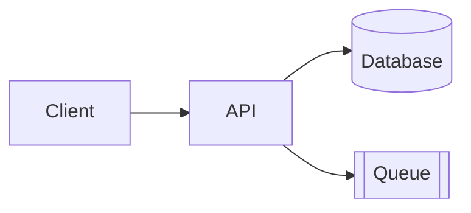
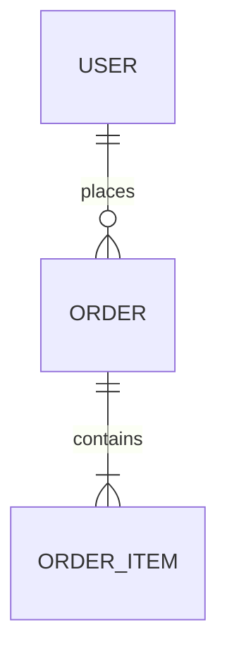
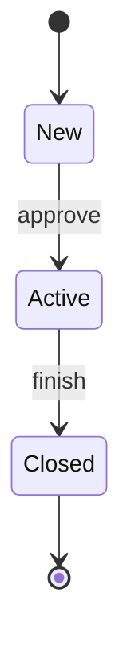

# How to Write a TRD — Guide

This guide explains what a Technical Requirements Document (TRD) is, how it relates to the SDD, how to use the template, and what to write in each section.

**Use it together with:**
- [TRD_Template.md](TRD_Template.md): the blank template to copy and fill in
- [TRD_Sample_In-App_Feedback.md](TRD_Sample_In-App_Feedback.md): a completed example, so you can see what "good" looks like. It is fictional and matches the PRD, DRD, and SDD samples, so its stack, volumes, and thresholds are illustrations, not defaults.
- [PRD_Guide.md](../PRD/PRD_Guide.md) and [DRD_Guide.md](../DRD/DRD_Guide.md): the documents the TRD builds on.
- [SDD_Guide.md](../SDD/SDD_Guide.md): the detailed design that the engineers write underneath the TRD.

---

## Part 1: TRD Basics

### What is a TRD?

A TRD is the **high-level design (HLD)**. It describes **what architecture and technical targets will satisfy a product requirement**: the architecture, the main data entities, the interfaces, security, reliability targets, testing strategy, and rollout. It is written by the **tech lead**, reviewed by architecture, security, and operations, and **approved before development starts**. The approved TRD is the baseline the engineers build against.

The detail underneath (class and module design, field-level tables, endpoint specs, algorithms, test cases) goes in the engineers' **SDD**.

### How the four documents fit together

| | PRD | DRD | TRD | SDD |
|---|-----|-----|-----|-----|
| Answers | What, for whom, why, how do we measure it? | How does it look and behave on screen? | What architecture and technical targets? | How is each part built? |
| Level | Product | Interaction | **High-level design (HLD)** | Low-level design (LLD), the tech spec |
| Author | Product manager | Interaction / UX designer | **Tech lead** | Engineers |
| Status | Approved baseline | Approved baseline | **Approved baseline** | Living, ends as the as-built record |
| Main readers | Everyone | Engineers, QA, visual design | Engineers, QA, SRE, security, architects | Engineers, QA, on-call |

The TRD should not repeat the other documents. Link to them by ID (US-001, DR-003) and state the technical consequences.

### TRD vs. SDD

| | TRD (tech lead) | SDD (engineers) |
|---|-----------------|-----------------|
| Purpose | Set the approved architecture, constraints, and targets | Say how to build it, in detail |
| Changes | Rarely, and with the lead's agreement | Often, as engineers build |
| Typical content | Architecture, components, stack, decisions, data entities, API overview, security, non-functional targets, rollout, risks | Class and module design, sequence diagrams, field-level tables, DDL, endpoint detail, algorithms, concurrency, config, test cases |

A quick test: if a reader needs it to **judge whether the design is sound**, it belongs in the TRD. If a reader needs it to **implement or maintain the code**, it belongs in the SDD.

### Who writes it, and what happens afterwards

1. **The tech lead drafts the TRD**, using the PRD and DRD, and gets it reviewed and approved before development.
2. **Engineers write and maintain the SDD** underneath it while they build.
3. **Changes to the TRD** (architecture, decisions, security, targets, interfaces other teams use) need the tech lead's agreement. Section 14 of the TRD records who owns the SDD and the rules for changes.
4. After launch, the TRD is corrected once to match what was built, and then it stays as the record of the approved design.

### What a TRD is not

| A TRD is not... | Because... |
|-----------------|------------|
| A product spec | Why the feature exists and who needs it belongs in the PRD. |
| A UI spec | Layouts and screen behavior belong in the DRD. |
| A detailed design | Field-level tables, endpoint-by-endpoint specs, and algorithms belong in the SDD. |
| A place for vague wishes | "Scalable and secure" means nothing without numbers and a test. |
| Edited casually | It is the approved baseline. Changes need the lead's agreement and a log entry. |

### Who reads it, and what they look for

| Reader | Looking for |
|--------|-------------|
| Engineers | Sections 2–6 and 14: architecture, data entities, behavior, interfaces, who owns the SDD |
| Architects / reviewers | Sections 2.4, 7, 8, 12: decisions, security, non-functional targets, risks |
| QA | Sections 4, 5, 10: behavior, error conventions, test strategy |
| SRE / operations | Sections 8, 9, 11: targets, alerts, deployment, rollback |
| Security / compliance | Sections 3.3, 7: data lifecycle, threat model, controls |
| Product / design | Sections 1.2, 8: does the technical plan cover the requirements and the quality targets? |

### Writing principles

1. **Trace everything.** Each technical item should come from a PRD or DRD requirement, or from a stated non-functional need.
2. **Use numbers.** "p95 < 300 ms," "99.9% monthly," "5 retries over about 1 hour." If you don't know yet, write the question and an owner.
3. **Design for failure.** For every dependency, say what happens when it is slow, down, or wrong.
4. **Record decisions and alternatives.** A decision without the options rejected is hard to challenge or revisit.
5. **Stay at the right level.** Include what a reviewer needs to judge the design. Push detail down to the SDD.
6. **Make it testable and operable.** Every requirement needs a way to verify it; every launch needs dashboards, alerts, and a rollback.
7. **Be honest about assumptions.** Label estimates as estimates and say how you'll check them.
8. **Keep it proportionate.** Skip sections that don't apply (see "Choosing a size").

---

## Part 2: The Writing Process

Don't fill the template top to bottom. A better order:

| Step | Do this | Sections |
|------|---------|----------|
| 1. Read the PRD and DRD | List every requirement with a technical consequence; note constraints and open questions | 1.2, 1.4 |
| 2. Size the problem | Estimate volumes, peaks, growth, data size | 1.4, 8 |
| 3. Sketch the architecture | Context and containers, then components and technology | 2 |
| 4. Make and record decisions | For each real choice, list options and why | 2.4 |
| 5. Outline the data | Entities, relationships, lifecycle | 3 |
| 6. Describe key behavior | Per feature: key rules, lifecycle, failure behavior | 4 |
| 7. Define the interface overview | API table, error convention, versioning, integrations, queues | 5, 6 |
| 8. Add security | Authentication, data protection, threats, audit | 7 |
| 9. Set quality targets | Performance, availability, reliability, SLOs | 8, 9 |
| 10. Plan testing and rollout | Test strategy, pipeline, rollout, rollback | 10, 11 |
| 11. List risks and plan the work | Risks with mitigations; milestones | 12, 13 |
| 12. Hand off to the engineers | Name the SDD owners and the change rules | 14 |
| 13. Review | Walk through the checklist with architecture, security, SRE, and Support/Ops | 15 |

### Choosing a size

| Situation | Include | Skip |
|-----------|---------|------|
| **Full**: new service, multi-team, sensitive data, or high scale | Everything | Nothing |
| **Standard**: typical feature (default) | Sections 1–5, 7–12, 14–16 | Events (6) if no queues; implementation plan (13) if the schedule is obvious |
| **Quick**: small change inside an existing service | 1, 2.1, 3, 5, 8, 11, 14 | Architecture decisions, events, threat model beyond new risks, implementation plan |

A short TRD is fine. The SDD still exists for every project, but it can be short too.

---

## Part 3: Section-by-Section Guide

For each section: **what it's for**, **what to write**, **tips**, and **common mistakes**.

---

### Document Header

**What it's for:** Shows which version this is, who owns it, and which PRD, DRD, and SDD it relates to.

**Write:** Version, tech lead (author), reviewers, status, date, links to the PRD (with version), DRD (with version), the SDD, and repositories.

**Common mistake:** Not recording the PRD/DRD versions, so nobody knows when requirements moved.

---

### 1. Overview and Scope

#### 1.1 Purpose

Two or three sentences: what is built, and which product need it serves.

#### 1.2 Requirement Traceability

**Write:** A table mapping each PRD/DRD item that has a technical consequence (including objectives and non-functional criteria) to the TRD section that addresses it.

**Tips:** Do it early and update it as you go. A requirement with no TRD section is a gap; a TRD section with no requirement may be scope creep.

#### 1.3 Technical Scope

**Write:** What's in scope, what's out (with reasons), and environment assumptions.

#### 1.4 Constraints and Assumptions

**Write:** Fixed choices, assumptions with their impact if wrong and how you'll validate them, and dependencies on other teams with fallbacks.

**Tips:** Put the volume estimate here, with its derivation ("85,000 subscribers ÷ 60 days × 15%"). Reviewers can then challenge the reasoning instead of a bare number.

**Common mistakes:** Unlabeled guesses; dependencies with no owner or date.

---

### 2. System Architecture

#### 2.1 Architecture Overview

**Write:** A diagram that shows the system, its users, the main deployable parts, and external systems. Use C4 thinking: first the context, then containers; add component-level diagrams only where complexity demands.

**Tips:** Show data flow direction. Mark synchronous and asynchronous links differently. Every box in the diagram should appear in 2.2.

#### 2.2 Components

**Write:** For each component: single responsibility, what it exposes and consumes, technology, owner.

**Common mistake:** A component with three responsibilities ("handles requests, syncs data, and sends emails"): split it or justify it.

#### 2.3 Technology Stack

**Write:** Choices by layer with versions and the reason or constraint. Say which choices are mandated and which are yours.

#### 2.4 Architecture Decisions

**Write:** One row per significant decision: the choice, alternatives, rationale (trade-offs, cost, risk), and status (Proposed, Accepted, Superseded).

**Tips:** Record decisions that are costly to reverse or easy to forget: sync vs. async, build vs. buy, where state lives. If the reasoning is long, write a separate ADR and link it.

#### 2.5 Deployment Model

**Write:** Hosting, runtime, regions, environments, and any feature flags used for rollout.

---

### 3. Data Model (High Level)

**What it's for:** Shows what data the system holds and for how long. It is not a table definition.

#### 3.1 Entities and Relationships

**Write:** An ER diagram showing entities, their keys, and how they relate. Leave out the other columns.

**Tips:** Use underscores in Mermaid entity names (`ORDER_ITEM`); hyphens can break rendering.

#### 3.2 Key Entities

**Write:** A short table: what each entity represents, a few key attributes, whether it holds personal data, and which system is the source of truth.

#### 3.3 Data Lifecycle

**Write:** Retention, deletion or anonymization (including user deletion requests), backup, and recovery objectives.

**Tips:** Personal data needs a deletion path that includes copies (object storage, third-party tools).

**Detail goes in the SDD:** field-level tables and DDL, indexes and query plans, transactions, caching, migrations, and backfill.

**Common mistake:** Listing every column in the TRD, then not updating it when the schema changes.

---

### 4. Technical Functional Requirements

**What it's for:** The technical counterpart of the PRD's feature list. It tells reviewers what the system does for each feature and the rules that shape the design.

**Write, per feature:**

| Field | What to put |
|-------|-------------|
| Traces to | PRD/DRD IDs |
| Priority | From the PRD |
| Description | What the system does, in technical terms |
| Key rules | The few rules that shape the design (limits, permissions, ordering, what is stored first) |
| Lifecycle | A small state diagram if the object has states |
| Key failure behavior | One line per important failure |
| Detail in SDD | Section number |

**Tips:** Mention only the rules a reviewer needs. Think about duplicates, retries, partial failure, and what the client sees. Inputs, validation details, state-transition rules, algorithms, and error handling per module go in the SDD.

**Common mistakes:** Rewriting the PRD's rules; copying the SDD's step-by-step logic into the TRD; leaving out what happens when a dependency is down.

---

### 5. Interface Overview

#### 5.1 API Overview

**Write:** An endpoint table: method, purpose, auth, whether it is idempotent, and rate limit.

**Tips:** Request and response schemas live in the SDD or in a generated OpenAPI file. Publish the OpenAPI file and keep it generated from code.

#### 5.2 Error Code Convention

**Write:** The code format (for example `VAL-001`), the categories, how they map to HTTP statuses, how clients turn codes into messages, and any rule about not leaking information (such as 404 instead of 403).

**Tips:** The full catalog goes in the SDD. The convention goes here so every service follows it.

#### 5.3 Versioning and Compatibility

**Write:** Version scheme, compatibility promises, and deprecation policy.

**Tips:** Mobile apps linger on old versions for months. State how long old versions must keep working.

#### 5.4 External Integrations

**Write:** System, method, purpose, limits, failure behavior, owner.

**Tips:** Check the real rate limits and plan limits with the owner. Say what happens when the dependency is down, not just "retry".

---

### 6. Events and Messaging *(optional)*

**What it's for:** Describes the queues and events that tie components together, and the reliability policy for them.

**Write:** Topology (name, producer, consumers, ordering) and the reliability policy: delivery guarantee, retry policy (how many, over how long, which errors), dead-letter handling and who owns it, idempotency principle, schema evolution.

**Tips:** Assume at-least-once delivery and make consumers idempotent. Say who looks at the dead-letter queue and how quickly. Exact delays, payload schemas, and consumer logic go in the SDD.

**Common mistakes:** Retrying errors that will never succeed (validation failures); no alert on the dead-letter queue.

---

### 7. Security Architecture

#### 7.1–7.2 Authentication, Authorization, and Data Protection

**Write:** How users and services authenticate; the authorization model (including object-level checks); encryption in transit and at rest; secret handling; how personal data is stored, accessed, and kept out of logs.

#### 7.3 Threat Model

**Write:** For this system's actual data flows: the threat, where it applies, likelihood and impact, mitigation, and how it is verified.

**Tips:** Walk each data flow and trust boundary. Ask: who could abuse this? What if an ID is guessed? What if a file isn't what it claims to be? What if a webhook is forged? Aim for realistic threats, not a textbook list.

#### 7.4 Audit and Compliance

**Write:** What is logged for sensitive actions, how long it is kept, and the technical controls that meet legal requirements.

**Common mistakes:** Listing "OWASP Top 10" with no link to this system; treating security as a final-week activity.

---

### 8. Non-Functional Requirements

**What it's for:** Quality targets with numbers and a way to verify each.

**Write:** Category, requirement, target, and how to verify. Cover performance, throughput, availability, reliability, scalability, capacity, compatibility, and maintainability.

**Tips:**
- Start from the PRD's non-functional criteria and the DRD's Section 7, then add technical ones.
- Do the capacity arithmetic in the document (rows × size × growth).
- Include "what happens when a dependency is down" as a reliability target.
- If the SDD finds a target can't be met, change it here with the lead's agreement and log the change (Section 14).

**Common mistakes:** "Fast," "highly available," "secure" with no numbers; targets that can't be measured.

---

### 9. Observability and Operations

**Write:**
- **SLOs**: what you measure, the target, and the alert.
- **Logging, metrics, and tracing requirements**: what must be logged (and what must not), the categories of metrics, how traces are propagated, and the dashboards each team needs.
- **Alerts**: threshold, severity, owner, runbook.

**Tips:** Build the dashboards for the people who will use them: SRE, Support, and Product have different needs. Test alerts before launch. Every alert should have a runbook. Specific log fields, metric names, and span names go in the SDD.

**Common mistakes:** Alerts nobody owns; logs that leak personal data.

---

### 10. Testing Strategy

**Write:** For each level (unit, contract, integration, end-to-end, performance, security, resilience, privacy): scope, target or criteria, owner. Add a table mapping PRD acceptance criteria to test levels.

**Tips:**
- Contract tests protect other teams and old clients from breaking changes.
- Resilience tests prove the failure behavior you designed: block a dependency, kill a worker, send duplicates.
- Test at a multiple of expected load (for example 3×), not just the expected load.
- Concrete test cases go in the SDD.

**Common mistakes:** Only unit tests; no test for the failure paths promised in Sections 4–6.

---

### 11. Delivery and Deployment

**Write:**
- **Environments**: purpose, data, and differences from production.
- **CI/CD**: stages and gates.
- **Rollout and rollback**: phases, the checks before each phase, how to turn it off, and how to undo a deployment and migration; a launch readiness checklist.

**Tips:** Use a feature flag so rollback is a switch, not a deploy. Keep migrations backward compatible so an old version can still run.

---

### 12. Risks

**Write:** ID, risk, likelihood, impact, mitigation, owner.

**Tips:** Every risk has a mitigation and an owner. Include third-party limits, data volume surprises, and people or timing risks.

---

### 13. Implementation Plan *(optional)*

**Write:** Milestones with scope, dependencies, estimate, owner. Align rollout dates with the PRD's launch plan.

---

### 14. Detailed Design Handoff

**What it's for:** Connects the approved TRD to the engineers' SDD, so the two stay consistent.

**Write:**
- **SDD ownership**: the SDD, its owner(s), the components it covers, and the reviewer.
- **Rules for changes**: what engineers may change freely in the SDD, and what needs the tech lead's agreement and a TRD update.
- **Changes since approval**: a short list of approved deviations, each pointing to the SDD's deviation log.

**Tips:**
- Free to change: module structure, field-level design, indexes, algorithms, configuration values, log and metric names, test cases.
- Needs the lead: architecture, ADR decisions, security design, non-functional targets, and interfaces other teams use.
- Update the TRD's change log whenever a deviation is approved.

**Common mistake:** Leaving the rules unwritten, so the lead's sections go stale while the engineers' sections stay current.

---

### 15. Review Checklist, 16. Appendix

Use the checklist before sending for review. The appendix holds open questions (owner, due date), glossary, references, and the change log.

---

## Part 4: Using the Mermaid Diagrams

The template uses Mermaid, which renders in GitHub, Notion, Obsidian, VS Code (with a preview extension), and the [Mermaid Live Editor](https://mermaid.live).

**Architecture / flow**

| Shape | Syntax | Use for |
|-------|--------|---------|
| Rectangle | `A[Text]` | Service or component |
| Cylinder | `D[(Text)]` | Database or store |
| Double brackets | `Q[[Text]]` | Queue |
| Arrow | `A --> B` | Call or data flow |
| Dotted arrow | `A -.-> B` | Optional or asynchronous link |

**Entity relationships**

Cardinality: `||` exactly one, `o|` zero or one, `|{` one or more, `o{` zero or more. Use underscores in names.

**State diagram**

Sequence and class diagrams belong in the SDD. For complex architecture diagrams, draw them in a diagram tool and link the file.

---

## Part 5: Quality Checklist

**Traceability and scope**
- [ ] The TRD names the PRD and DRD versions it is based on
- [ ] Each requirement with a technical impact appears in Section 1.2
- [ ] Out-of-scope items and assumptions are written down, with how they'll be validated

**Architecture and data**
- [ ] The diagram, component list, and data entities agree
- [ ] Significant decisions are recorded with alternatives and reasons
- [ ] Personal data is marked; retention and deletion are specified

**Behavior and interfaces**
- [ ] Each feature states its key rules, lifecycle, and key failure behavior
- [ ] Each API has purpose, auth, idempotency, and rate limit; error convention and versioning are stated
- [ ] Retry, backoff, and dead-letter policy are defined for every queue and external call

**Security and quality**
- [ ] The threat model is specific to this system; each threat has a mitigation and a test
- [ ] Non-functional targets are numbers with a verification method
- [ ] SLOs, alerts, owners, and runbooks exist

**Delivery and handoff**
- [ ] The test strategy covers failure paths and maps PRD acceptance criteria
- [ ] Rollout, rollback, and launch readiness are written down
- [ ] Risks have mitigations and owners
- [ ] SDD ownership and change rules are named (Section 14)
- [ ] Open questions have owners and dates; no `[brackets]` remain
- [ ] Version, status, and change log are current

---

## Part 6: Common Mistakes at a Glance

| Mistake | Fix |
|---------|-----|
| Repeating the PRD or DRD | Link by ID; write only the technical consequence |
| Putting field-level or step-by-step detail in the TRD | Move it to the SDD; keep the TRD at design level |
| Vague quality words ("fast," "scalable") | Use targets, derivations, and a test method |
| Only the happy path | Describe timeouts, retries, duplicates, outages, partial failure |
| Calling a slow or unreliable service inside the user's request | Store first, then process asynchronously (queue / outbox) |
| No idempotency | Add idempotency keys; make consumers safe to repeat |
| Decisions without reasons | Add ADR rows with alternatives and trade-offs |
| Security as a closing step | Build the threat model with the design; test each mitigation |
| Logging personal data | Allowlist log fields; scrub sensitive values |
| Unowned alerts | Give each alert an owner and a runbook |
| No rollback | Use a feature flag and backward-compatible migrations |
| Silent TRD changes | Agree changes with the lead and log them |
| Stale TRD | Correct it once at launch; keep the change log current |

---

## Part 7: Keeping the TRD Useful

A TRD earns its keep when reviewers can find the weak points before code exists, and when a new engineer can see which design was approved and why.

- **Review early.** Send for architecture and security review while decisions are still cheap to change.
- **Keep decisions findable.** Link ADRs, and mark superseded ones rather than deleting them.
- **Let the SDD move; keep the TRD steady.** Engineers update the SDD as they build. Only changes to the approved design reach the TRD, and they are logged.
- **Close the loop.** After launch, compare real volumes and latencies with your assumptions, correct the TRD once to match what was built, and let the SDD's as-built notes carry the rest.
