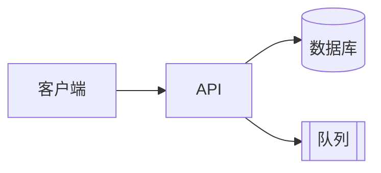
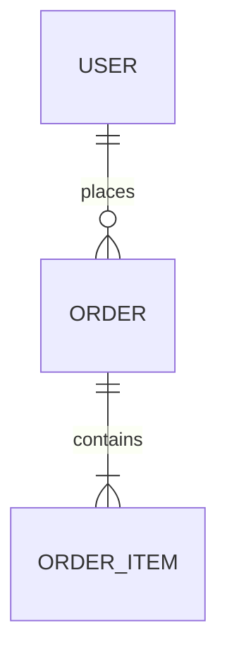
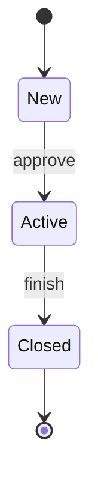

# 如何撰写 TRD — 指南

本指南说明什么是技术需求文档（TRD）、它与 SDD 的关系、如何使用模板，以及每个章节应写什么。

**配合以下文件使用：**
- [TRD_Template_zh.md](TRD_Template_zh.md)：可复制并填写的空白模板
- [TRD_Sample_In-App_Feedback_zh.md](TRD_Sample_In-App_Feedback_zh.md)：一份完整示例，让你看到"好的 TRD"是什么样子。示例是虚构的，与 PRD、DRD 和 SDD 示例相匹配，因此其中的技术栈、量级和阈值仅作说明，不是默认选项。
- [PRD_Guide_zh.md](../PRD/PRD_Guide_zh.md) 和 [DRD_Guide_zh.md](../DRD/DRD_Guide_zh.md)：TRD 所依托的文档。
- [SDD_Guide_zh.md](../SDD/SDD_Guide_zh.md)：工程师在 TRD 之下撰写的详细设计。

---

## 第一部分：TRD 基础

### 什么是 TRD？

TRD 是**概要设计（HLD）**。它描述**用什么架构和技术目标来满足一项产品需求**：架构、主要数据实体、接口、安全、可靠性目标、测试策略和发布。它由**技术负责人**撰写，经架构、安全和运维评审，并在**开发开始前获得批准**。获批的 TRD 是工程师据以构建的基线。

其下的细节（类和模块设计、字段级的表、端点规格、算法、测试用例）放在工程师的 **SDD** 中。

### 四份文档如何配合

| | PRD | DRD | TRD | SDD |
|---|-----|-----|-----|-----|
| 回答 | 做什么、为谁做、为什么、如何衡量？ | 界面上长什么样、怎么表现？ | 什么架构、什么技术目标？ | 每个部分具体怎么构建？ |
| 层级 | 产品 | 交互 | **概要设计（HLD）** | 详细设计（LLD），即技术方案 |
| 作者 | 产品经理 | 交互 / UX 设计师 | **技术负责人** | 工程师 |
| 状态 | 已批准的基线 | 已批准的基线 | **已批准的基线** | 活文档，最终成为实际构建的记录 |
| 主要读者 | 所有人 | 研发、测试、视觉设计 | 研发、测试、SRE、安全、架构师 | 研发、测试、值班 |

TRD 不应重复其他文档。按编号（US-001、DR-003）链接过去，并说明由此产生的技术后果。

### TRD 与 SDD

| | TRD（技术负责人） | SDD（工程师） |
|---|-----------------|-----------------|
| 目的 | 确定已批准的架构、约束和目标 | 详细说明如何构建 |
| 变更 | 很少，且需经负责人同意 | 经常，随工程师构建而变化 |
| 典型内容 | 架构、组件、技术栈、决策、数据实体、API 概览、安全、非功能目标、发布、风险 | 类和模块设计、时序图、字段级的表、DDL、端点细节、算法、并发、配置、测试用例 |

一个快速判断：如果读者需要它来**判断设计是否合理**，它属于 TRD。如果读者需要它来**实现或维护代码**，它属于 SDD。

### 谁来写，之后会怎样

1. **技术负责人起草 TRD**，依据 PRD 和 DRD，并在开发前完成评审和批准。
2. **工程师在构建过程中撰写并维护 SDD**。
3. **对 TRD 的变更**（架构、决策、安全、目标、其他团队使用的接口）需要技术负责人同意。TRD 的第 14 章记录了谁负责 SDD，以及变更规则。
4. 上线后，TRD 会被一次性修正为与实际构建一致，然后作为已批准设计的记录保留下来。

### TRD 不是什么

| TRD 不是…… | 原因 |
|-----------------|------------|
| 产品说明 | 功能为什么存在、谁需要它，属于 PRD。 |
| UI 规格 | 布局和界面行为属于 DRD。 |
| 详细设计 | 字段级的表、逐个端点的规格和算法属于 SDD。 |
| 空泛愿望的容器 | "可扩展、安全"在没有数字和测试时毫无意义。 |
| 可以随手修改的文档 | 它是已批准的基线。变更需要负责人同意并留下日志。 |

### 谁会读它，关注什么

| 读者 | 关注点 |
|--------|-------------|
| 研发 | 第 2–6 章和第 14 章：架构、数据实体、行为、接口、谁负责 SDD |
| 架构师 / 评审人 | 2.4、7、8、12 节：决策、安全、非功能目标、风险 |
| 测试 | 第 4、5、10 章：行为、错误约定、测试策略 |
| SRE / 运维 | 第 8、9、11 章：目标、告警、部署、回滚 |
| 安全 / 合规 | 3.3、7 节：数据生命周期、威胁模型、控制措施 |
| 产品 / 设计 | 1.2、8 节：技术方案是否覆盖需求和质量目标？ |

### 写作原则

1. **全程可追溯。**每个技术条目都应来自某个 PRD 或 DRD 需求，或某项明确说明的非功能需求。
2. **用数字。**"p95 < 300 ms"、"月度 99.9%"、"约 1 小时内重试 5 次"。如果还不知道，就写出问题并指定负责人。
3. **为失败而设计。**对每个依赖，说明它变慢、宕机或出错时会发生什么。
4. **记录决策和替代方案。**不写被否决方案的决策，很难被质疑或重新审视。
5. **停留在合适的层级。**写评审人判断设计所需的内容。把细节下沉到 SDD。
6. **可测试、可运维。**每条需求都要有验证方式；每次上线都要有看板、告警和回滚方案。
7. **如实说明假设。**把估算标为估算，并说明你将如何验证。
8. **规模适度。**跳过不适用的章节（见"选择文档规模"）。

---

## 第二部分：撰写流程

不要从上到下依次填写模板。更好的顺序：

| 步骤 | 做什么 | 对应章节 |
|------|---------|----------|
| 1. 阅读 PRD 和 DRD | 列出每条有技术后果的需求；记录约束和待决问题 | 1.2、1.4 |
| 2. 估算问题规模 | 估算量级、峰值、增长、数据大小 | 1.4、8 |
| 3. 勾勒架构 | 上下文和容器，然后是组件和技术 | 2 |
| 4. 做出并记录决策 | 对每个真正的选择，列出方案及理由 | 2.4 |
| 5. 勾勒数据 | 实体、关系、生命周期 | 3 |
| 6. 描述关键行为 | 每个功能：关键规则、生命周期、失败行为 | 4 |
| 7. 定义接口概览 | API 表、错误约定、版本管理、集成、队列 | 5、6 |
| 8. 加入安全 | 认证、数据保护、威胁、审计 | 7 |
| 9. 设定质量目标 | 性能、可用性、可靠性、SLO | 8、9 |
| 10. 规划测试和发布 | 测试策略、流水线、发布、回滚 | 10、11 |
| 11. 列出风险并规划工作 | 带缓解措施的风险；里程碑 | 12、13 |
| 12. 交接给工程师 | 写明 SDD 负责人和变更规则 | 14 |
| 13. 评审 | 与架构、安全、SRE 和客服 / 运营一起过检查清单 | 15 |

### 选择文档规模

| 场景 | 包含 | 省略 |
|-----------|---------|------|
| **完整版**：新服务、多团队、敏感数据或大规模 | 全部 | 无 |
| **标准版**：典型功能（默认） | 第 1–5、7–12、14–16 章 | 没有队列时省略事件（6）；排期显而易见时省略实施计划（13） |
| **快速版**：现有服务内的小改动 | 1、2.1、3、5、8、11、14 | 架构决策、事件、除新增风险外的威胁模型、实施计划 |

TRD 简短也没有问题。每个项目仍然有 SDD，但它也可以很短。

---

## 第三部分：逐章指南

每个章节包括：**作用**、**写什么**、**技巧**和**常见错误**。

---

### 文档头部

**作用：**显示这是哪个版本、谁负责，以及它关联哪份 PRD、DRD 和 SDD。

**写什么：**版本、技术负责人（作者）、评审人、状态、日期，以及 PRD（含版本）、DRD（含版本）、SDD 和代码仓库的链接。

**常见错误：**没有记录 PRD / DRD 的版本，导致没人知道需求是什么时候变的。

---

### 1. 概述与范围

#### 1.1 目的

两三句话：构建什么，以及它服务于哪项产品需求。

#### 1.2 需求追溯

**写什么：**一张表，把每个有技术后果的 PRD / DRD 条目（包括目标和非功能标准）映射到处理它的 TRD 章节。

**技巧：**尽早做，并随进展更新。没有对应 TRD 章节的需求是缺口；没有对应需求的 TRD 章节可能是范围蔓延。

#### 1.3 技术范围

**写什么：**范围内是什么，范围外是什么（附原因），以及环境假设。

#### 1.4 约束与假设

**写什么：**固定的选择、写明若不成立的影响及验证方式的假设，以及对其他团队的依赖和兜底方案。

**技巧：**把量级估算放在这里，并附上推导过程（"85,000 订阅用户 ÷ 60 天 × 15%"）。这样评审人可以质疑推理，而不是一个光秃秃的数字。

**常见错误：**没有标注的猜测；没有负责人或日期的依赖。

---

### 2. 系统架构

#### 2.1 架构概览

**写什么：**一张图，展示系统、用户、主要可部署部分和外部系统。采用 C4 的思路：先画上下文，再画容器；只有在复杂度需要时，才补充组件级图。

**技巧：**展示数据流方向。用不同方式标记同步和异步链路。图中的每个方框都应出现在 2.2 中。

#### 2.2 组件

**写什么：**对每个组件：单一职责、对外提供和依赖什么、技术、负责人。

**常见错误：**一个组件承担三项职责（"处理请求、同步数据、发送邮件"）——要么拆分，要么说明理由。

#### 2.3 技术栈

**写什么：**按层列出选型、版本，以及理由或约束。说明哪些选型是被强制的，哪些是你自己的选择。

#### 2.4 架构决策

**写什么：**每个重要决策一行：选择、替代方案、理由（权衡、成本、风险）和状态（提议中、已采纳、已取代）。

**技巧：**记录那些难以回退或容易被遗忘的决策：同步 vs. 异步、自建 vs. 采购、状态存放在哪里。如果推理很长，写一份独立的 ADR 并链接过去。

#### 2.5 部署模型

**写什么：**托管、运行时、区域、环境，以及用于发布的任何功能开关。

---

### 3. 数据模型（概要）

**作用：**展示系统保存哪些数据、保存多久。它不是表定义。

#### 3.1 实体与关系

**写什么：**一张 ER 图，展示实体、它们的键，以及它们之间的关系。省略其他列。

**技巧：**Mermaid 实体名称使用下划线（`ORDER_ITEM`）；连字符可能导致渲染失败。

#### 3.2 关键实体

**写什么：**一张简短的表：每个实体代表什么、几个关键属性、是否包含个人数据，以及哪个系统是权威数据源。

#### 3.3 数据生命周期

**写什么：**保留期、删除或匿名化（包括用户删除请求）、备份和恢复目标。

**技巧：**个人数据需要一条覆盖所有副本（对象存储、第三方工具）的删除路径。

**细节放在 SDD：**字段级的表和 DDL、索引与查询计划、事务、缓存、迁移和回填。

**常见错误：**把每一列都列在 TRD 里，然后在 schema 变化时又不更新。

---

### 4. 技术功能需求

**作用：**PRD 功能清单的技术对应部分。它告诉评审人系统为每个功能做什么，以及塑造设计的规则。

**每个功能包含：**

| 字段 | 填写内容 |
|-------|-------------|
| 追溯至 | PRD / DRD 编号 |
| 优先级 | 来自 PRD |
| 描述 | 系统做什么，用技术语言描述 |
| 关键规则 | 塑造设计的几条规则（限制、权限、顺序、先存什么） |
| 生命周期 | 如果对象有状态，画一个小状态图 |
| 关键失败行为 | 每个重要故障一行 |
| 详见 SDD | 章节号 |

**技巧：**只写评审人需要的规则。考虑重复、重试、部分失败，以及客户端看到什么。输入、校验细节、状态流转规则、算法，以及每个模块的错误处理，放在 SDD 中。

**常见错误：**重写 PRD 里的规则；把 SDD 中逐步的逻辑复制进 TRD；漏写依赖宕机时会发生什么。

---

### 5. 接口概览

#### 5.1 API 概览

**写什么：**一张端点表：方法、用途、认证、是否幂等、频率限制。

**技巧：**请求和响应的 schema 放在 SDD 或自动生成的 OpenAPI 文件中。发布一份 OpenAPI 文件，并保持它由代码生成。

#### 5.2 错误码约定

**写什么：**错误码格式（例如 `VAL-001`）、类别、与 HTTP 状态码的映射、客户端如何把错误码转成提示文案，以及关于不泄露信息的规则（例如用 404 而不是 403）。

**技巧：**完整的目录放在 SDD 中。约定放在这里，让每个服务都遵循。

#### 5.3 版本管理与兼容性

**写什么：**版本方案、兼容性承诺和弃用政策。

**技巧：**移动应用的旧版本会存在好几个月。写明旧版本必须继续工作多久。

#### 5.4 外部集成

**写什么：**系统、方式、用途、限制、失败行为、负责人。

**技巧：**向负责人确认真实的频率限制和套餐限制。说明依赖宕机时会发生什么，而不只是"重试"。

---

### 6. 事件与消息 *（可选）*

**作用：**描述把各组件串联起来的队列和事件，以及它们的可靠性策略。

**写什么：**拓扑（名称、生产者、消费者、是否保序）和可靠性策略：投递保证、重试策略（多少次、多长时间、哪些错误）、死信处理及负责人、幂等原则、schema 演进。

**技巧：**假设至少一次投递，并让消费者具备幂等性。说明谁来查看死信队列、多快查看。精确的延迟、载荷 schema 和消费者逻辑放在 SDD 中。

**常见错误：**重试永远不会成功的错误（校验失败）；死信队列没有告警。

---

### 7. 安全架构

#### 7.1–7.2 认证、授权与数据保护

**写什么：**用户和服务如何认证；授权模型（包括对象级检查）；传输和静态加密；密钥处理；个人数据如何存储、访问，以及如何不进入日志。

#### 7.3 威胁模型

**写什么：**针对这个系统真实的数据流：威胁、适用位置、可能性和影响、缓解措施，以及如何验证。

**技巧：**逐条走查每条数据流和信任边界。问：谁可能滥用它？如果有人猜到了 ID 会怎样？如果文件并非它声称的类型会怎样？如果 webhook 被伪造会怎样？力求现实的威胁，而不是教科书清单。

#### 7.4 审计与合规

**写什么：**敏感操作记录什么、保留多久，以及满足法律要求的技术控制。

**常见错误：**列出"OWASP Top 10"却不与本系统挂钩；把安全当作最后一周的工作。

---

### 8. 非功能需求

**作用：**带数字、带验证方式的质量目标。

**写什么：**类别、要求、目标值和验证方式。涵盖性能、吞吐量、可用性、可靠性、可扩展性、容量、兼容性和可维护性。

**技巧：**
- 从 PRD 的非功能标准和 DRD 的第 7 章出发，再补充技术层面的要求。
- 在文档里做容量推算（行数 × 大小 × 增长）。
- 把"依赖宕机时会发生什么"作为可靠性目标写进去。
- 如果 SDD 发现某个目标达不到，就在这里经负责人同意后修改，并记录变更（第 14 章）。

**常见错误：**"快""高可用""安全"却没有数字；无法度量的目标。

---

### 9. 可观测性与运维

**写什么：**
- **SLO**：度量什么、目标值、告警。
- **日志、指标与链路追踪要求**：必须记录什么（以及不得记录什么）、指标的类别、trace 如何传递，以及各团队需要的看板。
- **告警**：阈值、严重级别、负责人、运行手册。

**技巧：**按使用者来建看板：SRE、客服和产品需要的不同。上线前测试告警。每条告警都应有运行手册。具体的日志字段、指标名称和 span 名称放在 SDD 中。

**常见错误：**没人负责的告警；泄露个人数据的日志。

---

### 10. 测试策略

**写什么：**对每个层级（单元、契约、集成、端到端、性能、安全、韧性、隐私）：范围、目标或标准、负责人。再加一张表，把 PRD 验收标准映射到测试层级。

**技巧：**
- 契约测试保护其他团队和旧版客户端不被破坏性变更影响。
- 韧性测试证明你所设计的失败行为：屏蔽一个依赖、杀掉一个 worker、发送重复请求。
- 用预期负载的倍数（例如 3 倍）来测试，而不仅仅是预期负载。
- 具体的测试用例放在 SDD 中。

**常见错误：**只有单元测试；没有针对第 4–6 章所承诺的失败路径的测试。

---

### 11. 交付与部署

**写什么：**
- **环境**：用途、数据，以及与生产的差异。
- **CI/CD**：阶段和关卡。
- **发布与回滚**：各阶段、每个阶段之前的检查、如何关闭、如何撤销一次部署和迁移；上线就绪检查清单。

**技巧：**使用功能开关，让回滚是一个开关而不是一次部署。保持迁移向后兼容，让旧版本仍能运行。

---

### 12. 风险

**写什么：**编号、风险、可能性、影响、缓解措施、负责人。

**技巧：**每个风险都有缓解措施和负责人。包含第三方限制、数据量的意外增长，以及人员或时间方面的风险。

---

### 13. 实施计划 *（可选）*

**写什么：**里程碑，包含范围、依赖、估算、负责人。让发布日期与 PRD 的上线计划保持一致。

---

### 14. 详细设计交接

**作用：**把获批的 TRD 与工程师的 SDD 连接起来，让两者保持一致。

**写什么：**
- **SDD 归属**：SDD、它的负责人、覆盖的组件，以及评审人。
- **变更规则**：工程师可以在 SDD 中自由修改什么，以及什么需要技术负责人同意并更新 TRD。
- **批准后的变更**：已批准偏差的简短清单，每条都指向 SDD 的偏差记录。

**技巧：**
- 可自由修改：模块结构、字段级设计、索引、算法、配置值、日志和指标名称、测试用例。
- 需要负责人同意：架构、ADR 决策、安全设计、非功能目标，以及其他团队使用的接口。
- 每当一项偏差获批，就更新 TRD 的变更记录。

**常见错误：**规则没有写下来，结果负责人负责的章节过时了，而工程师负责的章节还是最新的。

---

### 15. 评审检查清单，16. 附录

送审前使用检查清单。附录存放待决问题（负责人、截止日期）、术语表、参考资料和变更记录。

---

## 第四部分：使用 Mermaid 图表

模板使用 Mermaid，可在 GitHub、Notion、Obsidian、VS Code（需预览插件）和 [Mermaid Live Editor](https://mermaid.live) 中渲染。

**架构 / 流程**

| 形状 | 语法 | 用途 |
|-------|--------|---------|
| 矩形 | `A[文字]` | 服务或组件 |
| 圆柱 | `D[(文字)]` | 数据库或存储 |
| 双括号 | `Q[[文字]]` | 队列 |
| 箭头 | `A --> B` | 调用或数据流 |
| 虚线箭头 | `A -.-> B` | 可选或异步链路 |

**实体关系**

基数：`||` 恰好一个，`o|` 零或一，`|{` 一个或多个，`o{` 零个或多个。名称使用下划线。

**状态图**

时序图和类图属于 SDD。对于复杂的架构图，可以在图表工具里绘制，然后链接文件。

---

## 第五部分：质量检查清单

**追溯与范围**
- [ ] TRD 写明了所基于的 PRD 和 DRD 版本
- [ ] 每条有技术影响的需求都出现在 1.2 节
- [ ] 范围外事项和假设已写明，并说明如何验证

**架构与数据**
- [ ] 架构图、组件列表和数据实体相互一致
- [ ] 重要决策已连同替代方案和理由记录
- [ ] 个人数据已标出；保留和删除已说明

**行为与接口**
- [ ] 每个功能写明了关键规则、生命周期和关键失败行为
- [ ] 每个 API 都有用途、认证、幂等性和频率限制；错误约定和版本管理已说明
- [ ] 每个队列和外部调用都定义了重试、退避和死信策略

**安全与质量**
- [ ] 威胁模型针对本系统；每个威胁都有缓解措施和测试
- [ ] 非功能目标是数字，并有验证方式
- [ ] SLO、告警、负责人和运行手册已具备

**交付与交接**
- [ ] 测试策略覆盖失败路径并映射 PRD 验收标准
- [ ] 发布、回滚和上线就绪已写明
- [ ] 风险有缓解措施和负责人
- [ ] 已写明 SDD 归属和变更规则（第 14 章）
- [ ] 待决问题有负责人和日期；没有遗留 `[方括号]`
- [ ] 版本、状态和变更记录是最新的

---

## 第六部分：常见错误一览

| 错误 | 解决办法 |
|---------|-----|
| 重复 PRD 或 DRD | 按编号链接；只写技术后果 |
| 把字段级或逐步的细节放进 TRD | 移到 SDD；让 TRD 保持在设计层级 |
| 含糊的质量用词（"快""可扩展"） | 使用目标值、推导过程和测试方法 |
| 只有主流程 | 说明超时、重试、重复、故障、部分失败 |
| 在用户请求中调用缓慢或不可靠的服务 | 先存储，再异步处理（队列 / outbox） |
| 没有幂等性 | 增加幂等键；让消费者可安全重复执行 |
| 决策没有理由 | 增加带替代方案和权衡的 ADR 行 |
| 把安全放在收尾环节 | 与设计同步建立威胁模型；测试每个缓解措施 |
| 日志里记录个人数据 | 对日志字段使用白名单；对敏感值脱敏 |
| 没人负责的告警 | 给每条告警指定负责人和运行手册 |
| 没有回滚 | 使用功能开关和向后兼容的迁移 |
| 悄悄修改 TRD | 与负责人商定变更并记录 |
| TRD 过时 | 上线时一次性修正；保持变更记录最新 |

---

## 第七部分：让 TRD 持续有用

TRD 的价值在于：评审人能在代码出现之前找出薄弱环节，并且新工程师能看到批准的是哪种设计、为什么。

- **尽早评审。**在决策仍然便宜可改时，就送交架构和安全评审。
- **让决策便于查找。**链接 ADR，并将被取代的标记出来而不是删除。
- **让 SDD 流动，让 TRD 稳定。**工程师在构建时更新 SDD。只有对已批准设计的变更才会进入 TRD，并被记录。
- **形成闭环。**上线后，将真实的量级和延迟与你的假设对比，把 TRD 一次性修正为与实际构建一致，其余交给 SDD 的实际构建说明。
