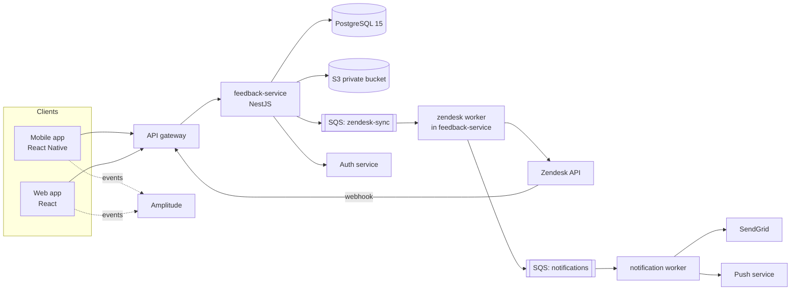
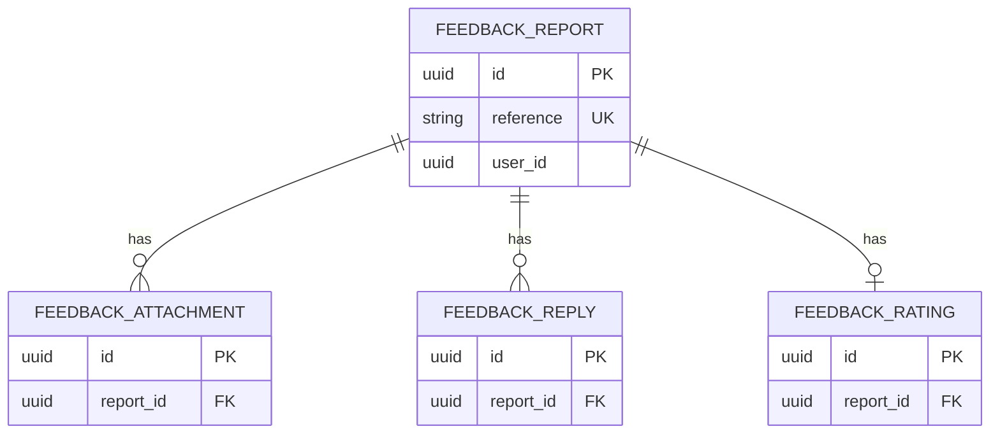
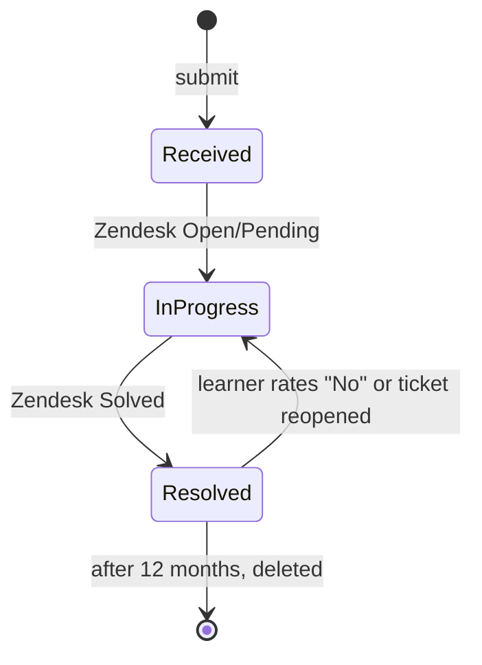

# In-App Feedback Center — Technical Requirements Document (TRD)

> **Sample document.** This is a fictional, filled-in example of `TRD_Template.md`. It is the high-level design written by the tech lead, and it sits between [PRD_Sample_In-App_Feedback.md](../PRD/PRD_Sample_In-App_Feedback.md) / [DRD_Sample_In-App_Feedback.md](../DRD/DRD_Sample_In-App_Feedback.md) and the engineers' detailed design in [SDD_Sample_In-App_Feedback.md](../SDD/SDD_Sample_In-App_Feedback.md). The product ("LearnSphere"), people, limits, and tech stack match those documents. Systems, volumes, and thresholds are invented; where a number is an assumption, it says so. Product UI strings (for example "Please choose an issue type") stay in English because the sample product launches in English.

| | |
|---|---|
| **Version** | v1.1 |
| **Author (tech lead)** | Daniel Ortiz, Engineering Lead |
| **Architect / reviewers** | Platform architecture group; Identity team; Support Ops (Lena Fischer); Security (reviewer on call) |
| **Status** | Approved |
| **Last updated** | 2026-10-30 |
| **Related PRD** | In-App Feedback Center PRD v1.0 (2026-10-15) |
| **Related DRD** | In-App Feedback Center DRD v1.0 (2026-10-28) |
| **Related SDD** | In-App Feedback Center SDD (in progress, v0.3) |
| **Repository / design docs** | `learnsphere/feedback-service` (new); ADRs in `docs/adr/` |

---

## 1. Overview and Scope

### 1.1 Purpose

Build a new `feedback-service` that receives problem reports from the mobile and web apps, stores them with context and screenshots, creates and syncs Zendesk tickets, and notifies learners about progress. It delivers the product need in PRD 1.1: make reporting easy and actionable for paying learners, and give Support one system to work in.

### 1.2 Requirement Traceability

| Source | ID | Summary | TRD section |
|--------|----|---------|-------------|
| PRD | US-001, US-002 | Report from the lesson with screenshots | 4.1, 5.1 |
| PRD | US-003 | Context attached to every report | 4.2 |
| PRD | US-004 | Learner sees report status | 4.3, 5.1 |
| PRD | US-005 | Notifications on update | 4.4 |
| PRD | US-006 | Feedback categorized for Product | 4.2, 9.2 |
| PRD | US-007 | Resolution rating | 4.5 |
| PRD | OBJ-003 | Median first useful response 38 h → 12 h | 4.2 (routing), 8 |
| PRD | 3.3.1 | Rate limit 10 reports / 24 h | 4.1, 5.1 |
| PRD | 3.3.2 | Zendesk down → retry 5 times over 1 hour, then alert | 6.2 |
| PRD | 6.3 | Encryption, audited access, 12-month retention, deletion within 30 days | 3.3, 7 |
| PRD | 5.2 | Submit < 3 s p95; API 99.9%; no lost reports | 8 |
| DRD | DR-004 | Offline draft sent automatically within 60 s | 4.1, 5.3 |
| DRD | DR-006 | Notification deep link to report detail | 4.4 |
| DRD | Section 9 | Tracking events | 9.2 |

### 1.3 Technical Scope

- **In scope**: `feedback-service` (new); the shared client feedback module (React Native and web); presigned uploads to S3; Zendesk integration (create ticket, status webhook, reopen); notification sending through the existing mail and push services; deletion and retention jobs.
- **Out of scope**: Zendesk configuration beyond the custom fields requested from Support Ops; free-tier access; live chat; the existing support email workflow.
- **Environment assumptions**: AWS (existing account and VPC), PostgreSQL 15 cluster provided by Platform, SQS and S3 available, Auth service issues JWTs with `plan` and `sub` claims, SendGrid account owned by Platform.

### 1.4 Constraints and Assumptions

| Type | Description | Impact if wrong | How we'll validate |
|------|-------------|-----------------|--------------------|
| Constraint | Must use the existing Zendesk instance and API | No alternative ticketing; limits fixed by plan | Confirm plan rate limit with Support Ops by 2026-11-02 |
| Constraint | Stack is fixed by PRD 6.1: React Native 0.76, React 18, NestJS, PostgreSQL 15, S3, SQS | None | n/a |
| Assumption | Expected volume ≈ 210 reports/day at launch (85,000 subscribers ÷ 60 days between issues ≈ 1,400 issue events/day × 15% target submission rate) | Under-sizing | Re-check at 10% rollout; load test at 3× (≈ 640/day) and burst of 10 reports/s |
| Assumption | A major playback outage could cause a short burst of reports (design target: accept 10 reports/s for 10 minutes) | Zendesk limit reached; delayed tickets | Burst test in staging; queue absorbs overflow |
| Dependency | Zendesk custom fields created by Support Ops before QA | Blocks integration testing | Requested; due 2026-11-06 |
| Dependency | Auth service exposes plan type to services | Cannot restrict to paying users | Identity team confirmed JWT claim `plan` |

---

## 2. System Architecture

### 2.1 Architecture Overview

### 2.2 Components

| Component | Responsibility | Exposes / consumes | Technology | Owner |
|-----------|----------------|--------------------|------------|-------|
| Feedback module (client) | Form UI, validation, draft storage, upload, retry | Calls `feedback-service` API | React Native 0.76 / React 18, shared library | Mobile & Web |
| `feedback-service` API | Validate and store reports, rate limit, issue presigned URLs, serve list/detail, record ratings | REST `/v1/feedback`; produces SQS messages | NestJS (Node.js 20) | Engineering |
| Zendesk worker | Create tickets, add tags/fields, process reopen requests | Consumes `zendesk-sync`; Zendesk REST API | NestJS worker process | Engineering |
| Zendesk webhook handler | Verify and apply status and reply updates | `POST /v1/webhooks/zendesk` | NestJS controller | Engineering |
| Notification worker | Send acknowledgment, update, and resolution notices | Consumes `notifications`; SendGrid, push service | NestJS worker process | Engineering |
| Retention job | Delete expired reports and attachments; process deletion requests | Scheduled (daily) | NestJS scheduled task | Engineering |

### 2.3 Technology Stack

| Layer | Choice | Version | Notes |
|-------|--------|---------|-------|
| Mobile | React Native | 0.76 | Shared feedback module for iOS and Android |
| Web | React + TypeScript | 18 | Same component library as mobile where possible |
| Backend | Node.js + NestJS | Node 20 LTS | New microservice |
| Database | PostgreSQL | 15 | Provided by Platform cluster, separate schema `feedback` |
| Storage | AWS S3 | n/a | Private bucket, SSE-KMS, 12-month lifecycle rule |
| Queue | AWS SQS | n/a | Standard queues with DLQs |
| Email | SendGrid | API v3 | Existing account |
| Analytics | Amplitude SDK | current | Events defined in the DRD |

### 2.4 Architecture Decisions

| ID | Decision | Alternatives considered | Rationale | Status |
|----|----------|-------------------------|-----------|--------|
| ADR-001 | Store every report in our database first, then create the Zendesk ticket asynchronously through SQS | Create the ticket synchronously in the request | A Zendesk outage must never lose or block a report (PRD 6.2). Submit latency stays low and independent of Zendesk. | Accepted |
| ADR-002 | Use a transactional outbox: write the report and an outbox row in one transaction, then publish to SQS | Publish to SQS directly after commit | Avoids "saved but never queued" if the process dies between steps | Accepted |
| ADR-003 | Client generates an idempotency key when the form opens and sends it with the submit | Server-generated only | Offline drafts and retries can be sent several times without creating duplicate reports | Accepted |
| ADR-004 | Direct-to-S3 uploads with presigned POST (size and type conditions) | Upload through the API | Keeps large files off the API; the POST policy enforces the 5 MB limit at S3 | Accepted |
| ADR-005 | Zendesk is the system of record for ticket status; we mirror it through webhooks | Poll Zendesk | Webhooks give near-real-time updates and use fewer API calls | Accepted |
| ADR-006 | Build as a new service instead of a module in the monolith | Module inside the existing learner API | Separate scaling, deploy, and failure domain; small team ownership | Accepted |

### 2.5 Deployment Model

| Item | Choice |
|------|--------|
| Hosting | AWS (existing account), `eu-west-1` primary; clients are global |
| Runtime | Containers on the existing Kubernetes cluster: `feedback-api` (3 replicas minimum), `feedback-worker` (2 replicas) |
| Environments | Dev, Staging, Production |
| Feature flag | `feedback_center_enabled` (percentage rollout; also the kill switch) |

---

## 3. Data Model (High Level)

### 3.1 Entities and Relationships

### 3.2 Key Entities

| Entity | Purpose | Key attributes | Personal data? | System of record |
|--------|---------|----------------|----------------|------------------|
| `feedback_report` | One learner problem report | Reference `FB-YYYYMMDD-NNNN`, user, issue type, description, context (course, lesson, device, app version), status, queue, ticket ID | Yes (user, description, email, device info) | This service |
| `feedback_attachment` | A screenshot linked to a report (max 3, ≤ 5 MB) | Object key, content type, size | Yes (images) | This service (S3 holds the file) |
| `feedback_reply` | A public agent reply mirrored from Zendesk | Agent first name, body, time | Yes (message body) | Zendesk (mirrored here) |
| `feedback_rating` | The learner's "did this help" answer, one per resolution | Helped yes / no, optional comment | Yes (comment) | This service |

### 3.3 Data Lifecycle

| Data | Retention | Deletion / anonymization | Backup and recovery |
|------|-----------|--------------------------|---------------------|
| Reports, replies, ratings | 12 months from creation | Daily job hard-deletes rows older than 12 months | Daily snapshots, 14 days; RPO 5 min via PITR, RTO 1 h |
| Attachments (S3) | 12 months | S3 lifecycle rule at 12 months + job deletes keys for deleted reports | Versioning off; no backup copy of screenshots |
| Account deletion / GDPR / CCPA request | Within 30 days (target 7 days) | Event from the privacy service triggers deletion of all reports and attachments for the user and removal of the Zendesk ticket's personal fields | Deletion logged in the audit log (IDs only) |

---

## 4. Technical Functional Requirements

### 4.1 Submit a Report

- **Traces to**: US-001, US-002, DR-002, DR-004
- **Priority**: P0
- **Description**: Accept a report from a paying learner, store it durably, and queue Zendesk ticket creation.
- **Key rules**:
  - Only paying learners may submit; the plan comes from the session token.
  - At most 10 reports per learner in any 24 hours.
  - Up to 3 PNG or JPG screenshots of at most 5 MB each, uploaded directly to S3 and verified by the service before the report is accepted.
  - The client sends an idempotency key, so a repeated request returns the original result instead of creating a second report.
  - Each report gets a reference `FB-YYYYMMDD-NNNN`.
  - The report is stored first; the Zendesk ticket is created asynchronously (ADR-001).
- **Lifecycle**:

- **Key failure behavior**: Invalid input → a validation error naming the field. Database unavailable → the request fails with a retryable error and the client keeps a draft. Zendesk down → the request still succeeds; the ticket is created later.
- **Detail in SDD**: 3.1, 5.1, 6.1

### 4.2 Context Capture and Routing

- **Traces to**: US-003, US-006, OBJ-002, OBJ-003
- **Priority**: P0
- **Description**: The worker creates a Zendesk ticket carrying the report's context and routes it.
- **Key rules**:
  - Billing issues go to the Billing queue; all others go to General Support.
  - Tickets from learners with a certificate deadline within 7 days get a `priority` tag. The worker looks this up from the learner API when it creates the ticket (500 ms timeout); if the lookup fails, the tag is skipped (SDD DEV-002).
  - Tickets carry issue-type and plan tags and custom fields for reference, course, lesson, device, OS, app version, locale, and user ID.
  - Attachments are copied from S3 to the ticket.
- **Key failure behavior**: Retry for about 1 hour (6.2), then the report is marked failed, moved to the dead-letter queue, and Support Ops is alerted.
- **Detail in SDD**: 3.2, 6.2

### 4.3 List and View Reports

- **Traces to**: US-004, DR-005
- **Priority**: P1
- **Description**: Learners list and open their own reports.
- **Key rules**:
  - Only the owner can read a report; others get "not found", never "forbidden".
  - Reports older than 12 months are not shown.
  - Zendesk status maps New → received, Open / Pending → in progress, Solved → resolved.
  - Private agent notes are never mirrored or returned.
  - Lists are paged by cursor, 20 per page.
- **Detail in SDD**: 5.1, 6.3

### 4.4 Status Sync and Notifications

- **Traces to**: US-005, DR-006
- **Priority**: P1
- **Description**: Apply Zendesk updates to local state and notify the learner.
- **Key rules**:
  - Zendesk webhooks are accepted only with a valid signature, a recent timestamp, and an allowed source address.
  - Updates are idempotent: replies and status changes can arrive twice or out of order without corrupting state.
  - Notifications: acknowledgment within 5 minutes of submit, then agent replies and resolution, in the app and by email (email can be turned off by the learner). Push notifications deep-link to the report (DR-006).
  - Each notification event is sent at most once.
- **Detail in SDD**: 3.3, 6.4

### 4.5 Resolution Rating

- **Traces to**: US-007
- **Priority**: P2
- **Description**: Record whether a resolution helped; "No" reopens the ticket.
- **Key rules**: A rating is allowed only for a resolved report and only once per resolution. "No" reopens the Zendesk ticket, tags it `reopened`, routes it to the senior-agent group, and moves the report back to in progress.
- **Detail in SDD**: 3.4, 6.5

---

## 5. Interface Overview

### 5.1 API Overview

All endpoints are under `/v1`, require `Authorization: Bearer <JWT>` unless noted, and return JSON.

| Endpoint | Method | Purpose | Auth | Idempotent | Rate limit |
|----------|--------|---------|------|------------|------------|
| `/feedback/attachments/presign` | POST | Get presigned S3 POST for a screenshot | Learner | No | 30 / hour / user |
| `/feedback` | POST | Submit a report | Learner (paying) | Yes (idempotency key) | 10 reports / 24 h / user |
| `/feedback` | GET | List own reports | Learner | Yes | 60 / min / user |
| `/feedback/{id}` | GET | Report detail with replies | Learner (owner) | Yes | 60 / min / user |
| `/feedback/{id}/rating` | POST | Submit resolution rating | Learner (owner) | Yes (one per cycle) | 10 / min / user |
| `/webhooks/zendesk` | POST | Zendesk status and reply events | Signed request | Yes | Zendesk only (IP allowlist) |

Request and response schemas are in the SDD and the generated OpenAPI file.

### 5.2 Error Code Convention

| Item | Convention |
|------|------------|
| Format | `CATEGORY-NNN` (e.g., `VAL-001`, `AUTH-001`, `RATE-001`, `STATE-001`, `SYS-001`) |
| Categories | VAL = validation, AUTH = authentication or authorization, RATE = limits, STATE = invalid state, NOTFOUND = not found, SYS = system |
| HTTP mapping | VAL → 400, AUTH → 401 / 403, NOTFOUND → 404, STATE → 409, RATE → 429, SYS → 503 |
| Wording | Clients map codes to message keys; the wording follows the DRD. The full catalog is in the SDD. |
| Information leaks | Return 404, not 403, for resources the caller doesn't own |

### 5.3 Versioning and Compatibility

- **Versioning scheme**: URL major version (`/v1`).
- **Backward compatibility**: the response may gain fields; clients ignore unknown fields. Breaking changes require `/v2` and 6 months of overlap, because older app versions stay in use.
- **Offline drafts**: drafts store the full request including the idempotency key and attachment upload state; the app resumes uploads, then submits, within 60 s of connectivity returning (DR-004).
- **Deprecation policy**: announce in release notes; track old-version traffic before removal.

### 5.4 External Integrations

| System | Method | Purpose | Limits | Failure behavior | Owner |
|--------|--------|---------|--------|------------------|-------|
| Zendesk | REST API + webhooks | Tickets, status, replies, reopen | Plan limit (**assumed 200 requests/min for design; confirm**) | Retry with backoff; DLQ and alert (6.2) | Support Ops (Lena Fischer) |
| SendGrid | API v3 | Emails | Account limits | Retry 3×; then log and alert if failure rate > 5% | Platform |
| Push service | Internal API | Push notifications | Internal | Retry 3×; best effort | Platform |
| Auth service | Internal API / JWT keys | Identity, plan type | Internal | Cached keys; request fails with 401 if unverifiable | Identity |
| Learner API | Internal API | Certificate deadline (priority tag), called by the Zendesk worker | 500 ms timeout | Skip priority tag | Learner platform |
| Amplitude | SDK (client side) | Funnel events | n/a | Fire and forget | Data |

---

## 6. Events and Messaging

### 6.1 Topology

| Queue | Producer | Consumer(s) | Ordering needed? |
|-------|----------|-------------|------------------|
| `zendesk-sync` (+ `-dlq`) | Outbox publisher | Zendesk worker | No |
| `notifications` (+ `-dlq`) | Submit path, webhook handler | Notification worker | No |
| `retention` | Scheduler | Retention job | No |

Payload schemas are in the SDD (5.3).

### 6.2 Reliability Policy

| Item | Policy |
|------|--------|
| Delivery guarantee | At-least-once; consumers are idempotent |
| Retry (`zendesk-sync`) | 5 retries with increasing delays over about 1 hour (PRD 3.3.2). Retry on timeouts, 429, and 5xx; do not retry validation-type 4xx errors. Exact delays are in SDD 6.2. |
| Dead-letter queue | After the last attempt: mark the report's sync failed, move the message to the DLQ, and alert Support Ops (P2) when any message stays in the DLQ for more than 15 minutes. A replay tool re-queues messages after a fix. |
| Idempotency | Ticket creation is keyed by the report's reference, so a retry never makes a second ticket. |
| Visibility | Learner sees the report as Received while sync is pending or failed; nothing is lost. |
| Schema evolution | Additive payload changes only; breaking changes require a new queue name. |

---

## 7. Security Architecture

### 7.1 Authentication and Authorization

| Item | Design |
|------|--------|
| Authentication | LearnSphere session JWT (verified against Auth service public keys, cached 10 min) |
| Authorization | Learners access only their own reports (`user_id` check on every query). Support staff access screenshots only through an internal, audited tool that issues short-lived signed URLs. |
| Service-to-service | Internal calls use mTLS through the cluster mesh |
| Webhook | Zendesk signing secret, timestamp check (5 min), IP allowlist |

### 7.2 Data Protection

| Item | Design |
|------|--------|
| In transit | TLS 1.2+ at the gateway; TLS 1.3 preferred |
| At rest | PostgreSQL storage encryption; S3 SSE-KMS (AES-256) with a dedicated key |
| Secrets | Zendesk token, SendGrid key, and webhook secret in the secret manager; rotated every 90 days; never logged |
| Personal data | Description, email, user ID, device info, and screenshots are personal data. Logs contain report IDs only, never descriptions, emails, or file names. |
| Uploads | Presigned POST with size and type limits; keys are random UUIDs under the user's prefix; bucket blocks public access; screenshots are served only by signed URLs |

### 7.3 Threat Model

| Threat | Where | Likelihood / Impact | Mitigation | Verified by |
|--------|-------|---------------------|------------|-------------|
| Spam or abusive submissions | `POST /feedback` | M / M | 10-per-day limit per user; paying users only; content limits; alert if spam > 2% | Load and abuse test |
| Accessing another learner's report | `GET /feedback/{id}` | M / H | Ownership check on every query; 404 on mismatch; random UUIDs | Authorization tests |
| Malicious file upload (script or oversized file disguised as an image) | Screenshots | M / M | Content type fixed in POST policy; size ≤ 5 MB; served from a separate bucket domain with `Content-Disposition` and `nosniff`; not rendered by agents' tools unless viewed as an image | Security test, upload fuzzing |
| Personal data in screenshots exposed | S3, support tool | M / H | Privacy notice (DRD 8.3.1); encryption; audited access; auto-delete at 12 months | Security review; access-log audit |
| Forged Zendesk webhook | Webhook endpoint | L / H | Signature, timestamp, IP allowlist | Negative tests |
| Replay of old submit requests | Submit | L / L | Idempotency key; duplicates return the original result | Unit test |
| Sensitive data in logs | All services | M / M | Structured logger with allowlisted fields; log review in CI | Log sampling checks |
| Stale or leaked signed URLs | Attachments | L / M | 5-minute expiry; tied to authenticated request | Test |

### 7.4 Audit and Compliance

- **Audit logging**: every support-staff access to an attachment is logged (staff ID, report ID, time) and kept for 24 months. Deletions are logged with report IDs only.
- **Regulatory**: GDPR/CCPA deletion within 30 days via the privacy service event; DPA with Zendesk is in place (PRD 7.4); retention 12 months.

---

## 8. Non-Functional Requirements

| Category | Requirement | Target | How to verify |
|----------|-------------|--------|---------------|
| Performance | `POST /feedback` latency (excluding upload time) | p95 < 400 ms server-side; whole submit < 3 s at p95 on 4G (PRD 5.2) | Load test; device-lab test |
| Performance | `GET /feedback` list | p95 < 300 ms | Load test |
| Performance | Form open | < 500 ms (client; context from local state) | Device test |
| Throughput | Burst submissions | Accept 10 reports/s for 10 min without errors (reports are stored and queued) | Burst test in staging |
| Availability | Feedback API | 99.9% monthly | Monitoring |
| Reliability | Zendesk outage | No report lost. At normal volume, all synced within 1 hour of Zendesk recovery. After the design burst, the backlog clears in about 2 hours (*estimate*; SDD DEV-001) | Failure-injection test (block Zendesk in staging); burst test |
| Reliability | Acknowledgment | Sent within 5 minutes of submit for ≥ 99% of reports | Metric |
| Scalability | Growth | Handles 5× launch volume with replica changes only | Capacity review, load test |
| Capacity | Storage | ≈ 210 reports/day × (≈ 2 KB row + ≈ 1.2 MB screenshots on average × 35% attach rate) ≈ 90 MB/day ≈ 33 GB/year | Forecast, S3 metrics |
| Compatibility | Older clients | Clients that don't know the entry point keep working; API changes additive | Contract tests |
| Maintainability | Code quality | Lint and type-check clean; OpenAPI spec generated and published | CI |

---

## 9. Observability and Operations

### 9.1 Service Level Objectives

| SLI | SLO | Alert |
|-----|-----|-------|
| Successful `POST /feedback` ÷ valid requests | 99.9% / 30 days | Page when burn rate would exhaust the budget in 24 h |
| `POST /feedback` p95 latency | < 400 ms | Warn at > 600 ms for 5 min |
| Reports with ticket synced within 15 min (normal volume) | ≥ 99% | Warn if < 97% for 30 min |
| Webhook processing delay | p95 < 30 s | Warn at 60 s |
| Acknowledgment sent within 5 min | ≥ 99% | Warn if < 95% for 30 min |

### 9.2 Logging, Metrics, and Tracing Requirements

| Type | Requirement |
|------|-------------|
| Logs | Structured JSON with request ID, user ID hash, report ID; no descriptions, emails, or filenames |
| Metrics | Request rate, errors by code, latency; outbox lag; queue depth and age; DLQ size; Zendesk call latency and 429 count; reports by type and course (daily); spam rate; rate-limit hits |
| Tracing | OpenTelemetry; trace ID propagated from the gateway through API, queue message attributes, and worker |
| Dashboards | Service health (SRE); Support Ops view (ticket sync, DLQ, volume vs. staffing guardrail of 80 tickets/agent/day); Product view (top issues by type and course, replacing the Zendesk-report workaround) |

Log fields, metric names, and span names are in the SDD (9).

### 9.3 Alerting and On-Call

| Alert | Threshold | Severity | Owner | Runbook |
|-------|-----------|----------|-------|---------|
| DLQ not empty | > 0 for 15 min | P2 (also notify Support Ops) | Engineering on-call | `runbooks/feedback-dlq.md` |
| Outbox lag | Oldest unpublished row > 5 min | P2 | Engineering on-call | `runbooks/feedback-outbox.md` |
| API error rate | > 1% for 5 min | P1 | Engineering on-call | `runbooks/feedback-api.md` |
| Zendesk 429s | > 20 in 5 min | P3 | Engineering | `runbooks/feedback-zendesk.md` |
| Spam rate | > 2% of reports in 1 hour | P3 | Support Ops + Engineering | `runbooks/feedback-abuse.md` |

---

## 10. Testing Strategy

| Level | Scope | Target / criteria | Owner |
|-------|-------|-------------------|-------|
| Unit | Validation, rate limit, reference generation, status mapping, routing rules | ≥ 85% line coverage on `feedback-service`; every rule in Section 4 has a test | Engineering |
| Contract | API (OpenAPI) and queue payloads; Zendesk client against recorded contracts | CI fails on breaking change | Engineering |
| Integration | API ↔ PostgreSQL, S3, SQS (local stack); Zendesk sandbox; webhook signature | All flows in 4.1–4.5 | Engineering / QA |
| End-to-end | DRD flows on iOS, Android, web | Each PRD acceptance criterion (AC-1 to AC-7) passes | QA |
| Performance | Load at 3× expected volume (≈ 640 reports/day) plus a 10 reports/s burst | Meets Section 8 targets | Engineering / SRE |
| Security | Dependency and static scans; authorization tests; upload fuzzing; pen test of presign and webhook endpoints | No high or critical findings open at launch | Security |
| Resilience | Block Zendesk for 90 min; kill workers mid-send; duplicate submits and webhooks | No lost or duplicated reports; recovery as per 6.2 | Engineering / SRE |
| Privacy | Deletion request end-to-end; retention job on test data | Data gone from DB, S3, and Zendesk personal fields within SLA | Engineering / Legal |

Concrete test cases are in the SDD (10).

**Mapping from PRD acceptance criteria**

| PRD criterion | Test level | Notes |
|---------------|-----------|-------|
| AC-1 Successful submission | E2E, integration | Checks reference within 3 s, ticket fields, acknowledgment within 5 min |
| AC-2 Required-field validation | Unit (server), E2E (client) | |
| AC-3 Offline submission | E2E, resilience | Airplane-mode test; sends within 60 s of reconnect |
| AC-4 Oversized screenshot | Unit, integration | Client check plus S3 policy rejection |
| AC-5 Rate limit | Integration | 11th request returns `RATE-001`; no ticket |
| AC-6 Status visible | Integration, E2E | Zendesk Open → in progress |
| AC-7 Rating reopens ticket | Integration, E2E | Ticket reopened, tagged, senior queue |

---

## 11. Delivery and Deployment

### 11.1 Environments

| Environment | Purpose | Data | Differences from production |
|-------------|---------|------|------------------------------|
| Dev | Development | Synthetic | Local stack for SQS/S3; Zendesk sandbox |
| Staging | QA, load, resilience tests | Synthetic | Smaller replicas; Zendesk sandbox |
| Production | Live | Real | Full replicas, alerts, audit logging |

### 11.2 CI/CD Pipeline

| Stage | Steps | Gate |
|-------|-------|------|
| Build | Lint, type-check, build image | Must pass |
| Test | Unit, contract, integration | Coverage ≥ 85%; all pass |
| Security | Dependency scan, static analysis, secret scan | No high or critical |
| Deploy to staging | Migrations, rollout, smoke test | Smoke test passes |
| Deploy to production | Rolling update; migrations first; flag stays at current percentage | Manual approval by the lead |

### 11.3 Rollout and Rollback

- **Rollout plan** (from PRD 7.2): internal dogfood week 6 → 10% week 7 → 50% week 8 → 100% week 9, using `feedback_center_enabled`. Before each step check: error rate < 1%, DLQ empty, ticket volume per agent ≤ 80/day, player start time regression < 100 ms, spam rate < 2%.
- **Rollback**: set the flag to 0% (entry point disappears immediately; existing reports and My Feedback remain readable). Service rollback by redeploying the previous image; migrations are additive so no schema rollback is needed.
- **Launch readiness checklist**: Zendesk custom fields live; dashboards and alerts tested; runbooks written; Support agents trained on new ticket fields and macros; privacy policy updated (Legal); load, resilience, and security tests passed.

---

## 12. Risks

| ID | Risk | Likelihood | Impact | Mitigation | Owner |
|----|------|------------|--------|------------|-------|
| R-001 | Zendesk rate limits or outage during a spike | M | H | Queue with backoff; burst test; confirm plan limit; reports never depend on Zendesk being up | Daniel Ortiz |
| R-002 | Screenshot upload fails on poor networks | M | M | Direct-to-S3 with resumable retry in the client; draft keeps upload state; submit without screenshot allowed after error | Mobile lead |
| R-003 | Personal information in screenshots | M | H | Privacy notice, encryption, audited access, 12-month deletion; investigate auto-redaction (spike) | Daniel Ortiz / Legal |
| R-004 | Ticket volume exceeds Support capacity after launch | M | H | Phased rollout, guardrail dashboard, staffing review at day 60 | Lena Fischer |
| R-005 | Duplicate tickets from retries | L | M | Idempotency key, external ID lookup before create | Engineering |
| R-006 | Reference counter (`NNNN`) exceeds 9,999 per day | L | L | Format allows up to 5 digits if needed; alert at 5,000/day | Engineering |
| R-007 | After a mass incident, the Zendesk backlog takes about 2 hours to clear (*estimate*) | L | M | Confirm the real Zendesk limit; evaluate batch ticket creation if the limit is lower; acknowledgments do not depend on Zendesk | Daniel Ortiz |

---

## 13. Implementation Plan

| Milestone | Scope | Depends on | Estimate | Owner |
|-----------|-------|------------|----------|-------|
| M1 (weeks 1–3) | Data model, submit and presign endpoints, rate limit, client form with validation and upload | Identity claims confirmed | 3 engineers | Backend + Mobile/Web |
| M2 (weeks 3–5) | Outbox, Zendesk worker, retries, DLQ and alerts; webhook handler; My Feedback list and detail; notifications | Zendesk custom fields (Nov 6) | 3 engineers | Backend + Mobile/Web |
| M3 (weeks 5–6) | Rating and reopen; offline drafts; retention and deletion jobs; load, security, and resilience testing; dashboards and runbooks | M2 | 3 engineers + QA (1 week) | All |
| Rollout (weeks 6–9) | Dogfood, 10%, 50%, 100% | M3 | — | Product + Support Ops |

---

## 14. Detailed Design Handoff

### 14.1 SDD Ownership

| SDD | Owner (engineer) | Components covered | Reviewer |
|-----|------------------|--------------------|----------|
| [In-App Feedback Center SDD](../SDD/SDD_Sample_In-App_Feedback.md) | Mei Tan (backend); Carlos Reyes (client module) | `feedback-service` API, workers, jobs; client feedback module (network and drafts) | Daniel Ortiz |

### 14.2 Rules for Changes

- **Engineers may change freely** (in the SDD): module and class structure, field-level design, indexes, algorithms, configuration values, log and metric names, and test cases.
- **Needs the tech lead's agreement** (and a TRD update): anything that changes the architecture, a decision in Section 2.4, security design, a target in Section 8, or an interface other teams depend on.
- Every such change is recorded in the SDD's deviation log (SDD 12) and in this document's change log.

### 14.3 Changes Since Approval

| ID | What changed | SDD reference | Approved by | Date |
|----|--------------|---------------|-------------|------|
| DEV-001 | Reliability target split: normal volume synced within 1 hour of Zendesk recovery; after the design burst, about 2 hours (*estimate*) | SDD 11, 12 | Daniel Ortiz | 2026-10-30 |
| DEV-002 | Priority (certificate deadline) lookup moved from the submit request to the Zendesk worker | SDD 6.2, 12 | Daniel Ortiz | 2026-10-30 |

---

## 15. Review Checklist

- [x] Every PRD/DRD requirement with a technical impact appears in 1.2
- [x] Architecture diagram, components, and data entities agree
- [x] Every API has purpose, auth, idempotency, and rate limit defined
- [x] Error code convention, versioning, and compatibility rules stated
- [x] Failure paths specified (Zendesk outage, offline, duplicates, S3 failures)
- [x] Threat model covers real data flows, each with a mitigation and a test
- [x] Non-functional targets are numbers with a verification method
- [x] SLOs, alerts, and runbooks exist for launch
- [x] Rollout and rollback plans are written
- [x] The SDD owner and the change rules are named (Section 14)
- [ ] Open question 1 (screenshot auto-redaction) is still open; it does not block v1

---

## 16. Appendix

### 16.1 Open Questions

| # | Question | Owner | Due date | Resolution |
|---|----------|-------|----------|------------|
| 1 | Can we auto-redact obvious personal data in screenshots? | Daniel Ortiz | 2026-11-20 | Open; spike scheduled (same as PRD open question 2) |
| 2 | What is the Zendesk plan's API rate limit? | Lena Fischer | 2026-11-02 | Open; design assumes 200 requests/min |
| 3 | Should the priority tag (certificate deadline) read from the learner API at submit time or from a nightly sync? | Daniel Ortiz | 2026-11-06 | Resolved: read by the Zendesk worker when it creates the ticket, 500 ms timeout; skip the tag on failure (SDD DEV-002) |
| 4 | Do we need cross-region replicas of the feedback database? | Platform architecture | 2026-11-13 | Open; single-region for v1, revisit at 100% rollout |

### 16.2 Glossary

| Term | Definition |
|------|------------|
| ADR | Architecture Decision Record: a short note capturing a design decision, the options considered, and why |
| HLD / LLD | High-level design (this TRD) / low-level design (the SDD) |
| SDD | Software Design Document: the engineers' detailed design, which also serves as the tech spec |
| Outbox pattern | Writing a message to a database table in the same transaction as the data change, then publishing it, so neither is lost |
| Idempotency key | A client-generated ID that lets the server recognize a repeated request and return the original result |
| DLQ | Dead-letter queue: where messages go after all retries fail |
| SLI / SLO | Service level indicator (what is measured) / objective (the target) |
| Presigned POST | A time-limited, rule-bound URL that lets the client upload directly to S3 |

### 16.3 References

- PRD: In-App Feedback Center v1.0; DRD: In-App Feedback Center v1.0; SDD: In-App Feedback Center (in progress)
- Zendesk API and webhook documentation (internal bookmarks)
- Q3 2026 Support Operations report (internal)
- Platform engineering standards and runbook templates (internal)

### 16.4 Change Log

| Version | Date | Author | Changes |
|---------|------|--------|---------|
| v0.1 | 2026-10-05 | Daniel Ortiz | Initial architecture and data model |
| v0.5 | 2026-10-14 | Daniel Ortiz | Added APIs, queues, and security sections |
| v0.9 | 2026-10-22 | Daniel Ortiz | Added threat model, testing plan, rollout; Support Ops and Security review |
| v1.0 | 2026-10-29 | Daniel Ortiz | Aligned with DRD v1.0 (offline drafts, error codes, tracking); approved |
| v1.1 | 2026-10-30 | Daniel Ortiz | Detailed design moved to the SDD; reliability target amended after burst analysis (SDD DEV-001); priority lookup moved to the Zendesk worker (SDD DEV-002) |
