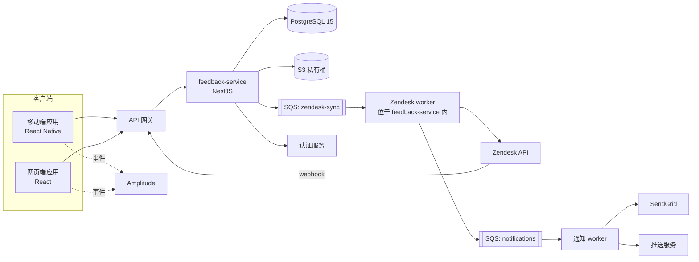
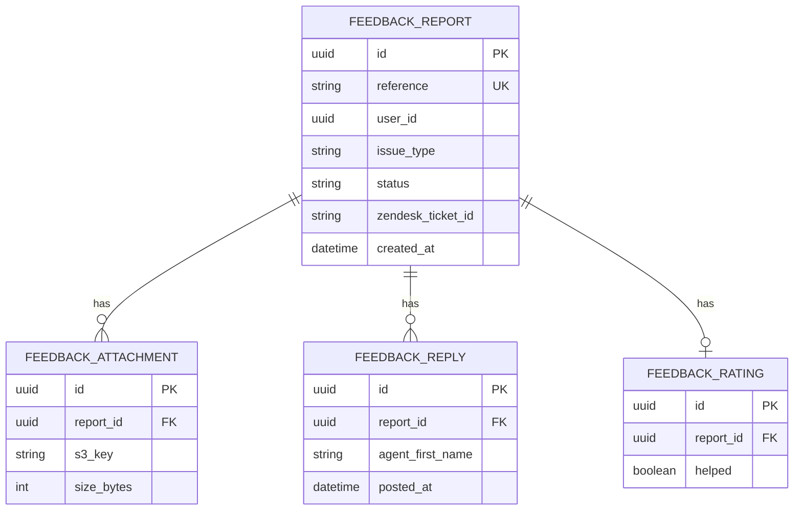
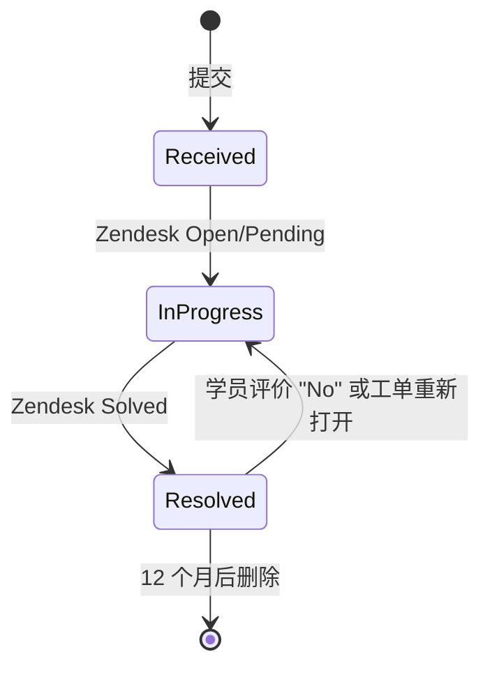

# 应用内反馈中心 — 技术需求文档（TRD）

> **示例文档。**这是 `TRD_Template_zh.md` 的一份虚构、完整填写的示例。它是 [PRD_Sample_In-App_Feedback_zh.md](../PRD/PRD_Sample_In-App_Feedback_zh.md) 和 [DRD_Sample_In-App_Feedback_zh.md](../DRD/DRD_Sample_In-App_Feedback_zh.md) 的研发配套文档，因此产品（"LearnSphere"）、人物、限制和技术栈均与这两份文档一致。系统、量级和阈值均为虚构；凡属假设的数字，文中会注明。产品界面文案（引号内的英文）保持英文原样，因为该产品首发仅支持英文。

| | |
|---|---|
| **版本** | v1.0 |
| **作者** | Daniel Ortiz，研发负责人 |
| **技术负责人** | Daniel Ortiz |
| **架构师 / 评审人** | 平台架构组；身份团队；客服运营（Lena Fischer）；安全（值班评审人） |
| **状态** | 已批准 |
| **最后更新** | 2026-10-29 |
| **关联 PRD** | 应用内反馈中心 PRD v1.0（2026-10-15） |
| **关联 DRD** | 应用内反馈中心 DRD v1.0（2026-10-28） |
| **代码仓库 / 设计文档** | `learnsphere/feedback-service`（新建）；ADR 位于 `docs/adr/` |

---

## 1. 概述与范围

### 1.1 目的

构建一个新的 `feedback-service`，用于接收移动端和网页端的问题反馈，连同上下文和截图一起存储，创建并同步 Zendesk 工单，并通知学员处理进展。它交付 PRD 1.1 中的产品诉求：让付费学员更容易反馈、反馈更可处理，并让客服在同一个系统里工作。

### 1.2 需求追溯

| 来源 | 编号 | 摘要 | TRD 章节 |
|--------|----|---------|-------------|
| PRD | US-001, US-002 | 在课程中反馈，并附截图 | 4.1、5.2 |
| PRD | US-003 | 每条反馈都附带上下文 | 4.2、3.2 |
| PRD | US-004 | 学员查看反馈状态 | 4.3、5.2 |
| PRD | US-005 | 更新时通知 | 4.4 |
| PRD | US-006 | 反馈按类别分类，供产品使用 | 4.2、9.2 |
| PRD | US-007 | 处理结果评价 | 4.5 |
| PRD | OBJ-003 | 首次有效回复的中位时间 38 小时 → 12 小时 | 4.2（分派）、8 |
| PRD | 3.3.1 | 频率限制：24 小时 10 条 | 4.1、5.2 |
| PRD | 3.3.2 | Zendesk 宕机 → 1 小时内重试 5 次，然后告警 | 6.2 |
| PRD | 6.3 | 加密、受审计的访问、12 个月留存、30 天内删除 | 3.4、7 |
| PRD | 5.2 | 提交 p95 < 3 秒；API 99.9%；不丢反馈 | 8 |
| DRD | DR-004 | 离线草稿在 60 秒内自动发送 | 4.1、5.3 |
| DRD | DR-006 | 通知深链打开反馈详情 | 4.4 |
| DRD | 第 9 章 | 埋点事件 | 9.2 |

### 1.3 技术范围

- **范围内**：`feedback-service`（新建）；共享的客户端反馈模块（React Native 和网页端）；通过预签名方式上传到 S3；Zendesk 集成（创建工单、状态 webhook、重新打开）；通过现有邮件和推送服务发送通知；删除与留存任务。
- **范围外**：除向客服运营申请的自定义字段外的 Zendesk 配置；免费用户访问；在线聊天；现有的客服邮件流程。
- **环境假设**：AWS（现有账号和 VPC）；由平台团队提供的 PostgreSQL 15 集群；SQS 和 S3 可用；认证服务签发的 JWT 带有 `plan` 和 `sub` 声明；SendGrid 账号由平台团队持有。

### 1.4 约束与假设

| 类型 | 描述 | 若不成立的影响 | 如何验证 |
|------|-------------|-----------------|--------------------|
| 约束 | 必须使用现有的 Zendesk 实例和 API | 没有替代的工单系统；限制由套餐固定 | 2026-11-02 前与客服运营确认套餐频率限制 |
| 约束 | 技术栈由 PRD 6.1 固定：React Native 0.76、React 18、NestJS、PostgreSQL 15、S3、SQS | 无 | 不适用 |
| 假设 | 上线时预期量约为每天 210 条反馈（85,000 订阅用户 ÷ 60 天 ≈ 每天约 1,400 次问题事件 × 15% 目标提交率） | 容量低估 | 在 10% 放量时复核；按 3 倍（约每天 640 条）及每秒 10 条的突发做压测 |
| 假设 | 重大播放故障可能引发短时突发反馈（设计目标：持续 10 分钟每秒 10 条） | 触达 Zendesk 限制；工单延迟 | 在预发布环境做突发测试；由队列吸收溢出 |
| 依赖 | 在 QA 之前，Zendesk 自定义字段须由客服运营创建 | 阻塞集成测试 | 已申请；截止 2026-11-06 |
| 依赖 | 认证服务向各服务暴露套餐类型 | 无法限制为仅付费用户 | 身份团队已确认 JWT 声明 `plan` |

---

## 2. 系统架构

### 2.1 架构概览



### 2.2 组件

| 组件 | 职责 | 对外提供 / 依赖 | 技术 | 负责人 |
|-----------|----------------|--------------------|------------|-------|
| 反馈模块（客户端） | 表单界面、校验、草稿存储、上传、重试 | 调用 `feedback-service` API | React Native 0.76 / React 18，共享库 | 移动端与网页端 |
| `feedback-service` API | 校验并存储反馈、频率限制、签发预签名 URL、提供列表 / 详情、记录评价 | REST `/v1/feedback`；向 SQS 生产消息 | NestJS（Node.js 20） | 研发 |
| Zendesk worker | 创建工单、添加标签 / 字段、处理重新打开请求 | 消费 `zendesk-sync`；Zendesk REST API | NestJS worker 进程 | 研发 |
| Zendesk webhook 处理器 | 校验并应用状态和回复更新 | `POST /v1/webhooks/zendesk` | NestJS controller | 研发 |
| 通知 worker | 发送确认、更新和解决通知 | 消费 `notifications`；SendGrid、推送服务 | NestJS worker 进程 | 研发 |
| 留存任务 | 删除过期的反馈和附件；处理删除请求 | 定时任务（每日） | NestJS 定时任务 | 研发 |

### 2.3 技术栈

| 层 | 选型 | 版本 | 备注 |
|-------|--------|---------|-------|
| 移动端 | React Native | 0.76 | iOS 与 Android 共用的反馈模块 |
| 网页端 | React + TypeScript | 18 | 尽可能与移动端共用同一套组件库 |
| 后端 | Node.js + NestJS | Node 20 LTS | 新建微服务 |
| 数据库 | PostgreSQL | 15 | 平台团队的集群，独立 schema `feedback` |
| 存储 | AWS S3 | 不适用 | 私有桶、SSE-KMS、12 个月生命周期规则 |
| 队列 | AWS SQS | 不适用 | 带死信队列的标准队列 |
| 邮件 | SendGrid | API v3 | 现有账号 |
| 分析 | Amplitude SDK | 当前版本 | 事件在 DRD 中定义 |

### 2.4 架构决策

| 编号 | 决策 | 考虑过的替代方案 | 理由 | 状态 |
|----|----------|-------------------------|-----------|--------|
| ADR-001 | 每条反馈先存入我们的数据库，再通过 SQS 异步创建 Zendesk 工单 | 在请求中同步创建工单 | Zendesk 宕机绝不能丢失或阻塞反馈（PRD 6.2）。提交延迟保持较低，且与 Zendesk 无关。 | 已采纳 |
| ADR-002 | 使用事务性 outbox：在同一个事务中写入反馈和 outbox 行，再发布到 SQS | 提交后直接发布到 SQS | 避免进程在两步之间崩溃造成"已保存但从未入队" | 已采纳 |
| ADR-003 | 表单打开时由客户端生成幂等键，并随提交一起发送 | 仅由服务端生成 | 离线草稿和重试可被多次发送，而不会产生重复反馈 | 已采纳 |
| ADR-004 | 使用预签名 POST 直传 S3（带大小和类型条件） | 通过 API 上传 | 让大文件不经过 API；POST 策略在 S3 层强制 5 MB 限制 | 已采纳 |
| ADR-005 | Zendesk 是工单状态的权威系统；我们通过 webhook 镜像 | 轮询 Zendesk | webhook 提供近实时更新，且 API 调用更少 | 已采纳 |
| ADR-006 | 构建为新服务，而不是单体中的一个模块 | 作为现有学员 API 内部的一个模块 | 独立的扩缩容、部署和故障域；小团队负责 | 已采纳 |

### 2.5 部署模型

| 事项 | 选择 |
|------|--------|
| 托管 | AWS（现有账号），主区域 `eu-west-1`；客户端遍布全球 |
| 运行时 | 现有 Kubernetes 集群上的容器：`feedback-api`（至少 3 个副本）、`feedback-worker`（2 个副本） |
| 环境 | 开发、预发布、生产 |
| 功能开关 | `feedback_center_enabled`（按百分比放量；同时也是紧急关闭开关） |

---

## 3. 数据模型

### 3.1 实体与关系



### 3.2 实体详情

**`feedback_report`**

| 字段 | 类型 | 必填 | 约束 | 备注 |
|-------|------|----------|-------------|-------|
| id | uuid | 是 | 主键 | |
| reference | text | 是 | 唯一；格式 `FB-YYYYMMDD-NNNN` | 由按日计数器生成（见 4.1） |
| user_id | uuid | 是 | 有索引 | 来自 JWT `sub`；**个人数据** |
| idempotency_key | uuid | 是 | 与 `user_id` 联合唯一 | 防止重复 |
| plan_type | text | 是 | | 来自 JWT |
| issue_type | text | 是 | 枚举：`video_audio`、`quiz_grading`、`course_content`、`billing`、`app_bug`、`other` | |
| description | text | 是 | 10–1,000 个字符 | **个人数据** |
| reply_email | text | 是 | 有效邮箱，≤ 254 字符 | **个人数据** |
| course_id, lesson_id | text | 否 | | 从播放页或测验页打开时存在 |
| device_model, os_version, app_version, locale | text | 是 | | 采集的上下文（PRD 3.3.2） |
| client_submitted_at | timestamptz | 是 | | 客户端时间戳；`created_at` 为服务端时间 |
| status | text | 是 | 枚举：`received`、`in_progress`、`resolved`；默认 `received` | 由 Zendesk 映射 |
| queue | text | 是 | 枚举：`billing`、`general` | 账单类问题分派到 Billing |
| priority | boolean | 是 | 默认 false | 证书截止日在 7 天内则为 true |
| zendesk_ticket_id | text | 否 | 设置后唯一 | 由 worker 设置 |
| sync_state | text | 是 | 枚举：`pending`、`synced`、`failed` | 告警使用 `failed` |
| created_at, updated_at, resolved_at | timestamptz | 是 / 是 / 否 | | |
| deleted_at | timestamptz | 否 | | 清除前的软删除 |

**`feedback_attachment`**：`id`、`report_id`（外键）、`s3_key`、`content_type`（`image/png` 或 `image/jpeg`）、`size_bytes`（≤ 5,242,880）、`created_at`。每条反馈最多 3 个（由服务强制）。

**`feedback_reply`**：`id`、`report_id`（外键）、`zendesk_comment_id`（唯一）、`agent_first_name`、`body`（仅公开评论）、`posted_at`。

**`feedback_rating`**：`id`、`report_id`（外键）、`helped`（boolean）、`comment`（≤ 300 个字符，可选）、`created_at`。每个解决周期一条（`report_id` + `resolution_seq` 联合唯一）。

**`reference_counter`**：`day`（date，主键）、`last_value`（int）。在提交事务内通过 `INSERT … ON CONFLICT DO UPDATE … RETURNING` 递增。

### 3.3 索引与查询模式

| 查询 / 访问模式 | 索引 | 预期量级 | 备注 |
|------------------------|-------|-----------------|-------|
| 列出某学员的反馈，最新的在前（最近 12 个月） | `(user_id, created_at DESC)`，条件 `deleted_at IS NULL` | 每次查看反馈约 1 次读取；较低 | 游标分页，每页 20 条 |
| 统计某学员最近 24 小时的反馈数（频率限制） | 同一索引 | 每次提交 1 次 | 同时用于频率限制检查 |
| 按 Zendesk 工单查找（webhook） | 唯一索引 `zendesk_ticket_id` | 每个 Zendesk 事件 1 次 | |
| 按幂等键查找 | 唯一索引 `(user_id, idempotency_key)` | 每次提交 1 次 | |
| 产品分析：按类型、课程、周统计 | `(issue_type, created_at)`、`(course_id, created_at)` | 看板，定期 | 在只读副本上运行 |

### 3.4 数据生命周期

| 数据 | 保留期 | 删除 / 匿名化 | 备份与恢复 |
|------|-----------|--------------------------|---------------------|
| 反馈、回复、评价 | 自 `created_at` 起 12 个月 | 每日任务硬删除超过 12 个月的行 | 每日快照，保留 14 天；通过 PITR 实现 RPO 5 分钟、RTO 1 小时 |
| 附件（S3） | 12 个月 | 12 个月时触发 S3 生命周期规则，另有任务删除已删除反馈对应的 key | 不开启版本控制；截图无备份副本 |
| 账号删除 / GDPR / CCPA 请求 | 30 天内（目标 7 天） | 隐私服务发出的事件触发删除该用户的所有反馈和附件，并清除 Zendesk 工单中的个人字段 | 删除记录写入审计日志（仅 ID） |

### 3.5 迁移与初始数据

- **工具**：Flyway，版本化 SQL 文件存放在服务仓库中。
- **策略**：v1 中所有迁移都是增量的（新 schema）；以后的变更使用 扩展 → 迁移 → 收缩。
- **回滚**：每次迁移都有 down 脚本；schema 是新的，因此回滚 = 在确认没有需要保留的数据后直接删除（放量期间，直接关闭功能开关）。
- **回填**：无；不导入任何现有反馈数据。

---

## 4. 技术功能需求

### 4.1 提交反馈

- **追溯至**：US-001、US-002、DR-002、DR-004
- **优先级**：P0
- **描述**：接收付费学员的反馈，持久化存储，并将创建 Zendesk 工单的任务入队。
- **输入**：问题类型、描述、回复邮箱、附件 key（0–3 个）、上下文字段、客户端时间戳、幂等键。用户身份和套餐来自 JWT。
- **输出**：返回 `201`，包含 `id` 和 `reference`；`feedback_report` 中新增一行（status `received`，`sync_state` `pending`）；向 `zendesk-sync` 写入 outbox 消息；向 `notifications` 发送消息（确认通知）。
- **校验规则**：
  - 套餐必须是付费套餐，否则返回 `403 AUTH-002`。
  - `issue_type` 在枚举内；描述 10–1,000 个字符；邮箱有效。
  - 每个附件 key 必须属于该用户的上传前缀；S3 `HEAD` 确认大小 ≤ 5 MB 且类型为 PNG/JPG；最多 3 个。
  - 频率限制：该用户最近 24 小时的反馈数必须 < 10，否则返回 `429 RATE-001`。
  - 与已有的 `(user_id, idempotency_key)` 相同的请求，返回原来的 `201` 响应（不创建新反馈）。
- **状态流转**：



- **错误处理**：校验失败返回 `400` 并指明字段；本请求不调用 Zendesk，因此其宕机不影响响应。若数据库不可用，返回 `503 SYS-001`；客户端保留草稿并重试。
- **副作用**：outbox → `zendesk-sync`；5 分钟内发送确认通知（通常 < 30 秒）；Amplitude 的 `feedback_submit` 由客户端发送，而不是服务端。
- **幂等性**：通过幂等键实现（见上文）。参考编号计数器的递增与反馈插入处于同一个事务，因此插入失败不会白白消耗一个参考编号。

### 4.2 上下文采集与分派

- **追溯至**：US-003、US-006、OBJ-002、OBJ-003
- **优先级**：P0
- **描述**：worker 创建 Zendesk 工单，把反馈的上下文写入自定义字段和标签，并完成分派。
- **业务规则**：
  - `billing` → Billing 队列（组 ID 来自配置）；其余 → 通用客服。
  - 如果学员的证书截止日在 7 天内（提交时从学员 API 读取），则设置 `priority = true` 并打上 `priority` 标签；如果该调用失败或超时（500 ms），则跳过标签，而不是让提交失败。
  - 标签：问题类型、`app-feedback`、`plan-<type>`。
  - 自定义字段：参考编号、课程、课时、设备、系统、应用版本、语言区域、用户 ID。
  - 附件以 Zendesk 上传的方式从 S3 添加（流式传输，不会在工单之外留存于 Zendesk）。
- **错误处理**：重试见 6.2；最终失败后 `sync_state = failed`，消息进入死信队列，并向客服运营告警。
- **副作用**：成功时保存 `zendesk_ticket_id`，设置 `sync_state = synced`。

### 4.3 列表与查看反馈

- **追溯至**：US-004、DR-005
- **优先级**：P1
- **描述**：学员列出并打开自己的反馈。
- **规则**：仅所有者可读（JWT 中的 `user_id` 必须匹配，否则返回 `404` 而不是 `403`，以免泄露 ID）；超过 12 个月的反馈不返回；Zendesk 状态映射为 New → `received`、Open/Pending → `in_progress`、Solved → `resolved`；内部（私有）客服备注绝不镜像或返回。
- **分页**：基于游标，每页 20 条。

### 4.4 状态同步与通知

- **追溯至**：US-005、DR-006
- **优先级**：P1
- **描述**：把 Zendesk webhook 应用到本地状态，并通知学员。
- **规则**：
  - webhook 端点校验 Zendesk 签名和时间戳（超过 5 分钟则拒绝）；未知工单返回 `200` 并忽略。
  - 更新具有幂等性：回复以 `zendesk_comment_id` 为键；状态变更仅在事件时间戳比 `updated_at` 新时才应用。
  - 通知：确认（5 分钟内）、客服回复、已解决。应用内加邮件；如果学员关闭了邮件，则跳过邮件。推送通知携带深链 `learnsphere://feedback/{id}`（DR-006）。
  - 每个事件的每条通知最多发送一次（去重键 = 事件类型 + 对象 ID）。

### 4.5 处理结果评价

- **追溯至**：US-007
- **优先级**：P2
- **描述**：记录处理结果是否有帮助；"No" 会重新打开工单。
- **规则**：仅当状态为 `resolved` 且本解决周期尚无评价时允许；"No" 会把 Zendesk 状态设为 Open，添加标签 `reopened`，分配给资深客服组，并将本地状态设为 `in_progress`；响应返回 "Thanks, we're taking another look." 对应的消息 key。

---

## 5. 接口规格

### 5.1 API 概览

所有端点都在 `/v1` 下，除非另有说明均需要 `Authorization: Bearer <JWT>`，并返回 JSON。

| 端点 | 方法 | 用途 | 认证 | 幂等 | 频率限制 |
|----------|--------|---------|------|------------|------------|
| `/feedback/attachments/presign` | POST | 获取截图的 S3 预签名 POST | 学员 | 否 | 每用户 30 次 / 小时 |
| `/feedback` | POST | 提交反馈 | 学员（付费） | 是（幂等键） | 每用户 24 小时 10 条 |
| `/feedback` | GET | 列出自己的反馈 | 学员 | 是 | 每用户 60 次 / 分钟 |
| `/feedback/{id}` | GET | 含回复的反馈详情 | 学员（所有者） | 是 | 每用户 60 次 / 分钟 |
| `/feedback/{id}/rating` | POST | 提交处理结果评价 | 学员（所有者） | 是（每周期一次） | 每用户 10 次 / 分钟 |
| `/webhooks/zendesk` | POST | Zendesk 状态和回复事件 | 签名请求 | 是 | 仅限 Zendesk（IP 白名单） |

### 5.2 端点详情

#### `POST /v1/feedback/attachments/presign`

**请求**

```json
{ "contentType": "image/png", "sizeBytes": 2048000 }
```

**响应（200）**

```json
{
  "attachmentKey": "feedback/{userId}/{uuid}.png",
  "upload": { "url": "https://…s3…", "fields": { "key": "…", "policy": "…", "x-amz-signature": "…" } },
  "expiresInSeconds": 300
}
```

POST 策略将 `content-length-range` 限制在 1–5,242,880 字节，并固定内容类型。

#### `POST /v1/feedback`

**请求**

```json
{
  "idempotencyKey": "6f0c0e8e-…",
  "issueType": "video_audio",
  "description": "Video freezes at 3:42",
  "replyEmail": "sam@example.com",
  "attachmentKeys": ["feedback/…/a1.png"],
  "context": {
    "courseId": "sql-101", "lessonId": "l-004",
    "deviceModel": "iPhone14,5", "osVersion": "iOS 17.4",
    "appVersion": "5.8.0", "locale": "en-US",
    "clientSubmittedAt": "2026-10-30T14:05:11Z"
  }
}
```

| 字段 | 类型 | 必填 | 校验 |
|-------|------|----------|------------|
| idempotencyKey | uuid | 是 | 有效的 UUID v4 |
| issueType | string | 是 | 6 个枚举值之一 |
| description | string | 是 | 10–1,000 个字符，已去除首尾空白 |
| replyEmail | string | 是 | 有效邮箱，≤ 254 字符 |
| attachmentKeys | string[] | 否 | ≤ 3 个；key 位于调用者前缀之下 |
| context.* | object | 是 | 字段见 3.2；`courseId` 和 `lessonId` 可选 |

**响应（201）**

```json
{ "id": "b1c7…", "reference": "FB-20261030-0042", "status": "received" }
```

**错误**

| HTTP | 错误码 | 条件 | 客户端行为（见 DRD 8.3.1） |
|------|------|-----------|-----------------------------------|
| 400 | VAL-001 | 字段缺失或无效（`details.field`） | 显示该字段的提示；保留内容 |
| 400 | VAL-002 | 附件缺失、类型错误或超过 5 MB | "Image is too large (max 5 MB)" 或类型提示 |
| 401 | AUTH-001 | 令牌过期或无效 | 登录弹层，恢复草稿 |
| 403 | AUTH-002 | 非付费套餐 | 入口本应隐藏；显示通用错误 |
| 429 | RATE-001 | 最近 24 小时已有 10 条反馈 | "You've reached today's limit…" |
| 503 | SYS-001 | 服务或数据库不可用 | 保存草稿，自动重试 |

#### `GET /v1/feedback` 与 `GET /v1/feedback/{id}`

列表项：`id`、`reference`、`issueType`、`status`、`createdAt`、`hasUnreadUpdate`。详情额外包含 `description`、`attachments`（短时效签名 URL，5 分钟）、`replies[]`（`agentFirstName`、`body`、`postedAt`）以及 `rating`（如有）。

#### `POST /v1/feedback/{id}/rating`

请求：`{ "helped": false, "comment": "Still freezing" }`。响应 `200`，返回新的 `status` 和 `messageKey`。错误：反馈未解决或已评价时返回 `409 STATE-001`；未找到或不属于调用者时返回 `404`。

### 5.3 版本管理与兼容性

- **版本方案**：URL 主版本号（`/v1`）。
- **向后兼容**：响应可以新增字段；客户端忽略未知字段。破坏性变更需要 `/v2` 并有 6 个月的并行期，因为旧版应用仍在使用。
- **离线草稿**：草稿保存完整请求，包括幂等键和附件上传状态；应用会恢复上传，如果旧的预签名 URL 已过期则重新申请，然后再提交。网络恢复后 60 秒内发送草稿（DR-004）。
- **弃用政策**：在发布说明中公告；移除前先跟踪旧版本的流量。

### 5.4 外部集成

| 系统 | 方式 | 用途 | 限制 | 失败行为 | 负责人 |
|--------|--------|---------|--------|------------------|-------|
| Zendesk | REST API + webhook | 工单、状态、回复、重新打开 | 套餐限制（**设计时假设为 200 次请求 / 分钟；需确认**） | 带退避重试；死信队列并告警（6.2） | 客服运营（Lena Fischer） |
| SendGrid | API v3 | 邮件 | 账号限制 | 重试 3 次；失败率 > 5% 时记录并告警 | 平台团队 |
| 推送服务 | 内部 API | 推送通知 | 内部 | 重试 3 次；尽力而为 | 平台团队 |
| 认证服务 | 内部 API / JWT 密钥 | 身份、套餐类型 | 内部 | 缓存密钥；无法验证时请求以 401 失败 | 身份团队 |
| 学员 API | 内部 API | 证书截止日（priority 标签） | 500 ms 超时 | 跳过 priority 标签 | 学员平台 |
| Amplitude | SDK（客户端） | 漏斗事件 | 不适用 | 发出即忘 | 数据团队 |

---

## 6. 事件与消息

### 6.1 拓扑

| 队列 | 生产者 | 消费者 | 载荷 | 是否需要保序？ |
|-------|----------|-------------|---------|------------------|
| `zendesk-sync`（及 `-dlq`） | Outbox 发布器 | Zendesk worker | `{ reportId, action: create \| reopen, attempt }` | 否 |
| `notifications`（及 `-dlq`） | 提交路径、webhook 处理器 | 通知 worker | `{ userId, reportId, type, dedupeKey }` | 否 |
| `retention` | 调度器 | 留存任务 | `{ day }` | 否 |

### 6.2 可靠性规则

| 事项 | 规则 |
|------|------|
| 投递保证 | 至少一次；消费者具备幂等性 |
| 重试（`zendesk-sync`） | 5 次尝试，延迟依次为 1、5、10、20 和 24 分钟（合计约 1 小时，符合 PRD 3.3.2）。对超时、429（遵守 `Retry-After`）和 5xx 重试。对 4xx 校验错误不重试。 |
| 死信队列 | 最后一次尝试之后：设置 `sync_state = failed`，移入死信队列，并在任何消息在死信队列中停留超过 15 分钟时向客服运营告警（P2）。修复后，由重放工具重新入队死信消息。 |
| 幂等性 | worker 先检查 `zendesk_ticket_id`；创建 Zendesk 工单时把反馈的 `reference` 作为外部 ID，并在创建前按它搜索，因此重试绝不会产生第二张工单。 |
| 可见性 | 同步待处理或失败期间，学员看到的反馈状态是 Received；不会丢失任何内容。 |
| Schema 演进 | 载荷只允许新增字段；破坏性变更需要新的队列名称。 |

---

## 7. 安全架构

### 7.1 认证与授权

| 事项 | 设计 |
|------|--------|
| 认证 | LearnSphere 会话 JWT（用认证服务的公钥验证，缓存 10 分钟） |
| 授权 | 学员只能访问自己的反馈（每次查询都检查 `user_id`）。客服人员只能通过内部、受审计的工具访问截图，该工具签发短时效签名 URL。 |
| 服务间 | 内部调用通过集群服务网格使用 mTLS |
| Webhook | Zendesk 签名密钥、时间戳检查（5 分钟）、IP 白名单 |

### 7.2 数据保护

| 事项 | 设计 |
|------|--------|
| 传输中 | 网关处 TLS 1.2+；优先 TLS 1.3 |
| 静态存储 | PostgreSQL 存储加密；S3 SSE-KMS（AES-256），使用专用密钥 |
| 密钥与凭据 | Zendesk 令牌、SendGrid 密钥和 webhook 密钥存放在密钥管理器；每 90 天轮换；绝不出现在代码或日志中 |
| 个人数据 | 描述、邮箱、用户 ID、设备信息和截图均为个人数据。日志中仅包含反馈 ID，绝不含描述、邮箱或文件名。 |
| 上传 | 带大小和类型限制的预签名 POST；key 是位于用户前缀下的随机 UUID；桶阻止公开访问；截图仅通过签名 URL 提供 |

### 7.3 威胁模型

| 威胁 | 位置 | 可能性 / 影响 | 缓解措施 | 验证方式 |
|--------|-------|---------------------|------------|-------------|
| 垃圾或滥用提交 | `POST /feedback` | 中 / 中 | 每用户每日 10 条限制；仅付费用户；内容限制；垃圾占比 > 2% 时告警 | 压力与滥用测试 |
| 访问其他学员的反馈 | `GET /feedback/{id}` | 中 / 高 | 每次查询检查归属；不匹配时返回 404；随机 UUID | 授权测试 |
| 恶意文件上传（伪装成图片的脚本或超大文件） | 截图 | 中 / 中 | POST 策略中固定内容类型；大小 ≤ 5 MB；从独立的桶域名提供，并带 `Content-Disposition` 和 `nosniff`；客服工具仅将其作为图片查看 | 安全测试、上传模糊测试 |
| 截图中的个人信息被泄露 | S3、客服工具 | 中 / 高 | 隐私说明（DRD 8.3.1）；加密；受审计的访问；12 个月后自动删除 | 安全评审；访问日志审计 |
| 伪造的 Zendesk webhook | webhook 端点 | 低 / 高 | 签名、时间戳、IP 白名单 | 反向测试 |
| 重放旧的提交请求 | 提交 | 低 / 低 | 幂等键；重复请求返回原结果 | 单元测试 |
| 日志中的敏感数据 | 所有服务 | 中 / 中 | 使用字段白名单的结构化日志器；CI 中做日志检查 | 日志抽样检查 |
| 过期或泄露的签名 URL | 附件 | 低 / 中 | 5 分钟过期；与已认证请求绑定 | 测试 |

### 7.4 审计与合规

- **审计日志**：客服人员对附件的每次访问都会被记录（人员 ID、反馈 ID、时间），保留 24 个月。删除操作仅用反馈 ID 记录。
- **监管**：GDPR / CCPA 删除请求在 30 天内通过隐私服务事件完成；与 Zendesk 的 DPA 已签署（PRD 7.4）；留存期 12 个月。

---

## 8. 非功能需求

| 类别 | 要求 | 目标值 | 验证方式 |
|----------|-------------|--------|---------------|
| 性能 | `POST /feedback` 延迟（不含上传时间） | 服务端 p95 < 400 ms；整个提交在 4G 下 p95 < 3 秒（PRD 5.2） | 压力测试；真机实验室测试 |
| 性能 | `GET /feedback` 列表 | p95 < 300 ms | 压力测试 |
| 性能 | 表单打开 | < 500 ms（客户端；上下文来自本地状态） | 真机测试 |
| 吞吐量 | 突发提交 | 持续 10 分钟每秒 10 条且无错误 | 预发布环境突发测试 |
| 可用性 | 反馈 API | 月度 99.9% | 监控 |
| 可靠性 | Zendesk 宕机 | 不丢数据；Zendesk 恢复后 1 小时内全部同步 | 故障注入测试（在预发布中屏蔽 Zendesk） |
| 可靠性 | 确认通知 | ≥ 99% 的反馈在 5 分钟内发出确认 | 指标 |
| 可扩展性 | 增长 | 仅调整副本数即可承受 5 倍上线量 | 容量评审、压力测试 |
| 容量 | 存储 | 约 210 条 / 天 ×（约 2 KB 行 + 平均约 1.2 MB 截图 × 35% 附带率）≈ 90 MB / 天 ≈ 33 GB / 年 | 预测、S3 指标 |
| 兼容性 | 旧版客户端 | 不认识该入口的客户端仍可正常工作；API 变更仅为增量 | 契约测试 |
| 可维护性 | 代码质量 | lint 与类型检查通过；生成并发布 OpenAPI 规范 | CI |

---

## 9. 可观测性与运维

### 9.1 服务水平目标

| SLI | SLO | 告警 |
|-----|-----|-------|
| 成功的 `POST /feedback` ÷ 有效请求 | 30 天 99.9% | 当燃烧速率将在 24 小时内耗尽预算时呼叫 |
| `POST /feedback` p95 延迟 | < 400 ms | 超过 600 ms 持续 5 分钟时预警 |
| 15 分钟内 `sync_state = synced` 的反馈 | ≥ 99% | 低于 97% 持续 30 分钟时预警 |
| webhook 处理延迟 | p95 < 30 秒 | 达到 60 秒时预警 |
| 5 分钟内发出确认 | ≥ 99% | 低于 95% 持续 30 分钟时预警 |

### 9.2 日志、指标、链路追踪

| 类型 | 要求 |
|------|-------------|
| 日志 | 结构化 JSON，含请求 ID、用户 ID 哈希、反馈 ID；不含描述、邮箱或文件名 |
| 指标 | 请求速率、按错误码统计的错误、延迟；outbox 滞后；队列深度与年龄；死信队列大小；Zendesk 调用延迟与 429 次数；按类型和课程统计的反馈数（每日）；垃圾占比；触发频率限制次数 |
| 链路追踪 | OpenTelemetry；trace ID 从网关经 API、队列消息属性传递到 worker |
| 看板 | 服务健康（SRE）；客服运营视图（工单同步、死信队列、对照人力护栏的量级：每位客服每天 80 张工单）；产品视图（按类型和课程统计的热点问题，替代 Zendesk 报表的临时方案） |

### 9.3 告警与值班

| 告警 | 阈值 | 严重级别 | 负责人 | 运行手册 |
|-------|-----------|----------|-------|---------|
| 死信队列非空 | > 0 持续 15 分钟 | P2（同时通知客服运营） | 研发值班 | `runbooks/feedback-dlq.md` |
| Outbox 滞后 | 最早未发布的行 > 5 分钟 | P2 | 研发值班 | `runbooks/feedback-outbox.md` |
| API 错误率 | > 1% 持续 5 分钟 | P1 | 研发值班 | `runbooks/feedback-api.md` |
| Zendesk 429 | 5 分钟内 > 20 次 | P3 | 研发 | `runbooks/feedback-zendesk.md` |
| 垃圾占比 | 1 小时内占反馈 > 2% | P3 | 客服运营 + 研发 | `runbooks/feedback-abuse.md` |

---

## 10. 测试计划

| 层级 | 范围 | 目标 / 标准 | 负责人 |
|-------|-------|-------------------|-------|
| 单元 | 校验、频率限制、参考编号生成、状态映射、分派规则 | `feedback-service` 行覆盖率 ≥ 85%；第 4 章中的每条规则都有测试 | 研发 |
| 契约 | API（OpenAPI）和队列载荷；基于录制契约的 Zendesk 客户端 | 破坏性变更会让 CI 失败 | 研发 |
| 集成 | API ↔ PostgreSQL、S3、SQS（本地栈）；Zendesk 沙箱；webhook 签名 | 4.1–4.5 中的所有流程 | 研发 / 测试 |
| 端到端 | iOS、Android、网页端上的 DRD 流程 | 每条 PRD 验收标准（AC-1 至 AC-7）均通过 | 测试 |
| 性能 | 3 倍预期量（约每天 640 条）负载，加上每秒 10 条的突发 | 满足第 8 章目标 | 研发 / SRE |
| 安全 | 依赖与静态扫描；授权测试；上传模糊测试；对 presign 和 webhook 端点做渗透测试 | 上线时无未关闭的高危或严重问题 | 安全 |
| 韧性 | 屏蔽 Zendesk 90 分钟；中途杀掉 worker；重复提交与重复 webhook | 无丢失或重复的反馈；按 6.2 恢复 | 研发 / SRE |
| 隐私 | 端到端删除请求；对测试数据运行留存任务 | 在 SLA 内，数据从数据库、S3 和 Zendesk 个人字段中清除 | 研发 / 法务 |

**PRD 验收标准映射**

| PRD 标准 | 测试层级 | 备注 |
|---------------|-----------|-------|
| AC-1 成功提交 | 端到端、集成 | 检查参考编号 3 秒内出现、工单字段、5 分钟内确认 |
| AC-2 必填项校验 | 单元（服务端）、端到端（客户端） | |
| AC-3 离线提交 | 端到端、韧性 | 飞行模式测试；网络恢复后 60 秒内发送 |
| AC-4 截图过大 | 单元、集成 | 客户端检查加上 S3 策略拒绝 |
| AC-5 频率限制 | 集成 | 第 11 次请求返回 `RATE-001`；不创建工单 |
| AC-6 状态可见 | 集成、端到端 | Zendesk Open → `in_progress` |
| AC-7 评价后重新打开工单 | 集成、端到端 | 工单被重新打开、打标签、进入资深客服队列 |

---

## 11. 交付与部署

### 11.1 环境

| 环境 | 用途 | 数据 | 与生产的差异 |
|-------------|---------|------|------------------------------|
| 开发 | 开发 | 合成数据 | SQS / S3 使用本地栈；Zendesk 沙箱 |
| 预发布 | QA、压测、韧性测试 | 合成数据 | 副本更少；Zendesk 沙箱 |
| 生产 | 线上 | 真实数据 | 完整副本、告警、审计日志 |

### 11.2 CI/CD 流水线

| 阶段 | 步骤 | 关卡 |
|-------|-------|------|
| 构建 | lint、类型检查、构建镜像 | 必须通过 |
| 测试 | 单元、契约、集成 | 覆盖率 ≥ 85%；全部通过 |
| 安全 | 依赖扫描、静态分析、密钥扫描 | 无高危或严重问题 |
| 部署到预发布 | 迁移、发布、冒烟测试 | 冒烟测试通过 |
| 部署到生产 | 滚动更新；先迁移；功能开关保持当前百分比 | 技术负责人手动审批 |

### 11.3 发布与回滚

- **发布计划**（来自 PRD 7.2）：内部试用第 6 周 → 10% 第 7 周 → 50% 第 8 周 → 100% 第 9 周，使用 `feedback_center_enabled`。每一步之前检查：错误率 < 1%、死信队列为空、每位客服工单量 ≤ 80 张 / 天、播放启动时间回退 < 100 ms、垃圾占比 < 2%。
- **回滚**：把开关设为 0%（入口立即消失；已有反馈和 My Feedback 仍可读取）。服务回滚则重新部署上一个镜像；迁移是增量的，因此无需回滚 schema。
- **上线就绪检查清单**：Zendesk 自定义字段已上线；看板和告警已测试；运行手册已编写；客服已接受新工单字段和话术宏的培训；隐私政策已更新（法务）；压测、韧性测试和安全测试已通过。

---

## 12. 风险

| 编号 | 风险 | 可能性 | 影响 | 缓解措施 | 负责人 |
|----|------|------------|--------|------------|-------|
| R-001 | 流量高峰时 Zendesk 触发频率限制或宕机 | 中 | 高 | 带退避的队列；突发测试；确认套餐限制；反馈不依赖 Zendesk 在线 | Daniel Ortiz |
| R-002 | 弱网下截图上传失败 | 中 | 中 | 客户端直传 S3，并支持可恢复重试；草稿保留上传状态；出错后允许不带截图提交 | 移动端负责人 |
| R-003 | 截图含个人信息 | 中 | 高 | 隐私说明、加密、受审计的访问、12 个月后删除；调研自动遮盖方案（技术预研） | Daniel Ortiz / 法务 |
| R-004 | 上线后工单量超出客服承载能力 | 中 | 高 | 分阶段发布、护栏看板、第 60 天人力评估 | Lena Fischer |
| R-005 | 重试造成重复工单 | 低 | 中 | 幂等键；创建前按外部 ID 查找 | 研发 |
| R-006 | 参考编号 `NNNN` 每日超过 9,999 | 低 | 低 | 格式可在需要时扩展到 5 位；达到每日 5,000 时告警 | 研发 |

---

## 13. 实施计划

| 里程碑 | 范围 | 依赖 | 估算 | 负责人 |
|-----------|-------|------------|----------|-------|
| M1（第 1–3 周） | 数据模型、提交与 presign 端点、频率限制、带校验和上传的客户端表单 | 身份声明已确认 | 3 名工程师 | 后端 + 移动端 / 网页端 |
| M2（第 3–5 周） | Outbox、Zendesk worker、重试、死信队列与告警；webhook 处理器；My Feedback 列表和详情；通知 | Zendesk 自定义字段（11 月 6 日） | 3 名工程师 | 后端 + 移动端 / 网页端 |
| M3（第 5–6 周） | 评价与重新打开；离线草稿；留存与删除任务；压测、安全和韧性测试；看板与运行手册 | M2 | 3 名工程师 + QA（1 周） | 全体 |
| 发布（第 6–9 周） | 内部试用、10%、50%、100% | M3 | — | 产品 + 客服运营 |

---

## 14. Agent 指令

### 14.1 上下文范围

- **从哪里开始**：`src/feedback/`（controller、service）、`src/zendesk/`、`src/notifications/`、`db/migrations/`。
- **编码前先阅读**：`docs/adr/`（ADR-001 至 ADR-006）、`docs/engineering-standards.md`、OpenAPI 文件 `openapi/feedback.yaml`。
- **不要改动**：认证服务客户端库、共享邮件库、生成的 API 客户端文件。

### 14.2 实现约束

- **必须**：所有输入使用共享的 DTO 校验器；第 4 章的每条规则都配一个单元测试；按描述使用幂等键和 outbox 模式；使用 5.2 中错误目录里的错误码。
- **禁止**：在提交请求中调用 Zendesk；在日志中记录描述、邮箱或文件名；未经批准新增依赖；用字符串拼接构造 SQL；把密钥存放在代码或配置文件中。

### 14.3 验证命令

```bash
npm run lint
npm run typecheck
npm run test:unit
npm run test:contract
npm run test:integration
npm run build
```

---

## 15. 评审检查清单

- [x] 每条对技术有影响的 PRD / DRD 需求都出现在 1.2 中
- [x] 架构图、组件和数据模型相互一致
- [x] 每个 API 都定义了请求、响应、错误、认证和频率限制
- [x] Schema 和队列载荷有版本；兼容性规则已说明
- [x] 失败路径已明确（Zendesk 宕机、离线、重复、S3 故障）
- [x] 威胁模型覆盖真实的数据流，每个威胁都有缓解措施和测试
- [x] 非功能目标是数字，并有验证方式
- [x] 上线所需的 SLO、告警和运行手册均已具备
- [x] 发布和回滚计划已编写
- [ ] 待决问题 1（截图自动遮盖）仍未解决；不阻塞 v1

---

## 16. 附录

### 16.1 待决问题

| # | 问题 | 负责人 | 截止日期 | 结论 |
|---|----------|-------|----------|------------|
| 1 | 能否对截图中明显的个人数据做自动遮盖？ | Daniel Ortiz | 2026-11-20 | 未决；已安排技术预研（与 PRD 待决问题 2 相同） |
| 2 | Zendesk 套餐的 API 频率限制是多少？ | Lena Fischer | 2026-11-02 | 未决；设计假设为 200 次请求 / 分钟 |
| 3 | priority 标签（证书截止日）应在提交时从学员 API 读取，还是通过夜间同步？ | Daniel Ortiz | 2026-11-06 | 已解决：提交时读取，超时 500 ms；失败时跳过标签 |
| 4 | 反馈数据库是否需要跨区域副本？ | 平台架构组 | 2026-11-13 | 未决；v1 为单区域，100% 放量时重新评估 |

### 16.2 术语表

| 术语 | 定义 |
|------|------------|
| ADR | 架构决策记录（Architecture Decision Record）：简短记录一个设计决策、考虑过的方案及理由 |
| Outbox 模式 | 在与数据变更相同的事务中，把消息写入数据库表，然后再发布，使两者都不会丢失 |
| 幂等键 | 由客户端生成的 ID，让服务端识别重复请求并返回原结果 |
| DLQ | 死信队列：所有重试失败后消息的去向 |
| SLI / SLO | 服务水平指标（度量什么）/ 目标（目标值） |
| 预签名 POST | 有时效、带规则的 URL，让客户端直接上传到 S3 |

### 16.3 参考资料

- PRD：应用内反馈中心 v1.0；DRD：应用内反馈中心 v1.0
- Zendesk API 和 webhook 文档（内部书签）
- 2026 年第三季度客服运营报告（内部）
- 平台工程规范和运行手册模板（内部）

### 16.4 变更记录

| 版本 | 日期 | 作者 | 变更内容 |
|---------|------|--------|---------|
| v0.1 | 2026-10-05 | Daniel Ortiz | 初始架构和数据模型 |
| v0.5 | 2026-10-14 | Daniel Ortiz | 增加 API、队列和安全章节 |
| v0.9 | 2026-10-22 | Daniel Ortiz | 增加威胁模型、测试计划、发布计划；客服运营和安全评审 |
| v1.0 | 2026-10-29 | Daniel Ortiz | 与 DRD v1.0 对齐（离线草稿、错误码、埋点）；已批准 |
