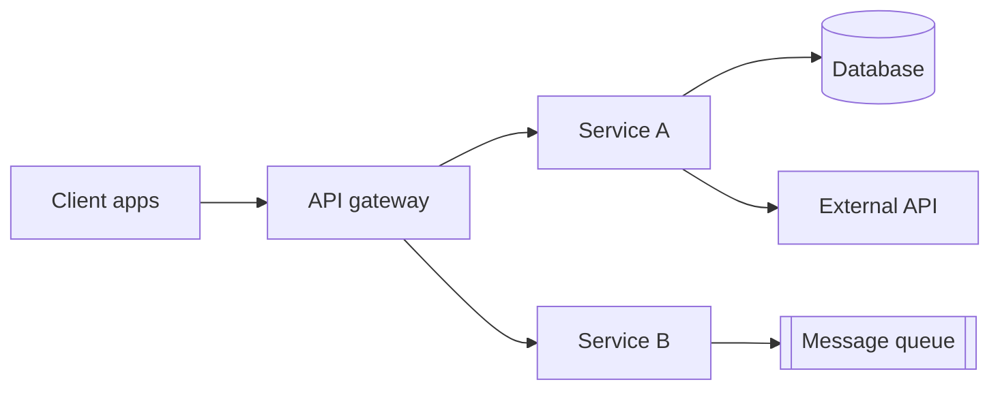
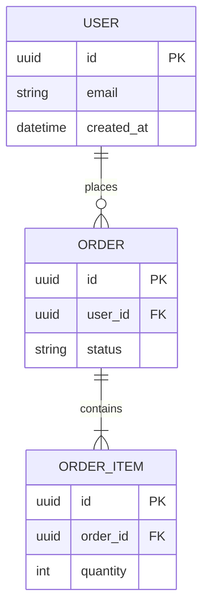
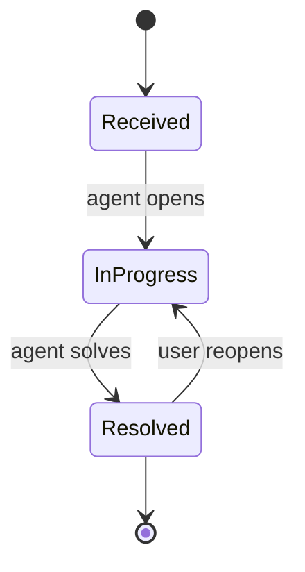

# [Project Name] — Technical Requirements Document (TRD)

| | |
|---|---|
| **Version** | v0.1 (Draft) |
| **Author** | [Name] |
| **Technical lead** | [Name] |
| **Architect / reviewers** | [Names] |
| **Status** | Draft / In Review / Approved |
| **Last updated** | [YYYY-MM-DD] |
| **Related PRD** | [Link, with version] |
| **Related DRD** | [Link, with version] |
| **Repository / design docs** | [Links] |

> **How to use this template**
> - Replace everything in `[brackets]`. Delete guidance lines (blockquotes) and sections that don't apply once you've decided.
> - The PRD says **what and why**; the DRD says **how it looks and behaves on screen**; the TRD says **how we build it**. Link to them instead of repeating them.
> - Every technical requirement should trace to a PRD or DRD item (use the IDs, e.g., US-001, DR-003) or to a non-functional need.
> - Prefer numbers to adjectives ("p95 < 300 ms", not "fast"). If a value isn't decided yet, put it in Open Questions with an owner and a date.
> - Record significant choices as decisions (Section 2.4) with the options you rejected, so future readers know why.
> - Sections marked *(optional)* can be skipped for small changes. A suggested Quick set is: 1, 2.1, 3, 5, 6, 8, 11.
> - Diagrams use Mermaid, which renders in GitHub, Notion, Obsidian, and most modern Markdown tools.

---

## 1. Overview and Scope

### 1.1 Purpose

[In two or three sentences: what is being built technically, and what product need from the PRD it serves.]

### 1.2 Requirement Traceability

> Map each product or design requirement to the technical sections that implement it.

| Source | ID | Summary | TRD section |
|--------|----|---------|-------------|
| PRD | US-001 | [Story summary] | 4.1, 5.1 |
| PRD | OBJ-001 | [Objective that drives a technical need] | 9.1 |
| DRD | DR-003 | [Design requirement with a technical impact] | 5.2 |

### 1.3 Technical Scope

- **In scope**: [Systems, services, and interfaces this TRD covers]
- **Out of scope**: [Related systems that are not changing, with reasons]
- **Environment assumptions**: [Cloud, regions, existing platform services you can rely on]

### 1.4 Constraints and Assumptions

| Type | Description | Impact if wrong | How we'll validate |
|------|-------------|-----------------|--------------------|
| Constraint | [e.g., Must use the existing Zendesk instance] | [ ] | [ ] |
| Assumption | [e.g., Peak load is 3× average] | [ ] | [ ] |
| Dependency | [Team / system we rely on] | [If delayed…] | [Fallback] |

---

## 2. System Architecture

### 2.1 Architecture Overview

> Show the main parts and how they connect. Use the C4 approach: start with context (system and its users), then containers (deployable parts). Add component diagrams only where a container is complex.



### 2.2 Components

| Component | Responsibility | Exposes / consumes | Technology | Owner |
|-----------|----------------|--------------------|------------|-------|
| [Service A] | [Single clear responsibility] | [APIs, events] | [Language / framework] | [Team] |
| [Service B] | [Responsibility] | [APIs, events] | [Technology] | [Team] |

### 2.3 Technology Stack

| Layer | Choice | Version | Notes (why, constraints) |
|-------|--------|---------|--------------------------|
| Client | [ ] | [ ] | [ ] |
| Backend | [ ] | [ ] | [ ] |
| Database | [ ] | [ ] | [ ] |
| Messaging / queue | [ ] | [ ] | [ ] |
| Storage | [ ] | [ ] | [ ] |
| Infrastructure | [ ] | [ ] | [ ] |

### 2.4 Architecture Decisions

> One row per significant decision (record details in a separate ADR file if long).

| ID | Decision | Alternatives considered | Rationale | Status |
|----|----------|-------------------------|-----------|--------|
| ADR-001 | [Chosen approach] | [Option B, Option C] | [Why: trade-offs, cost, risk] | Proposed / Accepted / Superseded |

### 2.5 Deployment Model

| Item | Choice |
|------|--------|
| Hosting | [Cloud provider / on-prem / hybrid] |
| Runtime | [Containers / serverless / VMs] |
| Regions | [ ] |
| Environments | [Dev, Staging, Prod] |

---

## 3. Data Model

### 3.1 Entities and Relationships



> Use underscores in entity names (`ORDER_ITEM`), not hyphens.

### 3.2 Entity Details

| Entity | Field | Type | Required | Constraints | Notes |
|--------|-------|------|----------|-------------|-------|
| [Entity] | [field] | [type] | Yes / No | [Unique, FK, max length, enum values] | [PII? default? source?] |

### 3.3 Indexing and Query Patterns

| Query / access pattern | Index | Expected volume | Notes |
|------------------------|-------|-----------------|-------|
| [e.g., List a user's reports, newest first] | [(user_id, created_at DESC)] | [reads / day] | [ ] |

### 3.4 Data Lifecycle

| Data | Retention | Deletion / anonymization | Backup and recovery |
|------|-----------|--------------------------|---------------------|
| [Data set] | [e.g., 12 months] | [Scheduled job; deletion request within 30 days] | [RPO / RTO] |

### 3.5 Migration and Seeding

- **Tool**: [Flyway / Liquibase / Prisma Migrate / other]
- **Strategy**: [e.g., expand → migrate → contract; zero-downtime]
- **Rollback**: [How to reverse each migration]
- **Backfill**: [Existing data that needs converting, and how]

---

## 4. Technical Functional Requirements

> Repeat this block for each feature or capability. These are the technical counterpart of the PRD's feature specifications.

### 4.1 [Feature / capability name]

- **Traces to**: [US-001, DR-002]
- **Priority**: P0 / P1 / P2
- **Description**: [What the system does, in technical terms]
- **Inputs**: [Fields, types, limits, sources]
- **Outputs**: [Results, side effects, events emitted]
- **Validation rules**: [Server-side checks; limits; allowed values]
- **State transitions**:



- **Error handling**: [Each failure case → behavior, error code, retry or fallback]
- **Side effects**: [Notifications, third-party calls, audit entries]
- **Idempotency**: [How repeated requests are handled]

---

## 5. Interface Specifications

### 5.1 API Overview

| Endpoint | Method | Purpose | Auth | Idempotent | Rate limit |
|----------|--------|---------|------|------------|------------|
| `/v1/[resource]` | POST | [Create …] | [Bearer token, role] | Yes (key header) | [e.g., 10 / 24 h per user] |
| `/v1/[resource]/{id}` | GET | [Read …] | [Auth] | Yes | [ ] |

### 5.2 Endpoint Details

> Repeat per endpoint.

#### `POST /v1/[resource]`

**Request**

```json
{
  "field": "value"
}
```

| Field | Type | Required | Validation |
|-------|------|----------|------------|
| field | string | Yes | [10–1000 chars] |

**Response (201)**

```json
{
  "id": "uuid",
  "reference": "string"
}
```

**Errors**

| HTTP | Code | Condition | Client behavior |
|------|------|-----------|-----------------|
| 400 | VAL-001 | [Missing or invalid field] | [Show field message] |
| 401 | AUTH-001 | [Token expired] | [Re-authenticate] |
| 429 | RATE-001 | [Limit exceeded] | [Show limit message] |
| 503 | SYS-001 | [Dependency unavailable] | [Queue and retry] |

### 5.3 Versioning and Compatibility

- **Versioning scheme**: [URL version / header]
- **Backward compatibility**: [Required? For how long? Old client versions still in use]
- **Deprecation policy**: [Notice period; how clients are told]

### 5.4 External Integrations

| System | Method | Purpose | Limits (rate, size) | Failure behavior | Owner |
|--------|--------|---------|---------------------|------------------|-------|
| [Service] | [REST / SDK / webhook] | [Purpose] | [Limits] | [Retry, fallback, alert] | [Team / contact] |

---

## 6. Events and Messaging *(optional)*

### 6.1 Topology

| Topic / queue | Producer | Consumer(s) | Payload (schema link) | Ordering needed? |
|---------------|----------|-------------|-----------------------|------------------|
| `[domain.entity.event.v1]` | [Service] | [Service(s)] | [Link] | Yes / No |

### 6.2 Reliability Rules

| Item | Rule |
|------|------|
| Delivery guarantee | [At-least-once / exactly-once / at-most-once] |
| Retry | [e.g., 5 retries, exponential backoff, over 1 hour] |
| Dead-letter queue | [Where messages go; who reviews; alert threshold] |
| Idempotency | [Consumer dedupes on message ID or idempotency key] |
| Schema evolution | [Additive changes only; version in topic name] |

---

## 7. Security Architecture

### 7.1 Authentication and Authorization

| Item | Design |
|------|--------|
| Authentication | [OAuth2 / OIDC / session token; token lifetime] |
| Authorization model | [RBAC roles and what each can do; resource-level checks] |
| Service-to-service auth | [mTLS / signed tokens] |

### 7.2 Data Protection

| Item | Design |
|------|--------|
| In transit | [TLS 1.2+ / 1.3] |
| At rest | [AES-256; key management service] |
| Secrets | [Secret manager; rotation period; never in code or logs] |
| Personal data | [What is collected, where stored, who can access, masking in logs] |

### 7.3 Threat Model

> List the realistic threats for this system, not just the textbook ones. Think about each data flow and trust boundary.

| Threat | Where | Likelihood / Impact | Mitigation | Verified by |
|--------|-------|---------------------|------------|-------------|
| Injection | [Inputs reaching the DB] | [M / H] | [Parameterized queries; input validation] | [Security test] |
| Broken access control | [Object IDs in APIs] | [M / H] | [Ownership checks on every read and write] | [Authorization tests] |
| Abuse / spam | [Public submit endpoint] | [M / M] | [Rate limits, size limits, moderation] | [Load test] |
| Sensitive data exposure | [Uploaded files, logs] | [M / H] | [Encryption, signed URLs, log scrubbing] | [Review, audit] |
| [Other] | | | | |

### 7.4 Audit and Compliance

- **Audit logging**: [Which actions are logged, with what fields, retained for how long]
- **Regulatory requirements**: [GDPR / CCPA / SOC 2 / other, and the technical controls that satisfy them]

---

## 8. Non-Functional Requirements

> These come from the PRD's non-functional criteria and the DRD's Section 7; add the technical ones. Each needs a target and a way to verify it.

| Category | Requirement | Target | How to verify |
|----------|-------------|--------|---------------|
| Performance | [API latency] | [p95 < 300 ms] | [Load test] |
| Performance | [Throughput] | [N requests / s at peak] | [Load test at 3× expected] |
| Availability | [Service uptime] | [99.9% monthly] | [Monitoring] |
| Reliability | [Dependency outage] | [No data loss; queued and retried] | [Failure-injection test] |
| Scalability | [Growth headroom] | [Handles 5× current volume without redesign] | [Capacity review] |
| Capacity | [Storage growth] | [GB / month] | [Forecast, alerts] |
| Compatibility | [Clients supported] | [Older app versions keep working] | [Contract tests] |
| Accessibility | [Where backend-relevant] | [Alt text and labels in API responses] | [Audit] |
| Maintainability | [Code health] | [Lint clean, documented APIs] | [CI checks] |

---

## 9. Observability and Operations

### 9.1 Service Level Objectives

| SLI | SLO | Alert |
|-----|-----|-------|
| [Availability of submit API] | [99.9% / 30 days] | [Page when burn rate > X] |
| [Latency p95] | [< 300 ms] | [Warn at 400 ms for 5 min] |
| [Error rate] | [< 1%] | [P1 when > 1% for 5 min] |

### 9.2 Logging, Metrics, Tracing

| Type | Requirement |
|------|-------------|
| Logs | [Structured JSON; request ID; no personal data or secrets] |
| Metrics | [Request rate, errors, latency, queue depth, retry count, DLQ size] |
| Tracing | [OpenTelemetry; trace ID propagated across services] |
| Dashboards | [What each team needs to see] |

### 9.3 Alerting and On-Call

| Alert | Threshold | Severity | Owner | Runbook |
|-------|-----------|----------|-------|---------|
| [DLQ not empty] | [> 0 for 15 min] | [P2] | [Team] | [Link] |

---

## 10. Testing Plan

| Level | Scope | Target / criteria | Owner |
|-------|-------|-------------------|-------|
| Unit | [Business rules, validation] | [e.g., ≥ 80% line coverage on new code; all rules in 4.x covered] | [Dev] |
| Contract | [API and event schemas between services] | [No breaking change passes CI] | [Dev] |
| Integration | [Service ↔ DB, queue, external APIs (sandbox)] | [All paths in 4.x and 5.x] | [Dev / QA] |
| End-to-end | [Critical user flows from the DRD] | [Each PRD acceptance criterion automated or manually verified] | [QA] |
| Performance | [Load, spike, soak] | [Meets Section 8 targets at 3× expected volume] | [Dev / SRE] |
| Security | [SAST, dependency scan, pen test, authz tests] | [No high / critical findings open] | [Security] |
| Resilience | [Dependency outage, retry, DLQ] | [No lost reports; recovery in N min] | [Dev / SRE] |

**Mapping from PRD acceptance criteria**

| PRD criterion | Test level | Test ID / location |
|---------------|-----------|--------------------|
| AC-1 | E2E, Integration | [ ] |

---

## 11. Delivery and Deployment

### 11.1 Environments

| Environment | Purpose | Data | Differences from production |
|-------------|---------|------|------------------------------|
| Dev | [ ] | [Synthetic] | [ ] |
| Staging | [ ] | [Anonymized / synthetic] | [ ] |
| Production | [ ] | [Real] | — |

### 11.2 CI/CD Pipeline

| Stage | Steps | Gate |
|-------|-------|------|
| Build | [Lint, type-check, compile] | [Must pass] |
| Test | [Unit, contract, integration] | [Coverage and pass thresholds] |
| Security | [Dependency and code scan] | [No high / critical] |
| Deploy | [Staging → smoke tests → production] | [Approval, if any] |

### 11.3 Rollout and Rollback

- **Rollout plan**: [Feature flag; phased %, with the metrics to check before each step]
- **Rollback**: [How to turn off or revert; data/migration compatibility; time to roll back]
- **Launch readiness checklist**: [Dashboards live, alerts tested, runbook written, support briefed]

---

## 12. Risks

| ID | Risk | Likelihood | Impact | Mitigation | Owner |
|----|------|------------|--------|------------|-------|
| R-001 | [e.g., Third-party API rate limits during spikes] | M | H | [Queue + backoff; load test at 3×] | [Name] |

---

## 13. Implementation Plan *(optional)*

| Milestone | Scope | Depends on | Estimate | Owner |
|-----------|-------|------------|----------|-------|
| M1 | [Data model + core API] | [ ] | [ ] | [ ] |
| M2 | [Integrations + events] | M1 | [ ] | [ ] |
| M3 | [Hardening, load tests, rollout] | M2 | [ ] | [ ] |

---

## 14. Agent Instructions *(optional)*

> Include this block if an AI coding agent will implement from this TRD. It limits the agent's context and states hard rules.

### 14.1 Context Scoping

- **Start from**: [Entry-point files / directories]
- **Read before coding**: [Coding standards, architecture notes, schema files]
- **Do not touch**: [Generated code, unrelated services]

### 14.2 Implementation Constraints

- **Required**: [e.g., use the shared validation library; add tests with every endpoint]
- **Prohibited**: [e.g., no new dependencies without approval; no raw SQL string building; no secrets in code]

### 14.3 Verification Commands

```bash
# Replace with your project's commands
[unit test command]
[contract test command]
[lint / type-check command]
[build command]
```

---

## 15. Review Checklist

Before approval, confirm:

- [ ] Every PRD/DRD requirement that has a technical impact appears in 1.2
- [ ] Architecture diagram, components, and data model agree with each other
- [ ] Every API has request, response, errors, auth, and rate limit defined
- [ ] Schemas and events are versioned; compatibility rules are stated
- [ ] Failure paths (timeouts, retries, outages) are specified, not just success
- [ ] Threat model covers the real data flows; each threat has a mitigation and a test
- [ ] Non-functional targets are numbers with a verification method
- [ ] SLOs, alerts, and runbooks exist for launch
- [ ] Rollout and rollback plans are written and rehearsed
- [ ] Open questions have owners and dates; no `[brackets]` remain

---

## 16. Appendix

### 16.1 Open Questions

| # | Question | Owner | Due date | Resolution |
|---|----------|-------|----------|------------|
| 1 | [Question] | [Name] | [Date] | [Open / Answer] |

### 16.2 Glossary

| Term | Definition |
|------|------------|
| [Term] | [Definition] |

### 16.3 References

- [PRD, DRD, ADR files, vendor docs, benchmarks, incident reports]

### 16.4 Change Log

| Version | Date | Author | Changes |
|---------|------|--------|---------|
| v0.1 | [YYYY-MM-DD] | [Name] | Initial draft |
