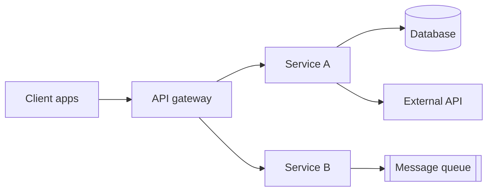
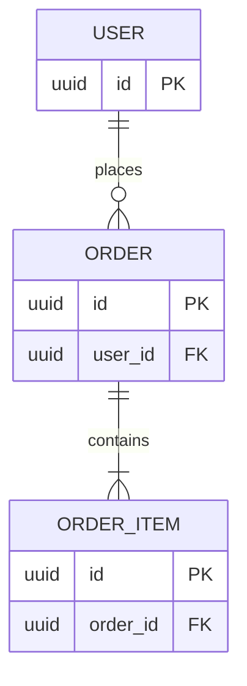
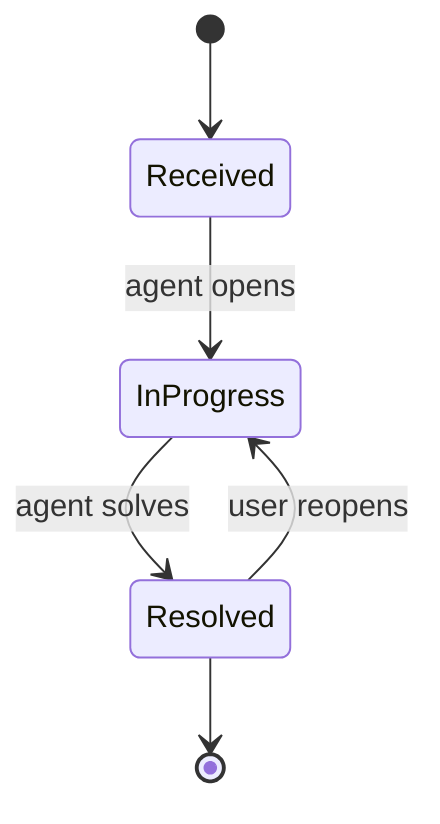

# [Project Name] — Technical Requirements Document (TRD)

| | |
|---|---|
| **Version** | v0.1 (Draft) |
| **Author (tech lead)** | [Name] |
| **Architect / reviewers** | [Names] |
| **Status** | Draft / In Review / Approved |
| **Last updated** | [YYYY-MM-DD] |
| **Related PRD** | [Link, with version] |
| **Related DRD** | [Link, with version] |
| **Related SDD** | [Link to the engineers' detailed design] |
| **Repository / design docs** | [Links] |

> **How to use this template**
> - The TRD is the **high-level design (HLD)**. It is written by the **tech lead**, reviewed, and approved before development. It sets the architecture, constraints, interfaces, and targets. The engineers' **SDD** (the low-level design) holds the detail underneath.
> - The PRD says **what and why**; the DRD says **how it looks and behaves on screen**; the TRD says **what architecture and technical targets**; the SDD says **how each part is built**. Link to them instead of repeating them.
> - Every technical requirement should trace to a PRD or DRD item (use the IDs, e.g., US-001, DR-003) or to a non-functional need.
> - Prefer numbers to adjectives ("p95 < 300 ms", not "fast"). If a value isn't decided yet, put it in Open Questions with an owner and a date.
> - Record significant choices as decisions (Section 2.4) with the options you rejected, so future readers know why.
> - Keep this document at the level a reviewer needs to judge whether the design is sound. Field-level tables, endpoint-by-endpoint specs, algorithms, and test cases belong in the SDD.
> - Engineers may correct detail in the SDD freely. Changes to anything in this document need the tech lead's agreement and a line in the change log (see Section 14).
> - Sections marked *(optional)* can be skipped for small changes. A suggested Quick set is: 1, 2.1, 3, 5, 8, 11, 14.
> - Diagrams use Mermaid, which renders in GitHub, Notion, Obsidian, and most modern Markdown tools.

---

## 1. Overview and Scope

### 1.1 Purpose

[In two or three sentences: what is being built technically, and what product need from the PRD it serves.]

### 1.2 Requirement Traceability

> Map each product or design requirement to the technical sections that address it.

| Source | ID | Summary | TRD section |
|--------|----|---------|-------------|
| PRD | US-001 | [Story summary] | 4.1, 5.1 |
| PRD | OBJ-001 | [Objective that drives a technical need] | 9.1 |
| DRD | DR-003 | [Design requirement with a technical impact] | 4.1 |

### 1.3 Technical Scope

- **In scope**: [Systems, services, and interfaces this TRD covers]
- **Out of scope**: [Related systems that are not changing, with reasons]
- **Environment assumptions**: [Cloud, regions, existing platform services you can rely on]

### 1.4 Constraints and Assumptions

| Type | Description | Impact if wrong | How we'll validate |
|------|-------------|-----------------|--------------------|
| Constraint | [e.g., Must use the existing Zendesk instance] | [ ] | [ ] |
| Assumption | [e.g., Peak load is 3× average] | [ ] | [ ] |
| Dependency | [Team / system we rely on] | [If delayed…] | [Fallback] |

---

## 2. System Architecture

### 2.1 Architecture Overview

> Show the main parts and how they connect. Use the C4 approach: start with context (system and its users), then containers (deployable parts). Add component diagrams only where a container is complex.

### 2.2 Components

| Component | Responsibility | Exposes / consumes | Technology | Owner |
|-----------|----------------|--------------------|------------|-------|
| [Service A] | [Single clear responsibility] | [APIs, events] | [Language / framework] | [Team] |
| [Service B] | [Responsibility] | [APIs, events] | [Technology] | [Team] |

### 2.3 Technology Stack

| Layer | Choice | Version | Notes (why, constraints) |
|-------|--------|---------|--------------------------|
| Client | [ ] | [ ] | [ ] |
| Backend | [ ] | [ ] | [ ] |
| Database | [ ] | [ ] | [ ] |
| Messaging / queue | [ ] | [ ] | [ ] |
| Storage | [ ] | [ ] | [ ] |
| Infrastructure | [ ] | [ ] | [ ] |

### 2.4 Architecture Decisions

> One row per significant decision (record details in a separate ADR file if long).

| ID | Decision | Alternatives considered | Rationale | Status |
|----|----------|-------------------------|-----------|--------|
| ADR-001 | [Chosen approach] | [Option B, Option C] | [Why: trade-offs, cost, risk] | Proposed / Accepted / Superseded |

### 2.5 Deployment Model

| Item | Choice |
|------|--------|
| Hosting | [Cloud provider / on-prem / hybrid] |
| Runtime | [Containers / serverless / VMs] |
| Regions | [ ] |
| Environments | [Dev, Staging, Prod] |

---

## 3. Data Model (High Level)

> Entities, relationships, and the data lifecycle. Field-level tables, indexes, and migrations go in the SDD.

### 3.1 Entities and Relationships

> Use underscores in entity names (`ORDER_ITEM`), not hyphens.

### 3.2 Key Entities

| Entity | Purpose | Key attributes | Personal data? | System of record |
|--------|---------|----------------|----------------|------------------|
| [Entity] | [What it represents] | [A few important attributes] | Yes / No | [This service / external system] |

### 3.3 Data Lifecycle

| Data | Retention | Deletion / anonymization | Backup and recovery |
|------|-----------|--------------------------|---------------------|
| [Data set] | [e.g., 12 months] | [Scheduled job; deletion requests within 30 days] | [RPO / RTO] |

---

## 4. Technical Functional Requirements

> One block per feature, at the level a reviewer needs. Inputs, validation, algorithms, and error details go in the SDD.

### 4.1 [Feature / capability name]

- **Traces to**: [US-001, DR-002]
- **Priority**: P0 / P1 / P2
- **Description**: [What the system does, in technical terms]
- **Key rules**:
  - [Rule that shapes the design, e.g., "Reports are stored first; the external ticket is created asynchronously"]
  - [Limits and permissions that matter, e.g., rate limit, who may call it]
- **Lifecycle** *(if the main object has states)*:

- **Key failure behavior**: [One line per important failure, e.g., "External service down → request still succeeds; sync retried later"]
- **Detail in SDD**: [Section number]

---

## 5. Interface Overview

### 5.1 API Overview

| Endpoint | Method | Purpose | Auth | Idempotent | Rate limit |
|----------|--------|---------|------|------------|------------|
| `/v1/[resource]` | POST | [Create …] | [Bearer token, role] | Yes (key header) | [e.g., 10 / 24 h per user] |
| `/v1/[resource]/{id}` | GET | [Read …] | [Auth] | Yes | [ ] |

> Request and response schemas are in the SDD (or in the generated OpenAPI file).

### 5.2 Error Code Convention

| Item | Convention |
|------|------------|
| Format | `CATEGORY-NNN` (e.g., `VAL-001`, `AUTH-001`, `RATE-001`, `STATE-001`, `SYS-001`) |
| Categories | [VAL = validation, AUTH = authentication or authorization, RATE = limits, STATE = invalid state, SYS = system] |
| HTTP mapping | [e.g., VAL → 400, AUTH → 401 / 403, RATE → 429, STATE → 409, SYS → 503] |
| Wording | [Clients map codes to message keys; the full catalog is in the SDD] |
| Information leaks | [e.g., return 404, not 403, for resources the caller doesn't own] |

### 5.3 Versioning and Compatibility

- **Versioning scheme**: [URL version / header]
- **Backward compatibility**: [Required? For how long? Old client versions still in use]
- **Deprecation policy**: [Notice period; how clients are told]

### 5.4 External Integrations

| System | Method | Purpose | Limits (rate, size) | Failure behavior | Owner |
|--------|--------|---------|---------------------|------------------|-------|
| [Service] | [REST / SDK / webhook] | [Purpose] | [Limits] | [Retry, fallback, alert] | [Team / contact] |

---

## 6. Events and Messaging *(optional)*

### 6.1 Topology

| Topic / queue | Producer | Consumer(s) | Ordering needed? |
|---------------|----------|-------------|------------------|
| `[domain.entity.event.v1]` | [Service] | [Service(s)] | Yes / No |

> Payload schemas are in the SDD.

### 6.2 Reliability Policy

| Item | Policy |
|------|--------|
| Delivery guarantee | [At-least-once / exactly-once / at-most-once] |
| Retry | [e.g., 5 retries over about 1 hour; which errors are retried] |
| Dead-letter queue | [Where messages go; who reviews; alert threshold] |
| Idempotency | [Principle, e.g., consumers dedupe on message ID or idempotency key] |
| Schema evolution | [Additive changes only; version in the name] |

> Exact delays, payloads, and consumer logic are in the SDD.

---

## 7. Security Architecture

### 7.1 Authentication and Authorization

| Item | Design |
|------|--------|
| Authentication | [OAuth2 / OIDC / session token; token lifetime] |
| Authorization model | [RBAC roles and what each can do; resource-level checks] |
| Service-to-service | [mTLS / signed tokens] |

### 7.2 Data Protection

| Item | Design |
|------|--------|
| In transit | [TLS 1.2+ / 1.3] |
| At rest | [AES-256; key management service] |
| Secrets | [Secret manager; rotation period; never in code or logs] |
| Personal data | [What is collected, where stored, who can access, masking in logs] |

### 7.3 Threat Model

> List the realistic threats for this system, not just the textbook ones. Think about each data flow and trust boundary.

| Threat | Where | Likelihood / Impact | Mitigation | Verified by |
|--------|-------|---------------------|------------|-------------|
| Injection | [Inputs reaching the DB] | [M / H] | [Parameterized queries; input validation] | [Security test] |
| Broken access control | [Object IDs in APIs] | [M / H] | [Ownership checks on every read and write] | [Authorization tests] |
| Abuse / spam | [Public submit endpoint] | [M / M] | [Rate limits, size limits, moderation] | [Load test] |
| Sensitive data exposure | [Uploaded files, logs] | [M / H] | [Encryption, signed URLs, log scrubbing] | [Review, audit] |
| [Other] | | | | |

### 7.4 Audit and Compliance

- **Audit logging**: [Which actions are logged, with what fields, retained for how long]
- **Regulatory requirements**: [GDPR / CCPA / SOC 2 / other, and the technical controls that satisfy them]

---

## 8. Non-Functional Requirements

> These come from the PRD's non-functional criteria and the DRD's Section 7; add the technical ones. Each needs a target and a way to verify it.

| Category | Requirement | Target | How to verify |
|----------|-------------|--------|---------------|
| Performance | [API latency] | [p95 < 300 ms] | [Load test] |
| Performance | [Throughput] | [N requests / s at peak] | [Load test at 3× expected] |
| Availability | [Service uptime] | [99.9% monthly] | [Monitoring] |
| Reliability | [Dependency outage] | [No data loss; queued and retried] | [Failure-injection test] |
| Scalability | [Growth headroom] | [Handles 5× current volume without redesign] | [Capacity review] |
| Capacity | [Storage growth] | [GB / month] | [Forecast, alerts] |
| Compatibility | [Clients supported] | [Older app versions keep working] | [Contract tests] |
| Accessibility | [Where backend-relevant] | [Alt text and labels in API responses] | [Audit] |
| Maintainability | [Code health] | [Lint clean, documented APIs] | [CI checks] |

---

## 9. Observability and Operations

### 9.1 Service Level Objectives

| SLI | SLO | Alert |
|-----|-----|-------|
| [Availability of submit API] | [99.9% / 30 days] | [Page when burn rate > X] |
| [Latency p95] | [< 300 ms] | [Warn at 400 ms for 5 min] |
| [Error rate] | [< 1%] | [P1 when > 1% for 5 min] |

### 9.2 Logging, Metrics, and Tracing Requirements

| Type | Requirement |
|------|-------------|
| Logs | [Structured JSON; request ID; no personal data or secrets] |
| Metrics | [Categories: request rate, errors, latency, queue depth, retries, dead-letter size] |
| Tracing | [OpenTelemetry; trace ID propagated across services and queues] |
| Dashboards | [What each team needs to see] |

> Log fields, metric names, and span names are in the SDD.

### 9.3 Alerting and On-Call

| Alert | Threshold | Severity | Owner | Runbook |
|-------|-----------|----------|-------|---------|
| [Dead-letter queue not empty] | [> 0 for 15 min] | [P2] | [Team] | [Link] |

---

## 10. Testing Strategy

| Level | Scope | Target / criteria | Owner |
|-------|-------|-------------------|-------|
| Unit | [Business rules, validation] | [e.g., ≥ 80% line coverage on new code] | [Dev] |
| Contract | [API and event schemas between services] | [No breaking change passes CI] | [Dev] |
| Integration | [Service ↔ DB, queue, external APIs (sandbox)] | [All main flows] | [Dev / QA] |
| End-to-end | [Critical user flows from the DRD] | [Each PRD acceptance criterion automated or manually verified] | [QA] |
| Performance | [Load, spike, soak] | [Meets Section 8 targets at 3× expected volume] | [Dev / SRE] |
| Security | [SAST, dependency scan, pen test, authz tests] | [No high / critical findings open] | [Security] |
| Resilience | [Dependency outage, retry, DLQ] | [No lost reports; recovery in N min] | [Dev / SRE] |

> Concrete test cases are in the SDD.

**Mapping from PRD acceptance criteria**

| PRD criterion | Test level | Notes |
|---------------|-----------|-------|
| AC-1 | E2E, Integration | [ ] |

---

## 11. Delivery and Deployment

### 11.1 Environments

| Environment | Purpose | Data | Differences from production |
|-------------|---------|------|------------------------------|
| Dev | [ ] | [Synthetic] | [ ] |
| Staging | [ ] | [Anonymized / synthetic] | [ ] |
| Production | [ ] | [Real] | — |

### 11.2 CI/CD Pipeline

| Stage | Steps | Gate |
|-------|-------|------|
| Build | [Lint, type-check, compile] | [Must pass] |
| Test | [Unit, contract, integration] | [Coverage and pass thresholds] |
| Security | [Dependency and code scan] | [No high / critical] |
| Deploy | [Staging → smoke tests → production] | [Approval, if any] |

### 11.3 Rollout and Rollback

- **Rollout plan**: [Feature flag; phased %, with the metrics to check before each step]
- **Rollback**: [How to turn off or revert; data/migration compatibility; time to roll back]
- **Launch readiness checklist**: [Dashboards live, alerts tested, runbook written, support briefed]

---

## 12. Risks

| ID | Risk | Likelihood | Impact | Mitigation | Owner |
|----|------|------------|--------|------------|-------|
| R-001 | [e.g., Third-party API rate limits during spikes] | M | H | [Queue + backoff; load test at 3×] | [Name] |

---

## 13. Implementation Plan *(optional)*

| Milestone | Scope | Depends on | Estimate | Owner |
|-----------|-------|------------|----------|-------|
| M1 | [Data model + core API] | [ ] | [ ] | [ ] |
| M2 | [Integrations + events] | M1 | [ ] | [ ] |
| M3 | [Hardening, load tests, rollout] | M2 | [ ] | [ ] |

---

## 14. Detailed Design Handoff

> The SDD is where engineers record how each part is built. This section says who owns it and how it stays consistent with this TRD.

### 14.1 SDD Ownership

| SDD | Owner (engineer) | Components covered | Reviewer |
|-----|------------------|--------------------|----------|
| [SDD name / link] | [Name] | [Components from Section 2.2] | [Tech lead] |

### 14.2 Rules for Changes

- **Engineers may change freely** (in the SDD): detail inside a component, such as module structure, field-level design, algorithms, configuration values, and test cases.
- **Needs the tech lead's agreement** (and a TRD update): anything that changes the architecture, a decision in Section 2.4, security design, a target in Section 8, or an interface other teams depend on.
- Every such change is recorded in the SDD's deviation log and in this document's change log.

### 14.3 Changes Since Approval

| ID | What changed | SDD reference | Approved by | Date |
|----|--------------|---------------|-------------|------|
| [DEV-001] | [Summary] | [SDD 12] | [Tech lead] | [Date] |

---

## 15. Review Checklist

Before approval, confirm:

- [ ] Every PRD/DRD requirement that has a technical impact appears in 1.2
- [ ] Architecture diagram, components, and data entities agree with each other
- [ ] Every API has purpose, auth, idempotency, and rate limit defined
- [ ] Error code convention, versioning, and compatibility rules are stated
- [ ] Failure paths (timeouts, retries, outages) are described, not just success
- [ ] Threat model covers the real data flows; each threat has a mitigation and a test
- [ ] Non-functional targets are numbers with a verification method
- [ ] SLOs, alerts, and runbooks exist for launch
- [ ] Rollout and rollback plans are written
- [ ] The SDD owner and the change rules are named (Section 14)
- [ ] Open questions have owners and dates; no `[brackets]` remain

---

## 16. Appendix

### 16.1 Open Questions

| # | Question | Owner | Due date | Resolution |
|---|----------|-------|----------|------------|
| 1 | [Question] | [Name] | [Date] | [Open / Answer] |

### 16.2 Glossary

| Term | Definition |
|------|------------|
| [Term] | [Definition] |

### 16.3 References

- [PRD, DRD, SDD, ADR files, vendor docs, benchmarks, incident reports]

### 16.4 Change Log

| Version | Date | Author | Changes |
|---------|------|--------|---------|
| v0.1 | [YYYY-MM-DD] | [Name] | Initial draft |
