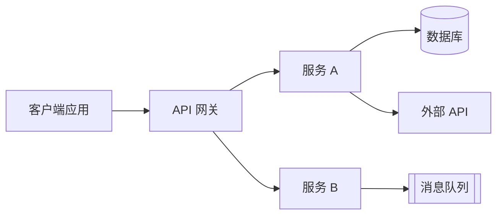
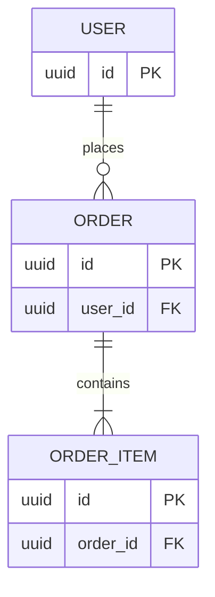
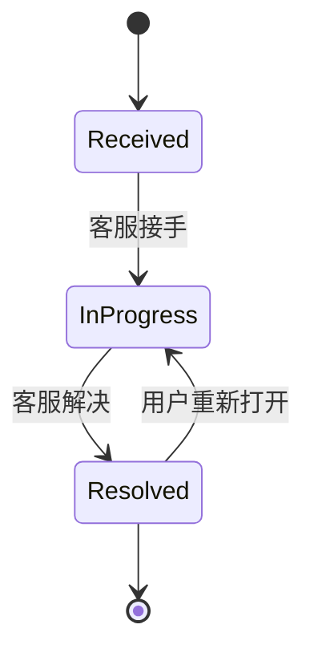

# [项目名称] — 技术需求文档（TRD）

| | |
|---|---|
| **版本** | v0.1（草稿） |
| **作者（技术负责人）** | [姓名] |
| **架构师 / 评审人** | [姓名] |
| **状态** | 草稿 / 评审中 / 已批准 |
| **最后更新** | [YYYY-MM-DD] |
| **关联 PRD** | [链接，含版本] |
| **关联 DRD** | [链接，含版本] |
| **关联 SDD** | [工程师所写详细设计的链接] |
| **代码仓库 / 设计文档** | [链接] |

> **模板使用说明**
> - TRD 是**概要设计（HLD）**。由**技术负责人**撰写，在开发前评审并批准。它确定架构、约束、接口和目标。工程师的 **SDD**（详细设计）负责其下的细节。
> - PRD 说明**做什么和为什么**；DRD 说明**在界面上长什么样、怎么表现**；TRD 说明**什么架构和技术目标**；SDD 说明**每个部分如何构建**。链接到它们，不要重复。
> - 每条技术需求都应能追溯到某个 PRD 或 DRD 条目（使用编号，如 US-001、DR-003），或某项非功能需求。
> - 用数字代替形容词（"p95 < 300 ms"，而不是"快"）。如果某个值尚未确定，把它放进待决问题，并指定负责人和日期。
> - 把重要的选择记录为决策（2.4 节），并写明被否决的方案，让以后的读者知道为什么。
> - 让本文档保持在评审人判断设计是否合理所需的层级。字段级的表、逐个端点的规格、算法和测试用例属于 SDD。
> - 工程师可以在 SDD 中自由修正细节。对本文档中任何内容的修改，都需要技术负责人同意，并在变更记录中留一行（见第 14 章）。
> - 标注 *（可选）* 的章节，在小改动时可以跳过。建议的快速版章节集合：1、2.1、3、5、8、11、14。
> - 图表使用 Mermaid，可在 GitHub、Notion、Obsidian 及大多数现代 Markdown 工具中渲染。

---

## 1. 概述与范围

### 1.1 目的

[用两三句话说明：从技术上要构建什么，以及它服务于 PRD 中的哪项产品需求。]

### 1.2 需求追溯

> 把每条产品或设计需求映射到对应处理它的技术章节。

| 来源 | 编号 | 摘要 | TRD 章节 |
|--------|----|---------|-------------|
| PRD | US-001 | [用户故事摘要] | 4.1、5.1 |
| PRD | OBJ-001 | [带来技术需求的目标] | 9.1 |
| DRD | DR-003 | [有技术影响的设计需求] | 4.1 |

### 1.3 技术范围

- **范围内**：[本 TRD 覆盖的系统、服务和接口]
- **范围外**：[不会变化的相关系统，并写明原因]
- **环境假设**：[云、区域、可依赖的现有平台服务]

### 1.4 约束与假设

| 类型 | 描述 | 若不成立的影响 | 如何验证 |
|------|-------------|-----------------|--------------------|
| 约束 | [例如：必须使用现有的 Zendesk 实例] | [ ] | [ ] |
| 假设 | [例如：峰值负载是平均值的 3 倍] | [ ] | [ ] |
| 依赖 | [所依赖的团队 / 系统] | [若延期……] | [备选方案] |

---

## 2. 系统架构

### 2.1 架构概览

> 展示主要部分及其连接方式。采用 C4 的思路：先画上下文（系统及其用户），再画容器（可部署的部分）。只有在某个容器很复杂时，才补充组件图。

### 2.2 组件

| 组件 | 职责 | 对外提供 / 依赖 | 技术 | 负责人 |
|-----------|----------------|--------------------|------------|-------|
| [服务 A] | [单一明确的职责] | [API、事件] | [语言 / 框架] | [团队] |
| [服务 B] | [职责] | [API、事件] | [技术] | [团队] |

### 2.3 技术栈

| 层 | 选型 | 版本 | 备注（原因、约束） |
|-------|--------|---------|--------------------------|
| 客户端 | [ ] | [ ] | [ ] |
| 后端 | [ ] | [ ] | [ ] |
| 数据库 | [ ] | [ ] | [ ] |
| 消息 / 队列 | [ ] | [ ] | [ ] |
| 存储 | [ ] | [ ] | [ ] |
| 基础设施 | [ ] | [ ] | [ ] |

### 2.4 架构决策

> 每个重要决策一行（如果内容较长，可在单独的 ADR 文件中记录详情）。

| 编号 | 决策 | 考虑过的替代方案 | 理由 | 状态 |
|----|----------|-------------------------|-----------|--------|
| ADR-001 | [所选方案] | [方案 B、方案 C] | [为什么：权衡、成本、风险] | 提议中 / 已采纳 / 已取代 |

### 2.5 部署模型

| 事项 | 选择 |
|------|--------|
| 托管 | [云厂商 / 自建机房 / 混合] |
| 运行时 | [容器 / Serverless / 虚拟机] |
| 区域 | [ ] |
| 环境 | [开发、预发布、生产] |

---

## 3. 数据模型（概要）

> 实体、关系和数据生命周期。字段级的表、索引和迁移放在 SDD 中。

### 3.1 实体与关系

> 实体名称使用下划线（`ORDER_ITEM`），不要使用连字符。

### 3.2 关键实体

| 实体 | 用途 | 关键属性 | 是否个人数据？ | 权威数据源 |
|--------|---------|----------------|----------------|------------------|
| [实体] | [它代表什么] | [几个重要属性] | 是 / 否 | [本服务 / 外部系统] |

### 3.3 数据生命周期

| 数据 | 保留期 | 删除 / 匿名化 | 备份与恢复 |
|------|-----------|--------------------------|---------------------|
| [数据集] | [例如：12 个月] | [定时任务；30 天内完成删除请求] | [RPO / RTO] |

---

## 4. 技术功能需求

> 每个功能一个块，写到评审人需要的层级。输入、校验、算法和错误细节放在 SDD 中。

### 4.1 [功能 / 能力名称]

- **追溯至**：[US-001、DR-002]
- **优先级**：P0 / P1 / P2
- **描述**：[系统做什么，用技术语言描述]
- **关键规则**：
  - [塑造设计的规则，例如"先存储反馈；外部工单异步创建"]
  - [重要的限制和权限，例如频率限制、谁能调用]
- **生命周期** *（如果主要对象有状态）*：

- **关键失败行为**：[每个重要故障一行，例如"外部服务宕机 → 请求仍然成功；稍后重试同步"]
- **详见 SDD**：[章节号]

---

## 5. 接口概览

### 5.1 API 概览

| 端点 | 方法 | 用途 | 认证 | 幂等 | 频率限制 |
|----------|--------|---------|------|------------|------------|
| `/v1/[resource]` | POST | [创建……] | [Bearer token，角色] | 是（幂等键请求头） | [例如：每用户 24 小时 10 次] |
| `/v1/[resource]/{id}` | GET | [读取……] | [认证] | 是 | [ ] |

> 请求和响应的 schema 在 SDD（或自动生成的 OpenAPI 文件）中。

### 5.2 错误码约定

| 事项 | 约定 |
|------|------------|
| 格式 | `类别-编号`（例如 `VAL-001`、`AUTH-001`、`RATE-001`、`STATE-001`、`SYS-001`） |
| 类别 | [VAL = 校验，AUTH = 认证或授权，RATE = 限制，STATE = 状态无效，SYS = 系统] |
| HTTP 映射 | [例如：VAL → 400，AUTH → 401 / 403，RATE → 429，STATE → 409，SYS → 503] |
| 文案 | [客户端把错误码映射为消息 key；完整目录在 SDD 中] |
| 信息泄露 | [例如：对调用者不拥有的资源返回 404，而不是 403] |

### 5.3 版本管理与兼容性

- **版本方案**：[URL 版本 / 请求头]
- **向后兼容**：[是否必须？保持多久？仍在使用的旧版客户端]
- **弃用政策**：[通知期；如何告知客户端]

### 5.4 外部集成

| 系统 | 方式 | 用途 | 限制（频率、大小） | 失败行为 | 负责人 |
|--------|--------|---------|---------------------|------------------|-------|
| [服务] | [REST / SDK / webhook] | [用途] | [限制] | [重试、兜底、告警] | [团队 / 联系人] |

---

## 6. 事件与消息 *（可选）*

### 6.1 拓扑

| 主题 / 队列 | 生产者 | 消费者 | 是否需要保序？ |
|---------------|----------|-------------|------------------|
| `[domain.entity.event.v1]` | [服务] | [服务] | 是 / 否 |

> 载荷 schema 在 SDD 中。

### 6.2 可靠性策略

| 事项 | 策略 |
|------|--------|
| 投递保证 | [至少一次 / 恰好一次 / 至多一次] |
| 重试 | [例如：约 1 小时内重试 5 次；哪些错误会重试] |
| 死信队列 | [消息去向；谁来检查；告警阈值] |
| 幂等性 | [原则，例如消费者根据消息 ID 或幂等键去重] |
| Schema 演进 | [只允许新增字段；版本写入名称] |

> 精确的延迟、载荷和消费者逻辑在 SDD 中。

---

## 7. 安全架构

### 7.1 认证与授权

| 事项 | 设计 |
|------|--------|
| 认证 | [OAuth2 / OIDC / 会话令牌；令牌有效期] |
| 授权模型 | [RBAC 角色及各自权限；资源级检查] |
| 服务间认证 | [mTLS / 签名令牌] |

### 7.2 数据保护

| 事项 | 设计 |
|------|--------|
| 传输中 | [TLS 1.2+ / 1.3] |
| 静态存储 | [AES-256；密钥管理服务] |
| 密钥与凭据 | [密钥管理器；轮换周期；绝不出现在代码或日志中] |
| 个人数据 | [收集什么、存放在哪、谁能访问、日志中如何脱敏] |

### 7.3 威胁模型

> 列出这个系统真实存在的威胁，而不只是教科书式的清单。逐一检视每条数据流和信任边界。

| 威胁 | 位置 | 可能性 / 影响 | 缓解措施 | 验证方式 |
|--------|-------|---------------------|------------|-------------|
| 注入 | [到达数据库的输入] | [中 / 高] | [参数化查询；输入校验] | [安全测试] |
| 访问控制失效 | [API 中的对象 ID] | [中 / 高] | [每次读写都检查归属] | [授权测试] |
| 滥用 / 垃圾信息 | [公开的提交端点] | [中 / 中] | [频率限制、大小限制、审核] | [压力测试] |
| 敏感数据泄露 | [上传的文件、日志] | [中 / 高] | [加密、签名 URL、日志脱敏] | [评审、审计] |
| [其他] | | | | |

### 7.4 审计与合规

- **审计日志**：[记录哪些操作、包含哪些字段、保留多久]
- **监管要求**：[GDPR / CCPA / SOC 2 / 其他，以及满足它们的技术控制]

---

## 8. 非功能需求

> 这些来自 PRD 的非功能标准和 DRD 的第 7 章；在此补充技术层面的要求。每一项都需要目标值和验证方式。

| 类别 | 要求 | 目标值 | 验证方式 |
|----------|-------------|--------|---------------|
| 性能 | [API 延迟] | [p95 < 300 ms] | [压力测试] |
| 性能 | [吞吐量] | [峰值 N 次请求 / 秒] | [3 倍压力测试] |
| 可用性 | [服务正常运行时间] | [月度 99.9%] | [监控] |
| 可靠性 | [依赖故障] | [不丢数据；排队并重试] | [故障注入测试] |
| 可扩展性 | [增长余量] | [无需重新设计即可承受 5 倍量] | [容量评审] |
| 容量 | [存储增长] | [GB / 月] | [预测、告警] |
| 兼容性 | [支持的客户端] | [旧版应用仍可使用] | [契约测试] |
| 无障碍 | [后端相关部分] | [API 响应中包含替代文本和标签] | [审计] |
| 可维护性 | [代码健康度] | [lint 通过、API 有文档] | [CI 检查] |

---

## 9. 可观测性与运维

### 9.1 服务水平目标

| SLI | SLO | 告警 |
|-----|-----|-------|
| [提交 API 的可用性] | [30 天 99.9%] | [当燃烧速率 > X 时呼叫] |
| [延迟 p95] | [< 300 ms] | [超过 400 ms 持续 5 分钟时预警] |
| [错误率] | [< 1%] | [超过 1% 持续 5 分钟时为 P1] |

### 9.2 日志、指标与链路追踪要求

| 类型 | 要求 |
|------|-------------|
| 日志 | [结构化 JSON；请求 ID；不含个人数据或密钥] |
| 指标 | [类别：请求速率、错误、延迟、队列深度、重试、死信队列大小] |
| 链路追踪 | [OpenTelemetry；跨服务和队列传递 trace ID] |
| 看板 | [各团队需要看到什么] |

> 日志字段、指标名称和 span 名称在 SDD 中。

### 9.3 告警与值班

| 告警 | 阈值 | 严重级别 | 负责人 | 运行手册 |
|-------|-----------|----------|-------|---------|
| [死信队列非空] | [> 0 持续 15 分钟] | [P2] | [团队] | [链接] |

---

## 10. 测试策略

| 层级 | 范围 | 目标 / 标准 | 负责人 |
|-------|-------|-------------------|-------|
| 单元 | [业务规则、校验] | [例如：新代码行覆盖率 ≥ 80%] | [研发] |
| 契约 | [服务间的 API 和事件 schema] | [破坏性变更无法通过 CI] | [研发] |
| 集成 | [服务 ↔ 数据库、队列、外部 API（沙箱）] | [所有主要流程] | [研发 / 测试] |
| 端到端 | [DRD 中的关键用户流程] | [每条 PRD 验收标准均已自动化或人工验证] | [测试] |
| 性能 | [负载、尖峰、长稳] | [在 3 倍预期量下满足第 8 章目标] | [研发 / SRE] |
| 安全 | [SAST、依赖扫描、渗透测试、授权测试] | [无未关闭的高危 / 严重问题] | [安全] |
| 韧性 | [依赖故障、重试、死信队列] | [不丢失反馈；N 分钟内恢复] | [研发 / SRE] |

> 具体的测试用例在 SDD 中。

**PRD 验收标准映射**

| PRD 标准 | 测试层级 | 备注 |
|---------------|-----------|-------|
| AC-1 | 端到端、集成 | [ ] |

---

## 11. 交付与部署

### 11.1 环境

| 环境 | 用途 | 数据 | 与生产的差异 |
|-------------|---------|------|------------------------------|
| 开发 | [ ] | [合成数据] | [ ] |
| 预发布 | [ ] | [匿名化 / 合成数据] | [ ] |
| 生产 | [ ] | [真实数据] | — |

### 11.2 CI/CD 流水线

| 阶段 | 步骤 | 关卡 |
|-------|-------|------|
| 构建 | [lint、类型检查、编译] | [必须通过] |
| 测试 | [单元、契约、集成] | [覆盖率和通过阈值] |
| 安全 | [依赖与代码扫描] | [无高危 / 严重问题] |
| 部署 | [预发布 → 冒烟测试 → 生产] | [审批（如有）] |

### 11.3 发布与回滚

- **发布计划**：[功能开关；分阶段百分比，以及每一步之前要检查的指标]
- **回滚**：[如何关闭或还原；数据 / 迁移兼容性；回滚所需时间]
- **上线就绪检查清单**：[看板已上线、告警已测试、运行手册已编写、客服已知悉]

---

## 12. 风险

| 编号 | 风险 | 可能性 | 影响 | 缓解措施 | 负责人 |
|----|------|------------|--------|------------|-------|
| R-001 | [例如：流量高峰时第三方 API 触发频率限制] | 中 | 高 | [队列 + 退避；3 倍压测] | [姓名] |

---

## 13. 实施计划 *（可选）*

| 里程碑 | 范围 | 依赖 | 估算 | 负责人 |
|-----------|-------|------------|----------|-------|
| M1 | [数据模型 + 核心 API] | [ ] | [ ] | [ ] |
| M2 | [集成 + 事件] | M1 | [ ] | [ ] |
| M3 | [加固、压测、发布] | M2 | [ ] | [ ] |

---

## 14. 详细设计交接

> SDD 是工程师记录每个部分如何构建的地方。本章说明谁负责它，以及它如何与本 TRD 保持一致。

### 14.1 SDD 归属

| SDD | 负责人（工程师） | 覆盖的组件 | 评审人 |
|-----|------------------|--------------------|----------|
| [SDD 名称 / 链接] | [姓名] | [2.2 节中的组件] | [技术负责人] |

### 14.2 变更规则

- **工程师可自由修改**（在 SDD 中）：组件内部的细节，如模块结构、字段级设计、算法、配置值和测试用例。
- **需要技术负责人同意**（并更新 TRD）：任何改变架构、2.4 节中的决策、安全设计、第 8 章中的目标，或其他团队所依赖接口的内容。
- 每一次这类变更，都记录在 SDD 的偏差记录和本文档的变更记录中。

### 14.3 批准后的变更

| 编号 | 变更内容 | SDD 引用 | 批准人 | 日期 |
|----|--------------|---------------|-------------|------|
| [DEV-001] | [摘要] | [SDD 12] | [技术负责人] | [日期] |

---

## 15. 评审检查清单

批准前，请确认：

- [ ] 每条对技术有影响的 PRD / DRD 需求都出现在 1.2 中
- [ ] 架构图、组件和数据实体相互一致
- [ ] 每个 API 都定义了用途、认证、幂等性和频率限制
- [ ] 错误码约定、版本管理和兼容性规则已说明
- [ ] 失败路径（超时、重试、故障）已描述，而不只是成功路径
- [ ] 威胁模型覆盖真实的数据流；每个威胁都有缓解措施和测试
- [ ] 非功能目标是数字，并有验证方式
- [ ] 上线所需的 SLO、告警和运行手册均已具备
- [ ] 发布和回滚计划已编写
- [ ] 已写明 SDD 负责人和变更规则（第 14 章）
- [ ] 待决问题有负责人和日期；没有遗留 `[方括号]`

---

## 16. 附录

### 16.1 待决问题

| # | 问题 | 负责人 | 截止日期 | 结论 |
|---|----------|-------|----------|------------|
| 1 | [问题] | [姓名] | [日期] | [未决 / 答案] |

### 16.2 术语表

| 术语 | 定义 |
|------|------------|
| [术语] | [定义] |

### 16.3 参考资料

- [PRD、DRD、SDD、ADR 文件、厂商文档、基准测试、故障复盘]

### 16.4 变更记录

| 版本 | 日期 | 作者 | 变更内容 |
|---------|------|--------|---------|
| v0.1 | [YYYY-MM-DD] | [姓名] | 初稿 |
