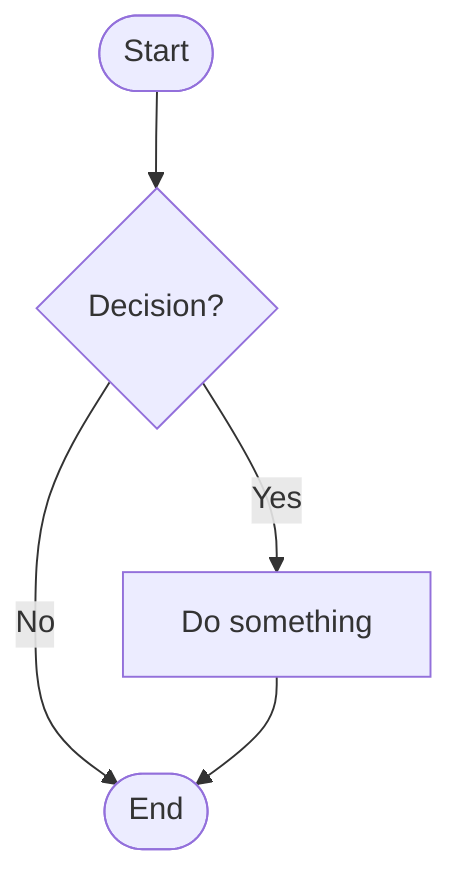

# How to Write a DRD — Guide

This guide explains what a Design Requirement Document (DRD) is, how to use the template, and what to write in each section.

**Use it together with:**
- [DRD_Template.md](DRD_Template.md): the blank template to copy and fill in
- [DRD_Sample_In-App_Feedback.md](DRD_Sample_In-App_Feedback.md): a completed example, so you can see what "good" looks like. It is fictional and matches the PRD sample, so its platforms and rules are illustrations, not defaults.
- [PRD_Guide.md](../product_requirement_document/PRD_Guide.md): the PRD guide. The DRD starts where the PRD ends.

---

## Part 1: DRD Basics

### What is a DRD?

A DRD turns product requirements into **concrete screens and behavior**. It is the shared agreement on how each page looks in structure, what each element does, and what happens in every state. Engineers build from it, QA tests against it, and the product owner uses it to check that the design meets the requirement.

It is written by the interaction or UX designer. On small teams, the product manager may write part of it.

### Why write one?

| For | Benefit |
|-----|---------|
| You | Forces you to think through every state; leaves a record you can use in project reviews |
| The project | Lowers communication cost and risk; handles forgotten decisions, misunderstandings, and "who changed this?" questions |
| The team | Documents can be shared and learned from; a consistent format means each role finds what they need quickly |

### PRD vs. DRD

| | PRD | DRD |
|---|-----|-----|
| Question answered | *What* are we building, for whom, *why*, and how will we know it worked? | *How* does it look in structure and behave on screen? |
| Main author | Product manager | Interaction / UX designer |
| Main content | Problem, objectives, user stories, rules, metrics | Structure, flows, wireframes, element states, global rules |
| Main readers | Everyone | Engineers, QA, visual designers, product |

Don't repeat the PRD. Link to it and add the design detail.

### What a DRD is not

| A DRD is not... | Because... |
|-----------------|------------|
| A business case | "Why this feature" belongs in the PRD. A short background is enough. |
| A visual spec | Colors, spacing, and font sizes belong in the visual design or design system. Wireframes stay grayscale. |
| A technical design | How the code is organized is for engineering. The DRD says what the user sees and what the system must do for them. |
| Finished after handoff | Update it and log changes whenever the design changes. |

### Who reads it, and what they look for

| Reader | Looking for |
|--------|-------------|
| Product manager | Sections 2 and 5: does the design cover the requirements? |
| Engineers | Sections 3, 6, 7, 8: data, shared components, constraints, behavior |
| QA | Section 8: element rules, states, and edge cases to test |
| Visual designer | Sections 6 and 8: structure, components, states to style |
| Support / Ops | Section 8 messages and states: what users will see |

### Writing principles

1. **One page, one task.** Each page lets the user finish one thing, with a clear start and end.
2. **Show every state.** A screen is not finished until empty, loading, error, offline, and no-permission cases are designed.
3. **Use real data.** Real names, long titles, big numbers, and missing values reveal layout problems that "Lorem ipsum" hides.
4. **Stay grayscale.** Black, white, and gray keep attention on structure and behavior.
5. **Define once, reference everywhere.** Shared rules go in Section 6, not on every page.
6. **Be unambiguous.** Write messages word for word; state limits as numbers. Change nothing silently: if a design changes, tell the people affected and log it.
7. **Make it checkable.** If QA can't tell what should happen when the user does X, the note is not finished.

---

## Part 2: The Writing Process

Don't fill the template top to bottom. A better order:

| Step | Do this | Sections |
|------|---------|----------|
| 1. Read the PRD | Understand the problem, users, scope, and priorities. List open questions for the PM. | 2 |
| 2. Gather inputs | Look at research, personas, competitors, existing designs and components | 2.4, 6 |
| 3. Map the structure | Draw modules and pages; list the dynamic data on each | 3 |
| 4. Draw the flows | Business flow first, then function flows for complex features; include failure paths | 4 |
| 5. List the work | One row per requirement with platform, pages, PRD link, impact | 5 |
| 6. Agree constraints early | Talk to engineering about performance, network, security, compatibility | 7 |
| 7. Define the shared pieces | Reusable pages, components, formats, limits | 6 |
| 8. Wireframe page by page | Sketch, write the element rules and states, test with users | 8 |
| 9. Add tracking | Define events that feed the PRD metrics | 9 |
| 10. Review and finalize | Check list, resolve open questions, update change log | 1, 10 |

### Choosing a size

| Situation | Include | Skip |
|-----------|---------|------|
| **Full**: new product area or multi-platform work | Everything | Nothing |
| **Standard**: typical feature (default) | Sections 1–8 | Supporting research, tracking if not needed, archive until something is retired |
| **Quick**: small change on existing patterns | 1, 2.1–2.2, 5, 8 (changed pages only) | 3, 4.2, 6, 7, 9, 11, unless the change touches them |

---

## Part 3: Section-by-Section Guide

For each section: **what it's for**, **what to write**, **tips**, and **common mistakes**.

---

### Document Header

**What it's for:** Lets readers see at a glance which version this is, who owns it, and where the PRD and design files are.

**Write:** Product and team, version, author, status (Draft / In Review / Approved), last-updated date, link to the related PRD (with its version), link to the design file, stakeholders.

**Common mistake:** Not recording which PRD version the DRD was based on, so nobody knows if requirements moved.

---

### 1. Change Log

**What it's for:** Makes every change traceable to a person and a date.

**Write:** Version, date, owner, and what changed. Update on every revision, however small.

**Tips:** Be specific ("Added offline state to the form"), not vague ("Updated wireframes").

---

### 2. Requirement Analysis

**What it's for:** Helps every reader understand the design task in a few minutes.

**Write:**
- **Background** (2.1): why this design work is needed. Short, and linked to the PRD.
- **Design scope** (2.2): what's in and out, and which platforms.
- **Design goals** (2.3): what the design must achieve, with how you will judge it.
- **Supporting research** (2.4, optional): user research, personas, competitor analysis, experience maps.

**Tips:**
- Design goals are about the experience ("a learner can submit in under 30 seconds"), not the business. Business goals live in the PRD.
- Research links make the document persuasive when you need to defend a choice.

**Common mistakes:** Copying the PRD's background and objectives; goals with no way to check them.

---

### 3. Product Structure and Information Structure

**What it's for:** Shows the shape of the product and what data each page needs, before layout work begins.

#### 3.1 Product Structure

**Write:** A tree of modules and the pages under each. Show page names only, not contents.

**Tips:** Use it as the table of contents for Section 8. Use the same names in the wireframes.

#### 3.2 Information Structure

**Write:** For each page, a list of the **dynamic** data elements: name, type, source, and notes (format, limit, what's shown when empty).

**Tips:**
- Leave out anything fixed: static labels, icons, and headings.
- This list is what engineers use to check that the APIs return what the design needs. Share it early.

**Common mistakes:** Listing every label on the page; forgetting the empty value for optional data.

---

### 4. Flows

**What it's for:** Shows logic that is hard to see on a single wireframe.

#### 4.1 Business Flow

**Write:** A Mermaid flowchart of the overall process from start to end, including decisions, errors, and exits.

#### 4.2 Function Flow

**Write:** One flow per complex function (attaching a file, payment, sign-in) showing the design logic and every branch.

**Tips:**
- If a flow has more than about 15 nodes, split it.
- Always draw failure paths: validation failure, no network, no permission.
- A business flow shows what the user and system do; a function flow shows how one feature decides between outcomes.

**Common mistakes:** Only the happy path; flows that contradict the wireframes.

---

### 5. Requirement List

**What it's for:** One place to see what's in this release and what it touches.

**Write:** For each item: ID, description, platform, pages, PRD reference, priority, and possible impact (on other pages, data, or flows).

**Tips:**
- Use the PRD's priorities (P0/P1/P2) so the two documents agree.
- The "possible impact" column is where hidden work shows up: shared components, new routes, data from other teams.
- Every DR row should map to a PRD story or feature. If it doesn't, ask why it's there.

**Common mistakes:** Rows that restate the PRD word for word; no impact column filled in.

---

### 6. Global Design Specifications

**What it's for:** Holds the rules shared across pages so they aren't repeated (and don't drift apart).

**Write:**
- **Reusable pages** (6.1): share page, empty state, error page, search, sign-in prompts.
- **Common components** (6.2): buttons, inputs, navigation, dialogs, toasts, loading, empty states, network errors — with their variants, states, and usage rules.
- **Units and formats** (6.3): date, time, currency, distance, file size.
- **Character and input limits** (6.4): min, max, allowed characters, and what happens at the limit.

**Tips:**
- Wireframes should say "use the standard empty state (6.1)" rather than redraw it.
- Write message wording for dialogs and toasts as a rule ("Toasts last 3 seconds, never carry actions").
- If your team has a design system, link to it and list only the exceptions.

**Common mistakes:** Defining the same component differently on two pages; limits written as "reasonable length".

---

### 7. Non-Functional Requirements

**What it's for:** Settles things that affect design and engineering, before the wireframes are final.

**Write:** For each area, the requirement and, where it applies, what the user sees when it isn't met.

| Area | Cover |
|------|-------|
| **Security** | Who can see and do what; sensitive data handling; validation (server always, client for UX); abuse protection |
| **Performance** | Response time targets; concurrency and throughput if relevant; what the user sees on timeout |
| **User experience conventions** | Loading approach; dialog and toast rules; reuse; network failure, switch, and interruption |
| **Other** | Compatibility; accessibility; upgrades; internationalization; analytics approach |

**Tips:**
- Hold this conversation with engineering early. A late "we can't do that in 2 seconds" breaks designs.
- For every performance target, say what the user sees when it isn't met (skeleton, timeout message, retry).
- Back-end validation is always required; front-end validation is there so users see problems immediately. Say which fields get it.

**Common mistakes:** "Should be fast" with no number; leaving network failure undefined; ignoring accessibility until QA.

---

### 8. Page Interaction Specifications

**What it's for:** The core of the DRD. Every screen, element, and state, so nobody has to guess.

#### 8.1 Document Structure

**Write:** Organize pages the same way as the product structure: **Platform → Feature → Page → Sub-page → Branch**. Name pages and frames consistently (for example, `Page_Screen_State`).

#### 8.2 What Every Page Includes

| Element | Purpose |
|---------|---------|
| Page title | What the page is (matches the nav-bar title) |
| Screen title | A unique name per screen/state so notes can refer to it ("return to Screen B") |
| Screen content | Grayscale wireframe, realistic data (suggested 375 × 812 px for mobile) |
| Design notes | Logic, element states, small flows specific to this screen |
| Flow lines | Arrows showing how screens connect |
| Links | To related pages, branches, and global rules in Section 6 |

#### 8.3 Page Specification

**Write, per page:**
- Related requirement (DR-xxx)
- The task the user completes on this page, in one sentence
- Entry points and exit points (including back behavior)
- Wireframes (names or links)
- An **elements table**: each element, its description, its states, and its rules
- A **page-states table**: loading, empty, error, no permission, offline
- **Interaction notes**: gestures, transitions, feedback, edge cases, tracking

**Tips:**
- Number the elements on the wireframe and refer to the same numbers in the table.
- For each element, ask: what happens on tap? When is it disabled? What if the text is very long? What if the value is missing?
- Write messages exactly as they will appear.
- Think about: rapid taps, back during submit, interrupted network, rotated screen, keyboard covering a field, very small screens, text scaled to 200%.
- Specify behavior and results, not animation curves (those belong in motion specs) or colors (visual spec).

**Interaction notes should not contain:**

| Don't write | Where it goes |
|-------------|---------------|
| Business reasoning ("why we want this") | PRD and Section 2 |
| Visual specs (colors, spacing, fonts) | Visual design / design system |
| Code logic | Engineering |

**Self-check before review:**

- [ ] Every tappable element has a defined result
- [ ] Every element with changing state shows all its states
- [ ] Empty, loading, error, offline, and no-permission cases are covered
- [ ] Limits and validation messages are written out
- [ ] Entry, exit, and back behavior are clear
- [ ] QA could answer "what should I see when I do X?" from the page alone

**Common mistakes:** Showing only the happy-path screen; saying "show an error" without the text; notes that describe the picture ("a button on the right") instead of the behavior.

---

### 9. Tracking Requirements (optional)

**What it's for:** Makes sure the product can measure the PRD's metrics.

**Write:** Event name, page, trigger, properties, and which metric it feeds.

**Tips:**
- Start from the PRD's metrics and work backwards: which events do you need to compute them?
- Include the denominator events (e.g., form opens) as well as the success events (e.g., submits).
- Agree naming (`object_action`) with the data team.

**Common mistakes:** Tracking everything; missing the event that gives the denominator.

---

### 10. Open Questions

**What it's for:** Keeps unresolved issues visible so they don't turn into assumptions.

**Write:** Question, owner, due date, and the answer when known. Review before approval.

---

### 11. Archive (Trash)

**What it's for:** Stores retired designs so the main document stays clean and abandoned options can be explained or recovered.

**Write:** Item, date retired, reason, and link.

**Tips:** The reason is the valuable part. It prevents the same idea from coming back in two months, and it records what you learned (for example, from a usability test).

---

## Part 4: Using the Mermaid Diagrams

The flow diagrams in the template use Mermaid, which renders in GitHub, Notion, Obsidian, VS Code (with a preview extension), and the [Mermaid Live Editor](https://mermaid.live).

| Shape | Syntax | Use for |
|-------|--------|---------|
| Rounded ends | `A([Text])` | Start / end |
| Rectangle | `B[Text]` | A step or screen |
| Diamond | `C{Text}` | A decision |
| Labeled arrow | `A -->|label| B` | A condition on a branch |

For the product-structure tree, a top-down `flowchart TD` with modules and pages works well. For complex diagrams, you can also draw in your design tool and link the frame instead.

---

## Part 5: Quality Checklist

Before sending for review, confirm:

**Foundations**
- [ ] The DRD names the PRD version it is based on
- [ ] Every requirement (DR-xxx) links to a PRD item
- [ ] Scope and platforms are clear

**Structure and flows**
- [ ] Product structure matches the page list in Section 8
- [ ] Dynamic data per page is listed, with an empty value for optional fields
- [ ] Flows include error, offline, and permission paths

**Shared rules**
- [ ] Components, formats, and limits are defined once in Section 6
- [ ] Message text (dialogs, toasts, errors) is written word for word
- [ ] Non-functional requirements have been agreed with engineering

**Pages**
- [ ] Each page states its task, entry points, exit points, and back behavior
- [ ] Every element lists its states and rules
- [ ] Loading, empty, error, offline, and no-permission states are shown
- [ ] Wireframes use real data and are grayscale
- [ ] Accessibility is addressed (labels, focus, contrast, text size)

**Completeness**
- [ ] Tracking events cover each PRD metric (numerator and denominator)
- [ ] Open questions have owners and dates
- [ ] Retired designs are in the archive with reasons
- [ ] No `[brackets]` or guidance text left over
- [ ] Version, status, and change log are up to date

---

## Part 6: Common Mistakes at a Glance

| Mistake | Fix |
|---------|-----|
| Repeating the PRD | Link to it; add only the design detail |
| Only the happy path | Add empty, loading, error, offline, and permission states |
| "Show an error" | Write the exact message and where it appears |
| Same component described differently on two pages | Define it once in Section 6 and reference it |
| Colored, polished mockups in the DRD | Keep wireframes grayscale; style belongs to visual design |
| Perfect data in wireframes | Use real, messy data: long names, big numbers, missing values |
| Late talk with engineering about constraints | Agree Section 7 before final wireframes |
| Notes that describe the picture | Describe behavior, rules, and results |
| Silent changes | Tell affected people and log the change |
| Deleting old designs | Archive them with the reason they were dropped |
| Letting the DRD go stale | Update it with the design and keep the change log current |

---

## Part 7: Keeping the DRD Useful

The test of a DRD is whether it makes work faster and reduces back-and-forth. Clear, well-organized notes matter more than polished screens, and the thinking behind a choice matters more than the screen itself.

- **Standardize.** Use the same folder names, page layout, and note style across projects. Short, structured notes beat long paragraphs.
- **Build a component library.** Keep a small set of well-defined interaction components and update it as the product grows. Fewer, better components beat many.
- **Close the loop.** Each task should start and end clearly on a page, with no dead ends.
- **Change deliberately.** If a design must change after handoff, update the document and tell the people affected the same day.
