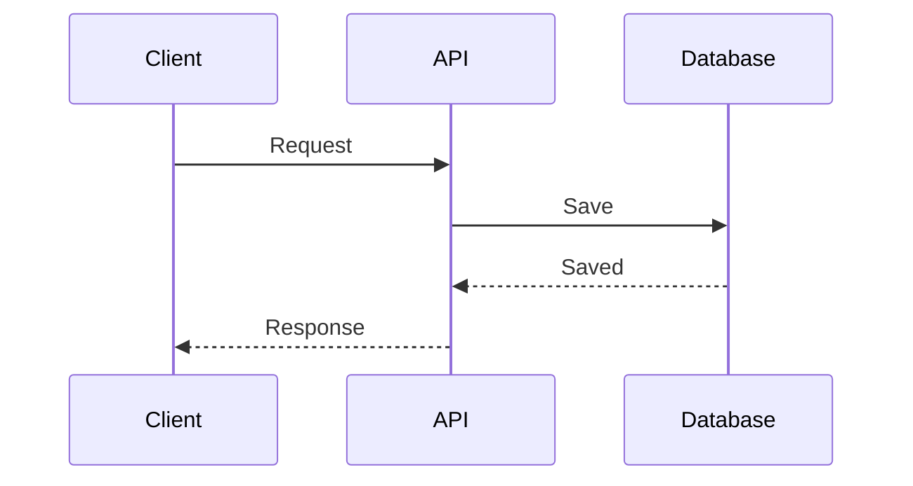
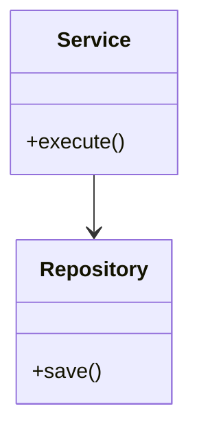
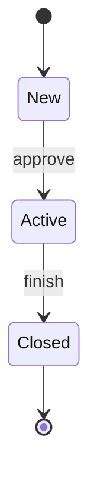

# How to Write an SDD — Guide

This guide explains what a Software Design Document (SDD) is, how it relates to the TRD, how to use the template, and what to write in each section.

**Use it together with:**
- [SDD_Template.md](SDD_Template.md): the blank template to copy and fill in
- [SDD_Sample_In-App_Feedback.md](SDD_Sample_In-App_Feedback.md): a completed example, so you can see what "good" looks like. It is fictional and matches the PRD, DRD, and TRD samples, so its stack, numbers, and names are illustrations, not defaults.
- [TRD_Guide.md](../technical_requirement_document/TRD_Guide.md): the high-level design the SDD builds on.

---

## Part 1: SDD Basics

### What is an SDD?

An SDD describes **exactly how each part of the system is built**: modules and classes, the order of calls between them, table and index definitions, detailed rules and algorithms, error handling, configuration, and test cases. It is the **low-level design (LLD)**. In this document set it is also the team's **tech spec**: the document engineers write, keep updating while they build, and leave behind as the record of what was built.

### How the four documents fit together

| | PRD | DRD | TRD | SDD |
|---|-----|-----|-----|-----|
| Answers | What, for whom, why? | How does it look and behave on screen? | What architecture and technical targets? | How is each part built? |
| Level | Product | Interaction | **High-level design (HLD)** | **Low-level design (LLD)** |
| Author | Product manager | UX / interaction designer | **Tech lead** | **Engineers** |
| Status | Approved baseline | Approved baseline | **Approved baseline** | **Living, ends as the as-built record** |
| Required for every project? | Yes | When there is UI work | Yes | **Yes** (scaled to the size of the project) |

### TRD vs. SDD

| | TRD (tech lead) | SDD (engineers) |
|---|-----------------|-----------------|
| Purpose | Set the approved architecture, constraints, and targets | Say how to build it, in detail |
| Typical content | Architecture, components, stack, decisions, data entities, API overview, security, non-functional targets, rollout, risks | Class and module design, sequence diagrams, field-level tables, DDL, endpoint detail, algorithms, concurrency, error handling, config, observability detail, test cases |
| Changes | Rarely, and with the lead's agreement | Often, as engineers build |
| Approval | Reviewed and approved before development | Reviewed by the tech lead; only deviations from the TRD need sign-off |

A quick test: if a reader needs it to **judge whether the design is sound**, it goes in the TRD. If a reader needs it to **implement or maintain the code**, it goes in the SDD.

### The update rule

Engineers edit the SDD freely while they build. But:
- If a change affects something the TRD decided — the architecture, a security rule, a target, or an interface other teams depend on — the engineer **tells the tech lead**, records it in **Section 12 (Deviations)**, and the lead agrees and updates the TRD.
- Small corrections to detail need no approval.

This keeps the approved TRD trustworthy while letting the SDD stay current.

### What an SDD is not

| An SDD is not... | Because... |
|------------------|------------|
| A copy of the TRD | Link to the TRD by ID. Add the detail underneath. |
| A copy of generated docs | If OpenAPI or schema docs can be generated from code, link them. Hand-copies go stale. |
| Source code in prose | Describe design and rules. Code shows the exact implementation. |
| A one-time document | It changes as you build and finishes with as-built notes. |

### Who reads it, and what they look for

| Reader | Looking for |
|--------|-------------|
| Engineers building the project | Sections 2–8: modules, flows, data, interfaces, logic, errors |
| Other engineers, reviewers | Sections 3, 6, 7, 12: flows, rules, failure handling, deviations |
| Tech lead | Sections 1.3 and 12: does the build follow the TRD? |
| QA | Sections 5, 6, 7, 10: behavior, error cases, test design |
| SRE / on-call | Sections 7, 8, 9: failure handling, configuration, metrics, alerts |
| New team members | Sections 2, 3, 14: how the code is organized, and what was built |

### Writing principles

1. **Detail the TRD, don't repeat it.** Every section should refine something from the TRD.
2. **Precise enough to implement.** Another engineer should be able to build from a section without asking you.
3. **Show the order of things.** Sequence diagrams make flows, retries, and failures much easier to review than prose.
4. **Cover failure and concurrency.** Say what happens on timeouts, duplicates, retries, and two requests at once.
5. **Link, don't copy.** Generated and external sources stay authoritative.
6. **Record deviations honestly.** A deviation that is logged is a decision. One that isn't becomes a surprise.
7. **Label estimates.** Mark guessed numbers as estimates and replace them with measurements.
8. **Keep it current.** Update it in the same change as the code when the design changes.

---

## Part 2: The Writing Process

An SDD starts after the TRD is approved. Don't fill it top to bottom; a better order:

| Step | Do this | Sections |
|------|---------|----------|
| 1. Read the TRD, PRD, and DRD | List what your part must deliver; note the TRD items you implement | 1 |
| 2. Break into modules | Decide the modules or classes and who depends on whom | 2 |
| 3. Draw the key flows | Sequence diagrams for success, failure, and retry | 3 |
| 4. Design the data | Tables, indexes, transactions, caching, migrations | 4 |
| 5. Specify the interfaces | Endpoints, errors, messages | 5 |
| 6. Write the detailed logic | Rules, algorithms, state machines, idempotency, concurrency | 6 |
| 7. List failures and edge cases | Per module, with detection, handling, and outcome | 7 |
| 8. Define configuration and observability | Settings, flags, secrets, logs, metrics, traces, alerts | 8, 9 |
| 9. Design the tests | Cases and acceptance-criteria mapping | 10 |
| 10. Check performance | Estimate load per component and find bottlenecks | 11 |
| 11. Review with the tech lead | Resolve differences; log deviations | 12 |
| 12. Build, and keep the SDD current | Update as you go; add as-built notes at launch | 13, 14 |

### Choosing a size

An SDD is required for every project, but the size should match the work.

| Situation | Include | Skip |
|-----------|---------|------|
| **Full**: new service, complex module, multiple engineers, sensitive data | Everything | Nothing |
| **Standard**: typical feature (default) | Sections 1–12 and 14 | Agent instructions (13) if humans only; empty subsections |
| **Short**: small change in an existing service | 1, 5 or 6 (only what changes), 7, 10, 12, 14 | The rest. 1–2 pages is fine. |

---

## Part 3: Section-by-Section Guide

For each section: **what it's for**, **what to write**, **tips**, and **common mistakes**.

---

### Document Header

**Write:** Version, owning engineer, reviewer (tech lead), status (Draft / In Progress / In Review / As built), last-updated date, links to the PRD, DRD, and TRD (with the TRD version you built on), the code repository, and generated API and schema docs.

**Common mistake:** Not recording which approved TRD version the SDD is based on.

---

### 1. Purpose, Scope, and Traceability

**What it's for:** Shows what this SDD covers and which TRD items it implements.

**Write:** Purpose, what is and isn't covered, and a table mapping each TRD item you implement to the SDD section that details it.

**Tips:** If a TRD item has no SDD section yet, that's a gap to fill before you build it. If an SDD section has no TRD item, ask whether it belongs.

---

### 2. Module and Component Design

**What it's for:** Shows how the code is organized inside each TRD component.

**Write:** A class or module diagram; a table of modules with responsibility, public interface, and dependencies; design notes (patterns used, shared libraries).

**Tips:** Give each module one job. Show dependencies pointing one way. Name the patterns you rely on (outbox, repository, strategy), because they explain a lot.

**Common mistakes:** Diagrams of every class (show the ones that matter); modules with two or three responsibilities.

---

### 3. Key Flows

**What it's for:** Shows the order of calls between modules and services, including when things go wrong.

**Write:** Sequence diagrams for the main success path and the important failure and retry paths.

**Tips:** Draw a flow only if order matters: calls to other services, transactions, queues, retries. Include the point where data is saved and where messages are sent.

**Common mistakes:** Only the happy path; diagrams that don't match the code.

---

### 4. Data Design

**What it's for:** Everything about storing data, down to the column.

**Write:**
- **Tables** (4.1): DDL or a field table with type, required, constraints, and notes. Mark personal data.
- **Indexes and query plans** (4.2): the real queries, the index for each, and any plan notes.
- **Constraints and transactions** (4.3): what is written together, locking and isolation, rules the database enforces vs. the code.
- **Caching** (4.4): what, where, how long, how invalidated.
- **Migrations and backfill** (4.5): files, rollback for each, how to convert existing data.

**Tips:** Generate DDL from migrations if you can, and link it. Think about what happens when two writers touch the same row.

**Common mistakes:** Indexes without a query behind them; migrations with no rollback; forgetting backfill.

---

### 5. Interface Detail

**What it's for:** The exact contract between this code and its callers.

**Write:**
- **Endpoints** (5.1): link the generated OpenAPI file; add who can call it, side effects, and special rules. If you have no generated file, give request, response, and validation per endpoint. If callers outside your team use the API, they read the published API reference built from that file ([API_Guide.md](../api_reference/API_Guide.md)); link to it and don't copy it.
- **Error catalog** (5.2): HTTP status, code, condition, message key, and what the client does.
- **Messages and events** (5.3): payload schemas, producer, consumer, ordering, size, version.

**Tips:** Use one error-code format across the service. Keep message wording in the client's i18n files and refer to keys.

**Common mistakes:** Retyping a generated spec by hand; error codes without a client behavior.

---

### 6. Detailed Logic

**What it's for:** The rules and logic behind each feature, precise enough to implement.

**Write, per feature:** the TRD item it traces to; numbered steps; pseudocode for anything tricky; a state machine if the object has a lifecycle; idempotency; concurrency; timeouts and retries.

**Tips:**
- Say what makes a repeated request safe, and how you detect it.
- Say what happens when two requests arrive at once, and which lock or constraint protects you.
- Give exact numbers: timeouts, retry delays, limits.

**Common mistakes:** Describing the happy path only; leaving concurrency to chance.

---

### 7. Error Handling and Edge Cases

**What it's for:** One place to see every failure and what the system does about it.

**Write:** For each module: the failure, how it is detected, how it is handled, the result for the user or system, and how it is logged or alerted.

**Tips:** Include dependency outages, partial failures, bad input, duplicates, expired credentials, and very large or very small values.

**Common mistakes:** "Handle errors appropriately"; failures that are caught but never logged.

---

### 8. Configuration

**Write:** Settings with meaning, defaults, and values per environment; feature flags with purpose, owner, and removal plan; secret names and where they are stored (never values).

**Tips:** Every flag should have a removal date. Keep secrets out of config files.

---

### 9. Observability Detail

**Write:** Log events and required fields (and what must not appear); metric names, types, and labels; trace span names and attributes; and an alert-wiring table that ties each TRD alert to a metric, threshold, and runbook.

**Tips:** Name metrics consistently. Log identifiers, not personal data.

---

### 10. Test Design

**Write:** Test cases with type, scenario, data, expected result, and what they cover; a table mapping each PRD acceptance criterion to test IDs; test data and what is mocked.

**Tips:** Include concurrency, retry, duplicate, outage, and malformed-input cases, not only the happy path. Every rule in Section 6 should have a test.

---

### 11. Performance and Capacity Detail

**Write:** For each component or query: expected load, resource use and bottlenecks, benchmark results, and tuning notes.

**Tips:** Work out the arithmetic, including calls to external services per request. Compare with the limits in the TRD. Mark estimates as estimates, then replace them with measurements. If the numbers can't meet a TRD target, that's a deviation to raise now.

---

### 12. Deviations from the TRD

**What it's for:** Keeps the approved TRD trustworthy while the SDD changes.

**Write:** For each difference: the TRD reference, what differs, why, impact (on other parts, teams, or targets), who approved it, the date, and whether the TRD was updated.

**Tips:** If you're unsure whether something is a deviation, it probably is: log it. Anything touching architecture, security, a target, or an interface other teams use needs the tech lead's sign-off.

---

### 13. Implementation Notes and Agent Instructions

**What it's for:** Helps humans and AI coding agents start in the right place and stay within the rules.

**Write:** Where to start, what to read first, what not to touch; what is required and prohibited; the exact commands that verify the work.

**Tips:** Keep rules short and checkable. Commands should run as written.

---

### 14. As-Built Notes and Appendix

**Write:**
- **As-built notes** (fill in at launch): what shipped, differences from the plan, known limitations and technical debt, follow-up work.
- **Open questions**: owner and due date.
- **Change log**: version, date, author, what changed.

**Tips:** The as-built notes turn the SDD from a plan into a record. Do them in the same week as the launch, while it's fresh.

---

## Part 4: Using the Mermaid Diagrams

The template uses Mermaid, which renders in GitHub, Notion, Obsidian, VS Code (with a preview extension), and the [Mermaid Live Editor](https://mermaid.live).

**Sequence diagram**

| Syntax | Meaning |
|--------|---------|
| `A->>B: text` | Call from A to B |
| `B-->>A: text` | Reply from B to A |
| `participant X as Name` | Declare and name a participant |
| `alt … else … end` | Alternative paths |
| `loop … end` | Repeated steps |
| `Note over A,B: text` | A note spanning participants |

**Class diagram**

**State diagram**

For large diagrams, draw them in a diagram tool and link the file.

---

## Part 5: Quality Checklist

**Traceability**
- [ ] The SDD names the approved TRD version it builds on
- [ ] Each TRD item you implement maps to an SDD section
- [ ] Deviations are logged, and the tech lead has signed off where needed

**Design**
- [ ] Each module has one clear responsibility
- [ ] Key flows have sequence diagrams, including failure and retry paths
- [ ] Tables, indexes, transactions, and migrations (with rollback) are defined
- [ ] Generated docs are linked, not retyped

**Logic and failure**
- [ ] Each feature has precise steps, idempotency, concurrency, and timeout rules
- [ ] Every failure and edge case has detection, handling, and an outcome
- [ ] Numbers (timeouts, retries, limits) are exact

**Operations and quality**
- [ ] Config, flags, and secret names are listed; no secret values
- [ ] Logs, metrics, traces, and alert wiring are defined
- [ ] Test cases cover failure paths and map to PRD acceptance criteria
- [ ] Capacity arithmetic is shown; estimates are labeled

**Completeness**
- [ ] No `[brackets]` or guidance text left over
- [ ] Open questions have owners and dates
- [ ] As-built notes are filled in at launch
- [ ] Version, status, and change log are current

---

## Part 6: Common Mistakes at a Glance

| Mistake | Fix |
|---------|-----|
| Repeating the TRD | Link by ID; add the detail underneath |
| Retyping generated API or schema docs | Link them |
| Happy path only | Add failure, retry, duplicate, and concurrency cases |
| "Handle errors appropriately" | Say what is detected, what happens, and what is logged |
| Silent design changes | Log them in Section 12 and tell the tech lead |
| Estimates that look like facts | Label them; replace with measurements |
| Config values and secrets in the doc | List key names; keep values in config and the secret manager |
| Never updated after launch | Add as-built notes at launch; update with later changes |
| One giant SDD for everything | Write one per project, and size it to the work |

---

## Part 7: Keeping the SDD Useful

An SDD earns its keep when another engineer can pick up the code, understand why it works the way it does, and trust the document.

- **Update with the code.** If the design changes, change the SDD in the same pull request or the same day.
- **Review at fixed moments.** The tech lead reads the SDD before the build starts, once mid-build, and again at launch.
- **Close the loop.** At launch, fill in the as-built notes and compare estimates with measurements.
- **Escalate early.** When the build can't follow the TRD, say so right away and log the deviation, rather than hoping nobody notices.
